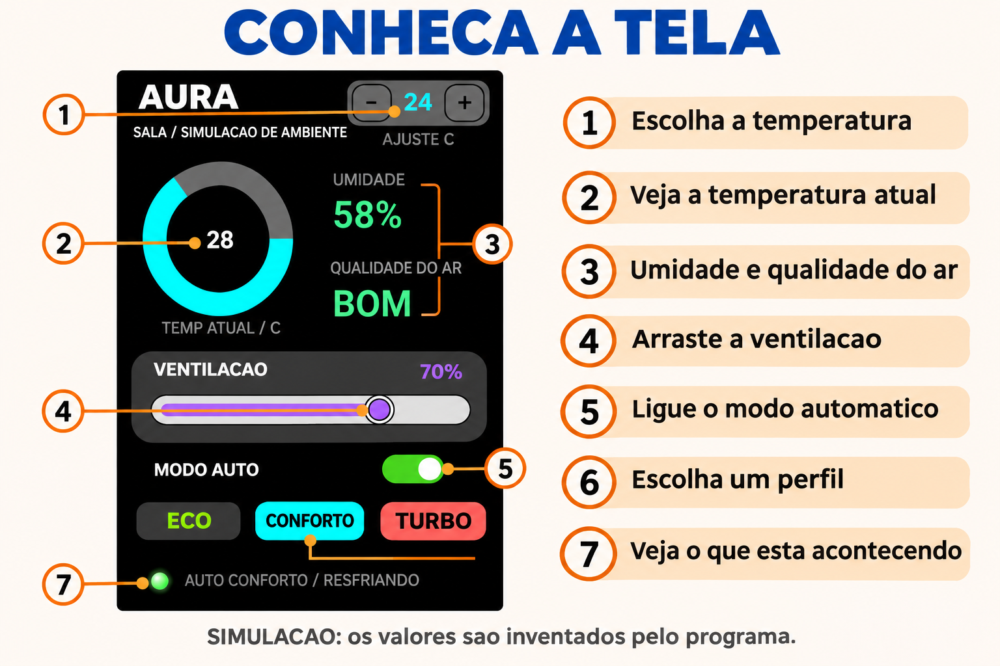
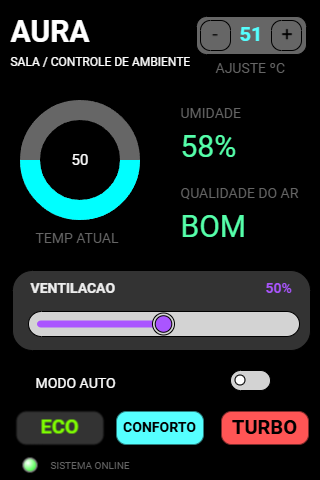
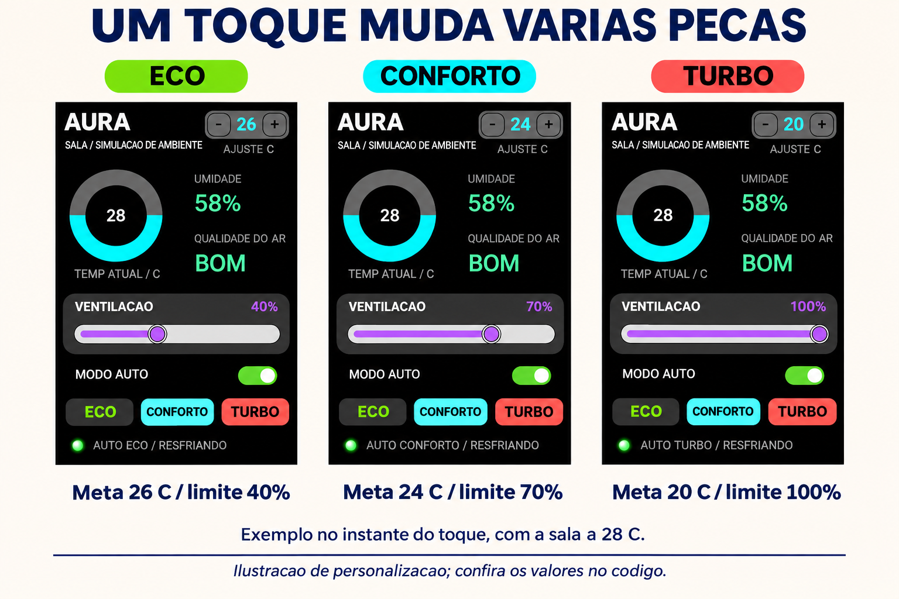
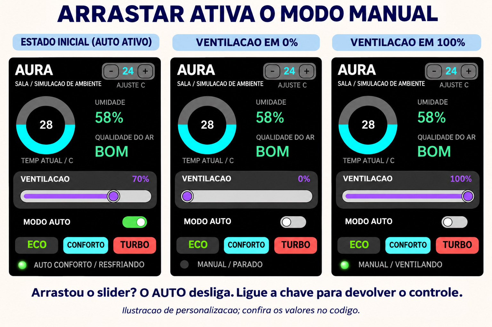
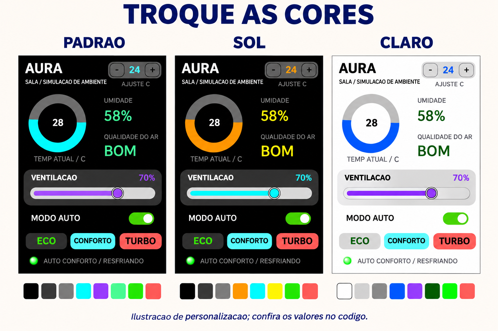
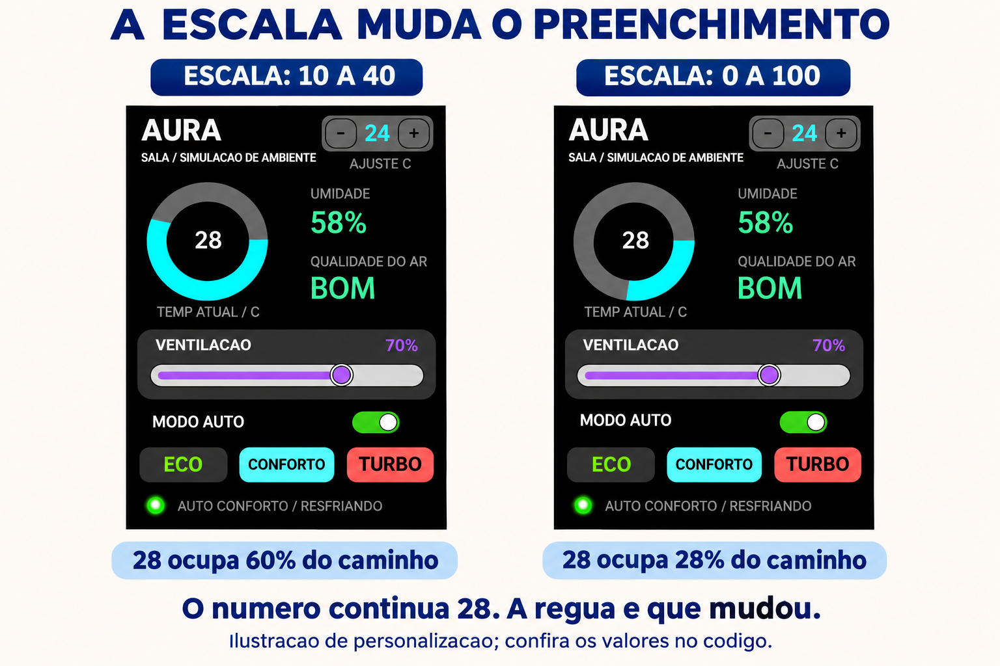
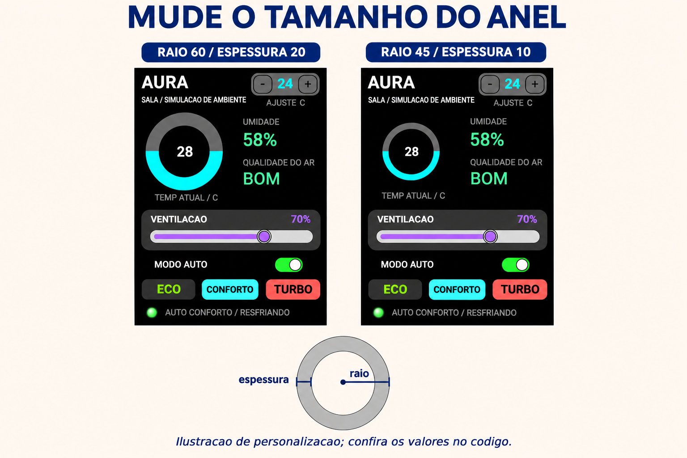
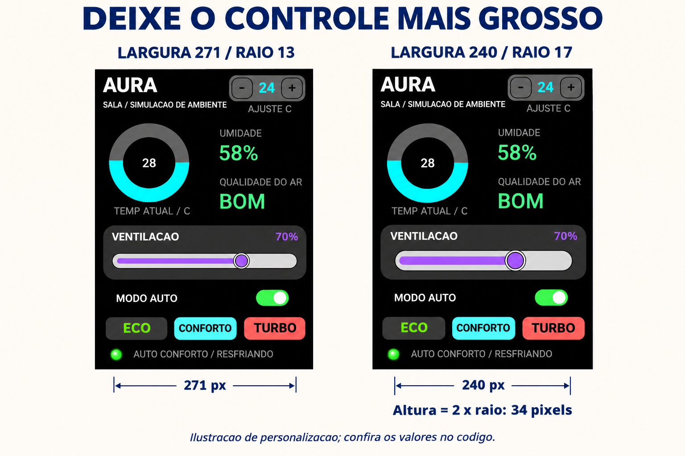
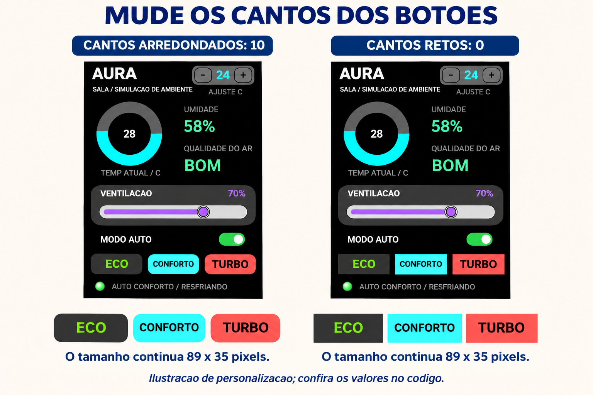
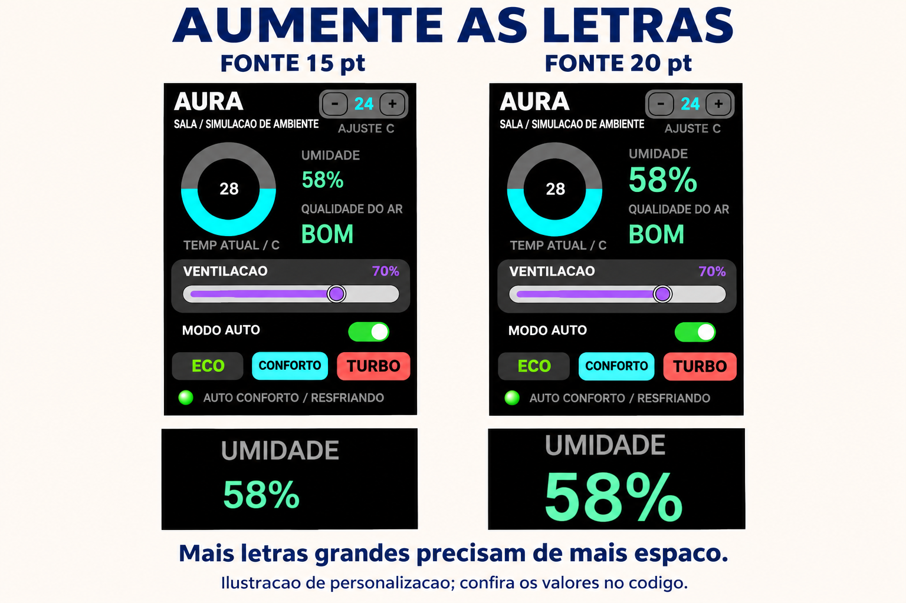

# Controle de ambiente

O projeto AURA demonstra um **controle de ambiente simulado**. Você escolhe a temperatura desejada, ajusta a ventilação e acompanha as mudanças nas leituras. Os valores são calculados pelo programa, sem sensores, ventilador, relé ou conexão Wi-Fi.

Este manual acompanha o [controle_ambiente.ino](controle_ambiente.ino). Ele explica como operar o painel, entender o código e alterar cores, tamanhos, escalas e regras de funcionamento.



**Sobre as imagens:** as nove pranchas novas são ilustrações didáticas baseadas na tela original da pasta. Elas ajudam a comparar as mudanças; não são capturas de testes na placa nem representações com precisão de pixels. Fontes, cores e proporções podem ter pequenas diferenças. Os valores exatos estão no código. Na simulação em funcionamento, os números continuam mudando.

## Conteúdo

1. [Prepare e execute o exemplo](#1-prepare-e-execute-o-exemplo).
2. [Aprenda o que cada toque faz](#2-aprenda-o-que-cada-toque-faz).
3. [Conheça a organização do código](#3-conheça-a-organização-do-código).
4. [Entenda como os widgets interagem](#4-entenda-como-os-widgets-interagem).
5. [Troque as cores](#5-troque-as-cores).
6. [Mude as escalas](#6-mude-as-escalas).
7. [Mude tamanhos e posições](#7-mude-tamanhos-e-posições).
8. [Mude letras e textos](#8-mude-letras-e-textos).
9. [Configure seus próprios perfis](#9-configure-seus-próprios-perfis).
10. [Consulte as funções e os métodos](#10-consulte-as-funções-e-os-métodos).
11. [Faça experiências e resolva problemas](#11-faça-experiências-e-resolva-problemas).
12. [Copie o programa completo](#12-programa-completo).

Se esta for sua primeira vez, faça os capítulos 1 e 2. Depois escolha **uma** modificação das figuras e experimente. Consulte os demais capítulos conforme precisar.

## 1. Prepare e execute o exemplo

### O material

- Uma placa **ESP32-S3**, com os GPIOs da tabela disponíveis.
- Display **ST7796 de 320 × 480 pixels**, com comunicação SPI, e toque capacitivo **FT6336U**, com comunicação I2C.
- Cabo USB de dados, alimentação adequada ao módulo e fios.
- IDE Arduino, esta biblioteca **DisplayWX 1.0.33** e **GFX Library for Arduino**. A referência local usa GFX **1.6.5**.
- Pacote de placas **esp32 by Espressif Systems 3.3.12**. A DisplayWX desta pasta aceita as versões 3.3.11 e 3.3.12.

Peça ajuda de um adulto para montar os fios com a alimentação desligada. Os sinais do ESP32-S3 usam **3,3 V**. A alimentação e a iluminação do display devem seguir as especificações do seu módulo.

### Configure a biblioteca

Abra o [user_setup.h](../../../user_setup.h) da **raiz da biblioteca**, ao lado da pasta `src`. Deixe ativas estas opções:

```cpp
#define DISP_DEFAULT
#define TOUCH_FT6336
```

Comente as outras opções de display, toque e câmera com `//`. Por exemplo, `#define TOUCH_FT6236U` deve virar `// #define TOUCH_FT6236U`. O nome reconhecido para FT6336U é **`TOUCH_FT6336`**, sem o U. Colocar essas opções somente no `.ino` não configura todos os arquivos da biblioteca.

### Ligue o display e o toque

| Sinal | GPIO do ESP32-S3 |
| --- | --- |
| MOSI / SDI do display | 11 |
| SCK / CLK do display | 12 |
| CS do display | 10 |
| DC / RS do display | 8 |
| RST do display | 9 |
| SDA do toque | 13 |
| SCL do toque | 14 |
| INT do toque | 18 |
| RST do toque | 17 |
| GND | GND comum aos módulos |

`DISP_MISO = -1` significa que não há fio de leitura SPI. A iluminação não tem GPIO de controle declarado neste sketch: use a ligação de backlight do seu módulo. A tabela corresponde às constantes de pinagem do `.ino` para ESP32-S3. O LED verde do painel é **um desenho**, não um LED que você precisa ligar a um GPIO.

### Carregue o programa

1. Copie a pasta `controle_ambiente` para sua pasta de projetos.
2. Abra [controle_ambiente.ino](controle_ambiente.ino) na IDE Arduino. O código completo também está no final deste manual.
3. Selecione o modelo ESP32-S3 correspondente à sua placa e a porta USB correta.
4. Confira o `user_setup.h`, clique em **Verificar** e depois em **Carregar**.
5. Abra o Monitor Serial em **115200 baud**. Reinicie a placa e procure `AURA: simulacao iniciada`.
6. Espere a tela aparecer e faça os testes do próximo capítulo.

A tela fica em pé, com rotação `0`: são 320 pixels de largura e 480 de altura. Um pixel é um ponto que compõe a imagem.

<details>
<summary>Veja a imagem original que veio com o projeto</summary>



Essa imagem mostra o desenho inicial, com ajuste 51 e números de demonstração. O programa atualizado começa em **CONFORTO, meta 24 °C, temperatura 28 °C, umidade 58% e ventilação 70%**. Depois, as leituras simuladas mudam. Não é preciso reproduzir os números antigos da imagem.

</details>

## 2. Aprenda o que cada toque faz

Um **widget** é uma peça da tela. Cada peça tem uma tarefa:

| Peça | Nome no código | O que faz |
| --- | --- | --- |
| Caixa com − e + | `spinbox1` | Escolhe a temperatura desejada, inicialmente entre 16 e 30 °C. |
| Anel | `circload1` | Mostra a temperatura simulada atual, arredondada para inteiro. |
| Ventilação | `slider1` | Escolhe a força da ventilação. Arrastar ativa o modo manual. |
| Chave MODO AUTO | `toggle1` | Entrega o controle ao automático ou mantém a ventilação atual no manual. |
| ECO | `textbutton1` | Ativa AUTO, meta 26 °C e limite de ventilação de 40%. |
| CONFORTO | `textbutton1copy` | Ativa AUTO, meta 24 °C e limite de 70%. |
| TURBO | `textbutton1copy2` | Ativa AUTO, meta 20 °C e limite de 100%. |
| Luz do rodapé | `led1` | Acende quando a ventilação simulada é maior que zero. |
| Textos que mudam | `textoUmidade`, `textoQualidade`, `textoVentilacao`, `textoEstado` | São widgets `Label` que mostram as leituras e o estado. |

### Experiência A: escolha um perfil



Toque em **ECO**. O ajuste vira 26 e AUTO liga. Toque em **TURBO**: a meta vira 20. O anel não pula imediatamente para 20, porque a sala precisa de tempo para esfriar.

Os valores 40%, 70% e 100% da figura são o resultado logo após escolher cada perfil **com a sala a 28 °C**. Também são os limites máximos dos perfis. Perto da meta, a ventilação automática pode ser menor. As cores dos botões são fixas; o nome do perfil ativo aparece no rodapé.

### Experiência B: assuma o controle



Arraste a ventilação totalmente para a esquerda. AUTO desliga, aparece `MANUAL / PARADO` e o LED apaga. Arraste para a direita: a porcentagem sobe, o LED acende e aparece `MANUAL / VENTILANDO`.

No manual, a meta fica guardada, mas não comanda o aquecimento/resfriamento. Ligue AUTO para voltar a usá-la. Desligar AUTO **não zera** a ventilação: conserva o valor atual.

### Experiência C: defina uma meta

Use − e +. Cada toque muda a meta em 1 grau e o perfil passa a `PERSONAL`. Se AUTO já estiver ligado, a sala tentará se aproximar da nova meta. Se estiver desligado, continua manual até você ligar a chave.

Faça toques curtos, soltando o dedo. Alguns controles podem repetir a ação quando você segura o toque.

### Regras da simulação

- A sala começa em 28 °C; a temperatura externa fictícia é 30 °C.
- AUTO compara temperatura e meta, escolhe a ventilação e simula aquecer ou resfriar.
- Uma diferença de até 0,3 grau é considerada estável. Não precisa acertar um decimal perfeito.
- No manual, mais ventilação faz a temperatura tender a um valor mais baixo. Essa regra foi definida para a simulação.
- Mais ventilação tende a diminuir a umidade e aumentar o índice fictício de qualidade do ar.
- `BOM` significa índice de pelo menos 70; `REGULAR`, de 40 até menos de 70; `RUIM`, abaixo de 40.

**Esses números não medem uma sala real.** O índice de qualidade é simulado, não uma medição de CO₂, poluição ou segurança do ar. O programa não aciona equipamentos externos. Reiniciar a placa restaura os valores iniciais; este exemplo não salva as escolhas.

## 3. Conheça a organização do código

O `.ino` tem blocos numerados. Use **Ctrl+F** na IDE para procurar a constante ou função que quer mudar.

| Bloco | Procure por | O que você encontra |
| --- | --- | --- |
| 1 | `TEMP_ESCALA_MIN` | Escalas, valores iniciais, velocidade e perfis. |
| 2 | `COR_FUNDO` | Cores e fonte da umidade. |
| 3 | `ANEL_X` | Posições, tamanhos e arredondamento. |
| 4 | `DISPLAY_W` | Ligações do display e do toque. |
| 5 | `EstadoAmbiente` | Estado do ambiente e tipos de comandos. |
| 6 | `HSlider slider1` | Objetos e listas. |
| 7 | `limitarInteiro` | Regras e contas da simulação. |
| 8 | `void setup()` | Início, repetição e atualização visual. |
| 9 | `void screen0()` | Fundo e textos fixos. |
| 10 | `void loadWidgets()` | Fichas de configuração dos widgets. |
| 11 | `void enviarComando` | Callbacks e fila de comandos. |

### Termos básicos de C++

| Palavra/símbolo | Significado |
| --- | --- |
| Variável | Um espaço na memória que guarda uma informação. |
| `int` | Número inteiro, como 24. |
| `float` | Número com parte decimal, como `28.5f`. Use ponto, não vírgula. |
| `bool` | `true` (sim) ou `false` (não). |
| `const` e `constexpr` | Valores fixos durante a execução. Edite o código e carregue novamente para mudá-los. `constexpr` também pode ser conferido durante a compilação. |
| `struct` | Uma ficha que reúne informações. |
| `enum class` | Uma lista de nomes permitidos, como ECO e TURBO. |
| Callback | Função escolhida para responder a uma ação. |
| `&objeto` | O endereço da peça, para a biblioteca encontrá-la. |
| Array | Uma lista de peças. |
| `nullptr` | Nada foi ligado naquele campo. |
| `;` | O ponto final de muitas instruções. |

### Primeiro crie, depois configure

```cpp
// Cria a peca na posicao escolhida, na tela 0.
HSlider slider1(SLIDER_X, SLIDER_Y, 0);

// A lista guarda o endereco da peca.
HSlider* arrayHslider[] = {&slider1};
```

X cresce para a direita; Y cresce para baixo. A primeira tela é 0. Nos botões e no slider, X/Y indicam o canto superior esquerdo. No **CircularBar** e no **Led**, indicam o centro do círculo. Nos Labels, o alinhamento também conta: `TL_DATUM` prende o canto superior esquerdo; `TR_DATUM`, o superior direito.

Os objetos ficam fora das funções para continuarem existindo enquanto o programa roda. A ficha do slider fica dentro de `loadWidgets()`:

```cpp
HSliderConfig configHSlider0 = {
    .callback = slider1_cb,       // Acao quando o usuario mexe.
    .subtitle = nullptr,         // Atualizamos a legenda separadamente.
    .minValue = 0,
    .maxValue = VENT_ESCALA_MAX,  // Limite da regua do slider.
    .radius = SLIDER_RAIO,       // Raio; a altura sera o dobro.
    .width = SLIDER_LARGURA,
    .pressedColor = COR_VENTILACAO,
    .backgroundColor = COR_TRILHA
};
slider1.setup(configHSlider0);         // Entrega a ficha ao widget.
myDisplay.setHSlider(arrayHslider, 1); // Registra uma peca.
```

O nome do callback aparece **sem `()`**, porque estamos escolhendo a função para depois. O slider não recebe um `subtitle`: seu valor bruto pode ir até 255, enquanto a legenda deve continuar mostrando até 100%. O programa faz essa tradução.

| Ficha | Campos principais |
| --- | --- |
| `configHSlider0` | Escala, `radius`, `width`, cores e `callback`. |
| `configLed0` | `radius`, `colorOn`, `colorOff`, `initialState`. |
| `configSpinBox0` | Escala, `startValue`, `step`, largura, altura, cores e callback. |
| `configEco`, `configConforto`, `configTurbo` | Texto, fonte, largura, altura, raio dos cantos, cores e callback. |
| `configToggle0` | Largura, altura, cor ligada e callback. |
| `configCirculaBar0` | Escala, raio, ângulos, cores, espessura, `showValue` e `inverted`. |
| Fichas dos quatro Labels | `text`, `prefix`, `suffix`, `fontFamily`, `datum`, `fontColor`, `backgroundColor`. |

`width` é largura; `height`, altura; `radius`, raio. Nos TextButtons, o raio arredonda os **cantos**. `prefix` vem antes do valor e `suffix`, depois: o `%` da umidade vem do sufixo.

Mantenha a ordem dos campos do exemplo. Para mudar as fichas, edite e carregue novamente. Vários widgets ignoram uma segunda chamada de `setup()`; não tente trocar o tema chamando `loadWidgets()` repetidamente no loop.

## 4. Entenda como os widgets interagem

Ao receber um toque, o controle envia um comando para uma fila. O `loop()` lê os comandos, atualiza o estado do ambiente e mostra o resultado no painel.

```text
Seu toque → callback → fila de comandos
                            ↓
               loop → aplicarComando → ambiente
                            ↓
                 simularPasso, na hora certa
                            ↓
                    atualizarWidgets
                            ↓
               botoes, anel, textos e LED
```

### O comando e o estado do ambiente

```cpp
struct Comando {
    TipoComando tipo; // O que aconteceu: AUTO, AJUSTE, ECO...
    int valor;       // O numero que acompanha o pedido.
};
```

`EstadoAmbiente` guarda temperatura, umidade, qualidade, meta, ventilação, limite, modo e perfil. O objeto `ambiente` é a memória principal. Os widgets mostram essa memória.

A biblioteca atende o toque em sua própria tarefa. A fila entrega os pedidos ao loop de maneira organizada; só ele modifica `ambiente` depois do início. Você não precisa criar outras tarefas para personalizar o exemplo.

### Callbacks de interação

```cpp
void slider1_cb() {
    enviarComando(TipoComando::VENTILACAO, slider1.getValue());
}
```

`getValue()` lê o número escolhido. O callback envia o pedido e termina, sem esperar a sala esfriar.

| Callback | Comando enviado |
| --- | --- |
| `spinbox1_cb` | `AJUSTE` e a nova meta. |
| `toggle1_cb` | `AUTO` com 1 para ligado ou 0 para desligado. |
| `textbutton1_cb` | `ECO`. |
| `textbutton1copy_cb` | `CONFORTO`. |
| `textbutton1copy2_cb` | `TURBO`. |

```cpp
void enviarComando(TipoComando tipo, int valor) {
    if (filaComandos == nullptr) return;
    Comando comando = {tipo, valor};
    if (xQueueSend(filaComandos, &comando, 0) != pdPASS) {
        Serial.println("Fila cheia: repita o toque.");
    }
}
```

Há espaço para 16 pedidos. O último `0` de `xQueueSend` significa que o callback não espera por espaço. Se a fila ficar cheia, a Serial pede para repetir o toque.

### Um comando atualiza vários widgets

```cpp
void aplicarComando(EstadoAmbiente& estado, const Comando& comando) {
    switch (comando.tipo) {
        case TipoComando::VENTILACAO:
            estado.ventilacao = valorSliderParaPercentual(comando.valor);
            estado.automatico = false; // Arrastar o slider assume o controle manual.
            estado.perfil = Perfil::PERSONALIZADO;
            estado.limiteAutomatico = 100;
            break;
        case TipoComando::AJUSTE:
            estado.meta = limitarInteiro(comando.valor, AJUSTE_MIN, AJUSTE_MAX);
            estado.perfil = Perfil::PERSONALIZADO;
            estado.limiteAutomatico = 100;
            break;
        case TipoComando::AUTO:
            estado.automatico = comando.valor != 0;
            break;
        case TipoComando::ECO: aplicarPerfil(estado, Perfil::ECO); break;
        case TipoComando::CONFORTO: aplicarPerfil(estado, Perfil::CONFORTO); break;
        case TipoComando::TURBO: aplicarPerfil(estado, Perfil::TURBO); break;
    }
    ajustarVentilacaoAutomatica(estado);
}
```

No caso `VENTILACAO`, o programa guarda a porcentagem e coloca `automatico = false`. Na atualização visual, a chave AUTO desliga. Um widget provocou uma mudança em outro!

`AJUSTE` muda a meta, mas conserva o modo. Os casos de perfil chamam `aplicarPerfil()`, que escolhe meta, limite e liga AUTO.

### Atualização periódica no loop

```cpp
void loop() {
    if (filaComandos == nullptr) { delay(100); return; }
    bool mudou = false;
    Comando comando;
    // Cada comando da fila representa uma acao feita na tela.
    for (int i = 0; i < 16 && xQueueReceive(filaComandos, &comando, 0) == pdTRUE; ++i) {
        aplicarComando(ambiente, comando);
        mudou = true;
    }
    unsigned long agora = millis();
    unsigned long decorrido = agora - ultimaSimulacao;
    if (decorrido >= INTERVALO_SIMULACAO_MS) {
        ultimaSimulacao = agora;
        float segundos = decorrido / 1000.0f * VELOCIDADE_SIMULACAO;
        simularPasso(ambiente, segundos);
        mudou = true;
    }
    if (mudou) atualizarWidgets();
    delay(10); // Pausa curta: a interface continua respondendo.
}
```

`millis()` informa o tempo desde que a placa ligou. **1000 ms = 1 segundo**. A cada 500 ms, há um passo da simulação. Entre os passos, os comandos continuam sendo atendidos. A pausa de 10 ms no fim é curta.

`agora - ultimaSimulacao` mede o tempo decorrido; dividir por `1000.0f` transforma esse tempo em segundos. Assim, reduzir o intervalo não acelera sozinho a sala.

### Como evitar callbacks repetidos

```cpp
slider1.setValue(valorSlider, false);
spinbox1.setValue(ambiente.meta, false);
toggle1.setStatus(ambiente.automatico, false);
```

`false` atualiza o widget sem executar seu callback. Se o controle automático movesse o slider com callback, essa mudança seria interpretada como uma ação do usuário e ativaria o modo manual.

```cpp
void atualizarWidgets() {
    myDisplay.startCustomDraw();
    // false atualiza o desenho sem enviar um novo comando pelo callback.
    int valorSlider = percentualParaValorSlider(ambiente.ventilacao);
    if (slider1.getValue() != valorSlider) slider1.setValue(valorSlider, false);
    if (spinbox1.getValue() != ambiente.meta) spinbox1.setValue(ambiente.meta, false);
    if (toggle1.getStatus() != ambiente.automatico) toggle1.setStatus(ambiente.automatico, false);
    circload1.setValue(int(ambiente.temperatura + 0.5f)); // Mostra inteiro arredondado.
    textoUmidade.setTextInt(int(ambiente.umidade + 0.5f));
    textoQualidade.setText(nomeQualidade(ambiente.qualidade));
    textoVentilacao.setTextInt(ambiente.ventilacao);
    led1.setState(ambiente.ventilacao > 0);
    char mensagem[64];
    if (ambiente.automatico) {
        snprintf(mensagem, sizeof(mensagem), "AUTO %s / %s", nomePerfil(ambiente.perfil), nomeAcao(ambiente));
    } else {
        snprintf(mensagem, sizeof(mensagem), "MANUAL / %s", nomeAcao(ambiente));
    }
    textoEstado.setText(mensagem);
    myDisplay.finishCustomDraw();
}
```

`startCustomDraw()` e `finishCustomDraw()` agrupam as mudanças visuais. Mantenha o par e não coloque esperas demoradas entre as chamadas. As comparações antes dos setters evitam reescrever os controles sem necessidade.

### Cálculos da simulação

```cpp
void ajustarVentilacaoAutomatica(EstadoAmbiente& estado) {
    if (!estado.automatico) return;
    float erro = estado.temperatura - estado.meta;
    if (erro < 0) erro = -erro; // Distancia ate a meta, sem sinal negativo.
    int pedido = (erro <= FAIXA_ESTAVEL) ? 20 : 35 + int(erro * 18);
    estado.ventilacao = limitarInteiro(pedido, 0, estado.limiteAutomatico);
}
```

`erro` é a distância entre temperatura e meta. Longe da meta, o pedido de ventilação cresce. O limite do perfil é um teto. Perto da meta, o pedido é 20%, ainda respeitando o teto.

```cpp
void simularPasso(EstadoAmbiente& estado, float segundos) {
    // Passos pequenos mantem a animacao suave, mesmo apos uma pausa.
    segundos = limitarDecimal(segundos, 0.0f, 2.0f);
    ajustarVentilacaoAutomatica(estado);
    float forca = estado.ventilacao / 100.0f;
    if (estado.automatico) {
        // A sala tende lentamente para a temperatura externa.
        estado.temperatura += (TEMP_EXTERNA - estado.temperatura) * 0.02f * segundos;
        float erro = estado.meta - estado.temperatura;
        float passo = 0.6f * forca * segundos;
        if (erro > FAIXA_ESTAVEL) estado.temperatura += (erro < passo ? erro : passo);
        if (erro < -FAIXA_ESTAVEL) estado.temperatura -= (-erro < passo ? -erro : passo);
    } else {
        // Nesta simulacao, a ventilacao pode reduzir a temperatura em ate 6 graus.
        float destino = TEMP_EXTERNA - 6.0f * forca;
        estado.temperatura += (destino - estado.temperatura) * 0.08f * segundos;
    }
    // Mais ventilacao tende a reduzir a umidade e melhorar o indice de ar.
    float umidadeDestino = 70.0f - 35.0f * forca;
    float qualidadeDestino = 20.0f + 80.0f * forca;
    estado.umidade += (umidadeDestino - estado.umidade) * 0.12f * segundos;
    estado.qualidade += (qualidadeDestino - estado.qualidade) * 0.18f * segundos;
    estado.temperatura = limitarDecimal(estado.temperatura, 5.0f, 45.0f);
    estado.umidade = limitarDecimal(estado.umidade, 0.0f, 100.0f);
    estado.qualidade = limitarDecimal(estado.qualidade, 0.0f, 100.0f);
}
```

O cálculo define um valor de destino, aproxima o valor atual gradualmente e verifica os limites. `forca` vai de 0 a 1: 50% vira `0.5f`. As cores e os tamanhos podem ser alterados sem modificar esses cálculos.

As três últimas linhas limitam a temperatura a 5–45 °C e umidade/qualidade a 0–100. São limites do **ambiente simulado**; a escala desenhada no anel é outra escolha.

## 5. Troque as cores



**Para cada alteração:** encontre a constante, substitua sua linha, verifique e carregue novamente. Não acrescente outra constante com o mesmo nome. Parta da versão padrão e faça uma experiência de cada vez.

### Exemplo 1: tema Sol

No bloco 2, substitua estas linhas:

```cpp
const uint16_t COR_ANEL = CFK_ORANGE;
const uint16_t COR_VENTILACAO = CFK_COLOR044;
const uint16_t COR_DADOS = CFK_YELLOW;
```

O anel fica laranja; a ventilação, ciano; umidade e qualidade, amarelas. O código também usa `COR_ANEL` no número do ajuste, então esse número acompanha a cor do anel.

### Exemplo 2: tema Claro

Partindo novamente das cores padrão, substitua:

```cpp
const uint16_t COR_FUNDO = CFK_WHITE;
const uint16_t COR_TEXTO = CFK_BLACK;
const uint16_t COR_LEGENDA = CFK_GREY4;
const uint16_t COR_PAINEL = CFK_GREY13;
const uint16_t COR_ANEL = CFK_BLUE;
const uint16_t COR_ANEL_VAZIO = CFK_GREY12;
const uint16_t COR_VENTILACAO = CFK_PURPLE;
const uint16_t COR_DADOS = CFK_COLOR028;
const uint16_t COR_ECO_FUNDO = CFK_GREY13;
const uint16_t COR_ECO_TEXTO = CFK_COLOR028;
```

As outras cores ficam como no programa completo. Mudar somente o fundo para branco deixaria textos brancos difíceis de enxergar; por isso trocamos também as letras. Alguns detalhes, como bordas da chave, usam o tema interno da biblioteca.

| Constante | Parte que ela pinta |
| --- | --- |
| `COR_FUNDO` | Fundo geral e fundo dos textos sobre a tela. |
| `COR_TEXTO` | Título, textos principais e número do anel. |
| `COR_LEGENDA` | Legendas e mensagem do rodapé. |
| `COR_PAINEL` | Caixa da ventilação e LED apagado. |
| `COR_ANEL` / `COR_ANEL_VAZIO` | Arco cheio / vazio; também participam das cores do SpinBox. |
| `COR_VENTILACAO` / `COR_TRILHA` | Slider e porcentagem / fundo da trilha. |
| `COR_DADOS` | Umidade e qualidade do ar. |
| `COR_AUTO` | Chave ligada e LED aceso. |
| `COR_ECO_FUNDO` / `COR_ECO_TEXTO` | Fundo / letras de ECO. |
| `COR_CONFORTO_FUNDO` / `COR_TURBO_FUNDO` | Fundos dos outros botões. |
| `COR_BOTAO_TEXTO` | Letras de CONFORTO e TURBO. |

`CFK_...` são cores prontas. Você não precisa aprender RGB565 agora. Para voltar ao tema original, recopie as constantes do bloco 2 do programa completo.

## 6. Mude as escalas

### Escala do anel



Na escala original, o começo vale 10 e o fim, 40. O valor 28 percorre 18 de um total de 30 graus: **60% do arco**. Na escala 0–100, a mesma temperatura percorre **28% do arco**.

No bloco 1:

```cpp
const int TEMP_ESCALA_MIN = 0;
const int TEMP_ESCALA_MAX = 100;
```

Isso muda a faixa de valores representada pelo anel. **Não transforma 28 °C em ventilação de 28%**, não muda a meta nem aquece a sala. A ficha do anel usa essas constantes em `minValue` e `maxValue`.

O mínimo precisa ser menor que o máximo. Escolha uma faixa que contenha as temperaturas que quer ver. O CircularBar limita a leitura exibida à sua escala: fora dela, o desenho fica preso no limite, mesmo que a memória tenha outro valor.

### A meta tem outra escala

Para permitir metas de 14 a 32 °C, andando de 2 em 2, altere no bloco 1:

```cpp
const int AJUSTE_MIN = 14;
const int AJUSTE_MAX = 32;
const int AJUSTE_PASSO = 2;
```

Esses valores configuram o **SpinBox**. O passo vale para os toques; o programa pode definir outros inteiros. Um perfil com meta fora dos limites é limitado: meta 12 com mínimo 14 vira 14.

### Slider de 0 a 255, mas ventilação até 100%

Mude no bloco 1:

```cpp
const int VENT_ESCALA_MAX = 255;
```

A leitura bruta passa a ir até 255. A sala continua usando **0–100%**. As funções abaixo fazem a tradução:

```cpp
int valorSliderParaPercentual(int valor) {
    valor = limitarInteiro(valor, 0, VENT_ESCALA_MAX);
    return (valor * 100 + VENT_ESCALA_MAX / 2) / VENT_ESCALA_MAX;
}
```

```cpp
int percentualParaValorSlider(int percentual) {
    return (limitarInteiro(percentual, 0, 100) * VENT_ESCALA_MAX + 50) / 100;
}
```

128 de 255 vira aproximadamente 50%. A legenda continua mostrando **50%**, não 128%. Acrescentar o símbolo `%` sozinho não faz essa conta.

## 7. Mude tamanhos e posições

### Anel menor e mais fino



No bloco 3:

```cpp
const int ANEL_RAIO = 45;
const int ANEL_ESPESSURA = 10;
```

O **raio** vai do centro à borda. O **diâmetro** é o dobro: raio 45 ocupa 90 pixels de largura. A espessura é a largura da faixa colorida. O centro continua em `(80,160)`, porque `ANEL_X` e `ANEL_Y` não mudaram. A legenda também fica onde estava.

Deixe `ANEL_RAIO - ANEL_ESPESSURA` com pelo menos 15 para caber o número. `static_assert` confere essa regra na compilação e mostra uma mensagem se você a quebrar.

Para mover o anel, altere `ANEL_X` e `ANEL_Y`. Confira `X - raio`, `X + raio`, `Y - raio` e `Y + raio`: as bordas precisam caber na tela e não cobrir outras peças. Para mover a legenda, procure `TEMP ATUAL / C` em `screen0()` e altere sua posição também.

### Slider mais grosso



No bloco 3, mude as quatro linhas juntas:

```cpp
const int SLIDER_X = 40;
const int SLIDER_Y = 307;
const int SLIDER_LARGURA = 240;
const int SLIDER_RAIO = 17;
```

A altura vira `2 × 17 = 34` pixels. O slider vai de X = 40 a 280 e de Y = 307 a 341, dentro do painel que termina em Y = 350.

O painel de fundo tem seu próprio tamanho em `screen0()`; aumentar o slider não aumenta o painel automaticamente. Use raio maior que 4 e largura maior que duas vezes o raio.

### Cantos retos nos botões



No bloco 3:

```cpp
const int BOTAO_CANTO = 0;
```

Os três botões ficam retos, ainda com 89 × 35 pixels e as mesmas ações. Para voltar ao arredondado, use `10`.

`BOTAO_LARGURA` e `BOTAO_ALTURA` mudam os três. Eles começam nos X 15, 115 e 220; confira o espaço entre eles. O último termina em `220 + largura`, que deve ser menor ou igual a 320.

### Outras peças

O SpinBox usa largura 112 e altura 40 na ficha. Preserve largura maior que `2 × altura + 10` para caberem os controles laterais e o número. A chave usa largura 40 e altura 20 na posição `(230,370)`. O LED tem raio 8 e centro `(30,465)`; um raio grande pode sair da tela.

## 8. Mude letras e textos

### Aumente a fonte da umidade



No bloco 2, troque a linha da fonte por:

```cpp
const GFXfont* const FONTE_UMIDADE = &RobotoRegular20pt7b;
```

O nome é uma etiqueta de fonte; `15pt` e `20pt` são tamanhos. O `&` aponta para essa fonte na biblioteca. Para voltar, use `&RobotoRegular15pt7b`.

Muda **só o valor da umidade**, não a palavra UMIDADE ou todos os textos. O valor começa em X = 180, deixando 140 pixels à direita. Confira também `100%`, que ocupa mais espaço que `58%`.

### Troque palavras fixas

Em `screen0()`, encontre:

```cpp
myDisplay.printText("AURA", 10, 18, TL_DATUM, COR_TEXTO, COR_FUNDO, &RobotoBold15pt7b);
```

Troque o texto entre aspas. Um nome grande pode encostar no SpinBox; escolha um nome curto ou uma fonte menor. Os textos do display estão sem acentos para facilitar o uso com as fontes do exemplo.

Trocar `"ECO"` na ficha muda o nome visível, mas não sua regra: a regra vem do callback.

### Textos variáveis usam Label

```cpp
textoUmidade.setTextInt(58);       // A ficha acrescenta %.
textoQualidade.setText("REGULAR");
```

Esses métodos mudam o texto. `printText()` desenha uma frase fixa. Os antigos `58%`, `BOM`, `50%` e `SISTEMA ONLINE` foram substituídos por Labels para acompanhar a simulação.

Se usar as linhas acima como teste, `atualizarWidgets()` escreverá os valores da sala novamente na próxima atualização. Para mudar permanentemente a informação, altere sua regra ou a linha correspondente dentro dessa função.

## 9. Configure seus próprios perfis

Um perfil é um pacote de escolhas, definido no bloco 1:

| Perfil | Meta | Limite de ventilação |
| --- | --- | --- |
| ECO | `META_ECO = 26` | `LIMITE_ECO = 40` |
| CONFORTO | `META_CONFORTO = 24` | `LIMITE_CONFORTO = 70` |
| TURBO | `META_TURBO = 20` | `LIMITE_TURBO = 100` |

Para fazer um ECO mais suave:

```cpp
const int META_ECO = 27;
const int LIMITE_ECO = 30;
```

Carregue e toque ECO. A meta vira 27 e a ventilação não passa de 30%. Um limite pequeno pode demorar mais para atingir a meta ou não compensar a temperatura externa. Observe e compare.

```cpp
void aplicarPerfil(EstadoAmbiente& estado, Perfil perfil) {
    estado.perfil = perfil;
    estado.automatico = true;
    if (perfil == Perfil::ECO) {
        estado.meta = META_ECO;
        estado.limiteAutomatico = LIMITE_ECO;
    } else if (perfil == Perfil::CONFORTO) {
        estado.meta = META_CONFORTO;
        estado.limiteAutomatico = LIMITE_CONFORTO;
    } else {
        estado.meta = META_TURBO;
        estado.limiteAutomatico = LIMITE_TURBO;
    }
    estado.meta = limitarInteiro(estado.meta, AJUSTE_MIN, AJUSTE_MAX);
    estado.limiteAutomatico = limitarInteiro(estado.limiteAutomatico, 0, 100);
    ajustarVentilacaoAutomatica(estado);
}
```

A função liga AUTO, escolhe meta/limite, confere as faixas e calcula a ventilação. Ela recebe os três perfis dos botões. `PERSONALIZADO` nasce ao mexer no slider ou no ajuste.

### Ponto de partida e velocidade

Mude `TEMP_INICIAL` para `18.0f` e escolha CONFORTO para observar aquecimento. Para dobrar a velocidade, substitua:

```cpp
constexpr float VELOCIDADE_SIMULACAO = 2.0f;
```

O intervalo continua 500 ms, mas cada passo representa mais tempo. Passos muito longos são limitados a dois segundos para evitar saltos após pausas. Comece com velocidade 1 ou 2 e conserve o intervalo original.

`UMIDADE_INICIAL` e `QUALIDADE_INICIAL` usam 0–100. `TEMP_EXTERNA` muda o destino natural da sala; não é um pino nem um sensor. Os limites finais da temperatura simulada continuam 5 e 45 em `simularPasso()`.

## 10. Consulte as funções e os métodos

### Funções criadas neste sketch

| Função | Sua tarefa |
| --- | --- |
| `setup()` | Cria a fila, inicia display/toque, configura as peças e aplica CONFORTO. Executa uma vez. |
| `loop()` | Recebe pedidos e avança a simulação. |
| `loadWidgets()` | Preenche fichas, configura e registra as listas. |
| `screen0()` | Pinta fundo, textos fixos e widgets da tela 0. |
| `enviarComando` | Coloca um comando na fila; usada nos callbacks. |
| `aplicarComando` | Interpreta o comando; chamada pelo loop. |
| `aplicarPerfil` | Escolhe uma meta e um limite para ECO, CONFORTO ou TURBO. |
| `ajustarVentilacaoAutomatica` | Decide a ventilação quando AUTO está ligado. |
| `simularPasso` | Avança os números um pouco. |
| `atualizarWidgets` | Faz a tela acompanhar `ambiente`. |
| `limitarInteiro` / `limitarDecimal` | Mantêm números entre mínimo e máximo. |
| `valorSliderParaPercentual` / `percentualParaValorSlider` | Traduzem a escala do slider e porcentagem. |
| `nomePerfil`, `nomeQualidade`, `nomeAcao` | Escolhem os textos da tela. |

### Altere valores pelo código mantendo o estado atualizado

Use o caminho dos toques:

```cpp
enviarComando(TipoComando::TURBO, 0); // Aplica o perfil inteiro.
```

Ou, em outra ação:

```cpp
// Ventilacao manual em 50%, mesmo com slider de 0 a 255.
enviarComando(TipoComando::VENTILACAO, percentualParaValorSlider(50));
```

`slider1.setValue(50, false)` muda só o controle. O loop pode desfazer essa mudança porque `ambiente` é a memória principal. `enviarComando()` mantém estado, chave, legenda e slider combinando.

### Métodos dos widgets

Um método pertence a uma peça: `led1.setState(true)` manda o LED desenhado acender. As chamadas abaixo são válidas depois da configuração, mas `atualizarWidgets()` controla os valores regularmente. Mude a aparência pelas constantes/fichas e o funcionamento pelos comandos.

As fichas de `setup(...)` existem dentro de `loadWidgets()`. Não copie o nome de uma ficha para o loop esperando encontrá-la lá.

### HSlider: métodos para seu programa

Um controle deslizante horizontal. Arrastar o controle escolhe um número entre o mínimo e o máximo.

| Método | Como usar | Resultado e cuidado |
| --- | --- | --- |
| `setup(config)` | `slider1.setup(configHSlider0);` | Aplica a ficha de configuração após preparar o display. Não retorna valor. Configure no `loadWidgets()` antes de iniciar a tarefa. |
| `getValue()` | `int valor = slider1.getValue();` | Retorna o número inteiro selecionado. |
| `setValue(valor, triggerCallback = true)` | `slider1.setValue(50, false);` | Limita o número à escala e atualiza o controle. O segundo argumento `false` evita o callback; com `true`, pode chamá-lo mesmo repetindo o valor. |
| `setEnabled(valor)` | `slider1.setEnabled(false);` | Método herdado: bloqueia o toque com false e permite com true. Não altera o valor nem executa callback. |
| `isEnabled()` | `bool ativo = slider1.isEnabled();` | Consulta a habilitação para toque. |
| `lock()` | `slider1.lock();` | Bloqueia a interação por toque enquanto você não chamar unlock(). Não é uma trava para organizar tarefas do processador. |
| `unlock()` | `slider1.unlock();` | Remove esse bloqueio de toque; não desfaz setEnabled(false). |
| `isLocked()` | `bool bloqueado = slider1.isLocked();` | Consulta se lock() está ativo. |
| `show()` | `slider1.show();` | Torna visível na sua tela e pede atualização. |
| `hide()` | `slider1.hide();` | Impede futuras atualizações visuais e, quando há toque, sua interação. Não apaga os pixels já desenhados: repinte a tela como explicado abaixo. |

O setup do slider começa no mínimo; a atualização inicial deste sketch coloca a ventilação de CONFORTO. Use `minValue < maxValue`, raio maior que 4 e largura maior que duas vezes o raio. A altura resulta de duas vezes o raio. O Label de `subtitle`, quando usado, acompanha o valor.


### SpinBox: métodos para seu programa

Uma caixa com controles de menos e mais para escolher um número inteiro.

| Método | Como usar | Resultado e cuidado |
| --- | --- | --- |
| `setup(config)` | `spinbox1.setup(configSpinBox0);` | Aplica a ficha de configuração após preparar o display. Não retorna valor. Configure no `loadWidgets()` antes de iniciar a tarefa. |
| `getValue()` | `int valor = spinbox1.getValue();` | Lê o número escolhido. |
| `setValue(valor, triggerCallback = true)` | `spinbox1.setValue(25, false);` | Limita o número à escala e pede atualização. O callback é opcional e, quando habilitado, pode ser chamado mesmo se o valor já era igual. |
| `show()` | `spinbox1.show();` | Torna visível na sua tela e pede atualização. |
| `hide()` | `spinbox1.hide();` | Impede futuras atualizações visuais e, quando há toque, sua interação. Não apaga os pixels já desenhados: repinte a tela como explicado abaixo. |

A metade esquerda diminui e a direita aumenta. `.step` controla o salto. Reserve largura maior que `2 * height + 10` para sobrar espaço para o número. O valor inicial é limitado à escala.


### ToggleButton: métodos para seu programa

Um interruptor com um indicador circular: à direita representa ligado, à esquerda desligado.

| Método | Como usar | Resultado e cuidado |
| --- | --- | --- |
| `setup(config)` | `toggle1.setup(configToggle0);` | Aplica a ficha de configuração após preparar o display. Não retorna valor. Configure no `loadWidgets()` antes de iniciar a tarefa. |
| `getStatus()` | `bool ligado = toggle1.getStatus();` | Consulta o estado guardado. |
| `setStatus(valor, triggerCallback = true)` | `toggle1.setStatus(true, false);` | Define o estado e pede atualização visual. Com callback habilitado, pode chamá-lo mesmo repetindo o estado. |
| `changeState()` | `toggle1.changeState();` | Inverte apenas o valor guardado; não chama callback nem pede atualização visual. |
| `setEnabled(valor)` | `toggle1.setEnabled(false);` | Método herdado: bloqueia o toque com false e permite com true. Não altera o valor nem executa callback. |
| `isEnabled()` | `bool ativo = toggle1.isEnabled();` | Consulta a habilitação para toque. |
| `lock()` | `toggle1.lock();` | Bloqueia a interação por toque enquanto você não chamar unlock(). Não é uma trava para organizar tarefas do processador. |
| `unlock()` | `toggle1.unlock();` | Remove esse bloqueio de toque; não desfaz setEnabled(false). |
| `isLocked()` | `bool bloqueado = toggle1.isLocked();` | Consulta se lock() está ativo. |
| `show()` | `toggle1.show();` | Torna visível na sua tela e pede atualização. |
| `hide()` | `toggle1.hide();` | Impede futuras atualizações visuais e, quando há toque, sua interação. Não apaga os pixels já desenhados: repinte a tela como explicado abaixo. |

Para alternar e atualizar a tela sem callback, use `toggle1.setStatus(!toggle1.getStatus(), false)`. A largura é limitada a pelo menos 30 pixels. Neste sketch, a atualização inicial liga a chave porque CONFORTO começa em AUTO.


### TextButton: métodos para seu programa

Um botão com palavras escritas dentro. Ele executa uma ação, como somar, navegar ou conectar.

| Método | Como usar | Resultado e cuidado |
| --- | --- | --- |
| `setup(config)` | `textbutton1.setup(configEco);` | Aplica a ficha de configuração após preparar o display. Não retorna valor. Configure no `loadWidgets()` antes de iniciar a tarefa. |
| `onClick()` | `textbutton1.onClick();` | Solicita o callback pelo código. Não recebe argumento `triggerCallback` e não guarda estado ligado/desligado. |
| `getEnabled()` | `bool podeTocar = textbutton1.getEnabled();` | Retorna se o botão está habilitado para toque. |
| `setEnabled(valor)` | `textbutton1.setEnabled(false);` | `false` bloqueia o toque e `true` permite. Não muda automaticamente a cor; `onClick()` pelo código continua possível. |
| `show()` | `textbutton1.show();` | Torna visível na sua tela e pede atualização. |
| `hide()` | `textbutton1.hide();` | Impede futuras atualizações visuais e, quando há toque, sua interação. Não apaga os pixels já desenhados: repinte a tela como explicado abaixo. |

O `radius` da configuração arredonda os cantos; não é o tamanho do botão. Use dimensões maiores que as letras. Para trocar o texto inicial, altere `.text` e carregue o programa novamente; não existe `setText()` nesta classe. Toques prolongados podem repetir ações.


### CircularBar: métodos para seu programa

Uma barra em forma de arco, que pode completar uma volta.

| Método | Como usar | Resultado e cuidado |
| --- | --- | --- |
| `setup(config)` | `circload1.setup(configCirculaBar0);` | Aplica a ficha de configuração após preparar o display. Não retorna valor. Configure no `loadWidgets()` antes de iniciar a tarefa. |
| `setValue(valor)` | `circload1.setValue(28);` | Atualiza o indicador com um valor limitado à escala, sem callback. Aceita número inteiro. |
| `setScale(minimo, maximo)` | `circload1.setScale(0, 100);` | Troca os dois limites e pede atualização. Use limites diferentes. |
| `setMinValue(minimo)` | `circload1.setMinValue(0);` | Troca o limite inferior e pede atualização da escala. |
| `setMaxValue(maximo)` | `circload1.setMaxValue(100);` | Troca o limite superior e pede atualização da escala. |
| `getMinValue()` | `int minimo = circload1.getMinValue();` | Retorna o limite inferior, não a leitura atual. |
| `getMaxValue()` | `int maximo = circload1.getMaxValue();` | Retorna o limite superior, não a leitura atual. |
| `show()` | `circload1.show();` | Torna visível na sua tela e pede atualização. |
| `hide()` | `circload1.hide();` | Impede futuras atualizações visuais e, quando há toque, sua interação. Não apaga os pixels já desenhados: repinte a tela como explicado abaixo. |

Não existe `getValue()` público: guarde o valor em uma variável se precisar relê-lo. Mantenha mínimo menor que máximo. Se o raio menos a espessura for menor que 15 pixels, o número central é desativado por falta de espaço.


### Led: métodos para seu programa

Uma luz desenhada na tela para indicar ligado/desligado. Ela não aciona um pino físico e não recebe toque.

| Método | Como usar | Resultado e cuidado |
| --- | --- | --- |
| `setup(config)` | `led1.setup(configLed0);` | Aplica a ficha de configuração após preparar o display. Não retorna valor. Configure no `loadWidgets()` antes de iniciar a tarefa. |
| `setState(valor)` | `led1.setState(true);` | Liga o indicador com `true` ou desliga com `false`. Só pede atualização se o estado mudou; não chama callback. |
| `getState()` | `bool aceso = led1.getState();` | Retorna o estado do indicador, sem ler nenhum GPIO. |
| `setColor(cor)` | `led1.setColor(CFK_GREEN);` | Troca a cor usada quando ligado e pede atualização visual. |
| `show()` | `led1.show();` | Torna visível na sua tela e pede atualização. |
| `hide()` | `led1.hide();` | Impede futuras atualizações visuais e, quando há toque, sua interação. Não apaga os pixels já desenhados: repinte a tela como explicado abaixo. |

O raio deve ser positivo; 5 a 50 pixels é uma faixa prática. Para ligar um LED físico, seu programa ainda precisa de `digitalWrite()`.


### Label: métodos para seu programa

Uma etiqueta de texto. Mostra palavras ou números com prefixo e sufixo, mas não recebe toques.

| Método | Como usar | Resultado e cuidado |
| --- | --- | --- |
| `setup(config)` | `textoUmidade.setup(configUmidade);` | Aplica a ficha de configuração após preparar o display. Não retorna valor. Configure no `loadWidgets()` antes de iniciar a tarefa. |
| `setText(texto)` | `textoUmidade.setText("Pronto");` | Mostra texto de `const char*` ou `String`, montando prefixo + texto + sufixo. Não retorna valor. |
| `setPrefix(texto)` | `textoUmidade.setPrefix("Valor: ");` | Guarda o texto que vem antes. Chame depois `setText`, `setTextInt` ou `setTextFloat` para reconstruir o conteúdo exibido. |
| `setSuffix(texto)` | `textoUmidade.setSuffix(" V");` | Guarda o texto que vem depois. Atualize o conteúdo em seguida para mostrar a nova combinação. |
| `setTextInt(valor)` | `textoUmidade.setTextInt(42);` | Mostra um número inteiro com prefixo e sufixo. |
| `setTextFloat(valor, casas = 2)` | `textoUmidade.setTextFloat(3.25, 2);` | Mostra número decimal. O segundo argumento escolhe 0 a 5 casas; omitido, usa 2. |
| `setDecimalPlaces(casas)` | `textoUmidade.setDecimalPlaces(1);` | Guarda a precisão, limitada a 0–5. Não reformata sozinho o texto; `setTextFloat` define novamente a precisão com seu próprio argumento. |
| `setFontSize(escala)` | `textoUmidade.setFontSize(2);` | Define o fator de tamanho das letras; use 1 para normal. Não pede atualização sozinho: atualize o texto ou recarregue a tela depois. |
| `show()` | `textoUmidade.show();` | Torna visível na sua tela e pede atualização. |
| `hide()` | `textoUmidade.hide();` | Impede futuras atualizações visuais e, quando há toque, sua interação. Não apaga os pixels já desenhados: repinte a tela como explicado abaixo. |

Para limpar prefixo ou sufixo, use `""`. Altere os dois antes de mandar o novo conteúdo. Um Label não mede nada: é o programa que fornece o valor.

`hide()` não apaga sozinho os pixels antigos. Use `hide()` e depois `myDisplay.loadScreen(screen0)` para limpar a tela. Para voltar, use `show()` e recarregue. Esconder um widget não desliga a simulação: esconder o slider não zera a ventilação.

O desenho periódico e a detecção de toque ficam a cargo da DisplayWX. Seu código não precisa chamar essas rotinas internas.

## 11. Faça experiências e resolva problemas

### Lista de testes

1. Reinicie: meta 24, AUTO ligado, perfil CONFORTO e temperatura começando em 28.
2. Toque ECO e confira meta 26/limite 40%; toque TURBO e confira meta 20/limite 100%.
3. Arraste para zero: AUTO desliga, LED apaga e aparece PARADO.
4. Arraste para 100%: LED acende. Espere cerca de um minuto e compare as leituras.
5. No manual, altere a meta. Ligue AUTO para observar o controle voltar a usá-la.
6. Experimente uma cor, depois um tamanho, depois uma escala. Anote o que mudou.

### Experiência intermediária: comandos pela Serial

Acrescente este bloco **dentro do loop**, logo após a verificação de `filaComandos == nullptr`. Preserve o restante:

```cpp
if (Serial.available() > 0) {
    char letra = Serial.read();
    if (letra == 'e') enviarComando(TipoComando::ECO, 0);
    if (letra == 'c') enviarComando(TipoComando::CONFORTO, 0);
    if (letra == 't') enviarComando(TipoComando::TURBO, 0);
    if (letra == 'm') enviarComando(TipoComando::VENTILACAO, 0);
    if (letra == 'a') enviarComando(TipoComando::AUTO, 1);
}
```

Carregue e envie uma letra minúscula no Monitor Serial: `e`, `c` e `t` escolhem perfis; `m` para a ventilação no manual; `a` liga AUTO. A quebra de linha é ignorada. O programa completo abaixo não inclui essa experiência opcional.

### Quando algo parecer errado

| Situação | O que conferir |
| --- | --- |
| Não encontra `startTouchFT6336` ou o tipo de display | Opções do `user_setup.h` da raiz, placa e versões instaladas. |
| Mensagem de `static_assert` | Leia a regra: escalas, passo, raio/espessura ou intervalo. |
| Tela apagada | Alimentação, backlight, GND e fios SPI. |
| Toque deslocado ou sem resposta | Controlador, pinos I2C e rotação 0 do exemplo em pé. |
| A cor não mudou | Salve, compile e carregue. Não repita o setup dos widgets no loop. |
| Texto cortado | Diminua fonte/texto ou mova a peça. Teste o maior valor possível. |
| Um valor volta sozinho | O loop restaura `ambiente`. Envie um comando ou mude a regra. |
| AUTO desligou ao arrastar | É a mudança intencional para controle manual. |
| Anel cheio, mas a sala continua mudando | A leitura ultrapassou a escala visual. Amplie a faixa do anel. |
| Temperatura não bate exatamente com a meta | Há arredondamento, faixa estável e limite de força. Espere e compare com TURBO. |
| LED aceso com AUTO desligado | Ele indica ventilação maior que zero, também no manual. |

### O que foi conferido

As regras do próprio `.ino` foram compiladas e executadas em testes no computador: perfis, limites, aquecimento/resfriamento, manual/automático, escalas 0–100 e 0–255, evolução prolongada e limites de tempo. Isso verifica a lógica; não substitui a compilação completa para ESP32-S3 nem o ensaio de display/toque na montagem física. As imagens são ilustrações de referência, não resultados desses testes.

## 12. Programa completo

Este é o conteúdo completo de [controle_ambiente.ino](controle_ambiente.ino). Copie o bloco inteiro para um sketch com esse nome. Ele usa as bibliotecas instaladas, sem precisar de outro arquivo próprio de código. As imagens e o Markdown não precisam ser gravados na placa.

```cpp
/*
  AURA - controle de ambiente SIMULADO.
  Placa: ESP32S3; display ST7796 320 x 480; touch FT6336U.
  Em user_setup.h da biblioteca: DISP_DEFAULT e TOUCH_FT6336.
  Nao ha sensores, Wi-Fi, motor ou rele: os valores sao simulados pelo programa.
  Veja README.md para aprender a mudar cores, tamanhos, escalas e perfis.
*/
#include <SPI.h>
#include <Arduino_GFX_Library.h>
#include <displaywx.h>
#include <freertos/FreeRTOS.h>
#include <freertos/queue.h>

// 1. PERSONALIZE AQUI: escalas, comportamento e perfis.
const int TEMP_ESCALA_MIN = 10;  // Escala do anel, em graus C.
const int TEMP_ESCALA_MAX = 40;
const int AJUSTE_MIN = 16;       // Limites dos botoes - e +.
const int AJUSTE_MAX = 30;
const int AJUSTE_PASSO = 1;
const int VENT_ESCALA_MAX = 100; // Escala do slider; a simulacao usa 0 a 100%.
const unsigned long INTERVALO_SIMULACAO_MS = 500;
constexpr float VELOCIDADE_SIMULACAO = 1.0f;
const float TEMP_INICIAL = 28.0f;
const float TEMP_EXTERNA = 30.0f;
const float UMIDADE_INICIAL = 58.0f;
const float QUALIDADE_INICIAL = 70.0f; // Indice ficticio: maior = melhor.
const int META_ECO = 26;
const int META_CONFORTO = 24;
const int META_TURBO = 20;
const int LIMITE_ECO = 40;       // Ventilacao maxima de cada perfil, em %.
const int LIMITE_CONFORTO = 70;
const int LIMITE_TURBO = 100;
const float FAIXA_ESTAVEL = 0.3f;

static_assert(TEMP_ESCALA_MIN < TEMP_ESCALA_MAX, "Confira a escala do anel");
static_assert(AJUSTE_MIN < AJUSTE_MAX, "Confira os limites do ajuste");
static_assert(AJUSTE_PASSO > 0, "O passo precisa ser positivo");
static_assert(VENT_ESCALA_MAX > 0 && VENT_ESCALA_MAX <= 1000, "Use escala de ventilacao entre 1 e 1000");
static_assert(INTERVALO_SIMULACAO_MS >= 50, "Use intervalo de pelo menos 50 ms");
static_assert(VELOCIDADE_SIMULACAO > 0 && VELOCIDADE_SIMULACAO <= 5, "Use velocidade entre 0 e 5, sem zero");

// 2. PERSONALIZE AQUI: cores e letras.
const uint16_t COR_FUNDO = CFK_BLACK;
const uint16_t COR_TEXTO = CFK_WHITE;
const uint16_t COR_LEGENDA = CFK_GREY6;
const uint16_t COR_PAINEL = CFK_GREY3;
const uint16_t COR_ANEL = CFK_COLOR043;
const uint16_t COR_ANEL_VAZIO = CFK_GREY6;
const uint16_t COR_VENTILACAO = CFK_COLOR062;
const uint16_t COR_TRILHA = CFK_WHITE;
const uint16_t COR_DADOS = CFK_COLOR038;
const uint16_t COR_AUTO = CFK_COLOR032;
const uint16_t COR_ECO_FUNDO = CFK_GREY3;
const uint16_t COR_ECO_TEXTO = CFK_COLOR025;
const uint16_t COR_CONFORTO_FUNDO = CFK_COLOR044;
const uint16_t COR_TURBO_FUNDO = CFK_COLOR008;
const uint16_t COR_BOTAO_TEXTO = CFK_BLACK;
const GFXfont* const FONTE_UMIDADE = &RobotoRegular15pt7b;

// 3. PERSONALIZE AQUI: posicoes e tamanhos, em pixels.
const int ANEL_X = 80;          // Centro do anel.
const int ANEL_Y = 160;
const int ANEL_RAIO = 60;
const int ANEL_ESPESSURA = 20;
const int SLIDER_X = 28;        // Canto superior esquerdo.
const int SLIDER_Y = 311;
const int SLIDER_LARGURA = 271;
const int SLIDER_RAIO = 13;     // Altura = 2 vezes o raio.
const int BOTAO_LARGURA = 89;
const int BOTAO_ALTURA = 35;
const int BOTAO_CANTO = 10;
static_assert(ANEL_RAIO - ANEL_ESPESSURA >= 15, "Deixe espaco para o numero do anel");
static_assert(SLIDER_RAIO > 4 && SLIDER_LARGURA > 2 * SLIDER_RAIO, "Confira o tamanho do slider");

// 4. LIGACOES: pinos originais do display e do touch, preservados.
const int DISPLAY_W = 320;
const int DISPLAY_H = 480;
const int DISP_FREQUENCY = 27000000;
const int TOUCH_MAP_X0 = 0;
const int TOUCH_MAP_Y0 = 0;
const int TOUCH_MAP_X1 = 320;
const int TOUCH_MAP_Y1 = 480;
const bool TOUCH_SWAP_XY = false;
const bool TOUCH_INVERT_X = false;
const bool TOUCH_INVERT_Y = false;
const int DISP_MOSI = 11;
const int DISP_MISO = -1;
const int DISP_SCLK = 12;
const int DISP_CS = 10;
const int DISP_DC = 8;
const int DISP_RST = 9;
const int TOUCH_SCL = 14;
const int TOUCH_SDA = 13;
const int TOUCH_INT = 18;
const int TOUCH_RST = 17;
const uint8_t rotationScreen = 0;
const bool isIPS = true;

// 5. MEMORIA DA SIMULACAO. Somente o loop modifica este estado.
enum class Perfil { ECO, CONFORTO, TURBO, PERSONALIZADO };
enum class TipoComando { VENTILACAO, AJUSTE, AUTO, ECO, CONFORTO, TURBO };
struct Comando {
    TipoComando tipo;
    int valor;
};
struct EstadoAmbiente {
    float temperatura;
    float umidade;
    float qualidade;
    int meta;
    int ventilacao; // Sempre percentual: 0 a 100.
    int limiteAutomatico;
    bool automatico;
    Perfil perfil;
};
EstadoAmbiente ambiente = {
    TEMP_INICIAL, UMIDADE_INICIAL, QUALIDADE_INICIAL,
    META_CONFORTO, 0, LIMITE_CONFORTO, true, Perfil::CONFORTO
};
QueueHandle_t filaComandos = nullptr;
unsigned long ultimaSimulacao = 0;

// Avisos das funcoes usadas mais adiante.
void screen0();
void loadWidgets();
void atualizarWidgets();
void enviarComando(TipoComando tipo, int valor);
void aplicarComando(EstadoAmbiente& estado, const Comando& comando);
void aplicarPerfil(EstadoAmbiente& estado, Perfil perfil);
void ajustarVentilacaoAutomatica(EstadoAmbiente& estado);
void simularPasso(EstadoAmbiente& estado, float segundos);
int limitarInteiro(int valor, int minimo, int maximo);
float limitarDecimal(float valor, float minimo, float maximo);
int valorSliderParaPercentual(int valor);
int percentualParaValorSlider(int percentual);
const char* nomePerfil(Perfil perfil);
const char* nomeQualidade(float qualidade);
const char* nomeAcao(const EstadoAmbiente& estado);
void slider1_cb();
void spinbox1_cb();
void toggle1_cb();
void textbutton1_cb();
void textbutton1copy_cb();
void textbutton1copy2_cb();

// 6. OBJETOS: cada nome representa uma peca da tela.
SPIClass spiPrimary(HSPI);
Arduino_DataBus* bus = nullptr;
Arduino_GFX* tft = nullptr;
DisplayWX myDisplay;
HSlider slider1(SLIDER_X, SLIDER_Y, 0);
Led led1(30, 465, 0);
SpinBox spinbox1(195, 15, 0);
TextButton textbutton1(15, 410, 0);
TextButton textbutton1copy(115, 410, 0);
TextButton textbutton1copy2(220, 410, 0);
ToggleButton toggle1(230, 370, 0);
CircularBar circload1(ANEL_X, ANEL_Y, 0);
Label textoUmidade(180, 133, 0);
Label textoQualidade(180, 213, 0);
Label textoVentilacao(295, 281, 0); // Alinhado pela direita.
Label textoEstado(50, 461, 0);
HSlider* arrayHslider[] = {&slider1};
Led* arrayLed[] = {&led1};
SpinBox* arraySpinbox[] = {&spinbox1};
TextButton* arrayTextButton[] = {&textbutton1, &textbutton1copy, &textbutton1copy2};
ToggleButton* arrayTogglebtn[] = {&toggle1};
CircularBar* arrayCircularbar[] = {&circload1};
Label* arrayLabel[] = {&textoUmidade, &textoQualidade, &textoVentilacao, &textoEstado};

// 7. REGRAS DA SIMULACAO: nao acessam sensores nem desenham na tela.
int limitarInteiro(int valor, int minimo, int maximo) {
    if (valor < minimo) return minimo;
    if (valor > maximo) return maximo;
    return valor;
}
float limitarDecimal(float valor, float minimo, float maximo) {
    if (valor < minimo) return minimo;
    if (valor > maximo) return maximo;
    return valor;
}
int valorSliderParaPercentual(int valor) {
    valor = limitarInteiro(valor, 0, VENT_ESCALA_MAX);
    return (valor * 100 + VENT_ESCALA_MAX / 2) / VENT_ESCALA_MAX;
}
int percentualParaValorSlider(int percentual) {
    return (limitarInteiro(percentual, 0, 100) * VENT_ESCALA_MAX + 50) / 100;
}
void ajustarVentilacaoAutomatica(EstadoAmbiente& estado) {
    if (!estado.automatico) return;
    float erro = estado.temperatura - estado.meta;
    if (erro < 0) erro = -erro; // Distancia ate a meta, sem sinal negativo.
    int pedido = (erro <= FAIXA_ESTAVEL) ? 20 : 35 + int(erro * 18);
    estado.ventilacao = limitarInteiro(pedido, 0, estado.limiteAutomatico);
}
void aplicarPerfil(EstadoAmbiente& estado, Perfil perfil) {
    estado.perfil = perfil;
    estado.automatico = true;
    if (perfil == Perfil::ECO) {
        estado.meta = META_ECO;
        estado.limiteAutomatico = LIMITE_ECO;
    } else if (perfil == Perfil::CONFORTO) {
        estado.meta = META_CONFORTO;
        estado.limiteAutomatico = LIMITE_CONFORTO;
    } else {
        estado.meta = META_TURBO;
        estado.limiteAutomatico = LIMITE_TURBO;
    }
    estado.meta = limitarInteiro(estado.meta, AJUSTE_MIN, AJUSTE_MAX);
    estado.limiteAutomatico = limitarInteiro(estado.limiteAutomatico, 0, 100);
    ajustarVentilacaoAutomatica(estado);
}
void aplicarComando(EstadoAmbiente& estado, const Comando& comando) {
    switch (comando.tipo) {
        case TipoComando::VENTILACAO:
            estado.ventilacao = valorSliderParaPercentual(comando.valor);
            estado.automatico = false; // Arrastar o slider assume o controle manual.
            estado.perfil = Perfil::PERSONALIZADO;
            estado.limiteAutomatico = 100;
            break;
        case TipoComando::AJUSTE:
            estado.meta = limitarInteiro(comando.valor, AJUSTE_MIN, AJUSTE_MAX);
            estado.perfil = Perfil::PERSONALIZADO;
            estado.limiteAutomatico = 100;
            break;
        case TipoComando::AUTO:
            estado.automatico = comando.valor != 0;
            break;
        case TipoComando::ECO: aplicarPerfil(estado, Perfil::ECO); break;
        case TipoComando::CONFORTO: aplicarPerfil(estado, Perfil::CONFORTO); break;
        case TipoComando::TURBO: aplicarPerfil(estado, Perfil::TURBO); break;
    }
    ajustarVentilacaoAutomatica(estado);
}
void simularPasso(EstadoAmbiente& estado, float segundos) {
    // Passos pequenos mantem a animacao suave, mesmo apos uma pausa.
    segundos = limitarDecimal(segundos, 0.0f, 2.0f);
    ajustarVentilacaoAutomatica(estado);
    float forca = estado.ventilacao / 100.0f;
    if (estado.automatico) {
        // A sala tende lentamente para a temperatura externa.
        estado.temperatura += (TEMP_EXTERNA - estado.temperatura) * 0.02f * segundos;
        float erro = estado.meta - estado.temperatura;
        float passo = 0.6f * forca * segundos;
        if (erro > FAIXA_ESTAVEL) estado.temperatura += (erro < passo ? erro : passo);
        if (erro < -FAIXA_ESTAVEL) estado.temperatura -= (-erro < passo ? -erro : passo);
    } else {
        // Nesta simulacao, a ventilacao pode reduzir a temperatura em ate 6 graus.
        float destino = TEMP_EXTERNA - 6.0f * forca;
        estado.temperatura += (destino - estado.temperatura) * 0.08f * segundos;
    }
    // Mais ventilacao tende a reduzir a umidade e melhorar o indice de ar.
    float umidadeDestino = 70.0f - 35.0f * forca;
    float qualidadeDestino = 20.0f + 80.0f * forca;
    estado.umidade += (umidadeDestino - estado.umidade) * 0.12f * segundos;
    estado.qualidade += (qualidadeDestino - estado.qualidade) * 0.18f * segundos;
    estado.temperatura = limitarDecimal(estado.temperatura, 5.0f, 45.0f);
    estado.umidade = limitarDecimal(estado.umidade, 0.0f, 100.0f);
    estado.qualidade = limitarDecimal(estado.qualidade, 0.0f, 100.0f);
}
const char* nomePerfil(Perfil perfil) {
    switch (perfil) {
        case Perfil::ECO: return "ECO";
        case Perfil::CONFORTO: return "CONFORTO";
        case Perfil::TURBO: return "TURBO";
        default: return "PERSONAL";
    }
}
const char* nomeQualidade(float qualidade) {
    if (qualidade >= 70.0f) return "BOM";
    if (qualidade >= 40.0f) return "REGULAR";
    return "RUIM";
}
const char* nomeAcao(const EstadoAmbiente& estado) {
    if (!estado.automatico) return estado.ventilacao > 0 ? "VENTILANDO" : "PARADO";
    if (estado.ventilacao == 0) return "SEM VENTILACAO";
    if (estado.temperatura > estado.meta + FAIXA_ESTAVEL) return "RESFRIANDO";
    if (estado.temperatura < estado.meta - FAIXA_ESTAVEL) return "AQUECENDO";
    return "ESTAVEL";
}

// 8. INICIO E REPETICAO.
void setup() {
    Serial.begin(115200);
    filaComandos = xQueueCreate(16, sizeof(Comando));
    if (filaComandos == nullptr) {
        Serial.println("Nao foi possivel criar a fila de comandos.");
        return;
    }
    spiPrimary.begin(DISP_SCLK, DISP_MISO, DISP_MOSI);
    bus = new Arduino_HWSPI(DISP_DC, DISP_CS, DISP_SCLK, DISP_MOSI, DISP_MISO, &spiPrimary);
    tft = new Arduino_ST7796(bus, DISP_RST, rotationScreen, isIPS, 320, 480);
    tft->begin(DISP_FREQUENCY);
    myDisplay.setDrawObject(tft);
    myDisplay.setTouchCorners(TOUCH_MAP_X0, TOUCH_MAP_X1, TOUCH_MAP_Y0, TOUCH_MAP_Y1);
    myDisplay.setInvertAxis(TOUCH_INVERT_X, TOUCH_INVERT_Y);
    myDisplay.setSwapAxis(TOUCH_SWAP_XY);
    myDisplay.startTouchFT6336(DISPLAY_W, DISPLAY_H, rotationScreen, TOUCH_SDA, TOUCH_SCL, TOUCH_INT, TOUCH_RST);
    loadWidgets();
    aplicarPerfil(ambiente, Perfil::CONFORTO);
    atualizarWidgets();
    myDisplay.loadScreen(screen0);
    ultimaSimulacao = millis();
    myDisplay.createTask(false, 3);
    Serial.println("AURA: simulacao iniciada. Nao ha sensores nem atuadores reais.");
}
void loop() {
    if (filaComandos == nullptr) { delay(100); return; }
    bool mudou = false;
    Comando comando;
    // Cada comando da fila representa uma acao feita na tela.
    for (int i = 0; i < 16 && xQueueReceive(filaComandos, &comando, 0) == pdTRUE; ++i) {
        aplicarComando(ambiente, comando);
        mudou = true;
    }
    unsigned long agora = millis();
    unsigned long decorrido = agora - ultimaSimulacao;
    if (decorrido >= INTERVALO_SIMULACAO_MS) {
        ultimaSimulacao = agora;
        float segundos = decorrido / 1000.0f * VELOCIDADE_SIMULACAO;
        simularPasso(ambiente, segundos);
        mudou = true;
    }
    if (mudou) atualizarWidgets();
    delay(10); // Pausa curta: a interface continua respondendo.
}
void atualizarWidgets() {
    myDisplay.startCustomDraw();
    // false atualiza o desenho sem enviar um novo comando pelo callback.
    int valorSlider = percentualParaValorSlider(ambiente.ventilacao);
    if (slider1.getValue() != valorSlider) slider1.setValue(valorSlider, false);
    if (spinbox1.getValue() != ambiente.meta) spinbox1.setValue(ambiente.meta, false);
    if (toggle1.getStatus() != ambiente.automatico) toggle1.setStatus(ambiente.automatico, false);
    circload1.setValue(int(ambiente.temperatura + 0.5f)); // Mostra inteiro arredondado.
    textoUmidade.setTextInt(int(ambiente.umidade + 0.5f));
    textoQualidade.setText(nomeQualidade(ambiente.qualidade));
    textoVentilacao.setTextInt(ambiente.ventilacao);
    led1.setState(ambiente.ventilacao > 0);
    char mensagem[64];
    if (ambiente.automatico) {
        snprintf(mensagem, sizeof(mensagem), "AUTO %s / %s", nomePerfil(ambiente.perfil), nomeAcao(ambiente));
    } else {
        snprintf(mensagem, sizeof(mensagem), "MANUAL / %s", nomeAcao(ambiente));
    }
    textoEstado.setText(mensagem);
    myDisplay.finishCustomDraw();
}

// 9. DESENHO FIXO. Os valores variaveis sao os Labels registrados abaixo.
void screen0() {
    myDisplay.setBackgroundColor(COR_FUNDO);
    tft->fillRoundRect(12, 270, 298, 80, 20, COR_PAINEL);
    myDisplay.printText("AURA", 10, 18, TL_DATUM, COR_TEXTO, COR_FUNDO, &RobotoBold15pt7b);
    myDisplay.printText("SALA / SIMULACAO DE AMBIENTE", 10, 56, TL_DATUM, COR_TEXTO, COR_FUNDO, &RobotoRegular6pt7b);
    myDisplay.printText("AJUSTE C", 215, 61, TL_DATUM, COR_LEGENDA, COR_FUNDO, &RobotoRegular7pt7b);
    myDisplay.printText("TEMP ATUAL / C", 28, 231, TL_DATUM, COR_LEGENDA, COR_FUNDO, &RobotoRegular7pt7b);
    myDisplay.printText("UMIDADE", 180, 106, TL_DATUM, COR_LEGENDA, COR_FUNDO, &RobotoRegular7pt7b);
    myDisplay.printText("QUALIDADE DO AR", 180, 186, TL_DATUM, COR_LEGENDA, COR_FUNDO, &RobotoRegular7pt7b);
    myDisplay.printText("VENTILACAO", 30, 281, TL_DATUM, COR_TEXTO, COR_PAINEL, &RobotoBold7pt7b);
    myDisplay.printText("MODO AUTO", 35, 376, TL_DATUM, COR_TEXTO, COR_FUNDO, &RobotoRegular7pt7b);
    myDisplay.drawWidgetsOnScreen(0);
}

// 10. FICHAS DE CONFIGURACAO. setup() de cada widget e chamado uma vez.
void loadWidgets() {
    HSliderConfig configHSlider0 = {
        .callback = slider1_cb, .subtitle = nullptr,
        .minValue = 0, .maxValue = VENT_ESCALA_MAX,
        .radius = SLIDER_RAIO, .width = SLIDER_LARGURA,
        .pressedColor = COR_VENTILACAO, .backgroundColor = COR_TRILHA
    };
    slider1.setup(configHSlider0);
    myDisplay.setHSlider(arrayHslider, 1);
    LedConfig configLed0 = {
        .radius = 8, .colorOn = COR_AUTO, .colorOff = COR_PAINEL, .initialState = false
    };
    led1.setup(configLed0);
    myDisplay.setLed(arrayLed, 1);
    SpinBoxConfig configSpinBox0 = {
        .callback = spinbox1_cb, .minValue = AJUSTE_MIN, .maxValue = AJUSTE_MAX,
        .startValue = META_CONFORTO, .width = 112, .height = 40, .step = AJUSTE_PASSO,
        .color = COR_ANEL_VAZIO, .textColor = COR_ANEL
    };
    spinbox1.setup(configSpinBox0);
    myDisplay.setSpinbox(arraySpinbox, 1);
    TextButtonConfig configEco = {
        .text = "ECO", .callback = textbutton1_cb, .fontFamily = &RobotoBold10pt7b,
        .width = BOTAO_LARGURA, .height = BOTAO_ALTURA, .radius = BOTAO_CANTO,
        .backgroundColor = COR_ECO_FUNDO, .textColor = COR_ECO_TEXTO
    };
    textbutton1.setup(configEco);
    TextButtonConfig configConforto = {
        .text = "CONFORTO", .callback = textbutton1copy_cb, .fontFamily = &RobotoBold7pt7b,
        .width = BOTAO_LARGURA, .height = BOTAO_ALTURA, .radius = BOTAO_CANTO,
        .backgroundColor = COR_CONFORTO_FUNDO, .textColor = COR_BOTAO_TEXTO
    };
    textbutton1copy.setup(configConforto);
    TextButtonConfig configTurbo = {
        .text = "TURBO", .callback = textbutton1copy2_cb, .fontFamily = &RobotoBold10pt7b,
        .width = BOTAO_LARGURA, .height = BOTAO_ALTURA, .radius = BOTAO_CANTO,
        .backgroundColor = COR_TURBO_FUNDO, .textColor = COR_BOTAO_TEXTO
    };
    textbutton1copy2.setup(configTurbo);
    myDisplay.setTextButton(arrayTextButton, 3);
    ToggleButtonConfig configToggle0 = {
        .callback = toggle1_cb, .width = 40, .height = 20, .pressedColor = COR_AUTO
    };
    toggle1.setup(configToggle0);
    myDisplay.setToggle(arrayTogglebtn, 1);
    CircularBarConfig configCirculaBar0 = {
        .minValue = TEMP_ESCALA_MIN, .maxValue = TEMP_ESCALA_MAX,
        .radius = ANEL_RAIO, .startAngle = 0, .endAngle = 360,
        .color = COR_ANEL, .backgroundColor = COR_ANEL_VAZIO,
        .textColor = COR_TEXTO, .backgroundText = COR_FUNDO,
        .thickness = ANEL_ESPESSURA, .showValue = true, .inverted = false
    };
    circload1.setup(configCirculaBar0);
    myDisplay.setCircularBar(arrayCircularbar, 1);
    LabelConfig configUmidade = {
        .text = "", .prefix = "", .suffix = "%", .fontFamily = FONTE_UMIDADE,
        .datum = TL_DATUM, .fontColor = COR_DADOS, .backgroundColor = COR_FUNDO
    };
    textoUmidade.setup(configUmidade);
    LabelConfig configQualidade = {
        .text = "", .prefix = "", .suffix = "", .fontFamily = &RobotoRegular12pt7b,
        .datum = TL_DATUM, .fontColor = COR_DADOS, .backgroundColor = COR_FUNDO
    };
    textoQualidade.setup(configQualidade);
    LabelConfig configVentilacao = {
        .text = "", .prefix = "", .suffix = "%", .fontFamily = &RobotoBold7pt7b,
        .datum = TR_DATUM, .fontColor = COR_VENTILACAO, .backgroundColor = COR_PAINEL
    };
    textoVentilacao.setup(configVentilacao);
    LabelConfig configEstado = {
        .text = "", .prefix = "", .suffix = "", .fontFamily = &RobotoRegular5pt7b,
        .datum = TL_DATUM, .fontColor = COR_LEGENDA, .backgroundColor = COR_FUNDO
    };
    textoEstado.setup(configEstado);
    myDisplay.setLabel(arrayLabel, 4);
}

// 11. CALLBACKS: enviam comandos para a fila; o loop os processa.
void enviarComando(TipoComando tipo, int valor) {
    if (filaComandos == nullptr) return;
    Comando comando = {tipo, valor};
    if (xQueueSend(filaComandos, &comando, 0) != pdPASS) {
        Serial.println("Fila cheia: repita o toque.");
    }
}
void slider1_cb() { enviarComando(TipoComando::VENTILACAO, slider1.getValue()); }
void spinbox1_cb() { enviarComando(TipoComando::AJUSTE, spinbox1.getValue()); }
void toggle1_cb() { enviarComando(TipoComando::AUTO, toggle1.getStatus() ? 1 : 0); }
void textbutton1_cb() { enviarComando(TipoComando::ECO, 0); }
void textbutton1copy_cb() { enviarComando(TipoComando::CONFORTO, 0); }
void textbutton1copy2_cb() { enviarComando(TipoComando::TURBO, 0); }
```

## Referências e imagens

- [Código do exemplo](controle_ambiente.ino) e [imagem original](screenshot.png).
- [Configuração da biblioteca](../../../user_setup.h).
- HSlider: [cabeçalho](../../../src/widgets/hslider/whslider.h) e [implementação](../../../src/widgets/hslider/whslider.cpp).
- SpinBox: [cabeçalho](../../../src/widgets/spinbox/wspinbox.h) e [implementação](../../../src/widgets/spinbox/wspinbox.cpp).
- ToggleButton: [cabeçalho](../../../src/widgets/togglebutton/wtoggle.h) e [implementação](../../../src/widgets/togglebutton/wtoggle.cpp).
- TextButton: [cabeçalho](../../../src/widgets/textbutton/wtextbutton.h) e [implementação](../../../src/widgets/textbutton/wtextbutton.cpp).
- CircularBar: [cabeçalho](../../../src/widgets/circularbar/wcircularbar.h) e [implementação](../../../src/widgets/circularbar/wcircularbar.cpp).
- Led: [cabeçalho](../../../src/widgets/led/wled.h) e [implementação](../../../src/widgets/led/wled.cpp).
- Label: [cabeçalho](../../../src/widgets/label/wlabel.h) e [implementação](../../../src/widgets/label/wlabel.cpp).
- [Integração da DisplayWX](../../../src/displaywx.cpp).
- [Prompts das nove ilustrações](images/PROMPTS.md), produzidas com imagegen a partir da tela original e salvas em `images`.

