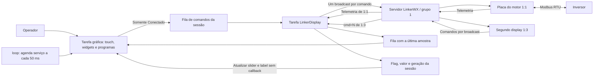
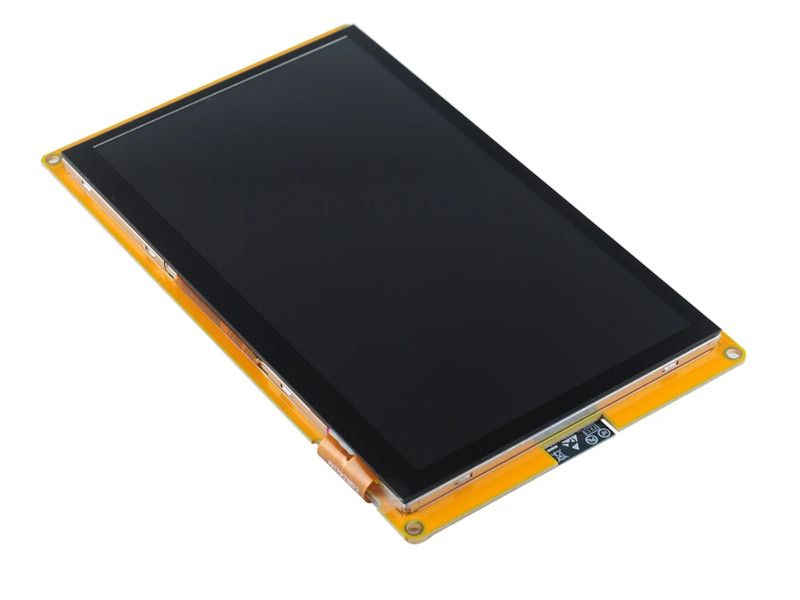
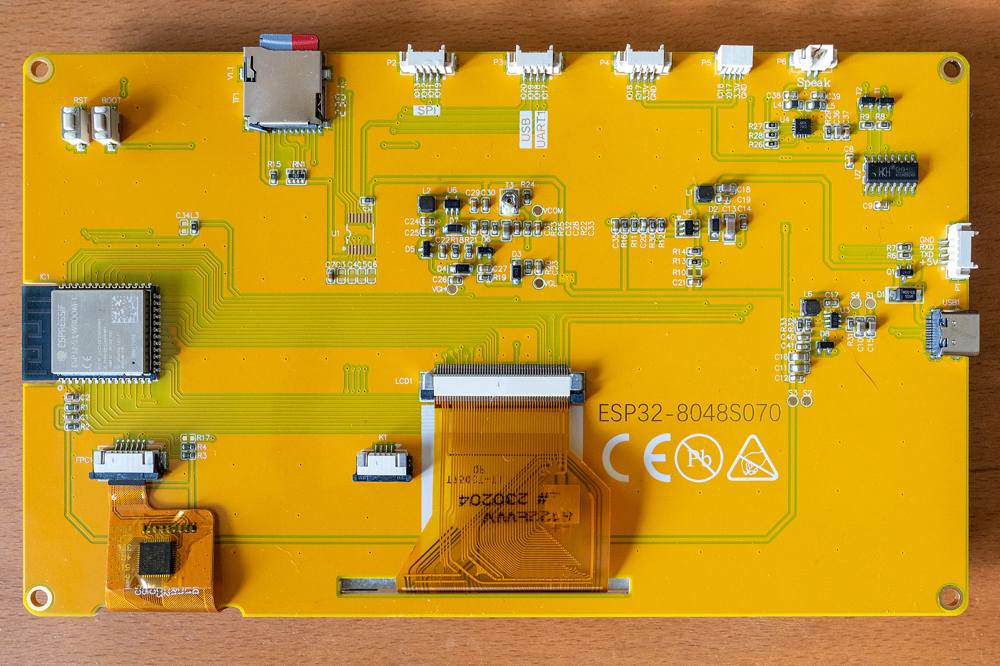
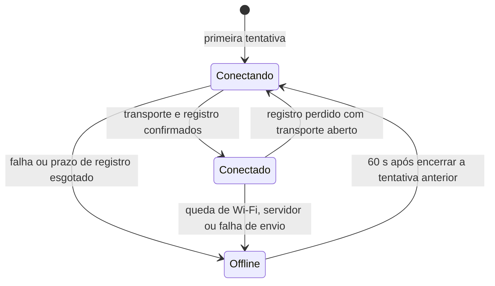
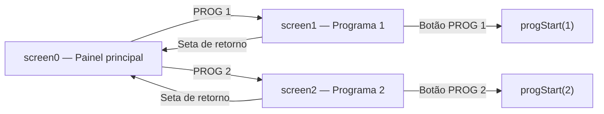
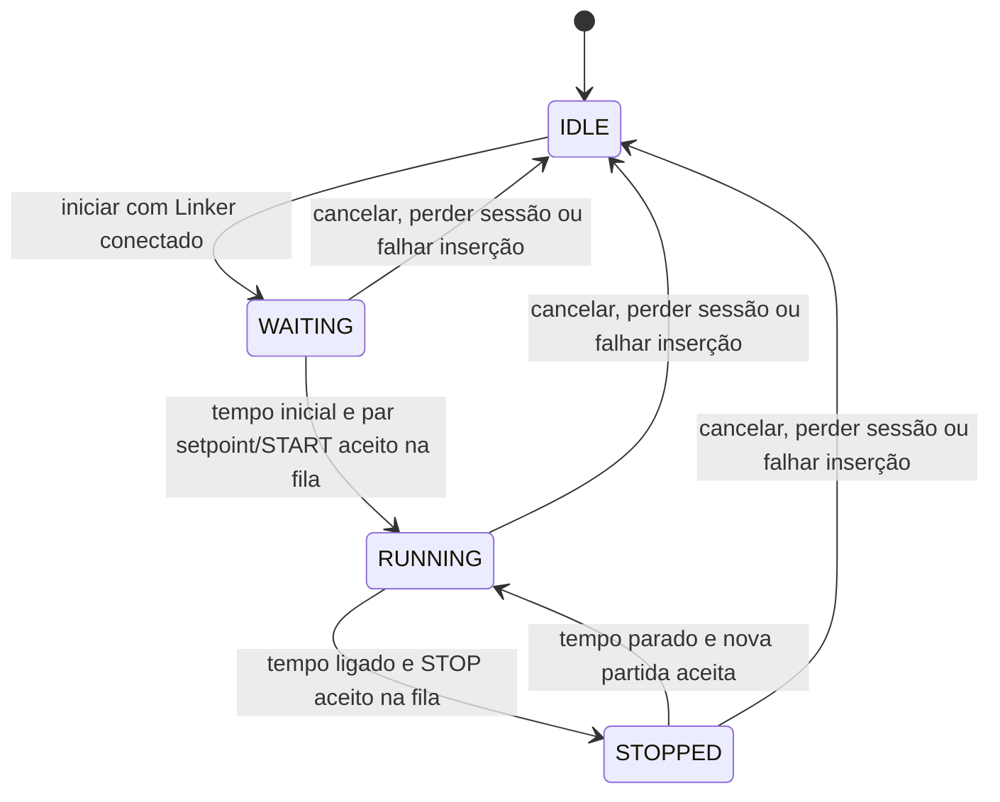
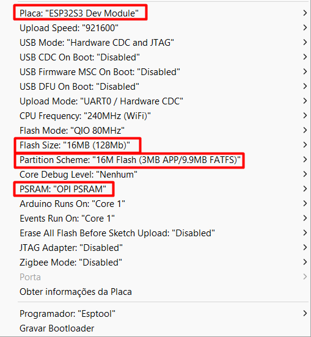

# Display de 7 polegadas — Interface remota do motor

Este projeto implementa uma interface de operação para ESP32-S3, display RGB de 800 × 480 pixels e touch GT911. A tela apresenta a telemetria do motor, envia comandos pelo LinkerWX e executa dois programas temporizados.

O projeto [codigo_placa_motor](../codigo_placa_motor/README.md) faz a comunicação Modbus RTU com o inversor. Este display trabalha com mensagens de rede e com a interface gráfica.

**Base desta documentação:** [codigo_display_7in.ino](codigo_display_7in.ino), [fluxo.h](fluxo.h), [controle_conexao.h](controle_conexao.h) e [controle_comandos.h](controle_comandos.h), revisados em 13/11/2026. As bibliotecas LinkerWX e DisplayWX foram mantidas intactas.

A interface inicia mesmo sem Wi-Fi/Linker. A conexão roda em uma tarefa própria; depois de uma falha, o projeto espera 60 s antes de tentar novamente. Na Screen0, `labelservstat` e `led1` mostram a sessão: **Conectando/amarelo**, **Conectado/verde** ou **Offline/vermelho**. Somente uma sessão conectada aceita comandos na fila.

O display atual usa **grupo 1, ID 2**; o segundo display usa **grupo 1, ID 3**. Um `cmd=N` recebido do outro display atualiza o slider geral e sua label, sem callback nem novo envio. A implementação da segunda tela está descrita no [guia de integração](GUIA_SEGUNDO_DISPLAY.md), com [imagens das três telas e legendas de cada campo e botão](GUIA_SEGUNDO_DISPLAY.md#7-imagens-e-legendas-das-telas).


*Imagem disponível no projeto. As curvas e os valores ilustram o layout. No código atual, apenas a série 0 dos gráficos recebe amostras de RPM.*

## Navegação

- [Arquitetura e arquivos](#1-arquitetura-e-arquivos)
- [Hardware e configuração](#2-hardware-e-configuração)
- [Inicialização e reconexão](#3-inicialização-e-reconexão)
- [Telas e controles](#4-telas-e-controles)
- [Loop e atualização gráfica](#5-loop-e-atualização-gráfica)
- [Mensagens LinkerWX](#6-mensagens-linkerwx)
- [Fila e sequência de envio](#7-fila-e-sequência-de-envio)
- [Recepção de telemetria](#8-recepção-de-telemetria)
- [Relação com os registradores Modbus](#9-relação-com-os-registradores-modbus)
- [Controle manual e cálculo do setpoint](#10-controle-manual-e-cálculo-do-setpoint)
- [Sincronização do slider entre displays](#104-sincronização-do-slider-entre-displays)
- [Programas temporizados](#11-programas-temporizados)
- [Funções importantes](#12-funções-importantes)
- [Preparação e diagnóstico](#13-preparação-e-diagnóstico)

## 1. Arquitetura e arquivos

O código separa a interface gráfica da lógica de comunicação e das rotinas temporizadas.

| Arquivo | Conteúdo | Uso atual |
| --- | --- | --- |
| [codigo_display_7in.ino](codigo_display_7in.ino) | Pinos, painel RGB, touch, widgets, três telas e callbacks de interação. | Entrada principal do projeto. |
| [fluxo.h](fluxo.h) | Tarefas, watchdog, telemetria, comandos, programas e serviço gráfico. | Incluído pelo `.ino`. |
| [controle_conexao.h](controle_conexao.h) | Estados de transporte e temporização da reconexão. | Usado somente pela tarefa de rede. |
| [controle_comandos.h](controle_comandos.h) | Fila fixa, geração da sessão e textos/cores de conexão. | Protegido por uma seção crítica curta no projeto. |
| [GUIA_SEGUNDO_DISPLAY.md](GUIA_SEGUNDO_DISPLAY.md) | Identidade LinkerWX, comandos, programas, telemetria e sincronização, com imagens e legendas. | Referência para implementar o segundo display, ID 3. |
| [tests/controle_conexao_test.cpp](tests/controle_conexao_test.cpp) e [tests/controle_comandos_test.cpp](tests/controle_comandos_test.cpp) | Testes nativos com relógio e cliente simulados. | Não integram o firmware Arduino. |
| [ipg1back.h](ipg1back.h) | Imagem de retorno de 32 × 32 pixels, com máscara. | Botão de volta da tela 1. |
| [ipg2back.h](ipg2back.h) | Imagem de retorno de 32 × 32 pixels, com máscara. | Botão de volta da tela 2. |
| [ipinionpng.h](ipinionpng.h) | Recurso gráfico de 32 × 32 pixels. | Presente, mas não incluído pelo fluxo atual. |
| [iwifivoltar.h](iwifivoltar.h) | Recurso gráfico de 32 × 32 pixels. | Presente, mas não incluído pelo fluxo atual. |

Os quatro cabeçalhos de imagem armazenam 1024 pixels de 16 bits e uma máscara de 128 bytes em `PROGMEM`. As imagens de retorno são carregadas com `setupFromPixels()`.

`fluxo.h` referencia os widgets e valores do `.ino` por declarações `extern`. As declarações apontam para as mesmas instâncias da interface.



O display usa grupo `1`, ID `2`. Cada comando gera uma chamada a `broadcastText(1, payload, SendType::ONLY_SEND)`, para todos os participantes desse grupo. A placa do motor usa ID `1` e o segundo display usa ID `3`; os IDs devem ser exclusivos dentro do grupo. O segundo display deve seguir o [guia de integração](GUIA_SEGUNDO_DISPLAY.md) para receber telemetria e sincronizar o slider geral.

Somente `LinkerDisplay` acessa `clientLinker`. Widgets, valores editados e máquina de estados dos programas pertencem à tarefa gráfica. O `loop()` apenas agenda esse serviço e alimenta seu próprio watchdog.

## 2. Hardware e configuração



*Painel de 7 polegadas associado ao projeto.*



*Imagem disponível na pasta. Os pinos abaixo foram extraídos do `.ino`.*

### 2.1 Painel e touch

| Item | Configuração |
| --- | --- |
| MCU indicado no código | ESP32-S3 embarcado na placa do display. |
| Painel | ESP32-8048S070, RGB, 800 × 480 pixels. |
| Driver gráfico | `Arduino_ESP32RGBPanel` + `Arduino_RGB_Display`. |
| Interface de widgets | `DisplayWX`. |
| Touch | GT911 por I²C. |
| Orientação | `rotationScreen = 0`. |
| Backlight | GPIO2, ligado em `HIGH`. |
| Serial | 115200 baud. |
| Câmera | Nenhuma configurada. |

| Sinal RGB | GPIOs, na ordem usada pelo construtor |
| --- | --- |
| DE / VSYNC / HSYNC / PCLK | 41 / 40 / 39 / 42 |
| R0 a R4 | 14, 21, 47, 48, 45 |
| G0 a G5 | 9, 46, 3, 8, 16, 1 |
| B0 a B4 | 15, 7, 6, 5, 4 |

| Parâmetro do painel | Valor |
| --- | --- |
| Clock preferido (`prefer_speed`) | 10.000.000 Hz (10 MHz) |
| HSYNC: polaridade / front porch / pulso / back porch | 0 / 180 / 30 / 16 |
| VSYNC: polaridade / front porch / pulso / back porch | 0 / 13 / 4 / 31 |
| `pclk_active_neg` | 1 |
| `de_idle_high` / `pclk_idle_high` | 0 / 0 |
| `bounce_buffer_size_px` | 16000 pixels, equivalentes a 20 linhas de 800 pixels |
| `isIPS`, passado como `useBigEndian` | `false` |

**Configuração RGB validada no display:** em 13/11/2026, o usuário confirmou que o conjunto de parâmetros acima, presente no construtor `Arduino_ESP32RGBPanel` do `.ino`, resolveu o deslocamento vertical intermitente da imagem, em que parte do topo reaparecia na borda inferior. A validação se refere ao conjunto completo, incluindo o clock de 10 MHz e os tempos de VSYNC de 13 / 4 / 31 (front porch / pulso / back porch).

| Sinal / ajuste do touch | Valor |
| --- | --- |
| SDA | GPIO19 |
| SCL | GPIO20 |
| RST | GPIO38 |
| INT | `-1`, sem GPIO dedicado configurado |
| Mapeamento X | 0 a 800 |
| Mapeamento Y | 0 a 480 |
| Trocar X/Y | `false` |
| Inverter X / Y | `false` / `false` |

### 2.2 Dependências identificadas no código

| Biblioteca / componente | Uso |
| --- | --- |
| Arduino para ESP32-S3 | GPIO, Wi-Fi, temporização, logs e FreeRTOS. |
| `Arduino_GFX_Library.h` | Painel e desenho RGB. |
| `displaywx.h` | Widgets, telas e task de touch/desenho. |
| `LinkerWX.h` e `LinkerWXWiFi.h` | Comunicação com o servidor e dispositivos. |
| `freertos/queue.h` | Fila de telemetria e agendamento do serviço gráfico. |
| `esp_task_wdt.h` | Watchdog de software das tarefas do loop, interface e rede. |
| `SPI.h` | Incluído no sketch; o painel é inicializado pelo driver RGB. |

Os fontes não fixam versões das bibliotecas nem todos os parâmetros de compilação da placa. A versão de `Arduino_GFX` precisa oferecer o construtor utilizado, inclusive o parâmetro de bounce buffer.

Este projeto usa **DisplayWX**. As referências a DisplayFK e aos ambientes PlatformIO dos READMEs antigos não descrevem esta versão.

### 2.3 Configuração de rede

Os valores ficam em [fluxo.h](fluxo.h).

| Identificador | Finalidade |
| --- | --- |
| `ssid` / `password` | Rede Wi-Fi. |
| `serverHost` / `serverPort` | Constantes `SERVER_ADDRESS` / `SERVER_PORT` da biblioteca LinkerWX. |
| `ROOT_CA` | Certificado TLS em PEM, identificado como ISRG Root X1. |
| `GRUPO = 1` / `DEVICE_ID = 2` | Identidade deste display. |
| Segundo display: grupo `1`, ID `3` | Origem aceita para sincronização por `cmd=N`. Se este mesmo código usar `DEVICE_ID = 3`, aceita essas atualizações do ID `2`. |
| `TOKEN` | Autenticação no serviço. |
| `cryptKey` em `configurarConexao()` | Chave de pacotes compatível com os demais participantes. |
| `TARGET_COMMAND_GROUP = 1` | Grupo destinatário do broadcast de comandos. |
| `MOTOR_SOURCE_GROUP = 1` / `MOTOR_SOURCE_ID = 1` | Origem aceita para telemetria. |
| `COMMAND_SEND_INTERVAL_MS = 500` | Intervalo mínimo entre broadcasts. |
| `RECONNECT_INTERVAL_MS = 60000` | Espera após terminar uma tentativa malsucedida ou detectar uma queda. |
| `REGISTER_TIMEOUT_MS = 10000` | Prazo para registro depois da abertura do transporte. |
| `TASK_WDT_TIMEOUT_MS = 240000` | Timeout comum do watchdog das tarefas. |
| `TELEMETRY_MAX_AGE_MS = 5000` | Prazo de validade da última amostra. |
| `UI_SERVICE_INTERVAL_MS = 50` | Intervalo de agendamento do serviço gráfico. |

O host e a porta efetivos dependem da biblioteca instalada. Os fontes desta pasta não fornecem esses valores literais.

## 3. Inicialização e reconexão

1. `setup()` inicia Serial, cria a fila de telemetria, configura o painel, o touch e os widgets e abre `screen0`.
2. `myDisplay.createTask(true, 240)` inicia a tarefa gráfica com watchdog dos núcleos.
3. `iniciarTarefas()` registra loop e interface no watchdog e cria `LinkerDisplay`.
4. A tarefa de rede registra seu próprio watchdog, configura o cliente e inicia a primeira tentativa. O `setup()` não aguarda Wi-Fi, TLS ou registro.



O prazo de registro é de 10 s depois que `begin()` retorna com transporte aberto. `poll()` é atendido nessa fase para receber `HI`/`AGAIN`. Na espera offline, o projeto não chama `begin()` nem `poll()`; o loop e a interface continuam atendendo normalmente.

O intervalo de 60 s é contado **após a chamada bloqueante terminar**, e não desde seu início. A biblioteca mantém seus próprios limites de Wi-Fi/TLS. Uma queda entre a verificação do projeto e o interior de `poll()` ainda pode provocar uma tentativa interna da LinkerWX; ela permanece isolada na tarefa de rede. `setReconnectInterval(60000)` também configura o intervalo público do cliente, sem alterar a biblioteca.

Falha de configuração, falta da fila de telemetria ou impossibilidade de criar/proteger a tarefa de rede deixa o projeto offline com log de diagnóstico, sem laço infinito de espera. A navegação local continua disponível quando a tarefa gráfica foi criada normalmente.

### Watchdog das tarefas

Loop, interface e rede ficam inscritos individualmente no Task Watchdog do ESP32. Cada tarefa alimenta sua própria inscrição: loop em `executar()`, interface em `servicoInterface()` e rede antes/depois das operações de conexão e em cada iteração.

O timeout comum é **240 s**, com panic habilitado, compatível com as chamadas bloqueantes da LinkerWX e o handshake TLS padrão de até 120 s do core instalado. O monitoramento das tarefas idle dos núcleos também permanece habilitado. A interface recebe o serviço periódico mesmo sem toque; outra tarefa não alimenta o watchdog em seu lugar. Isso evita reinícios por uma ausência normal de rede e permite detectar uma tarefa que parou de progredir.

## 4. Telas e controles

### 4.1 Tela principal — screen0

A tela inicial reúne medição, referência de frequência e comandos diretos.

| Elemento | Objeto | Informação / ação |
| --- | --- | --- |
| Medidor de RPM | `gaugerpm` | Rotação recebida em `motorData.rpm`; escala de 0 a 1800. |
| Tensão DC | `analogvdc` | `vdc`; escala de 0 a 400 V. |
| Tensão de saída | `analogtout` | `vs`; escala de 0 a 270 V. |
| Corrente | `analogcur` | `i`; escala de 0 a 10 A. |
| Frequência atual | `valuefact` | Campo `fa`, com sufixo Hz. |
| Frequência setada | `valuefset` | Campo `fs`, com sufixo Hz. |
| Slider manual | `slidergeral` | Inteiro de 0 a 100, apresentado com `%`; também recebe `cmd=N` do outro display, sem disparar callback. |
| Valor do slider manual | `labelhsliderge` | Mostra o valor do slider; atualizado também na sincronização remota. |
| Gráfico | `graphfreq` | Amostras de RPM na série 0; escala de 0 a 2000. Continua recebendo pontos fora da tela principal, com `workInBackground = true`. |
| Status do servidor | `labelservstat` | Conectando, Conectado ou Offline. |
| LED de conexão | `led1` | Amarelo, verde ou vermelho, respectivamente; permanece aceso. |

| Botão | Callback | Efeito |
| --- | --- | --- |
| START | `startbtn_cb()` | Enfileira `START`. |
| REVERSE | `reversebtn_cb()` | Enfileira `REVERSE`. |
| EMERGENCY | `emergcybtn_cb()` | Enfileira `EMERGENCY`. |
| STOP | `stopbtn_cb()` | Enfileira `STOP`. |
| PROG 1 | `prog1btn_cb()` | Abre `screen1`. |
| PROG 2 | `prog2btn_cb()` | Abre `screen2`. |

Todos os botões de comando recusam inserção na fila enquanto offline ou conectando. Conectado indica registro no Linker, sem confirmar presença do motor ou execução de uma ordem.

Os botões diretos não alteram `progActive`. Assim, o STOP ou o EMERGENCY da tela principal não cancela a máquina de estados de um programa já ativo.

### 4.2 Programa 1 — screen1


*Referência visual disponível no projeto. `SET RPM: 900` é um texto inicial configurado no widget; o valor calculado é atualizado pelo serviço gráfico, mesmo sem telemetria.*

| Campo | Objeto / variável | Valor inicial | Uso |
| --- | --- | --- | --- |
| Tempo de início | `pg1starttime` / `nb0_val` | 10 s | Espera antes da primeira partida. |
| Tempo ligado | `pg1runtime` / `nb1_val` | 20 s | Duração local do estado RUNNING. |
| Tempo parado | `pg1endtime` / `nb2_val` | 10 s | Espera entre ciclos. |
| Frequência máxima | `pg1freqmax` / `nb3_val` | 60 Hz | Copiada para a configuração; não limita o comando enviado. |
| RPM máximo | `pg1rpmmax` / `nb4_val` | 1798 RPM | Base do cálculo visual de SET RPM. |
| Slider | `sliderprg1` / `hslider1_val` | Variável inicial 0 | Número usado como setpoint na próxima partida do ciclo. |

O botão `PROG 1` desta tela chama `progStart(1)`. O botão `STOP` chama `progStop()`, que cancela a rotina e tenta enfileirar uma única parada. A seta retorna à tela principal.

### 4.3 Programa 2 — screen2


| Campo | Objeto / variável | Valor inicial |
| --- | --- | --- |
| Tempo de início | `pg2starttime` / `nb5_val` | 10 s |
| Tempo ligado | `pg2runtime` / `nb6_val` | 30 s |
| Tempo parado | `pg2stoptime` / `nb7_val` | 30 s |
| Frequência máxima | `pg2freqmax` / `nb8_val` | 60 Hz |
| RPM máximo | `pg2rpmmax` / `nb9_val` | 1798 RPM |
| Slider | `sliderprg2` / `hslider2_val` | Variável inicial 0 |

O funcionamento é igual ao Programa 1. O botão `PROG 2` chama `progStart(2)`.

Há uma única máquina de estados compartilhada. Iniciar outro programa substitui a seleção e reinicia a espera inicial. Essa troca não enfileira um STOP automaticamente.

### 4.4 Navegação



Trocar de tela não encerra uma rotina. Para cancelá-la, os botões STOP das telas de programa chamam `progStop()`.

## 5. Loop e atualização gráfica

O `loop()` chama `Fluxo::executar()`: agenda `servicoInterface()` na fila pública de callbacks da DisplayWX sem esperar por espaço, alimenta seu watchdog e faz `delay(10)`. Há no máximo um serviço pendente; fila gráfica cheia causa nova tentativa de agendamento, sem bloquear o loop.

O serviço executa na própria tarefa gráfica, junto dos callbacks de toque. Ele atualiza status/LED, avança os programas, consome a última amostra de telemetria e atualiza os widgets. A rede nunca desenha na tela. A fila de telemetria contém uma cópia da amostra e a geração da sessão; uma amostra de sessão anterior é descartada.

Para `cmd=N` do outro display, a rede publica `sliderRemotoPendente`, `sliderRemotoValor` e `sliderRemotoGeracao`, protegidos por `comandosMux`. O serviço gráfico consome essa atualização somente se a sessão ainda for válida e atualiza o slider geral e sua label, sem inserir comando na fila de envio.

| Atividade | Temporização |
| --- | --- |
| Agendar serviço gráfico | A cada pelo menos 50 ms. |
| Consumir edição do slider manual | A cada pelo menos 1000 ms, somente na mesma sessão conectada. |
| Aplicar atualização remota do slider | No próximo serviço gráfico agendado, sem aguardar o período manual de 1 s. |
| Avançar programa | Em cada serviço gráfico; tempos em segundos inteiros. |
| Transmitir próximo comando | Pelo menos 500 ms após a tentativa anterior. |
| Espera dos loops de rede e aplicação | 10 ms. |
| Expirar telemetria | Após 5 s sem amostra válida ou ao perder a sessão. |

`startCustomDraw()` / `finishCustomDraw()` delimitam as atualizações dos widgets. O fluxo oferece as novas amostras de RPM à série 0 dos três gráficos; cada gráfico aceita os pontos conforme sua configuração `workInBackground`, descrita abaixo. As barras recebem valores convertidos para `int`, preservando a apresentação anterior: `2.3 A`, por exemplo, vira `2`.

**Gráfico principal em segundo plano:** no `.ino`, a configuração `LineChartConfig configLineChart0`, aplicada a `graphfreq` da `screen0`, usa **`.workInBackground = true`**. Assim, o gráfico principal continua armazenando as novas amostras de RPM enquanto o usuário está nas telas Prog1 ou Prog2. Ao voltar à tela inicial, ele exibe o histórico atualizado, dentro da capacidade do gráfico. O desenho ocorre quando a tela principal está visível.

As configurações `configLineChart1` e `configLineChart2` permanecem com `workInBackground = false`: os gráficos dos programas só aceitam novos pontos enquanto suas respectivas telas estão ativas. Essa opção não controla a execução dos programas. Em todos os gráficos, novos pontos dependem de telemetria nova e válida; trabalhar em segundo plano não gera amostras durante a falta de dados.

## 6. Mensagens LinkerWX

### 6.1 Rotas utilizadas

| Origem | Destino | Conteúdo | Chamada / modo |
| --- | --- | --- | --- |
| Display `1:2` | Grupo `1` | `cmd=<comando>` | Um `broadcastText(...)`, `SendType::ONLY_SEND`. |
| Segundo display `1:3` | Grupo `1` | `cmd=N`, por exemplo `cmd=50` | Broadcast para sincronização; este display atualiza o slider sem retransmitir. |
| Placa do motor | Grupo `1` | Telemetria `chave=valor;...` | Broadcast realizado pela placa do motor. |

O display não monta os frames internos do protocolo. Ele fornece os payloads para `LinkerWXWiFi`, que também atende conexão e eventos por `poll()`.

### 6.2 Payloads enviados pela interface

| Payload | Origem na interface | Interpretação na placa do motor |
| --- | --- | --- |
| `cmd=START` | Botão START ou partida de programa. | Comando de partida. |
| `cmd=STOP` | Botão STOP ou final do tempo ligado. | Comando de parada. |
| `cmd=REVERSE` | Botão REVERSE. | Comando de sentido reverso. |
| `cmd=EMERGENCY` | Botão EMERGENCY. | Comando de parada identificado como emergência. |
| `cmd=50` | Slider manual ou slider do programa. | Referência de **50 Hz** no código atual. |

Os sliders geram números inteiros. `sendCommandToMotor()` aceita texto, mas não existe um campo de comando livre na interface atual.

Comandos como `HELP`, `RPMSTATUS`, `STATUS` e `SET2000=N` existem no firmware da placa do motor. Os botões desta interface não os emitem.

### 6.3 Eventos tratados

| Evento / callback | Ação do display |
| --- | --- |
| `SRV / HI` ou `AGAIN` | Publica Conectado quando Wi-Fi e link estão válidos. |
| `RECV` do motor `1:1` | Encaminha o payload ao parser de telemetria. |
| `RECV` do outro display `1:3` | Aceita `cmd=N` inteiro de 0 a 100 e sinaliza a atualização gráfica do slider. Ignora outros comandos dessa origem. |
| `ERR`, código `1` ou `10` | Fecha a entrada da fila, invalida a sessão e desconecta o transporte. |
| Evento de desconexão Wi-Fi durante sessão online | Invalida imediatamente a sessão/fila; agenda tratamento na tarefa de rede. |
| Outros `ERR`, `DEST`, `onError`, `RECV_OK` | Registram diagnóstico. |

Os envios usam `ONLY_SEND`, sem solicitar ACK. O retorno de sucesso de `broadcastText()` indica aceitação pelo transporte, sem comprovar recebimento por todos os membros ou execução física do motor.

## 7. Fila e sequência de envio

Os callbacks de toque não fazem operações de rede. `sendCommandToMotor()` valida e copia o texto para uma fila circular fixa de 15 itens, cada um com até 31 caracteres e a geração da sessão. O nome da função foi preservado; o envio efetivo é broadcast.

A verificação do estado e a inserção usam a mesma seção crítica curta (`portMUX`). Nenhuma chamada de rede, desenho ou log é executada com esse lock adquirido. Offline ou Conectando recusa qualquer comando novo; fila cheia também recusa, sem aguardar espaço.

Cada mudança de estado limpa a fila e avança a geração. Antes de transmitir, a tarefa verifica Wi-Fi, registro e geração do item. Assim, a reconexão não recupera comandos antigos. Um comando já transmitido antes da detecção da queda não pode ser retirado do servidor.

Para a fila `50`, `START`, `STOP`, a sequência é:

```text
broadcast grupo 1: cmd=50
aguardar pelo menos 500 ms
broadcast grupo 1: cmd=START
aguardar pelo menos 500 ms
broadcast grupo 1: cmd=STOP
```

Não existe item reservado para um segundo destino. Cada comando produz uma única chamada de transmissão. Falha de broadcast invalida a sessão e descarta os demais pendentes; o comando que falhou não é repetido automaticamente.

O par setpoint/START de um programa é inserido inteiro ou recusado inteiro, conforme a capacidade disponível. Os dois comandos continuam sendo dois broadcasts, separados pelo intervalo de 500 ms. Valores numéricos menores ou iguais a zero são recusados; um programa com setpoint zero não enfileira START.

STOP e EMERGENCY continuam usando a fila comum, sem prioridade especial sobre comandos anteriores. A validação numérica considera o primeiro caractere (dígito ou `-`); a interface emite números inteiros, sem campo de texto livre.

## 8. Recepção de telemetria

### 8.1 Formato esperado

```text
fa=45.0;fs=45.0;vdc=310.0;vs=220.0;i=2.3;tq=65.0;edo=1;rpm=1350
```

*Exemplo ilustrativo do pacote publicado pela placa do motor.*

`parseTelemetry()` separa os itens por `;` e divide cada item no primeiro `=`. As chaves reconhecidas são sensíveis a maiúsculas e minúsculas.

### 8.2 Campos recebidos da placa atual

| Chave | Tipo em `MotorData` | Unidade | Uso na interface |
| --- | --- | --- | --- |
| `fa` | `float` | Hz | Texto de frequência atual. |
| `fs` | `float` | Hz | Texto de frequência setada. |
| `vdc` | `float` | V | Barra de tensão DC. |
| `vs` | `float` | V | Barra de tensão de saída. |
| `i` | `float` | A | Barra de corrente. |
| `tq` | `float` | % | Armazenado. |
| `edo` | `uint16_t` | Máscara de bits | Armazenado. |
| `rpm` | `uint32_t` | RPM | Gauge e série 0 dos três gráficos. |

### 8.3 Campos adicionais aceitos pelo parser

Essas chaves existem em `MotorData`, mas não são emitidas pela versão atual de `codigo_placa_motor.ino`. Elas também não são apresentadas nos widgets desta interface.

| Chave | Campo / tipo | Significado declarado em `fluxo.h` |
| --- | --- | --- |
| `v` | `v`, `float` | Velocidade; unidade não especificada. |
| `p` | `p`, `float` | Potência em W. |
| `tm` | `tm`, `float` | Temperatura do motor em °C. |
| `a1` | `a1`, `float` | Entrada analógica 1; escala não especificada. |
| `a2` | `a2`, `float` | Entrada analógica 2; escala não especificada. |
| `a3` | `a3`, `float` | Entrada analógica 3; escala não especificada. |
| `er` | `er`, `uint16_t` | Código de erro. |
| `tl` | `tl`, `uint32_t` | Tempo ligado em segundos. |
| `tr` | `tr`, `float` | Tempo restante; unidade não especificada. |
| `cf` | `cf`, `uint16_t` | Código de falha. |
| `if` | `inf`, `uint16_t` | Informação adicional. |

Não há mapa Modbus associado a essas chaves adicionais nos fontes desta pasta.

### 8.4 Fluxo e validade dos dados

Para telemetria, `onRECV()` aceita somente a origem `1:1`. As mensagens `cmd=N` do outro display seguem o tratamento de [sincronização do slider](#104-sincronização-do-slider-entre-displays) e não renovam a validade da telemetria. O parser mantém uma cópia privada na tarefa de rede; somente mensagens com pelo menos uma chave reconhecida renovam `lastUpdateMs` e produzem uma amostra. Campos ausentes mantêm o valor anterior da mesma sessão; uma nova sessão reinicia a cópia privada.

`xQueueOverwrite()` publica a última amostra em uma fila de capacidade 1. O serviço gráfico a consome sem espera, verifica sua geração e atualiza medidores, frequências e gráficos. Isso evita acesso simultâneo de rede e interface ao mesmo `MotorData`.

Depois de 5 s sem dados válidos, ou ao perder a sessão, as frequências `valuefact` e `valuefset` mostram `--`. Gauge e barras preservam a última leitura; os gráficos deixam de receber pontos antigos. O estado Conectado continua representando o Linker, não a presença de telemetria recente do motor.

Chaves desconhecidas são ignoradas. Espaços dentro dos pares não são removidos individualmente; use `fa=45.0`, sem espaços na chave.

## 9. Relação com os registradores Modbus

**Esta pasta não instancia ModbusMaster nem acessa registradores.** Ela envia comandos de aplicação e recebe campos já convertidos.

O mapa físico pertence à placa do motor. A tabela abaixo resume o contrato entre os projetos, conforme o `.ino` da placa documentado no [README correspondente](../codigo_placa_motor/README.md#7-registradores-modbus).

### Comandos enviados pelo display

| Payload LinkerWX | Operação realizada pela placa do motor |
| --- | --- |
| `cmd=START` | Escreve `1` em `0x2000`. |
| `cmd=REVERSE` | Escreve `2` em `0x2000`. |
| `cmd=STOP` | Escreve `6` em `0x2000`. |
| `cmd=EMERGENCY` | Escreve `5` em `0x2000`. |
| `cmd=50` | Escreve `5000` em `0x1000`, equivalente a 50 Hz. |

### Telemetria consumida pelo display

| Origem na placa do motor | Campo recebido | Conversão antes de transmitir |
| --- | --- | --- |
| `0x7000` | `fa` | bruto × 0,01 Hz |
| `0x7001` | `fs` | bruto × 0,01 Hz |
| `0x7002` | `vdc` | bruto × 0,1 V |
| `0x7003` | `vs` | bruto × 1 V |
| `0x7004` | `i` | bruto × 0,1 A |
| `0x7005` | `tq` | bruto × 0,1 % |
| `0x7008` | `edo` | Inteiro sem escala |
| Sensor no GPIO34 da placa | `rpm` | Cálculo por intervalo entre pulsos |

O bloco da placa também lê `0x7006` e `0x7007`, mas não os utiliza. Os registradores de diagnóstico `0x703D` e `0x703E` são consultados por `STATUS` na placa e não fazem parte desse pacote.

O display não aplica novamente as escalas Modbus. Ele recebe os valores de frequência e grandezas elétricas já convertidos para as unidades da tabela.

## 10. Controle manual e cálculo do setpoint

### 10.1 Slider manual

`slidergeral_cb()` copia o valor para `hslider0_val` e chama `atualizarSliderManual()`. Uma edição positiva, sem programa ativo e com sessão Conectada, fica pendente para o próximo serviço manual de 1 s. Edições sucessivas nesse intervalo substituem o valor pendente.

Edições offline ou durante reconexão permanecem visíveis, mas não geram comando ao conectar. A mudança de sessão invalida também o valor manual pendente. Fila cheia consome a tentativa local sem reenvio automático; o usuário precisa solicitar o valor novamente.

### 10.2 Porcentagem visual e frequência enviada

**O número do slider é enviado diretamente como frequência em Hz para a placa do motor.** O sufixo `%` pertence à apresentação da interface.

| Slider | Mensagem | Resultado na placa do motor |
| --- | --- | --- |
| 25 | `cmd=25` | Referência de 25 Hz. |
| 50 | `cmd=50` | Referência de 50 Hz. |
| 100 | `cmd=100` | Referência de 100 Hz. |
| 0 | Não é transmitido pela fila | A referência anterior não é alterada por esse valor. |

Mover o slider para zero não envia STOP. Nos programas, setpoint zero cancela a partida local antes de enfileirar o par setpoint/START.

### 10.3 SET RPM e frequência máxima

O texto SET RPM é calculado assim:

```text
SET RPM exibido = inteiro(slider / 100 × RPM máximo)

Exemplo:
slider = 50
RPM máximo = 1798
SET RPM exibido = 899
comando efetivamente enviado = cmd=50
```

Esse cálculo visual é atualizado em cada serviço gráfico, inclusive offline. Os textos iniciais são `900`, mas o serviço os recalcula usando as variáveis dos sliders, que começam em zero.

`freqMax = 60` não transforma slider 50 em 30 Hz e não impõe um teto ao valor transmitido. O cálculo de SET RPM permanece apenas visual.

O RPM recebido é usado para apresentação. Não há controle de velocidade em malha fechada baseado no sensor.

### 10.4 Sincronização do slider entre displays

O display ID `2` aceita `cmd=N` da origem **grupo 1, ID 3**. Com este mesmo código configurado como ID `3`, aceita o ID `2`. Mensagens da própria origem ou de outros dispositivos não atualizam o slider.

1. `onRECV()` valida o prefixo `cmd=` e o número inteiro completo entre **0 e 100**. Exemplos aceitos: `cmd=0`, `cmd=50`, `cmd=100`. Textos como `cmd=START`, valores negativos, decimais ou fora da faixa são ignorados nessa sincronização.
2. Com a sessão Conectada, grava a flag `sliderRemotoPendente`, o valor `sliderRemotoValor` e a geração `sliderRemotoGeracao`, sob `comandosMux`. Se chegarem várias atualizações antes do processamento gráfico, prevalece o valor mais recente.
3. `servicoInterface()` consome e limpa a flag, verifica a geração e aplica, na tarefa gráfica:

```cpp
slidergeral.setValue(valorSliderRemoto, false);
hslider0_val = slidergeral.getValue();
labelhsliderge.setTextInt(hslider0_val);
```

O `false` evita o callback do slider. A atualização recebida não chama `atualizarSliderManual()`, não cria comando pendente e não gera eco por broadcast. Pendências de edições locais anteriores não são canceladas automaticamente. Atualizações de uma sessão anterior são descartadas.

A sincronização altera somente o **slider geral e sua label**, inclusive quando o `cmd=N` foi enviado pelo programa do outro display. Não modifica os sliders ou parâmetros de Prog1/Prog2 nem inicia rotinas. Receber `cmd=0` pode atualizar a indicação visual, embora a interface não transmita zero como comando de frequência.

`cmd=N` representa o valor solicitado; não confirma execução no motor. O campo `fs` da telemetria continua atualizando apenas o texto de frequência setada, sem reposicionar automaticamente o slider. Não há mensagem adicional `freq=N`. Para implementar o outro dispositivo, consulte o [guia com imagens e legendas](GUIA_SEGUNDO_DISPLAY.md#7-imagens-e-legendas-das-telas).

## 11. Programas temporizados

A máquina de estados roda na tarefa gráfica, no mesmo contexto dos campos e botões. `progStart()` só aceita partida com sessão Conectada, copia os tempos e associa o programa à geração atual.



Os tempos começam quando os comandos entram na fila. Esses estados representam solicitações locais, sem confirmar o estado físico do motor. Setpoint e START entram como lote indivisível, sem `delay(100)` na tarefa gráfica.

| Ação | Comportamento |
| --- | --- |
| Editar tempos | São copiados na próxima chamada a `progStart()`. |
| Editar slider do programa | Altera o setpoint da próxima partida do ciclo. |
| Editar RPM máximo | Atualiza imediatamente o cálculo visual de SET RPM. |
| Abrir outra tela | Mantém a rotina ativa enquanto a sessão for válida. |
| Iniciar outro programa conectado | Substitui configuração e reinicia WAITING, sem STOP automático. |
| Perder a sessão | Cancela o programa local e descarta comandos pendentes; exige nova partida explícita. |
| STOP das telas de programa | Chama `progStop()` uma vez, cancela a rotina e tenta inserir um único STOP. |
| STOP / EMERGENCY da tela principal | Mantém o comportamento direto: tenta inserir o comando sem cancelar a rotina. |

Cancelar uma rotina enquanto offline não envia STOP e não comprova parada do motor. `progStop()` registra a recusa quando não consegue enfileirar. Comandos já transmitidos não são desfeitos.

Os campos continuam armazenados em RAM. Não foi acrescentada validação de faixa dos tempos antes da conversão para inteiros sem sinal.

## 12. Funções importantes

| Arquivo / função | Responsabilidade |
| --- | --- |
| `.ino`: `setup()` / `loop()` | Iniciar painel/tarefas e executar o agendador local. |
| `.ino`: `screen0/1/2()` / `loadWidgets()` | Configurar e desenhar telas/widgets. |
| `.ino`: callbacks | Navegação, edição local e solicitação de comandos. |
| `prepararFluxo()` | Criar a fila de telemetria. |
| `iniciarTarefas()` / `inicializarWatchdog()` | Registrar proteção das tarefas e iniciar rede. |
| `configurarConexao()` | Configurar identidade, credenciais, TLS e callbacks. |
| `tarefaLinker()` | Atender conexão, reconexão, recebimento e transmissão. |
| `executar()` | Agendar serviço gráfico e alimentar watchdog do loop. |
| `servicoInterface()` | Aplicar o valor remoto ao slider/label, atualizar status, telemetria, programas e watchdog gráfico. |
| `sendCommandToMotor()` / `flushCommandQueue()` | Inserir comando na sessão conectada / enviar broadcast. |
| `onRECV()` | Separar telemetria do motor e `cmd=N` do outro display; sinalizar a atualização remota do slider. |
| `parseTelemetry()` | Interpretar os campos do motor e publicar uma cópia da telemetria. |
| `progStart()` / `progRoutine()` / `progStop()` | Operar a máquina de estados local. |
| `ControleConexaoDisplay` | Controlar prazo de registro e espera de reconexão. |
| `FilaComandosGrupo` | Controlar capacidade, FIFO e invalidação de sessão. |

## 13. Preparação e diagnóstico

### Preparação do projeto

1. Abra `codigo_display_7in.ino` com os cabeçalhos na mesma pasta.
2. Configure a Arduino IDE conforme a [imagem de referência](config_ide.png) apresentada abaixo.
3. Disponibilize Arduino_GFX, DisplayWX e LinkerWX compatíveis com as APIs do código.
4. Ajuste rede, identidade, token, certificado, grupo de broadcast e origem de telemetria em `fluxo.h`.
5. Confira os parâmetros do painel RGB e do touch no `.ino`.
6. Compile e grave pelo ambiente configurado para a placa.
7. Abra o monitor Serial em 115200 baud.

Para visualizar os logs de conexão, fila e watchdog, selecione **Core Debug Level: Info** (ou superior) antes de compilar. `esp_log_level_set()` não reativa mensagens removidas por uma compilação com logs desabilitados.

### Configuração da Arduino IDE para compilação

Use as opções do menu **Ferramentas** mostradas na imagem. Ela complementa os parâmetros de compilação que não estão definidos nos arquivos `.ino` e `.h`.



*Destaques: placa `ESP32S3 Dev Module`, Flash Size `16MB (128Mb)`, Partition Scheme `16M Flash (3MB APP/9.9MB FATFS)` e PSRAM `OPI PSRAM`.*

### Verificação funcional no hardware

| Cenário | Resultado esperado |
| --- | --- |
| Atualizar a interface e alternar telas com os parâmetros RGB da seção 2.1 | Imagem alinhada, sem deslocamento vertical nem reaparecimento do topo na borda inferior. |
| Receber telemetria na tela Prog1 ou Prog2 e voltar à tela principal | `graphfreq` inclui as amostras recebidas durante a navegação, dentro da capacidade do gráfico, pois `configLineChart0.workInBackground = true`. |
| Ligar sem Wi-Fi | Interface e touch funcionam; Conectando/amarelo durante tentativa, Offline/vermelho após falha. |
| Wi-Fi disponível, servidor indisponível | Mesma continuidade local e nova tentativa após 60 s. |
| Registro confirmado | Conectado/verde em `labelservstat` / `led1`. |
| Queda durante operação | Fila invalidada, programa local cancelado e retomada dependente de nova solicitação. |
| Tocar comandos ou editar slider offline | Nada fica guardado para transmissão na reconexão. |
| Reconectar | Tela volta a Conectado; comandos antigos não reaparecem. |
| Enviar comando conectado | Um log `Broadcast grupo 1: cmd=...`; conferir recebimento no motor e no segundo display, ID 3. |
| Receber `cmd=50` do segundo display `1:3` | Slider geral, `hslider0_val` e `labelhsliderge` passam a 50, sem callback nem novo comando de envio. |
| Receber comando não numérico, fora da faixa ou de origem diferente | Nenhuma atualização remota do slider. A origem `1:1` continua reservada à telemetria do motor. |
| Perder a sessão antes de consumir uma atualização remota | A atualização antiga é descartada; não reaparece ao reconectar. |
| Perder apenas telemetria do motor | Frequências viram `--` após 5 s; status Linker pode continuar Conectado. |
| Cancelar programa conectado | Um único STOP solicitado; sem duplicação pelo callback. |
| Monitorar watchdog | Loop, UI e rede registrados; ausência normal de rede não causa reset. |

### Testes nativos e compilação

Os testes de [conexão](tests/controle_conexao_test.cpp) cobrem 9 cenários, incluindo boot offline, servidor ausente, registro sem resposta, queda de Wi-Fi/servidor/durante `poll()`, perda de registro, evento de desconexão e rollover de `millis()`.

Os testes de [comandos](tests/controle_comandos_test.cpp) cobrem 7 cenários: recusa offline/conectando, cópia/FIFO circular, lote indivisível, limites de texto, invalidação de sessão por dois estados e texto/cor dos indicadores. Foram compilados com Clang em C++11 usando `-Wall -Wextra -Werror` e passaram.

Exemplo de execução, a partir desta pasta, com um compilador C++ disponível:

```powershell
clang++ -std=c++11 -Wall -Wextra -Werror tests/controle_conexao_test.cpp -o controle_conexao_test.exe
./controle_conexao_test.exe
clang++ -std=c++11 -Wall -Wextra -Werror tests/controle_comandos_test.cpp -o controle_comandos_test.exe
./controle_comandos_test.exe
```

A configuração de compilação usa ESP32-S3, Arduino-ESP32 3.3.12, flash 16 MB, partição `app3M_fat9M_16MB`, modo QIO e PSRAM OPI. O histórico de validação registra um build completo de referência aprovado e uma recompilação posterior do sketch com sucesso usando a mesma receita e dependências, sem repetir a etapa de link. A correção do deslocamento da imagem com os parâmetros RGB atuais foi confirmada pelo usuário em hardware em 13/11/2026, conforme a seção 2.1. A validação de rádio, recepção do broadcast e watchdog no dispositivo continua dependendo dos respectivos ensaios em hardware.

As configurações editadas ficam em RAM. Não há gravação em arquivo, NVS ou outro armazenamento no fluxo atual. Os ícones usados pela interface estão compilados nos cabeçalhos; as fotografias e capturas deste README são apenas documentação.

As verificações automatizadas não substituem a validação de comunicação e operação no hardware. Nenhum firmware foi gravado na placa durante esta alteração.
