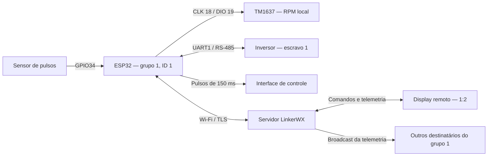
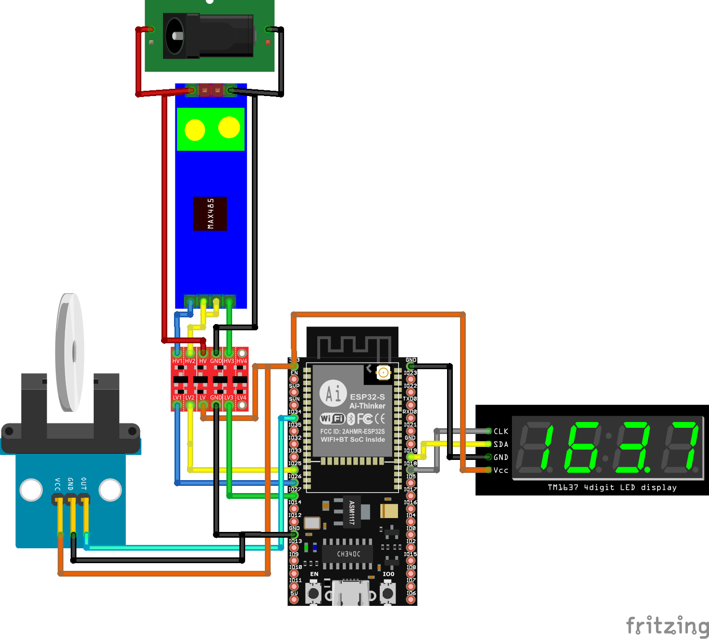
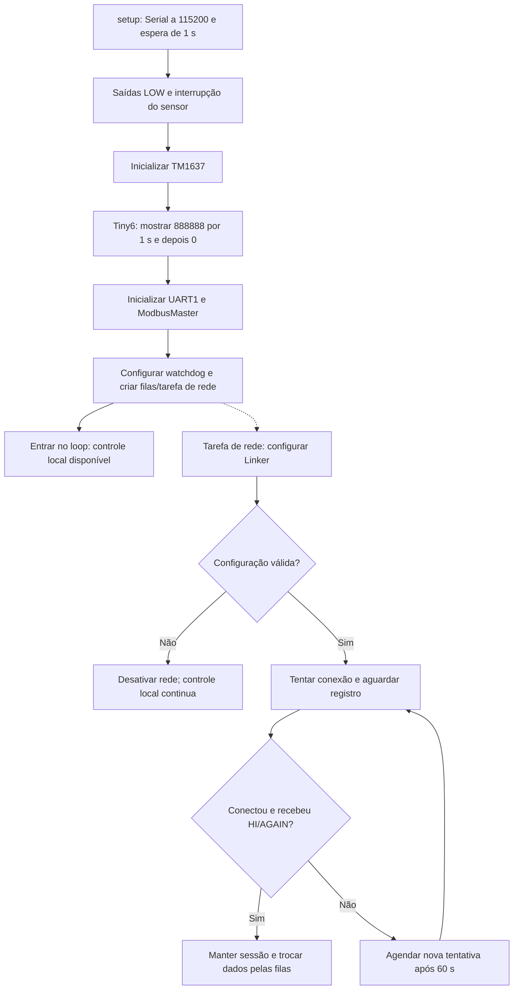
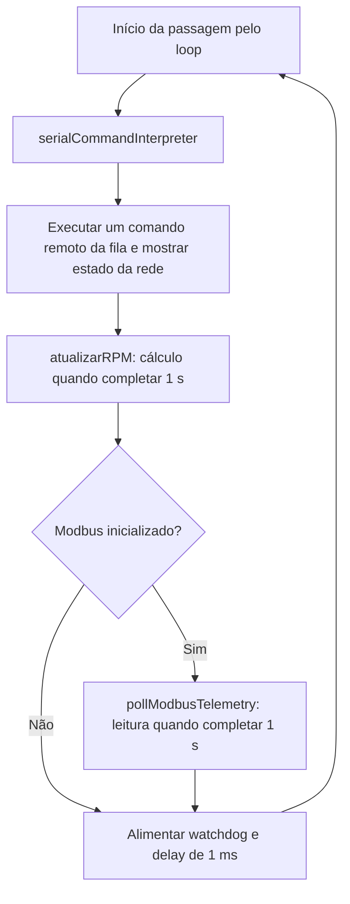
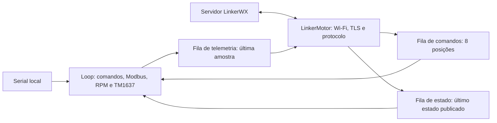
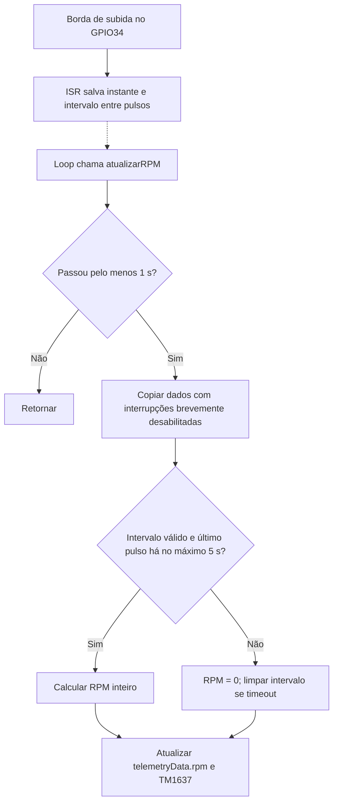
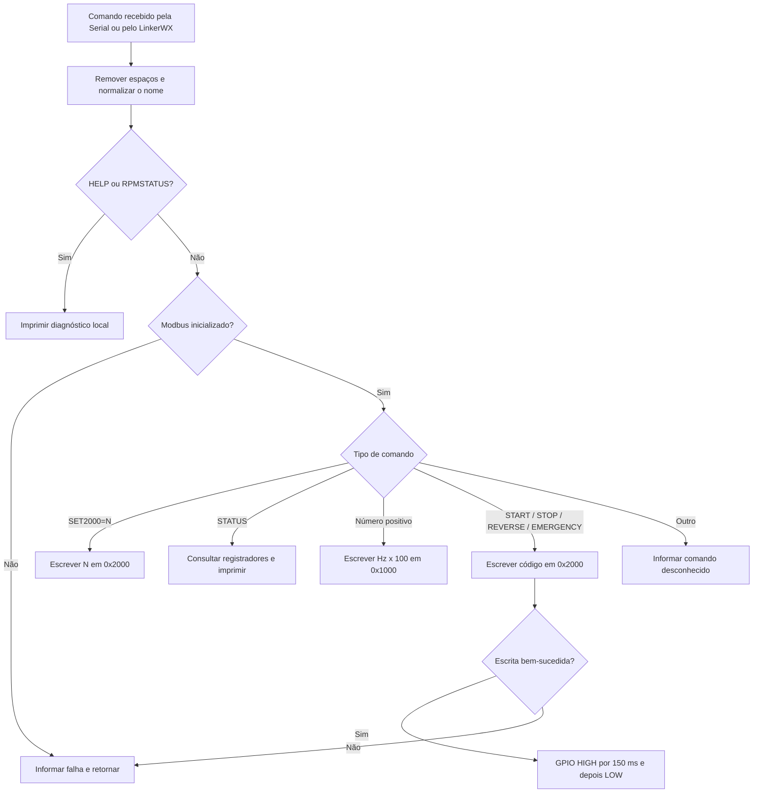
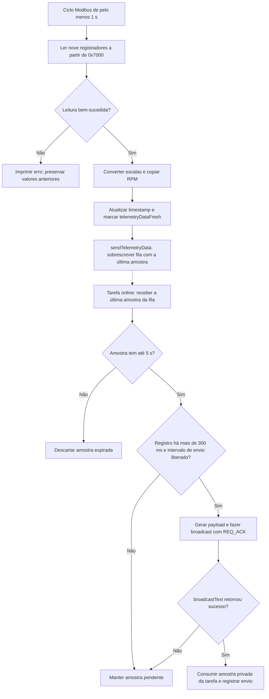
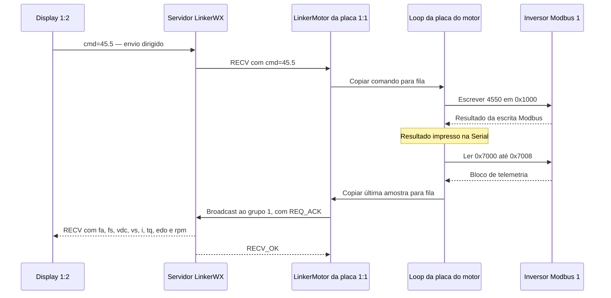

# Placa do motor — ESP32, Modbus RTU e LinkerWX

Este projeto controla um inversor de frequência, mede a rotação do motor e publica telemetria pelo LinkerWX. O ESP32 recebe comandos pela Serial ou pela rede. Um display TM1637 mostra o RPM medido localmente.

A interface remota está em [codigo_display_7in](../codigo_display_7in/README.md). Ela apresenta os dados e envia comandos para esta placa.

**A operação local independe de Wi-Fi e Linker.** Após inicializar o hardware, o programa atende a Serial, o Modbus e o display local enquanto uma tarefa separada cuida da rede. As tentativas agendadas pelo projeto aguardam 60 segundos após falha ou desconexão detectada. As duas tarefas usam watchdog com prazo comum de 4 minutos.

**Base desta documentação:** [codigo_placa_motor.ino](codigo_placa_motor.ino) e [controle_conexao.h](controle_conexao.h), revisados em 13/11/2026. A biblioteca LinkerWX permanece intacta. Arquivos de backup não definem o comportamento descrito aqui.

## Navegação

- [Visão geral](#1-visão-geral)
- [Hardware e pinos](#2-hardware-e-pinos)
- [Preparação e configuração](#3-preparação-e-configuração)
- [Inicialização](#4-inicialização)
- [Loop e temporizações](#5-loop-e-temporizações)
- [Tarefas e filas](#51-tarefas-e-filas)
- [Watchdog](#52-watchdog)
- [Medição de RPM](#6-medição-de-rpm)
- [Registradores Modbus](#7-registradores-modbus)
- [Comandos locais e remotos](#8-comandos-locais-e-remotos)
- [Comunicação LinkerWX](#9-comunicação-linkerwx)
- [Estados da conexão](#93-estados-da-conexão)
- [Telemetria](#10-telemetria)
- [Funções importantes](#11-funções-importantes)
- [Diagnóstico e limites atuais](#12-diagnóstico-e-limites-atuais)
- [Validação do fluxo](#validação-do-fluxo)

## 1. Visão geral

A placa reúne três caminhos de comunicação:

| Caminho | Responsabilidade |
| --- | --- |
| UART1 + RS-485 | Ler registradores e escrever comandos no inversor por Modbus RTU. |
| Wi-Fi + TLS + LinkerWX | Receber comandos e enviar telemetria ao grupo configurado. |
| Serial a 115200 baud | Executar comandos locais e apresentar logs de diagnóstico. |

O sensor de pulsos fornece o RPM. As leituras Modbus fornecem frequência, tensão, corrente, torque e estado das saídas do inversor.



**O envio atual de telemetria é um broadcast ao grupo 1.** A função usada é `clientLinker.broadcastText(...)`. A constante `TARGET_DISPLAY_ID = 2` existe, mas não participa desse envio.

Os comentários que mencionam comunicação exclusivamente 1:1 não representam esse trecho da implementação atual.

### Arquivos do projeto

| Arquivo | Responsabilidade |
| --- | --- |
| [codigo_placa_motor.ino](codigo_placa_motor.ino) | Hardware, loop local, tarefa de rede, filas, callbacks e watchdog. |
| [controle_conexao.h](controle_conexao.h) | Estados e temporizadores de reconexão/registro, usando a API pública do Linker. |
| [tests/controle_conexao_test.cpp](tests/controle_conexao_test.cpp) | Testes do controlador com transporte e relógio simulados, executados no computador. |
| `backup.txt` e `backup_2.txt` | Referências anteriores; não fazem parte do sketch compilado. |

## 2. Hardware e pinos



*Imagem reaproveitada de `references_code/generic/Projetos/motor_trifasico/codigo_placa_motor/misc/motor_modbus_weg_bb.png`. Ela ilustra a montagem original com TM1637 de quatro dígitos. O código atual seleciona seis dígitos. Use a tabela abaixo como referência dos GPIOs atuais.*

| Função | Constante ou sinal | GPIO / configuração |
| --- | --- | --- |
| Iniciar motor | `PIN_START` | 32 |
| Parar motor | `PIN_STOP` | 33 |
| Inverter sentido | `PIN_REVERSE` | 14 |
| Comando de emergência | `PIN_EMERGENCY` | 12 |
| Entrada do sensor de RPM | `SENSOR_RPM_PIN` | 34, `INPUT`, interrupção `RISING` |
| Recepção RS-485 | `MODBUS_RX_PIN` | 26, UART1 RX |
| Transmissão RS-485 | `MODBUS_TX_PIN` | 27, UART1 TX |
| Direção RS-485 | `MODBUS_DERE_PIN` | 25, controle conjunto DE/RE |
| Clock do display local | CLK | 18 |
| Dados do display local | DIO | 19 |
| Monitor Serial | `Serial` | 115200 baud |
| Inversor | `MODBUS_SLAVE_ID` | 1 |
| Porta do inversor | `serialPort_1` | 9600 baud, 8 bits, sem paridade, 1 stop bit |

As quatro saídas de controle começam em `LOW`. Após uma escrita Modbus bem-sucedida, a saída correspondente fica em `HIGH` durante 150 ms e retorna a `LOW`.

Esses GPIOs são sinais para a interface de controle. O `.ino` não define o circuito elétrico de potência, o modelo exato do inversor nem a alimentação dos módulos.

### Direção do transceiver RS-485

| Etapa | Ação do firmware |
| --- | --- |
| Repouso | GPIO25 em `LOW`, modo de recepção. |
| Antes de transmitir | `preTxModbus()` coloca GPIO25 em `HIGH` e aguarda 50 µs. |
| Depois de transmitir | `postTxModbus()` chama `flush()`, aguarda 500 µs e coloca GPIO25 em `LOW`. |

Esses callbacks atendem tanto às leituras quanto às escritas Modbus.

## 3. Preparação e configuração

Abra `codigo_placa_motor.ino` no ambiente Arduino configurado para a placa ESP32 utilizada.

### Dependências identificadas pelos includes

| Biblioteca / componente | Uso |
| --- | --- |
| Arduino para ESP32, `WiFi.h`, `HardwareSerial.h` | GPIO, interrupções, UART e Wi-Fi. |
| `freertos/FreeRTOS.h`, `freertos/task.h`, `freertos/queue.h` | Tarefa de rede e troca de cópias pelas filas; fornecidos pelo core ESP32. |
| `esp_task_wdt.h` | Inicialização, registro e alimentação do watchdog das tarefas; fornecido pelo core ESP32. |
| `LinkerWX.h` e `LinkerWXWiFi.h` | Protocolo, transporte TLS e manutenção da conexão. |
| `ModbusMaster.h` | Mestre Modbus RTU. |
| `TM1637TinyDisplay6.h` | Display de seis dígitos, selecionado atualmente. |
| `TM1637Display.h` | Alternativa para display de quatro dígitos. |

O ambiente verificado usa Arduino-ESP32 **3.3.12**, com placa **ESP32 Dev Module** (`esp32:esp32:esp32`) e o display de seis dígitos. O watchdog usa a API com `esp_task_wdt_config_t` e `esp_task_wdt_reconfigure()`. A compatibilidade com versões antigas do core, outras placas e a opção de quatro dígitos não foi validada nesta revisão.

Mantenha `controle_conexao.h` junto do `.ino` ao copiar ou abrir o projeto. O sketch não fixa as versões das bibliotecas por um gerenciador de dependências. Os comandos e ambientes PlatformIO do README antigo não se aplicam automaticamente a esta pasta.

### Valores a conferir antes da gravação

| Configuração | Onde ajustar / efeito |
| --- | --- |
| Rede Wi-Fi | `ssid` e `password`. |
| Servidor | `serverHost` e `serverPort`, derivados de `LinkerWX::SERVER_ADDRESS` e `LinkerWX::SERVER_PORT`. |
| Certificado TLS | `ROOT_CA`, PEM identificado no código como ISRG Root X1. |
| Identificação da placa | `GRUPO = 1` e `DEVICE_ID = 1`. |
| Autenticação | `TOKEN`, conforme a configuração do serviço. |
| Chave de pacotes | `cryptKey` dentro de `tarefaLinker()`; manter compatível com os demais participantes. |
| Destino da telemetria | `TARGET_DISPLAY_GROUP = 1`; o envio usa somente o grupo. |
| Inversor | Pinos, endereço do escravo e parâmetros de `serialPort_1.begin(...)`. |
| Sensor | `PULSOS_POR_VOLTA = 1`. Ajustar à quantidade de pulsos reais por revolução. |
| Display local | `#define SEIS_DIGITOS` ativo para o Tiny6. |

Para usar quatro dígitos, remova ou comente `SEIS_DIGITOS` e disponibilize a biblioteca `TM1637Display`. Os pinos CLK e DIO permanecem iguais.

O host e a porta numéricos não estão definidos neste sketch. Eles dependem das constantes da biblioteca instalada.

### Parâmetros do fluxo local e da rede

Todos estes valores estão no `.ino`; não é necessário editar a biblioteca Linker para configurá-los.

| Constante | Valor atual | Efeito |
| --- | --- | --- |
| `RECONNECT_INTERVAL_MS` | `60000` ms | Espera antes de uma nova tentativa agendada, após falha ou queda detectada. |
| `REGISTER_TIMEOUT_MS` | `10000` ms | Prazo para HI/AGAIN após `begin()` retornar com transporte conectado. |
| `TELEMETRY_MAX_AGE_MS` | `5000` ms | Idade máxima da amostra aceita para transmissão. |
| `TASK_WDT_TIMEOUT_MS` | `240000` ms | Prazo comum do watchdog do loop e da tarefa de rede. |
| `NETWORK_TASK_STACK_BYTES` | `12288` bytes | Stack alocada para `LinkerMotor`. |
| `REMOTE_COMMAND_QUEUE_LENGTH` | `8` | Número máximo de comandos remotos aguardando execução. |
| `MAX_COMMAND_LENGTH` | `100` caracteres | Limite do comando remoto normalizado, sem contar o terminador. |

## 4. Inicialização



O teste `888888` pertence à opção de seis dígitos. Na opção de quatro dígitos, o setup configura o brilho e mostra zero.

O setup não aguarda a rede. Se `clientLinker.setup()` falhar, a tarefa de rede informa o erro e termina; o controle local continua. Se `begin()` falhar, a tarefa agenda outra tentativa 60 s após o término da anterior. Falha na criação de filas ou da tarefa também preserva a operação local.

O watchdog é configurado antes de criar a tarefa de rede. Se não for possível proteger o loop, a rede fica desativada e o erro é informado na Serial. Se a tarefa de rede não conseguir se registrar no watchdog, ela termina. Nenhuma dessas falhas entra em espera infinita.

`setupModbus()` retorna `true` após configurar a UART e a biblioteca. Ele não consulta o inversor. Portanto, o log `Modbus pronto` ainda não comprova uma resposta do equipamento.

## 5. Loop e temporizações



| Atividade | Intervalo / condição |
| --- | --- |
| Recalcular RPM | Pelo menos 1000 ms desde o cálculo anterior. |
| Ler telemetria Modbus | Pelo menos 1000 ms desde o início do ciclo anterior. |
| Zerar RPM sem pulsos | Mais de 5 s desde o último pulso, observado no próximo cálculo. |
| Liberar telemetria após registro | Mais de 300 ms desde `HI` ou `AGAIN`. |
| Acionar uma saída digital | Pulso bloqueante de 150 ms. |
| Final do loop | `delay(1)`. |
| Tentativas de reconexão do projeto | 60000 ms após falha ou desconexão detectada. Primeira tentativa imediata na tarefa. |
| Confirmar registro Linker | Até 10000 ms após o TLS conectar; `poll()` processa HI/AGAIN nesse período. |
| Tarefa de rede | `vTaskDelay(10 ms)` entre ciclos, além das esperas internas da biblioteca. |
| Watchdog das duas tarefas | Prazo comum de 240000 ms (4 minutos), com panic/reinicialização. |
| Telemetria remota | Amostra com idade de até 5 s; tentativas de envio espaçadas por pelo menos 1 s. |

As operações Modbus e os pulsos digitais continuam síncronos no loop. As esperas de conexão e transmissão ficam na tarefa de rede. Os intervalos são condições de execução, sem garantia de periodicidade exata.

### 5.1 Tarefas e filas

No ESP32 com dois cores, `LinkerMotor` usa o core 0, prioridade 1 e stack de 12288 bytes. Em configuração unicore, é criada uma tarefa sem afinidade explícita. Somente ela acessa `clientLinker`; somente o loop acessa o Modbus e as saídas de controle.



| Fila | Produtor → consumidor | Quando chega novo conteúdo |
| --- | --- | --- |
| `filaComandosRemotos` | Rede → loop | Copia o texto para um buffer fixo. Se estiver cheia, descarta o novo comando com log. O loop executa um por passagem, em ordem de chegada. |
| `filaTelemetria` | Loop → rede | Sobrescreve a única posição com a leitura mais recente. Não acumula histórico offline. |
| `filaEstadoRede` | Rede → loop | Sobrescreve a única posição quando o estado muda. Estados intermediários podem não aparecer no log se forem substituídos antes da leitura. |

As operações de fila não aguardam espaço ou dados. `String`, ponteiros e o objeto `clientLinker` não são compartilhados pelas filas. O atendimento da Serial ocorre antes do comando remoto em cada passagem; ambos executam Modbus no loop, sem transações concorrentes.

### 5.2 Watchdog

O watchdog usa a API `esp_task_wdt` do Arduino-ESP32 3.3.12 instalado. Se já estiver inicializado, é reconfigurado. Cada tarefa se registra e alimenta seu próprio watchdog, sem alimentação por uma terceira tarefa. O prazo de 4 minutos inclui margem para Wi-Fi, DNS, TCP e handshake TLS (padrão de até 120 s no core instalado). Ele também se aplica ao loop: detectar um travamento local pelo TWDT pode levar esse tempo. Reduzir esse prazo exige validar os piores tempos de rede para evitar reinicializações durante tentativas legítimas.

O loop alimenta o watchdog ao concluir sua passagem. A tarefa de rede o alimenta antes e depois da manutenção da conexão e após o envio de telemetria. Enquanto aguarda a próxima tentativa, ela continua executando ciclos curtos; não fica suspensa por 60 segundos. Ausência de Wi-Fi ou servidor, por si só, não deve provocar reset. O watchdog está configurado com `trigger_panic = true`; no core verificado, a falha provoca reinicialização do ESP32.

## 6. Medição de RPM

`detectPulseRPM()` é executada em cada borda de subida do GPIO34. Ela guarda o instante do pulso e o intervalo desde o pulso anterior.

No início, são necessários dois pulsos para formar o primeiro intervalo. O cálculo usa o intervalo mais recente, sem média e sem filtro de ruído.

```text
RPM = 60.000.000 / intervalo_em_microssegundos / PULSOS_POR_VOLTA

Exemplo:
intervalo = 40.000 µs
pulsos por volta = 1
RPM = 1.500
```



O intervalo válido deve ser maior que zero e de até 60.000.000 µs. Além disso, o último pulso deve ter ocorrido há no máximo 5 s.

Com um pulso por volta, rotações abaixo de 12 RPM podem ultrapassar esse timeout entre pulsos. A indicação pode zerar nesse intervalo.

O display local depende do sensor, mesmo quando o Modbus falha. O RPM entra na amostra disponibilizada após uma leitura Modbus bem-sucedida; a tarefa de rede transmite essa cópia de forma assíncrona quando a sessão estiver disponível.

## 7. Registradores Modbus

Os endereços abaixo são os valores hexadecimais passados diretamente ao `ModbusMaster`. Eles não são números de referência no formato `4xxxx`.

O mapa documenta o uso feito pelo firmware. A identificação do inversor e a descrição detalhada dos seus bits não estão presentes neste `.ino`.

### 7.1 Leitura periódica

A chamada é `readHoldingRegisters(0x7000, 9)`. Ela solicita o bloco de `0x7000` a `0x7008`.

| Endereço | Posição no bloco | Campo / chave LinkerWX | Conversão | Unidade |
| --- | --- | --- | --- | --- |
| `0x7000` | 0 | `freqAtual` / `fa` | bruto × 0,01 | Hz |
| `0x7001` | 1 | `freqSetpoint` / `fs` | bruto × 0,01 | Hz |
| `0x7002` | 2 | `tensaoDC` / `vdc` | bruto × 0,1 | V |
| `0x7003` | 3 | `tensaoSaida` / `vs` | bruto × 1 | V |
| `0x7004` | 4 | `corrente` / `i` | bruto × 0,1 | A |
| `0x7005` | 5 | `torque` / `tq` | bruto × 0,1 | % |
| `0x7006` | 6 | Não utilizado | Lido, mas ignorado | — |
| `0x7007` | 7 | Não utilizado | Lido, mas ignorado | — |
| `0x7008` | 8 | `estadoDO` / `edo` | Inteiro sem escala | Máscara de bits |

O campo `rpm` não vem de um registrador Modbus. Sua origem é o sensor no GPIO34.

### 7.2 Escritas de controle

A chamada usada é `writeSingleRegister(endereço, valor)`.

| Endereço | Valor escrito | Comando | Uso no firmware |
| --- | --- | --- | --- |
| `0x1000` | frequência em Hz × 100, convertida para `uint16_t` | Número positivo, como `45.5` | Referência de frequência; o exemplo escreve `4550`. |
| `0x2000` | `1` | `START` | Partida no sentido direto. |
| `0x2000` | `2` | `REVERSE` | Partida no sentido reverso. |
| `0x2000` | `6` | `STOP` | Parada identificada no código como `soft`. |
| `0x2000` | `5` | `EMERGENCY` | Parada identificada no código como emergência. |
| `0x2000` | `N`, convertido para `uint16_t` | `SET2000=N` | Escrita direta, sem pulso digital. |

### 7.3 Diagnóstico por STATUS

| Endereço | Interpretação usada | Saída na Serial |
| --- | --- | --- |
| `0x703D` | Estado de funcionamento | Inteiro e representação binária. |
| `0x703E` | Código de falha | Inteiro. |
| `0x7000` | Frequência atual | bruto ÷ 100, em Hz. |
| `0x7004` | Corrente de saída | bruto ÷ 10, em A. |

`STATUS` faz quatro consultas separadas e também imprime o RPM armazenado. O código não decodifica os bits de `0x703D`, os códigos de `0x703E` nem os bits de `edo`.

## 8. Comandos locais e remotos

### 8.1 Formato de entrada

Na Serial, use 115200 baud e envie um comando por linha, terminado por LF ou CRLF. O parser ignora `\r` e processa a linha ao receber `\n`.

Os nomes dos comandos não distinguem maiúsculas de minúsculas. Espaços nas extremidades são removidos.

Pelo LinkerWX, o payload pode conter o comando diretamente ou usar `cmd=` / `CMD=`:

```text
cmd=START
cmd=45.5
cmd=STOP
cmd=STATUS
cmd=SET2000=6
```

`onRECV()` chama `handleRemoteCommand()`, que remove o prefixo e copia o comando para uma fila de oito posições. O loop retira no máximo um comando remoto por passagem e chama o mesmo `processSerialCommand()` usado pela Serial. Nenhum callback de rede executa Modbus. O prefixo remoto não é removido pelo leitor da Serial local.

### 8.2 Lista completa

| Comando | Resultado | Pulso digital |
| --- | --- | --- |
| `HELP` | Lista os comandos na Serial. | Não |
| `RPMSTATUS` | Mostra RPM, nível do GPIO34 e tempos capturados pela interrupção. | Não |
| `START` | Escreve `0x2000 = 1`. | GPIO32 |
| `REVERSE` | Escreve `0x2000 = 2`. | GPIO14 |
| `STOP` | Escreve `0x2000 = 6`. | GPIO33 |
| `EMERGENCY` | Escreve `0x2000 = 5`. | GPIO12 |
| `STATUS` | Lê os registradores de diagnóstico. | Não |
| `SET2000=N` | Escreve `N` em `0x2000`. | Não |
| Número positivo, como `30` ou `45.5` | Escreve frequência × 100 em `0x1000`. | Não |

**O pulso digital depende do sucesso da escrita Modbus**, inclusive em `EMERGENCY`. Uma falha na transação impede o acionamento do GPIO.



### 8.3 Comportamentos do parser

- Frequência igual a zero ou negativa não é aceita pelo caminho numérico.
- O separador decimal dos exemplos é ponto: `45.5`.
- `toFloat()` e `toInt()` fazem a conversão sem validação completa da entrada.
- Não há limite de frequência definido pela aplicação antes da conversão para 16 bits.
- A sintaxe pública de escrita direta é `SET2000=N`. O ramo interno `SET2000N` de `sendCommandToDrive()` não é encaminhado pelo parser principal.
- Ao acumular mais de 100 caracteres na Serial, o buffer é limpo. O recebimento continua, inclusive para os caracteres restantes da mesma linha.
- A leitura Serial processa até 64 bytes ou uma linha por passagem, mantendo o restante para o próximo loop.
- Comandos remotos de mais de 100 caracteres, após remover o prefixo/espaços, são descartados com log. Se a fila estiver cheia, o novo comando também é descartado; não há espera por espaço.

Resultados e erros aparecem somente na Serial. O firmware não envia uma resposta de execução dedicada ao remetente remoto.

## 9. Comunicação LinkerWX

### 9.1 Identificação e transporte

| Item | Configuração atual |
| --- | --- |
| Identidade da placa | Grupo `1`, ID `1`. |
| Interface remota prevista | Grupo `1`, ID `2`. |
| Transporte | `LinkerWXWiFi`, com Wi-Fi e TLS. |
| Servidor | Constantes `SERVER_ADDRESS` e `SERVER_PORT` da biblioteca. |
| Certificado | `ROOT_CA`, configurado com `setRootCA()`. |
| Telemetria | `broadcastText(TARGET_DISPLAY_GROUP, dadosA, SendType::REQ_ACK)`. |
| Comandos recebidos | `RECVResponse.data`, tratado por `onRECV()`. |

A tarefa `tarefaLinker()` configura a identidade com `clientLinker.setup()`. O controlador local `ControleConexaoMotor` agenda `begin()` e chama `poll()` enquanto Wi-Fi e socket estiverem conectados, inclusive antes da confirmação do registro. Fora desse estado, aguarda o intervalo sem chamar `poll()` repetidamente. Uma sessão sem confirmação por 10 s é encerrada e retorna à espera de 60 s.

`setReconnectInterval(60000)` também configura o intervalo interno de TLS pela API pública. Como a biblioteca não foi alterada, uma queda que ocorra dentro de `poll()` ainda pode provocar uma tentativa interna imediata de Wi-Fi. O intervalo de 1 minuto governa as tentativas agendadas pelo projeto; essa exceção fica isolada na tarefa de rede. A reconexão automática do driver Wi-Fi também pode reassociar a rede independentemente do agendamento do Linker.

Esta documentação apresenta os payloads da aplicação. O enquadramento de rede, o registro e a codificação dos pacotes ficam a cargo da biblioteca.

### 9.2 Eventos e respostas tratados

| Evento | Ação da placa |
| --- | --- |
| `SRV / HI` | Registra sucesso e atualiza `lastRegisterTime`. |
| `SRV / AGAIN` | Registra sessão já cadastrada e atualiza `lastRegisterTime`. |
| `SRV / WELCOME` | Imprime mensagem de boas-vindas. |
| `SRV / UNKNOWN` | Imprime tipo desconhecido. |
| `RECV` | Registra origem e dados; copia o comando para a fila do loop. |
| `ERR`, código `1` | Chama `disconnectServer()` para permitir nova conexão e registro. |
| `ERR`, código `10` | Registra desconexão forçada; a tarefa detecta o socket fechado e agenda nova tentativa. |
| `ERR`, código `11` | Registra token inválido para o destino. |
| Outros `ERR` | Imprime código e mensagem. |
| `DEST` | Imprime IP e porta informados pelo servidor. |
| `onError` | Imprime erro interno da biblioteca e comando associado. |
| `RECV_OK` | Registra a confirmação do servidor. |

`onRECV()` registra o grupo e o ID de origem, mas não os compara com uma lista de remetentes no código da aplicação.

`RECV_OK` é uma confirmação do servidor. Ele não comprova que o display atualizou a tela ou que algum comando foi executado fisicamente.

### 9.3 Estados da conexão

`ControleConexaoMotor`, em `controle_conexao.h`, é usado somente pela tarefa de rede. Seu agendamento usa diferenças de `uint32_t` com `millis()`, incluindo a passagem pelo zero do contador.

| Estado | Comportamento |
| --- | --- |
| `OFFLINE` | Primeira tentativa liberada imediatamente. Após uma falha, espera 60 s sem chamar `begin()` ou `poll()`. |
| `CONECTANDO` | Executa `begin()` na tarefa de rede. Essa chamada pode aguardar internamente; o loop local continua. |
| `AGUARDANDO_REGISTRO` | Wi-Fi e socket conectados; chama `poll()` para receber HI/AGAIN. Sem confirmação no prazo, fecha o socket e passa a `OFFLINE`. |
| `ONLINE` | Registro confirmado; mantém `poll()` e permite o envio de telemetria. Ao detectar queda de Wi-Fi/socket, fecha a sessão e agenda outra tentativa. |
| `DESATIVADA` | Estado de diagnóstico publicado se a tarefa não puder usar o watchdog ou se a configuração do protocolo for inválida. Nesses casos, a tarefa termina e o controle local continua. |

Se o registro deixar de ser válido, mas o socket continuar conectado, o controlador volta a aguardar confirmação por até 10 s. Se o socket cair durante `poll()`, a queda é verificada novamente ao retornar da chamada.

O intervalo de reconexão começa **depois de encerrar a sessão da tentativa que falhou**, usando o horário atualizado. Assim, uma tentativa que leve 15 s é seguida por mais 60 s de espera. Não há tentativas sobrepostas. Essa regra se aplica ao agendamento do projeto; permanecem as exceções internas de `poll()` e do driver Wi-Fi descritas na seção 9.1.

## 10. Telemetria

### 10.1 Payload enviado

```text
fa=45.0;fs=45.0;vdc=310.0;vs=220.0;i=2.3;tq=65.0;edo=1;rpm=1350
```

*Valores ilustrativos. A ordem acima é a ordem produzida por `gerarPacoteTelemetriaA()`.*

| Chave | Significado | Formato enviado |
| --- | --- | --- |
| `fa` | Frequência atual, em Hz | Uma casa decimal |
| `fs` | Referência de frequência, em Hz | Uma casa decimal |
| `vdc` | Tensão do barramento DC, em V | Uma casa decimal |
| `vs` | Tensão de saída, em V | Uma casa decimal |
| `i` | Corrente de saída, em A | Uma casa decimal |
| `tq` | Torque estimado, em % | Uma casa decimal |
| `edo` | Estado das saídas digitais | Inteiro decimal |
| `rpm` | Rotação medida pelo sensor | Inteiro decimal |

Os campos são separados por `;`. Não há JSON, prefixo `cmd=` ou timestamp nesse payload.

`lastUpdateMs` fica somente na estrutura local. Apesar da resolução de 0,01 Hz dos registradores, as frequências são transmitidas com uma casa decimal.

### 10.2 Leitura e envio



A leitura Modbus bem-sucedida disponibiliza uma cópia de `TelemetryData` em uma fila de uma posição, sem espera. `telemetryDataFresh` é limpo quando a cópia entra na fila. Leituras seguintes substituem a amostra enfileirada, inclusive offline; não há histórico acumulado.

`enviarTelemetriaNaRede()` consome a última amostra quando a sessão está online. Se o envio falhar, mantém sua cópia pendente até novo envio, substituição por uma amostra mais recente ou expiração de 5 s. As tentativas são espaçadas por pelo menos 1000 ms, preservando a cadência nominal da coleta. A fila e a amostra privada não compartilham ponteiros ou objetos `String` com o loop.

`telemetryReady()` permanece como helper local sem chamadas. A validade de 5 s do envio é aplicada diretamente pela tarefa de rede sobre a cópia recebida.

### 10.3 Exemplo de comunicação entre as placas



O diagrama resume o caminho desta placa. O recebimento remoto passa pela fila antes de executar Modbus; a telemetria também passa por fila antes do envio. O display também encaminha comandos ao Syller; essa sequência está descrita no [README da interface](../codigo_display_7in/README.md).

## 11. Funções importantes

Todas as funções abaixo estão em [codigo_placa_motor.ino](codigo_placa_motor.ino).

| Função | Responsabilidade |
| --- | --- |
| `setup()` | Inicializar hardware, watchdog, filas e tarefa de rede. |
| `loop()` | Atender Serial, fila de comandos remotos, RPM e Modbus; alimentar watchdog. |
| `tarefaLinker()` | Configurar e manter a rede, transmitir telemetria e alimentar seu watchdog. |
| `inicializarWatchdog()` | Inicializar/reconfigurar o TWDT e registrar a tarefa do loop. |
| `iniciarTarefaRede()` | Criar filas e tarefa; tratar falhas de alocação. |
| `atenderComandoRemoto()` | Executar um comando enfileirado, no loop. |
| `mostrarEstadoRede()` | Consumir e imprimir alterações do estado publicado pela tarefa. |
| `configurarPinosControle()` | Configurar as quatro saídas e colocá-las em LOW. |
| `configurarSensorRPM()` | Configurar GPIO34 e registrar a interrupção. |
| `detectPulseRPM()` | Capturar o intervalo entre pulsos. |
| `atualizarRPM()` / `atualizarDisplayRPM()` | Calcular a rotação e atualizar o TM1637. |
| `setupModbus()` | Preparar UART1, escravo e direção RS-485. |
| `pollModbusTelemetry()` | Ler o bloco periódico e tentar publicar os dados. |
| `gerarPacoteTelemetriaA()` | Serializar as oito chaves de telemetria. |
| `sendTelemetryData()` | Copiar a última amostra para a fila da rede. |
| `enviarTelemetriaNaRede()` | Verificar sessão, idade e intervalo; publicar no grupo. |
| `serialCommandInterpreter()` | Montar linhas recebidas pela Serial. |
| `onRECV()` | Preparar comandos recebidos pela rede. |
| `processSerialCommand()` | Interpretar comandos locais e remotos. |
| `sendCommandToDrive()` | Traduzir comandos de controle para operações Modbus. |
| `writeRegisterWithMsg()` | Escrever um registrador e registrar o resultado. |
| `executarAcaoMotor()` | Gerar o pulso de 150 ms no GPIO correspondente. |
| `showStatusDrive()` | Executar as consultas de diagnóstico. |
| `handleRemoteCommand()` | Normalizar e enfileirar comandos recebidos por `onRECV()`. |
| `telemetryReady()` | Helper de validade temporal; não é chamado pelo fluxo atual. |

## 12. Diagnóstico e limites atuais

### Conferência inicial

1. Abra o monitor Serial em 115200 baud.
2. Reinicie e observe o teste `888888` no Tiny6.
3. Envie `HELP` e confirme a resposta do parser.
4. Envie `RPMSTATUS` para examinar as capturas do sensor.
5. Envie `STATUS` e procure respostas dos registradores.
6. Observe `HI` ou `AGAIN` para o registro LinkerWX.
7. Procure `Modbus OK`, `[SEND #...]` e `[RECV_OK]` nos logs.

### Diagnóstico do sensor

Exemplo ilustrativo:

```text
[RPM] rpm=1500 GPIO34=1 intervalo_us=40000 ultimo_pulso_us=12000000 agora_us=12010000
```

| Campo | Como interpretar |
| --- | --- |
| `rpm` | Último valor calculado pelo loop. |
| `GPIO34` | Nível lógico no instante da consulta. |
| `intervalo_us` | Último intervalo entre pulsos; zero indica ausência de intervalo disponível. |
| `ultimo_pulso_us` | Instante da última captura. Deve avançar quando chegam pulsos. |
| `agora_us` | Instante da consulta. Permite comparar a idade do último pulso. |

### Sintomas comuns

| Sintoma | O que conferir |
| --- | --- |
| TM1637 apagado | Alimentação, CLK 18, DIO 19 e biblioteca compatível com o número de dígitos. |
| RPM zero com motor girando | `RPMSTATUS`, sinal no GPIO34, bordas de subida e `PULSOS_POR_VOLTA`. |
| RPM instável | Intervalos capturados e pulsos espúrios; não há filtro no algoritmo. |
| `Modbus erro=0xXX` | Endereço 1, 9600/8N1, RX 26, TX 27, direção 25 e conexão RS-485. |
| Comando sem pulso no GPIO | Resultado da escrita Modbus; o pulso exige sucesso. |
| Tiny6 atualiza, mas o display remoto não | Leitura Modbus, registro LinkerWX, grupo e logs de envio. |
| TLS não conecta | Rede, constantes de servidor e conteúdo completo de `ROOT_CA`. |
| `ERR 1` | Sessão será fechada para permitir reconexão e novo registro. |
| `ERR 11` | Configuração de token e destino. |
| `STATUS` remoto sem resposta na tela | A resposta desse comando é impressa apenas na Serial da placa. |
| `[REDE] Offline; nova tentativa em 60 s` | O agendador está aguardando; confirmar que `HELP` e `RPMSTATUS` continuam respondendo. |
| `[REDE] TLS conectado; aguardando HI/AGAIN por ate 10 s` | O socket conectou, mas o registro ainda não foi confirmado. Sem confirmação, haverá nova espera de 60 s. |
| `[RECV] Comando descartado: fila indisponivel ou cheia` | O comando não foi enfileirado para execução; verificar volume de comandos e tempo das operações locais. |
| `[WDT] Falha...` ou rede desativada | Conferir suporte da API de watchdog, recursos disponíveis e configuração do Linker. O log informa a etapa que falhou. |
| Reinicialização por watchdog | Investigar qual tarefa deixou de progredir; o prazo configurado é comum às duas tarefas e não deve ser reduzido sem avaliar as esperas de rede. |

### Limites que afetam a operação

- O firmware não implementa parada automática por perda de Wi-Fi, TLS ou telemetria.
- `EMERGENCY` percorre o mesmo caminho de software e Modbus dos outros comandos. Seu nome não representa um circuito físico independente de emergência.
- As rotinas temporizadas ficam no display remoto. Esta placa apenas executa os comandos recebidos.
- Não há confirmação de execução enviada pela aplicação ao display.
- Falhas de leitura preservam os valores anteriores de telemetria.
- O código não persiste configurações de operação nem armazena histórico de medições.

### Validação do fluxo

O teste [tests/controle_conexao_test.cpp](tests/controle_conexao_test.cpp) exercita o controlador real com transporte/relógio simulados: falha de Wi-Fi no boot, Wi-Fi sem servidor, falta de HI/AGAIN, operação online contínua, quedas de Wi-Fi/socket, queda durante `poll()`, perda de registro e rollover de `millis()`. Também verifica que a espera de 60 s começa ao terminar uma tentativa bloqueante e que não há `poll()` enquanto offline aguardando.

Verificação no computador em 13/11/2026: os oito cenários passaram com Clang 18/C++11. O sketch compilou com Arduino-ESP32 3.3.12 para `esp32:esp32:esp32`: 1.026.888 bytes de flash (78%) e 48.960 bytes de variáveis globais (14%). O compilador emitiu um aviso na declaração/definição existente de `detectPulseRPM()` com `IRAM_ATTR`; não houve erro de compilação. Os hashes de `LinkerWXWiFi.h/.cpp` permaneceram iguais aos anteriores à alteração.

Para repetir o teste do controlador a partir desta pasta, com um compilador C++ nativo disponível (gerar o executável em uma pasta temporária):

```powershell
clang++ -std=c++11 -Wall -Wextra -Werror tests/controle_conexao_test.cpp -o "$env:TEMP/controle_conexao_test.exe"
if ($LASTEXITCODE -eq 0) { & "$env:TEMP/controle_conexao_test.exe" }
```

Na placa, usar o monitor Serial a 115200 baud com final de linha LF ou CRLF. Confirmar primeiro os logs `[WDT] Loop protegido` e `[WDT] Tarefa de rede protegida`. Os cenários abaixo continuam pendentes de validação física:

| Cenário | Procedimento | Resultado esperado |
| --- | --- | --- |
| Boot sem Wi-Fi | Iniciar com o roteador indisponível; enviar `HELP` e `RPMSTATUS` durante as tentativas. | Setup termina e comandos locais respondem. Após cada tentativa falhar, há 60 s de espera agendada. |
| Wi-Fi presente, Linker indisponível | Manter a rede local e indisponibilizar o acesso ao servidor. | Esperas de DNS/TCP/TLS ficam na tarefa de rede; o loop continua atendendo a Serial e o Modbus. |
| Queda após registro | Depois de `ONLINE`, interromper Wi-Fi ou servidor e repetir os comandos locais. | Ao detectar a queda, a tarefa passa a `OFFLINE` e agenda reconexão; a operação local continua. |
| Retorno da conexão | Restaurar a rede/servidor e aguardar a tentativa agendada. | Receber HI/AGAIN, passar a `ONLINE` e transmitir uma amostra recente, sem despejar histórico. |
| Comando remoto | Enviar um comando pelo display e observar `[RECV]` e `[SERIAL CMD]`. | O comando passa pela fila e é executado no loop usando o mesmo caminho Modbus da Serial. |
| Watchdog de cada tarefa | Em montagem de teste, interromper deliberadamente o progresso de uma tarefa por vez. | O watchdog identifica a tarefa sem progresso e reinicia o ESP32. Falta de rede, com tentativas retornando normalmente, não deve provocar esse reset. |

Testes no computador não validam comunicação física, escalonamento no ESP32 nem a atuação do watchdog na placa.
