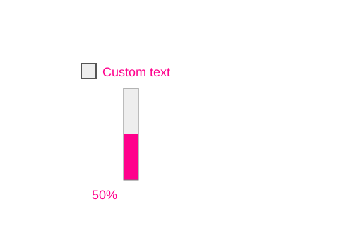

# CheckBox, VBar e Label: LED e barra de porcentagem

Um **widget** é uma peça da tela, como um botão, uma barra ou uma etiqueta. Neste painel, uma caixinha liga um LED e um potenciômetro controla uma barra. Um texto mostra a porcentagem da barra.

Este manual acompanha [checkbox_vbar_label.ino](checkbox_vbar_label.ino). A referência é o código local da **DisplayWX 1.0.33**, incluindo os `.h` e `.cpp` atuais dos widgets.



*Ilustração criada a partir das posições do sketch, mostrando uma leitura de exemplo de 50%. Não é uma captura do hardware.*

## Caminho da leitura

1. [Entenda o que cada peça faz](#1-o-que-este-exemplo-faz).
2. [Prepare a placa, os fios e as bibliotecas](#2-prepare-a-placa-e-as-bibliotecas).
3. [Copie o programa completo](#3-programa-completo).
4. [Aprenda os objetos, as fichas, os callbacks e o loop](#4-o-programa-explicado-por-partes).
5. [Consulte os métodos disponíveis para seu programa](#5-métodos-dos-widgets-para-usar-no-seu-programa).
6. [Faça uma experiência](#6-experiência-opcional).
7. [Confira o resultado](#7-como-conferir-se-funcionou).

## 1. O que este exemplo faz

A caixa controla o LED pelo callback. Separadamente, a cada dois segundos o `loop()` lê o potenciômetro, transforma a leitura de 0–4095 em 0–100 e entrega o valor à barra. A ligação `.subtitle = &labelvbar12` faz a barra atualizar a legenda.

| Peça no programa | Widget | Sua tarefa |
| --- | --- | --- |
| `checkbox1` | CheckBox | Liga/desliga o LED físico. |
| `labelvbar12` | Label | Mostra o número com o sufixo %. |
| `vertbar1` | VBar | Representa de 0 a 100 com uma barra vertical. |

**CheckBox:** Uma caixinha que pode ficar marcada ou desmarcada. Cada caixa decide seu próprio estado.

**Label:** Uma etiqueta de texto. Mostra palavras ou números com prefixo e sufixo, mas não recebe toques.

**VBar:** Uma barra que enche conforme um número. Pode ser vertical ou horizontal.

A caixa e a barra fazem tarefas independentes: desmarcar a caixa não interrompe a leitura do potenciômetro. A pasta não tinha captura de tela; a ilustração deste manual foi desenhada a partir das posições e dimensões do sketch, com uma leitura de exemplo de 50%.

Faça toques curtos, tirando o dedo antes do próximo. Alguns controles podem repetir a ação se você mantiver o dedo sobre eles. Arraste apenas os controles que foram feitos para deslizar.

## 2. Prepare a placa e as bibliotecas

Use uma placa **ESP32-S3**, display SPI **ST7796 de 320 × 480**, toque capacitivo **FT6336U**, cabo USB de dados e fios. A rotação 1 deixa uma área de desenho de **480 × 320 pixels**. Pixel é cada pontinho da imagem.

Na IDE Arduino, use a DisplayWX **1.0.33** deste projeto, **GFX Library for Arduino 1.6.5** e o pacote **esp32 by Espressif Systems 3.3.12**. O código da DisplayWX aceita as versões 3.3.11 e 3.3.12 desse pacote. Selecione o modelo ESP32-S3 da sua placa, sua porta USB e as opções de memória correspondentes ao hardware.

Abra o [user_setup.h da raiz da biblioteca](../../../user_setup.h), ao lado da pasta `src`. Deixe estas duas opções ativas:

```cpp
#define DISP_DEFAULT  // Display colorido.
#define TOUCH_FT6336  // Controlador FT6336U.
```

Desative as demais opções de display, toque e câmera colocando `//` no começo dessas linhas. Por exemplo: `// #define TOUCH_FT6236U`. O nome da opção correta é `TOUCH_FT6336`, sem U. Definir isso apenas no `.ino` não configura os outros arquivos da biblioteca.

### Ligações do display e do toque

| Sinal do módulo | GPIO do ESP32-S3 |
| --- | --- |
| MOSI / SDI do display | 11 |
| SCK / CLK | 12 |
| CS | 10 |
| DC / RS | 8 |
| RST do display | 9 |
| SDA do toque | 14 |
| SCL do toque | 13 |
| INT do toque | 18 |
| RST do toque | 17 |

`DISP_MISO = -1` significa que não há fio de leitura SPI. Una os GNDs. Alimente display e iluminação conforme o seu módulo; o sketch não controla um pino de backlight. Use sinais lógicos de 3,3 V. Faça a montagem com a alimentação desligada e ajuda de um adulto. Os números acima são GPIOs, não a posição física dos pinos no conector.

### Componentes deste exercício

Use um LED com resistor de 330 Ω no GPIO indicado e um potenciômetro de 10 kΩ. Ligue as pontas externas do potenciômetro a 3,3 V e GND; o terminal central vai ao GPIO de leitura. Não aplique 5 V na entrada analógica.

| Nome no programa | GPIO no `.ino` e neste manual | Ligação |
| --- | --- | --- |
| `pinLed` | 16 | LED físico com resistor |
| `pinPotenciometer` | 4 | Terminal central do potenciômetro |

Os GPIOs desta tabela já estão definidos no `.ino` e nos trechos de código deste manual. Os pinos do display, da iluminação e do toque foram preservados; GPIOs 17 e 18 ficam reservados ao toque nesta montagem. Confira que os GPIOs dos periféricos estão expostos e livres na sua placa.

### Como carregar

1. Copie a pasta inteira deste exemplo para uma pasta de trabalho. Mantenha o nome da pasta igual ao nome do `.ino`.
2. Abra o `.ino` na IDE Arduino e substitua seu conteúdo pelo **programa completo abaixo**. Mantenha os arquivos `.h` que acompanham o exemplo.
3. Configure o `user_setup.h`, a placa e a porta como indicado acima.
4. Confira os fios, clique em **Verificar** e depois em **Carregar**.
5. Abra o Monitor Serial em **115200 baud** e reinicie a placa para acompanhar o início. Se estiver usando a USB nativa do ESP32-S3, a opção **USB CDC On Boot**, quando disponível para sua placa, precisa estar habilitada para os diagnósticos nessa porta.

### Ajustes desta versão didática

O programa abaixo mantém os widgets e a proposta do `.ino`, com estes ajustes explícitos para a montagem descrita:

- A inicialização dos pinos ou da Serial2 vem antes de `createTask()`, para que os callbacks encontrem o hardware pronto. As saídas começam em LOW quando não havia estado inicial explícito.

As ligações são as mesmas no `.ino` e neste manual. Para reproduzir também os ajustes didáticos acima, copie o programa completo a seguir.

## 3. Programa completo

Copie o bloco inteiro, da primeira linha à última chave. Ele inclui a preparação da tela e todas as funções usadas. Os trechos isolados da próxima seção explicam este mesmo programa; não devem ser acrescentados novamente.

```cpp
#if CONFIG_IDF_TARGET_ESP32S2 || CONFIG_IDF_TARGET_ESP32S3
#define VSPI FSPI
#endif

#include <SPI.h>
#include <Arduino_GFX_Library.h>

#include <displaywx.h>

#define FORMAT_SPIFFS_IF_FAILED false
const int DISPLAY_W = 480;
const int DISPLAY_H = 320;
const int DISP_FREQUENCY = 27000000;
const int TOUCH_MAP_X0 = 0;
const int TOUCH_MAP_Y0 = 0;
const int TOUCH_MAP_X1 = 320;
const int TOUCH_MAP_Y1 = 480;
const bool TOUCH_SWAP_XY = false;
const bool TOUCH_INVERT_X = false;
const bool TOUCH_INVERT_Y = false;
const int DISP_MOSI = 11;
const int DISP_MISO = -1;
const int DISP_SCLK = 12;
const int DISP_CS = 10;
const int DISP_DC = 8;
const int DISP_RST = 9;
const int TOUCH_SCL = 13;
const int TOUCH_SDA = 14;
const int TOUCH_INT = 18;
const int TOUCH_RST = 17;
const uint8_t rotationScreen = 1;
const bool isIPS = true;

void screen0();
void loadWidgets();

void checkbox1_cb();

#if defined(CONFIG_IDF_TARGET_ESP32S3)
SPIClass spi_shared(FSPI);
#else
SPIClass spi_shared(HSPI);
#endif
Arduino_DataBus *bus = nullptr;
Arduino_GFX *tft = nullptr;
DisplayWX myDisplay;

// checkbox1: Liga/desliga o LED físico.
CheckBox checkbox1(115, 90, 0);
const uint8_t qtdCheckbox = 1;
CheckBox *arrayCheckbox[qtdCheckbox] = {&checkbox1};
// labelvbar12: Mostra o número com o sufixo %.
Label labelvbar12(130, 265, 0);
const uint8_t qtdLabel = 1;
Label *arrayLabel[qtdLabel] = {&labelvbar12};
// vertbar1: Representa de 0 a 100 com uma barra vertical.
VBar vertbar1(175, 125, 0);
const uint8_t qtdVBar = 1;
VBar *arrayVbar[qtdVBar] = {&vertbar1};

const int pinLed = 16;
const int pinPotenciometer = 4;

void setup(){

    Serial.begin(115200);

    spi_shared.begin(DISP_SCLK, DISP_MISO, DISP_MOSI);
    bus = new Arduino_HWSPI(DISP_DC, DISP_CS, DISP_SCLK, DISP_MOSI, DISP_MISO, &spi_shared);
    tft = new Arduino_ST7796(bus, DISP_RST, rotationScreen, isIPS, 320, 480);
    tft->begin(DISP_FREQUENCY);
    myDisplay.setDrawObject(tft);

    myDisplay.setTouchCorners(TOUCH_MAP_X0, TOUCH_MAP_X1, TOUCH_MAP_Y0, TOUCH_MAP_Y1);
    myDisplay.setInvertAxis(TOUCH_INVERT_X, TOUCH_INVERT_Y);
    myDisplay.setSwapAxis(TOUCH_SWAP_XY);
    // Inicia o controlador de toque escolhido em user_setup.h.
    myDisplay.startTouchFT6336(DISPLAY_W, DISPLAY_H, rotationScreen, TOUCH_SDA, TOUCH_SCL, TOUCH_INT, TOUCH_RST);

    loadWidgets();
    myDisplay.loadScreen(screen0);

    pinMode(pinLed, OUTPUT);
    pinMode(pinPotenciometer, INPUT);
    digitalWrite(pinLed, LOW);
    // Inicia o trabalho da biblioteca que atende o toque e atualiza a tela.
    myDisplay.createTask(false, 3);

}

void loop(){

    myDisplay.startCustomDraw();
    int value = analogRead(pinPotenciometer);
    int mappedValue = map(value, 0, 4095, 0, 100);
    vertbar1.setValue(mappedValue);
    myDisplay.finishCustomDraw();
    delay(2000);
}

void screen0(){

    myDisplay.setBackgroundColor(CFK_WHITE);

    myDisplay.printText("Custom text", 145, 92, TL_DATUM, CFK_COLOR30, CFK_WHITE, &RobotoRegular10pt7b);

    myDisplay.drawWidgetsOnScreen(0);
}

void loadWidgets(){

    CheckBoxConfig configCheckbox0 = {
            // Função chamada quando o usuário aciona este controle.
            .callback = checkbox1_cb,
            .weight = CheckBoxWeight::MEDIUM,
            .size = 21,
            .checkedColor = CFK_COLOR30,
            .uncheckedColor = CFK_GREY10
        };
    // Aplica a ficha ao objeto; faça isso durante a preparação.
    checkbox1.setup(configCheckbox0);
    myDisplay.setCheckbox(arrayCheckbox,qtdCheckbox);

    LabelConfig configLabel0 = {
            .text = "label_vbar 1",
            .prefix = "",
            .suffix = "%",
            .fontFamily = &RobotoRegular10pt7b,
            .datum = TL_DATUM,
            .fontColor = CFK_COLOR30,
            .backgroundColor = CFK_WHITE
        };
    // Aplica a ficha ao objeto; faça isso durante a preparação.
    labelvbar12.setup(configLabel0);
    myDisplay.setLabel(arrayLabel,qtdLabel);

    VerticalBarConfig configVBar0 = {
            .subtitle = &labelvbar12,
            .minValue = 0,
            .maxValue = 100,
            .round = 0,
            .orientation = Orientation::VERTICAL,
            .width = 21,
            .height = 130,
            .filledColor = CFK_COLOR30
        };
    // Aplica a ficha ao objeto; faça isso durante a preparação.
    vertbar1.setup(configVBar0);
    myDisplay.setVBar(arrayVbar,qtdVBar);

}

void checkbox1_cb(){

    bool myValue = checkbox1.getStatus();
    Serial.print("New value for checkbox is: ");Serial.println(myValue);

    digitalWrite(pinLed, myValue ? HIGH : LOW);
}
```

## 4. O programa explicado por partes

### 4.1 Objetos, variáveis e listas

Um **objeto** é uma peça que seu programa pode chamar pelo nome. Uma **variável** é uma caixinha que guarda um valor. `bool` guarda `true` ou `false`; `int` guarda um inteiro; `float` e `double` guardam números com parte decimal. `const` indica algo que não será trocado durante a execução.


```cpp
// checkbox1: Liga/desliga o LED físico.
CheckBox checkbox1(115, 90, 0);
// Quantidade de objetos desta lista.
const uint8_t qtdCheckbox = 1;
// Lista dos endereços dos widgets que a DisplayWX vai cuidar.
CheckBox *arrayCheckbox[qtdCheckbox] = {&checkbox1};
// labelvbar12: Mostra o número com o sufixo %.
Label labelvbar12(130, 265, 0);
// Quantidade de objetos desta lista.
const uint8_t qtdLabel = 1;
// Lista dos endereços dos widgets que a DisplayWX vai cuidar.
Label *arrayLabel[qtdLabel] = {&labelvbar12};
// vertbar1: Representa de 0 a 100 com uma barra vertical.
VBar vertbar1(175, 125, 0);
// Quantidade de objetos desta lista.
const uint8_t qtdVBar = 1;
// Lista dos endereços dos widgets que a DisplayWX vai cuidar.
VBar *arrayVbar[qtdVBar] = {&vertbar1};

const int pinLed = 16;
const int pinPotenciometer = 4;
```

| Objeto | Como interpretar a criação |
| --- | --- |
| `checkbox1` (CheckBox) | X = 115, Y = 90, tela = 0. Referência da posição: canto superior esquerdo. |
| `labelvbar12` (Label) | X = 130, Y = 265, tela = 0. Referência da posição: ponto de alinhamento escolhido por datum. |
| `vertbar1` (VBar) | X = 175, Y = 125, tela = 0. Referência da posição: canto superior esquerdo. |

X cresce para a direita e Y cresce para baixo, a partir do canto superior esquerdo da tela. O número da tela decide em qual página a peça aparece. A primeira tela é 0.

O `&` antes do nome entrega o **endereço** do objeto, como informar onde fica uma casa. O `*` na declaração da lista indica que ela guarda endereços. `qtd...` precisa corresponder à quantidade de itens: ao acrescentar um widget, acrescente seu endereço e ajuste a quantidade. Mantenha os objetos e essas listas globais, fora das funções, para continuarem existindo enquanto a interface trabalha.

### 4.2 A ficha de configuração (`struct`)

A `struct` funciona como uma ficha: cada campo escolhe uma característica. O ponto em `.width` significa “preencha o campo largura”. Depois, `objeto.setup(ficha)` entrega a ficha ao widget. Configure cada peça uma vez em `loadWidgets()`, depois de preparar o display e antes de iniciar a tarefa.

#### `configCheckbox0`: ficha de `checkbox1`

```cpp
CheckBoxConfig configCheckbox0 = {
            // Função chamada quando o usuário aciona este controle.
            .callback = checkbox1_cb,
            .weight = CheckBoxWeight::MEDIUM,
            .size = 21,
            .checkedColor = CFK_COLOR30,
            .uncheckedColor = CFK_GREY10
        };
// Aplica a ficha ao objeto; faça isso durante a preparação.
checkbox1.setup(configCheckbox0);
```

| Campo | Valor nesta ficha | Para que serve |
| --- | --- | --- |
| `callback` | `checkbox1_cb` | Nome da função chamada quando há uma ação. Escreva o nome sem `()`. `nullptr` significa sem callback. |
| `weight` | `CheckBoxWeight::MEDIUM` | Espessura do símbolo de marcação: `CheckBoxWeight::LIGHT`, `MEDIUM` ou `HEAVY`. |
| `size` | `21` | Lado do quadrado em pixels. No CheckBox, use de 10 a 100. |
| `checkedColor` | `CFK_COLOR30` | Cor da caixa marcada. |
| `uncheckedColor` | `CFK_GREY10` | Cor da caixa desmarcada. O valor `0` escolhe a cor automática do tema. |

Liga/desliga o LED físico.

#### `configLabel0`: ficha de `labelvbar12`

```cpp
LabelConfig configLabel0 = {
            .text = "label_vbar 1",
            .prefix = "",
            .suffix = "%",
            .fontFamily = &RobotoRegular10pt7b,
            .datum = TL_DATUM,
            .fontColor = CFK_COLOR30,
            .backgroundColor = CFK_WHITE
        };
// Aplica a ficha ao objeto; faça isso durante a preparação.
labelvbar12.setup(configLabel0);
```

| Campo | Valor nesta ficha | Para que serve |
| --- | --- | --- |
| `text` | `"label_vbar 1"` | Texto inicial. Escreva entre aspas, por exemplo `"Olá"`. |
| `prefix` | `""` | Texto colocado antes do valor, como `"Valor: "`. `""` deixa vazio. |
| `suffix` | `"%"` | Texto colocado depois do valor, como `" V"`. `""` deixa vazio. |
| `fontFamily` | `&RobotoRegular10pt7b` | Fonte das letras, por exemplo `&RobotoRegular10pt7b`. O `&` aponta para uma fonte que já existe. |
| `datum` | `TL_DATUM` | Alinhamento do texto em relação a `(x,y)`: `TL_DATUM` usa o canto superior esquerdo; `TC_DATUM`, o centro do topo. |
| `fontColor` | `CFK_COLOR30` | Cor das letras, usando os nomes `CFK_...`. |
| `backgroundColor` | `CFK_WHITE` | Cor do fundo, por exemplo `CFK_WHITE`. Use a cor da área onde o widget aparece. |

Mostra o número com o sufixo %.

#### `configVBar0`: ficha de `vertbar1`

```cpp
VerticalBarConfig configVBar0 = {
            // Label que vai acompanhar o valor deste indicador.
            .subtitle = &labelvbar12,
            .minValue = 0,
            .maxValue = 100,
            .round = 0,
            .orientation = Orientation::VERTICAL,
            .width = 21,
            .height = 130,
            .filledColor = CFK_COLOR30
        };
// Aplica a ficha ao objeto; faça isso durante a preparação.
vertbar1.setup(configVBar0);
```

| Campo | Valor nesta ficha | Para que serve |
| --- | --- | --- |
| `subtitle` | `&labelvbar12` | Endereço de um Label para mostrar o valor, como `&meuTexto`; use `nullptr` se não quiser legenda. |
| `minValue` | `0` | Menor valor da escala. Escolha um número menor que `maxValue`. |
| `maxValue` | `100` | Maior valor da escala. Escolha um número maior que `minValue`. |
| `round` | `0` | Arredondamento dos cantos em pixels. `0` deixa os cantos retos. |
| `orientation` | `Orientation::VERTICAL` | `Orientation::VERTICAL` preenche na vertical; `Orientation::HORIZONTAL`, na horizontal. |
| `width` | `21` | Largura em pixels, os pontinhos da imagem. Mantenha o desenho dentro da tela. |
| `height` | `130` | Altura em pixels. Reserve espaço suficiente para o desenho e as letras. |
| `filledColor` | `CFK_COLOR30` | Cor da parte preenchida. |

Representa de 0 a 100 com uma barra vertical.

Após configurar, registre cada lista. É assim que a DisplayWX sabe quais peças precisa acompanhar:

```cpp
// Registra a lista e sua quantidade para a biblioteca encontrar estes widgets.
myDisplay.setCheckbox(arrayCheckbox,qtdCheckbox);
// Registra a lista e sua quantidade para a biblioteca encontrar estes widgets.
myDisplay.setLabel(arrayLabel,qtdLabel);
// Registra a lista e sua quantidade para a biblioteca encontrar estes widgets.
myDisplay.setVBar(arrayVbar,qtdVBar);
```

`nullptr` significa “não liguei nada aqui”. Por exemplo, sem callback não há uma ação do seu programa para executar; sem `subtitle`, não há Label associado. Uma cor `CFK_...` é um valor de cor pronto da biblioteca. Uma fonte como `&RobotoRegular10pt7b` escolhe o desenho das letras. Para começar, conserve as fontes, os tamanhos e a ordem dos campos do exemplo.

### 4.3 O início: `setup()`

O Arduino executa `setup()` uma vez ao ligar. Ele prepara a comunicação, o display, o toque, os widgets e os componentes extras. A tarefa criada no fim continua cuidando da interface enquanto o seu `loop()` trabalha.

```cpp
void setup(){

    // Abre as mensagens de diagnóstico no computador.
    Serial.begin(115200);

    // Inicia os fios de comunicação SPI do display.
    spi_shared.begin(DISP_SCLK, DISP_MISO, DISP_MOSI);
    bus = new Arduino_HWSPI(DISP_DC, DISP_CS, DISP_SCLK, DISP_MOSI, DISP_MISO, &spi_shared);
    tft = new Arduino_ST7796(bus, DISP_RST, rotationScreen, isIPS, 320, 480);
    tft->begin(DISP_FREQUENCY);
    // Entrega à DisplayWX o objeto que desenha no display.
    myDisplay.setDrawObject(tft);

    // Informa a faixa de coordenadas recebida do toque.
    myDisplay.setTouchCorners(TOUCH_MAP_X0, TOUCH_MAP_X1, TOUCH_MAP_Y0, TOUCH_MAP_Y1);
    myDisplay.setInvertAxis(TOUCH_INVERT_X, TOUCH_INVERT_Y);
    myDisplay.setSwapAxis(TOUCH_SWAP_XY);
    // Inicia o controlador de toque escolhido em user_setup.h.
    myDisplay.startTouchFT6336(DISPLAY_W, DISPLAY_H, rotationScreen, TOUCH_SDA, TOUCH_SCL, TOUCH_INT, TOUCH_RST);

    // Preenche as fichas, configura e registra os widgets.
    loadWidgets();
    // Pede a troca de tela; passe o nome da função, sem ().
    myDisplay.loadScreen(screen0);

    // OUTPUT comanda uma saída; INPUT lê um sinal externo.
    pinMode(pinLed, OUTPUT);
    // OUTPUT comanda uma saída; INPUT lê um sinal externo.
    pinMode(pinPotenciometer, INPUT);
    // Comanda uma saída física: HIGH liga o sinal; LOW o desliga.
    digitalWrite(pinLed, LOW);
    // Inicia o trabalho da biblioteca que atende o toque e atualiza a tela.
    myDisplay.createTask(false, 3);

}
```

As declarações como `void screen0();` no começo do programa são **avisos de que essas funções existem**. Elas permitem usar seus nomes nas fichas antes de chegar à parte que contém o corpo da função. Não apague esses avisos ao copiar trechos.

### 4.4 Callbacks: o que acontece após a ação

Um **callback** é a tarefa que você escolhe para acontecer quando um controle é acionado ou uma edição é confirmada. Na ficha, escreva o nome **sem `()`**. A biblioteca o chama no momento adequado. Evite esperas longas dentro dele: guarde um pedido em uma variável e faça a parte demorada no `loop()`, quando necessário.

#### `checkbox1_cb()`

Liga/desliga o LED físico. Lê o estado escolhido; `true` significa ligado/marcado e `false`, desligado/desmarcado. Escreve o nível da saída física. `HIGH` é nível alto e `LOW`, baixo. A mensagem na Serial ajuda a conferir que a ação aconteceu.

```cpp
void checkbox1_cb(){

    // Lê o estado ligado/marcado que o widget guardou.
    bool myValue = checkbox1.getStatus();
    Serial.print("New value for checkbox is: ");Serial.println(myValue);

    // Comanda uma saída física: HIGH liga o sinal; LOW o desliga.
    digitalWrite(pinLed, myValue ? HIGH : LOW);
}
```

Quando aparecer `condicao ? HIGH : LOW`, leia assim: “se a condição for verdadeira, use HIGH; se for falsa, use LOW”. As mensagens da `Serial` servem para observar o programa; os widgets não precisam delas para desenhar.

### 4.5 O trabalho repetido: `loop()`

A caixa controla o LED pelo callback. Separadamente, a cada dois segundos o `loop()` lê o potenciômetro, transforma a leitura de 0–4095 em 0–100 e entrega o valor à barra. A ligação `.subtitle = &labelvbar12` faz a barra atualizar a legenda.

```cpp
void loop(){

    // Reserva o desenho para esta sequência do seu programa.
    myDisplay.startCustomDraw();
    // Lê a entrada analógica: nesta configuração, de 0 a 4095.
    int value = analogRead(pinPotenciometer);
    // Transforma a leitura de uma escala em outra, usando números inteiros.
    int mappedValue = map(value, 0, 4095, 0, 100);
    vertbar1.setValue(mappedValue);
    // Devolve o desenho à tarefa da interface.
    myDisplay.finishCustomDraw();
    // Pausa em milissegundos: 1000 ms equivalem a um segundo.
    delay(2000);
}
```

Mantenha `startCustomDraw()` e `finishCustomDraw()` em pares, como abrir e fechar um caderno de desenho. Deixe pausas, esperas de rede e tarefas demoradas fora desse par.

`analogRead()` fornece uma contagem. `map()` troca a escala por uma conta: por exemplo, 0–4095 pode virar 0–100. Não transforma o widget em um sensor; a leitura continua vindo do pino físico.

### 4.6 As telas

Cada função `screen...` pinta o fundo, coloca os textos fixos e manda desenhar os widgets daquela página. Troque de página com `myDisplay.loadScreen(screen0)` ou com a função da outra tela; passe o nome sem parênteses.

```cpp
void screen0(){

    // Pinta o fundo da tela com a cor escolhida.
    myDisplay.setBackgroundColor(CFK_WHITE);

    // Escreve um texto fixo; esse texto não é um widget interativo.
    myDisplay.printText("Custom text", 145, 92, TL_DATUM, CFK_COLOR30, CFK_WHITE, &RobotoRegular10pt7b);

    // Desenha os widgets registrados para esse número de tela.
    myDisplay.drawWidgetsOnScreen(0);
}
```

### 4.7 Funções extras

Este exemplo não precisa de outras funções próprias além das que acabamos de estudar. As funções como `digitalWrite`, `delay` e `analogRead` pertencem ao ambiente Arduino.

## 5. Métodos dos widgets para usar no seu programa

Um **método** é uma ação que pertence a um objeto. Em `objeto.metodo(valor)`, primeiro vem o nome da peça, depois o ponto, a ação e suas informações entre parênteses. As tabelas usam objetos reais deste exemplo. Faça essas chamadas **depois da configuração**; a linha `setup(...)` pertence à preparação. Os nomes das fichas só existem dentro de `loadWidgets()`.

### CheckBox: métodos para seu programa

Uma caixinha que pode ficar marcada ou desmarcada. Cada caixa decide seu próprio estado.

| Método | Como usar | Resultado e cuidado |
| --- | --- | --- |
| `setup(config)` | `checkbox1.setup(configCheckbox0);` | Aplica a ficha de configuração após preparar o display. Não retorna valor. Configure no `loadWidgets()` antes de iniciar a tarefa. |
| `getStatus()` | `bool marcado = checkbox1.getStatus();` | Retorna `true` se marcada ou `false` se desmarcada. |
| `setStatus(valor, triggerCallback = true)` | `checkbox1.setStatus(true, false);` | Marca com `true` ou desmarca com `false`. Atualiza a aparência. O segundo argumento `false` evita o callback; omitido, vale `true`. Pode chamar o callback mesmo repetindo o estado. |
| `setSize(tamanho)` | `checkbox1.setSize(30);` | Altera o lado do quadrado. Aceita 10 a 100; fora da faixa, ignora. Veja a observação sobre a marca abaixo. |
| `getSize()` | `uint16_t lado = checkbox1.getSize();` | Retorna o lado do quadrado em pixels. |
| `setColors(corMarcada, corDesmarcada = 0)` | `checkbox1.setColors(CFK_GREEN, CFK_GREY10);` | Troca as cores e pede atualização visual. `0` na segunda cor usa o tema. |
| `setEnabled(valor)` | `checkbox1.setEnabled(false);` | Método herdado: bloqueia o toque com false e permite com true. Não altera o valor nem executa callback. |
| `isEnabled()` | `bool ativo = checkbox1.isEnabled();` | Consulta a habilitação para toque. |
| `lock()` | `checkbox1.lock();` | Bloqueia a interação por toque enquanto você não chamar unlock(). Não é uma trava para organizar tarefas do processador. |
| `unlock()` | `checkbox1.unlock();` | Remove esse bloqueio de toque; não desfaz setEnabled(false). |
| `isLocked()` | `bool bloqueado = checkbox1.isLocked();` | Consulta se lock() está ativo. |
| `show()` | `checkbox1.show();` | Torna visível na sua tela e pede atualização. Para TouchArea, volta a permitir toque; ela continua invisível. |
| `hide()` | `checkbox1.hide();` | Impede futuras atualizações visuais e, quando há toque, sua interação. Não apaga os pixels já desenhados: repinte a tela como explicado abaixo. |

Nesta implementação, `setSize()` muda o quadrado, mas não recalcula os pontos do símbolo de marcação. Para mudar o tamanho mantendo a marca alinhada, altere `.size` na configuração e carregue o programa novamente. O estado inicial é desmarcado.

### Label: métodos para seu programa

Uma etiqueta de texto. Mostra palavras ou números com prefixo e sufixo, mas não recebe toques.

| Método | Como usar | Resultado e cuidado |
| --- | --- | --- |
| `setup(config)` | `labelvbar12.setup(configLabel0);` | Aplica a ficha de configuração após preparar o display. Não retorna valor. Configure no `loadWidgets()` antes de iniciar a tarefa. |
| `setText(texto)` | `labelvbar12.setText("Pronto");` | Mostra texto de `const char*` ou `String`, montando prefixo + texto + sufixo. Não retorna valor. |
| `setPrefix(texto)` | `labelvbar12.setPrefix("Valor: ");` | Guarda o texto que vem antes. Chame depois `setText`, `setTextInt` ou `setTextFloat` para reconstruir o conteúdo exibido. |
| `setSuffix(texto)` | `labelvbar12.setSuffix(" V");` | Guarda o texto que vem depois. Atualize o conteúdo em seguida para mostrar a nova combinação. |
| `setTextInt(valor)` | `labelvbar12.setTextInt(42);` | Mostra um número inteiro com prefixo e sufixo. |
| `setTextFloat(valor, casas = 2)` | `labelvbar12.setTextFloat(3.25, 2);` | Mostra número decimal. O segundo argumento escolhe 0 a 5 casas; omitido, usa 2. |
| `setDecimalPlaces(casas)` | `labelvbar12.setDecimalPlaces(1);` | Guarda a precisão, limitada a 0–5. Não reformata sozinho o texto; `setTextFloat` define novamente a precisão com seu próprio argumento. |
| `setFontSize(escala)` | `labelvbar12.setFontSize(2);` | Define o fator de tamanho das letras; use 1 para normal. Não pede atualização sozinho: atualize o texto ou recarregue a tela depois. |
| `show()` | `labelvbar12.show();` | Torna visível na sua tela e pede atualização. Para TouchArea, volta a permitir toque; ela continua invisível. |
| `hide()` | `labelvbar12.hide();` | Impede futuras atualizações visuais e, quando há toque, sua interação. Não apaga os pixels já desenhados: repinte a tela como explicado abaixo. |

Para limpar prefixo ou sufixo, use `""`. Altere os dois antes de mandar o novo conteúdo. Um Label não mede nada: é o programa que fornece o valor.

### VBar: métodos para seu programa

Uma barra que enche conforme um número. Pode ser vertical ou horizontal.

| Método | Como usar | Resultado e cuidado |
| --- | --- | --- |
| `setup(config)` | `vertbar1.setup(configVBar0);` | Aplica a ficha de configuração após preparar o display. Não retorna valor. Configure no `loadWidgets()` antes de iniciar a tarefa. |
| `setValue(valor)` | `vertbar1.setValue(50);` | Atualiza o indicador com um valor limitado à escala, sem callback. Aceita número inteiro. |
| `setScale(minimo, maximo)` | `vertbar1.setScale(0, 100);` | Troca os dois limites e pede atualização. Use limites diferentes. |
| `setMinValue(minimo)` | `vertbar1.setMinValue(0);` | Troca o limite inferior e pede atualização da escala. |
| `setMaxValue(maximo)` | `vertbar1.setMaxValue(100);` | Troca o limite superior e pede atualização da escala. |
| `getMinValue()` | `int minimo = vertbar1.getMinValue();` | Retorna o limite inferior, não a leitura atual. |
| `getMaxValue()` | `int maximo = vertbar1.getMaxValue();` | Retorna o limite superior, não a leitura atual. |
| `show()` | `vertbar1.show();` | Torna visível na sua tela e pede atualização. Para TouchArea, volta a permitir toque; ela continua invisível. |
| `hide()` | `vertbar1.hide();` | Impede futuras atualizações visuais e, quando há toque, sua interação. Não apaga os pixels já desenhados: repinte a tela como explicado abaixo. |

Não existe `getValue()` público: guarde o valor em uma variável se precisar relê-lo. Mantenha mínimo menor que máximo. O Label de `subtitle` é atualizado com o valor. Configure o Label antes do indicador e registre ambos.

### Como escolher se o callback deve acontecer

Nos métodos que mostram `triggerCallback = true`, omitir o último argumento permite solicitar o callback. Passar `false` evita o callback **daquela chamada**; não apaga callbacks já pendentes. A biblioteca executa os callbacks agendados por sua tarefa, então não conte com uma variável do callback já atualizada imediatamente na linha seguinte.

Se o callback comanda um pino ou copia um valor para uma variável, uma mudança silenciosa não fará essa outra tarefa. Escolha uma chamada com callback ou atualize o pino/variável explicitamente. A regra para repetir o mesmo valor está na tabela de cada classe; não é igual em todos os widgets. Não coloque setters com callback dentro do próprio callback sem necessidade, pois isso pode criar chamadas repetidas.

### Esconder e mostrar na tela

`hide()` não funciona como uma borracha para os pixels que já foram pintados. Para remover o desenho da página atual, esconda a peça e peça que a página seja montada novamente. Para fazê-la voltar, use `show()`. O estado/valor continua guardado.

```cpp
// Execute uma vez, na tela 0 deste exemplo.
checkbox1.hide();
myDisplay.loadScreen(screen0);

// Em outra ação, quando quiser mostrar de novo:
checkbox1.show();
myDisplay.loadScreen(screen0);
```

Os dois blocos são ações separadas: se executar todos de uma vez, o widget voltará logo em seguida. Textos fixos feitos com `printText()` continuam aparecendo, pois pertencem à função de tela. Um widget da tela 1 só aparece quando você volta à tela 1.

O desenho periódico e a detecção de toque ficam a cargo da DisplayWX. Seu `.ino` configura, registra, consulta e altera as peças pelas chamadas acima; não precisa chamar rotinas internas de desenho ou de detecção.

## 6. Experiência opcional

Atualiza a barra e sua legenda para 75%. Para observar um valor fixo, substitua temporariamente a atualização feita pelo potenciômetro; do contrário, a próxima leitura o substituirá.

```cpp
vertbar1.setValue(75);
```

Mude uma coisa de cada vez. O programa completo da seção 3 continua sendo o ponto de partida para voltar ao comportamento original do exercício.

## 7. Como conferir se funcionou

1. Gire o potenciômetro e espere até dois segundos: a barra e a porcentagem devem mudar juntas.
2. Toque na caixa e confira o LED físico.
3. A barra continua funcionando mesmo com a caixa desmarcada.

| Se acontecer... | Confira... |
| --- | --- |
| Erro ao compilar sobre tela, toque ou tipo desconhecido | Placa selecionada, versões instaladas e opções ativas no `user_setup.h` da raiz da biblioteca. Copie o programa inteiro. |
| Tela apagada ou sem desenho | Alimentação, GND, iluminação do módulo e fios/conectores do display. |
| Desenho correto, mas o toque não responde ou está deslocado | Controlador selecionado, SDA/SCL e configuração de rotação, limites e inversão dos eixos. Use os valores completos do exemplo para essa montagem. |
| Tela funciona, mas o componente externo não acompanha | Use os GPIOs da tabela deste manual, GND comum e a polaridade correta. Uma mudança com callback desativado pode atualizar só o widget. |
| Valor parece demorar para mudar | Confira o `delay()` no loop. Vários exemplos só enviam uma atualização a cada dois segundos. |
| Método com argumentos diferentes dá erro | Consulte a tabela da classe exata. Nem todos os `onClick` ou `setValue` recebem os mesmos argumentos. |

Este manual foi conferido com os arquivos locais da biblioteca. A validação descrita aqui é de código e documentação; a compilação para a sua placa e o ensaio físico devem ser feitos com a montagem indicada.

### Arquivos usados como referência

- [checkbox_vbar_label.ino](checkbox_vbar_label.ino).
- CheckBox: [declarações `.h`](../../../src/widgets/checkbox/wcheckbox.h) e [implementação `.cpp`](../../../src/widgets/checkbox/wcheckbox.cpp).
- Label: [declarações `.h`](../../../src/widgets/label/wlabel.h) e [implementação `.cpp`](../../../src/widgets/label/wlabel.cpp).
- VBar: [declarações `.h`](../../../src/widgets/verticalbar/wverticalbar.h) e [implementação `.cpp`](../../../src/widgets/verticalbar/wverticalbar.cpp).
- [DisplayWX](../../../src/displaywx.h) e [implementação da integração](../../../src/displaywx.cpp).
- [WidgetBase](../../../src/widgets/widgetbase.h) e [implementação](../../../src/widgets/widgetbase.cpp), para habilitação e bloqueio herdados.
