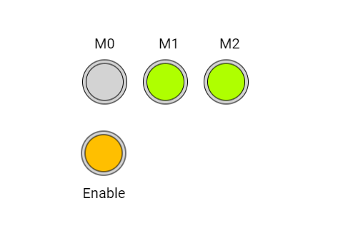

# CircleButton: botões redondos para um motor de passo

Um **widget** é uma peça da tela, como um botão, uma barra ou uma etiqueta. Quatro botões redondos escolhem três sinais de modo e ligam ou desligam a geração de passos. Um passo é um pequeno movimento do motor.

Este manual acompanha [circlebutton_stepper.ino](circlebutton_stepper.ino). A referência é o código local da **DisplayWX 1.0.33**, incluindo os `.h` e `.cpp` atuais dos widgets.



*Imagem que acompanha o exemplo. Ela ilustra a disposição das peças; valores, cores ativas e textos podem mudar durante a execução. Confira os estados iniciais descritos abaixo.*

## Caminho da leitura

1. [Entenda o que cada peça faz](#1-o-que-este-exemplo-faz).
2. [Prepare a placa, os fios e as bibliotecas](#2-prepare-a-placa-e-as-bibliotecas).
3. [Copie o programa completo](#3-programa-completo).
4. [Aprenda os objetos, as fichas, os callbacks e o loop](#4-o-programa-explicado-por-partes).
5. [Consulte os métodos disponíveis para seu programa](#5-métodos-dos-widgets-para-usar-no-seu-programa).
6. [Faça uma experiência](#6-experiência-opcional).
7. [Confira o resultado](#7-como-conferir-se-funcionou).

## 1. O que este exemplo faz

M0, M1 e M2 controlam os sinais de seleção de micropasso. O botão Enable decide se o motor recebe passos. Uma tarefa separada gera os pulsos STEP; o `loop()` fica vazio. A versão deste manual começa com o motor desabilitado e só gera pulsos quando Enable está ligado.

| Peça no programa | Widget | Sua tarefa |
| --- | --- | --- |
| `btnm0` | CircleButton | Escolhe o nível do sinal M0. |
| `btnm1` | CircleButton | Escolhe o nível do sinal M1. |
| `btnm2` | CircleButton | Escolhe o nível do sinal M2. |
| `btnenable` | CircleButton | Habilita o driver e permite os pulsos STEP. |

**CircleButton:** Um botão redondo que guarda ligado/desligado e alterna a cada toque aceito.

No DRV8825, nENBL é ativo em LOW: LOW habilita e HIGH desabilita. A versão do manual usa essa polaridade. M0/M1/M2 determinam o tamanho dos passos conforme a tabela do driver; não escolhem uma quantidade de passos. Consulte a [documentação do DRV8825 da Texas Instruments](https://www.ti.com/lit/ds/symlink/drv8825.pdf). Este exemplo não mede posição nem fornece aceleração ou controle preciso de velocidade.

Faça toques curtos, tirando o dedo antes do próximo. Alguns controles podem repetir a ação se você mantiver o dedo sobre eles. Arraste apenas os controles que foram feitos para deslizar.

## 2. Prepare a placa e as bibliotecas

Use uma placa **ESP32-S3**, display SPI **ST7796 de 320 × 480**, toque capacitivo **FT6336U**, cabo USB de dados e fios. A rotação 1 deixa uma área de desenho de **480 × 320 pixels**. Pixel é cada pontinho da imagem.

Na IDE Arduino, use a DisplayWX **1.0.33** deste projeto, **GFX Library for Arduino 1.6.5** e o pacote **esp32 by Espressif Systems 3.3.12**. O código da DisplayWX aceita as versões 3.3.11 e 3.3.12 desse pacote. Selecione o modelo ESP32-S3 da sua placa, sua porta USB e as opções de memória correspondentes ao hardware.

Abra o [user_setup.h da raiz da biblioteca](../../../user_setup.h), ao lado da pasta `src`. Deixe estas duas opções ativas:

```cpp
#define DISP_DEFAULT  // Display colorido.
#define TOUCH_FT6336  // Controlador FT6336U.
```

Desative as demais opções de display, toque e câmera colocando `//` no começo dessas linhas. Por exemplo: `// #define TOUCH_FT6236U`. O nome da opção correta é `TOUCH_FT6336`, sem U. Definir isso apenas no `.ino` não configura os outros arquivos da biblioteca.

### Ligações do display e do toque

| Sinal do módulo | GPIO do ESP32-S3 |
| --- | --- |
| MOSI / SDI do display | 11 |
| SCK / CLK | 12 |
| CS | 10 |
| DC / RS | 8 |
| RST do display | 9 |
| SDA do toque | 14 |
| SCL do toque | 13 |
| INT do toque | 18 |
| RST do toque | 17 |

`DISP_MISO = -1` significa que não há fio de leitura SPI. Una os GNDs. Alimente display e iluminação conforme o seu módulo; o sketch não controla um pino de backlight. Use sinais lógicos de 3,3 V. Faça a montagem com a alimentação desligada e ajuda de um adulto. Os números acima são GPIOs, não a posição física dos pinos no conector.

### Componentes deste exercício

Use um módulo driver DRV8825, um motor bipolar compatível e a alimentação apropriada ao conjunto. Ligue os GPIOs da tabela a MODE0/1/2, nENBL, STEP e DIR. Ligue GND do driver e da placa em comum; as duas bobinas do motor vão às duas pontes de saída do módulo. Mantenha nRESET e nSLEEP em nível alto para funcionamento. Ajuste o limite de corrente e a alimentação conforme o módulo e o motor, com ajuda de um adulto. O motor é alimentado pelo driver, nunca pelos GPIOs. Para estudar só os widgets, substitua as entradas do driver por LEDs com resistores e observe os sinais de controle.

| Nome no programa | GPIO no `.ino` e neste manual | Ligação |
| --- | --- | --- |
| `pinM0` | 16 | MODE0 / M0 do driver |
| `pinM1` | 4 | MODE1 / M1 do driver |
| `pinM2` | 5 | MODE2 / M2 do driver |
| `pinEnable` | 6 | nENBL ativo em LOW |
| `pinStep` | 15 | STEP: pulsos de passo |
| `pinDir` | 21 | DIR: direção fixa em LOW neste exemplo |

Os GPIOs desta tabela já estão definidos no `.ino` e nos trechos de código deste manual. Os pinos do display, da iluminação e do toque foram preservados; GPIOs 17 e 18 ficam reservados ao toque nesta montagem. Confira que os GPIOs dos periféricos estão expostos e livres na sua placa.

### Como carregar

1. Copie a pasta inteira deste exemplo para uma pasta de trabalho. Mantenha o nome da pasta igual ao nome do `.ino`.
2. Abra o `.ino` na IDE Arduino e substitua seu conteúdo pelo **programa completo abaixo**. Mantenha os arquivos `.h` que acompanham o exemplo.
3. Configure o `user_setup.h`, a placa e a porta como indicado acima.
4. Confira os fios, clique em **Verificar** e depois em **Carregar**.
5. Abra o Monitor Serial em **115200 baud** e reinicie a placa para acompanhar o início. Se estiver usando a USB nativa do ESP32-S3, a opção **USB CDC On Boot**, quando disponível para sua placa, precisa estar habilitada para os diagnósticos nessa porta.

### Ajustes desta versão didática

O programa abaixo mantém os widgets e a proposta do `.ino`, com estes ajustes explícitos para a montagem descrita:

- A tarefa usa `stepperEnabled` para começar parada, cede tempo com `delay(1)` e usa uma pausa de 2000 µs entre passos. O callback de Enable usa a polaridade ativa em LOW do DRV8825. A tarefa permanece ativa, sem `vTaskSuspend`/`vTaskResume`.

As ligações são as mesmas no `.ino` e neste manual. Para reproduzir também os ajustes didáticos acima, copie o programa completo a seguir.

## 3. Programa completo

Copie o bloco inteiro, da primeira linha à última chave. Ele inclui a preparação da tela e todas as funções usadas. Os trechos isolados da próxima seção explicam este mesmo programa; não devem ser acrescentados novamente.

```cpp
#if CONFIG_IDF_TARGET_ESP32S2 || CONFIG_IDF_TARGET_ESP32S3
#define VSPI FSPI
#endif

#include <SPI.h>
#include <atomic>
#include <Arduino_GFX_Library.h>

#include <displaywx.h>

#define FORMAT_SPIFFS_IF_FAILED false
const int DISPLAY_W = 480;
const int DISPLAY_H = 320;
const int DISP_FREQUENCY = 27000000;
const int TOUCH_MAP_X0 = 0;
const int TOUCH_MAP_Y0 = 0;
const int TOUCH_MAP_X1 = 320;
const int TOUCH_MAP_Y1 = 480;
const bool TOUCH_SWAP_XY = true;
const bool TOUCH_INVERT_X = false;
const bool TOUCH_INVERT_Y = true;
const int DISP_MOSI = 11;
const int DISP_MISO = -1;
const int DISP_SCLK = 12;
const int DISP_CS = 10;
const int DISP_DC = 8;
const int DISP_RST = 9;
const int TOUCH_SCL = 13;
const int TOUCH_SDA = 14;
const int TOUCH_INT = 18;
const int TOUCH_RST = 17;
const uint8_t rotationScreen = 1;
const bool isIPS = true;

void screen0();
void loadWidgets();

void btnm0_cb();
void btnm1_cb();
void btnm2_cb();
void btnenable_cb();

#if defined(CONFIG_IDF_TARGET_ESP32S3)
SPIClass spi_shared(FSPI);
#else
SPIClass spi_shared(HSPI);
#endif
Arduino_DataBus *bus = nullptr;
Arduino_GFX *tft = nullptr;
DisplayWX myDisplay;

// btnm0: Escolhe o nível do sinal M0.
CircleButton btnm0(146, 115, 0);
// btnm1: Escolhe o nível do sinal M1.
CircleButton btnm1(231, 115, 0);
// btnm2: Escolhe o nível do sinal M2.
CircleButton btnm2(316, 115, 0);
// btnenable: Habilita o driver e permite os pulsos STEP.
CircleButton btnenable(145, 215, 0);
const uint8_t qtdCircleBtn = 4;
CircleButton *arrayCirclebtn[qtdCircleBtn] = {&btnm0, &btnm1, &btnm2, &btnenable};

const int pinM0 = 16;
const int pinM1 = 4;
const int pinM2 = 5;
const int pinEnable = 6;
const int pinStep = 15;
const int pinDir = 21;
const int delayStepUs = 2000;
std::atomic<bool> stepperEnabled{false};

TaskHandle_t taskStepperHandle;

void taskStepper(void *parameter){
    (void)parameter;
    while(true){
        if(stepperEnabled.load()){
            digitalWrite(pinStep, HIGH);
            delayMicroseconds(10);
            digitalWrite(pinStep, LOW);
            delayMicroseconds(delayStepUs);
        }
        delay(1);
    }
}

void setup(){

    Serial.begin(115200);

    spi_shared.begin(DISP_SCLK, DISP_MISO, DISP_MOSI);
    bus = new Arduino_HWSPI(DISP_DC, DISP_CS, DISP_SCLK, DISP_MOSI, DISP_MISO, &spi_shared);
    tft = new Arduino_ST7796(bus, DISP_RST, rotationScreen, isIPS, 320, 480);
    tft->begin(DISP_FREQUENCY);
    myDisplay.setDrawObject(tft);

    myDisplay.setTouchCorners(TOUCH_MAP_X0, TOUCH_MAP_X1, TOUCH_MAP_Y0, TOUCH_MAP_Y1);
    myDisplay.setInvertAxis(TOUCH_INVERT_X, TOUCH_INVERT_Y);
    myDisplay.setSwapAxis(TOUCH_SWAP_XY);
    // Inicia o controlador de toque escolhido em user_setup.h.
    myDisplay.startTouchFT6336(DISPLAY_W, DISPLAY_H, rotationScreen, TOUCH_SDA, TOUCH_SCL, TOUCH_INT, TOUCH_RST);

    loadWidgets();
    myDisplay.loadScreen(screen0);

    pinMode(pinM0, OUTPUT);
    pinMode(pinM1, OUTPUT);
    pinMode(pinM2, OUTPUT);
    pinMode(pinEnable, OUTPUT);
    pinMode(pinStep, OUTPUT);
    pinMode(pinDir, OUTPUT);

    digitalWrite(pinEnable, HIGH);
    digitalWrite(pinDir, LOW);
    digitalWrite(pinStep, LOW);
    digitalWrite(pinM0, LOW);
    digitalWrite(pinM1, LOW);
    digitalWrite(pinM2, LOW);

    xTaskCreatePinnedToCore(taskStepper, "taskStepper", 10000, NULL, 1, &taskStepperHandle, 0);
    // Inicia o trabalho da biblioteca que atende o toque e atualiza a tela.
    myDisplay.createTask(false, 3);
}

void loop(){

}

void screen0(){

    myDisplay.setBackgroundColor(CFK_WHITE);

    myDisplay.printText("M0", 131, 52, TL_DATUM, CFK_BLACK, CFK_WHITE, &RobotoRegular10pt7b);
    myDisplay.printText("M1", 221, 52, TL_DATUM, CFK_BLACK, CFK_WHITE, &RobotoRegular10pt7b);
    myDisplay.printText("M2", 306, 52, TL_DATUM, CFK_BLACK, CFK_WHITE, &RobotoRegular10pt7b);

    myDisplay.printText("Enable", 115, 262, TL_DATUM, CFK_BLACK, CFK_WHITE, &RobotoRegular10pt7b);
    myDisplay.drawWidgetsOnScreen(0);
}

void loadWidgets(){

    CircleButtonConfig configCircleButton0 = {
            // Função chamada quando o usuário aciona este controle.
            .callback = btnm0_cb,
            .radius = 31,
            .pressedColor = CFK_COLOR08
        };

    // Aplica a ficha ao objeto; faça isso durante a preparação.
    btnm0.setup(configCircleButton0);
    CircleButtonConfig configCircleButton1 = {
            // Função chamada quando o usuário aciona este controle.
            .callback = btnm1_cb,
            .radius = 31,
            .pressedColor = CFK_COLOR08
        };

    // Aplica a ficha ao objeto; faça isso durante a preparação.
    btnm1.setup(configCircleButton1);
    CircleButtonConfig configCircleButton2 = {
            // Função chamada quando o usuário aciona este controle.
            .callback = btnm2_cb,
            .radius = 31,
            .pressedColor = CFK_COLOR08
        };

    // Aplica a ficha ao objeto; faça isso durante a preparação.
    btnm2.setup(configCircleButton2);
    CircleButtonConfig configCircleButton3 = {
            // Função chamada quando o usuário aciona este controle.
            .callback = btnenable_cb,
            .radius = 31,
            .pressedColor = CFK_COLOR05
        };

    // Aplica a ficha ao objeto; faça isso durante a preparação.
    btnenable.setup(configCircleButton3);
    myDisplay.setCircleButton(arrayCirclebtn,qtdCircleBtn);

}

void btnm0_cb(){

    bool myValue = btnm0.getStatus();
    Serial.print("New value for circlebutton is: ");Serial.println(myValue);
    digitalWrite(pinM0, myValue ? HIGH : LOW);
}

void btnm1_cb(){

    bool myValue = btnm1.getStatus();
    Serial.print("New value for circlebutton is: ");Serial.println(myValue);
    digitalWrite(pinM1, myValue ? HIGH : LOW);
}

void btnm2_cb(){

    bool myValue = btnm2.getStatus();
    Serial.print("New value for circlebutton is: ");Serial.println(myValue);
    digitalWrite(pinM2, myValue ? HIGH : LOW);
}

void btnenable_cb(){
    bool myValue = btnenable.getStatus();
    Serial.print("New value for circleButton is: "); Serial.println(myValue);
    if(myValue){
        digitalWrite(pinEnable, LOW);
        stepperEnabled.store(true);
    }else{
        stepperEnabled.store(false);
        digitalWrite(pinEnable, HIGH);
    }
}
```

## 4. O programa explicado por partes

### 4.1 Objetos, variáveis e listas

Um **objeto** é uma peça que seu programa pode chamar pelo nome. Uma **variável** é uma caixinha que guarda um valor. `bool` guarda `true` ou `false`; `int` guarda um inteiro; `float` e `double` guardam números com parte decimal. `const` indica algo que não será trocado durante a execução.


```cpp
// btnm0: Escolhe o nível do sinal M0.
CircleButton btnm0(146, 115, 0);
// btnm1: Escolhe o nível do sinal M1.
CircleButton btnm1(231, 115, 0);
// btnm2: Escolhe o nível do sinal M2.
CircleButton btnm2(316, 115, 0);
// btnenable: Habilita o driver e permite os pulsos STEP.
CircleButton btnenable(145, 215, 0);
// Quantidade de objetos desta lista.
const uint8_t qtdCircleBtn = 4;
// Lista dos endereços dos widgets que a DisplayWX vai cuidar.
CircleButton *arrayCirclebtn[qtdCircleBtn] = {&btnm0, &btnm1, &btnm2, &btnenable};

const int pinM0 = 16;
const int pinM1 = 4;
const int pinM2 = 5;
const int pinEnable = 6;
const int pinStep = 15;
const int pinDir = 21;
const int delayStepUs = 2000;
// Estado compartilhado com a tarefa do motor; false começa parado.
std::atomic<bool> stepperEnabled{false};

TaskHandle_t taskStepperHandle;
```

| Objeto | Como interpretar a criação |
| --- | --- |
| `btnm0` (CircleButton) | X = 146, Y = 115, tela = 0. Referência da posição: centro do círculo. |
| `btnm1` (CircleButton) | X = 231, Y = 115, tela = 0. Referência da posição: centro do círculo. |
| `btnm2` (CircleButton) | X = 316, Y = 115, tela = 0. Referência da posição: centro do círculo. |
| `btnenable` (CircleButton) | X = 145, Y = 215, tela = 0. Referência da posição: centro do círculo. |

X cresce para a direita e Y cresce para baixo, a partir do canto superior esquerdo da tela. O número da tela decide em qual página a peça aparece. A primeira tela é 0.

O `&` antes do nome entrega o **endereço** do objeto, como informar onde fica uma casa. O `*` na declaração da lista indica que ela guarda endereços. `qtd...` precisa corresponder à quantidade de itens: ao acrescentar um widget, acrescente seu endereço e ajuste a quantidade. Mantenha os objetos e essas listas globais, fora das funções, para continuarem existindo enquanto a interface trabalha.

### 4.2 A ficha de configuração (`struct`)

A `struct` funciona como uma ficha: cada campo escolhe uma característica. O ponto em `.width` significa “preencha o campo largura”. Depois, `objeto.setup(ficha)` entrega a ficha ao widget. Configure cada peça uma vez em `loadWidgets()`, depois de preparar o display e antes de iniciar a tarefa.

#### `configCircleButton0`: ficha de `btnm0`

```cpp
CircleButtonConfig configCircleButton0 = {
            // Função chamada quando o usuário aciona este controle.
            .callback = btnm0_cb,
            .radius = 31,
            .pressedColor = CFK_COLOR08
        };
// Aplica a ficha ao objeto; faça isso durante a preparação.
btnm0.setup(configCircleButton0);
```

| Campo | Valor nesta ficha | Para que serve |
| --- | --- | --- |
| `callback` | `btnm0_cb` | Nome da função chamada quando há uma ação. Escreva o nome sem `()`. `nullptr` significa sem callback. |
| `radius` | `31` | Raio em pixels: distância do centro até a borda do círculo. |
| `pressedColor` | `CFK_COLOR08` | Cor usada quando o controle está ativo. Use um nome pronto `CFK_...`. |

Escolhe o nível do sinal M0.

#### `configCircleButton1`: ficha de `btnm1`

```cpp
CircleButtonConfig configCircleButton1 = {
            // Função chamada quando o usuário aciona este controle.
            .callback = btnm1_cb,
            .radius = 31,
            .pressedColor = CFK_COLOR08
        };
// Aplica a ficha ao objeto; faça isso durante a preparação.
btnm1.setup(configCircleButton1);
```

Escolhe o nível do sinal M1.

#### `configCircleButton2`: ficha de `btnm2`

```cpp
CircleButtonConfig configCircleButton2 = {
            // Função chamada quando o usuário aciona este controle.
            .callback = btnm2_cb,
            .radius = 31,
            .pressedColor = CFK_COLOR08
        };
// Aplica a ficha ao objeto; faça isso durante a preparação.
btnm2.setup(configCircleButton2);
```

Escolhe o nível do sinal M2.

#### `configCircleButton3`: ficha de `btnenable`

```cpp
CircleButtonConfig configCircleButton3 = {
            // Função chamada quando o usuário aciona este controle.
            .callback = btnenable_cb,
            .radius = 31,
            .pressedColor = CFK_COLOR05
        };
// Aplica a ficha ao objeto; faça isso durante a preparação.
btnenable.setup(configCircleButton3);
```

Habilita o driver e permite os pulsos STEP.

Após configurar, registre cada lista. É assim que a DisplayWX sabe quais peças precisa acompanhar:

```cpp
// Registra a lista e sua quantidade para a biblioteca encontrar estes widgets.
myDisplay.setCircleButton(arrayCirclebtn,qtdCircleBtn);
```

`nullptr` significa “não liguei nada aqui”. Por exemplo, sem callback não há uma ação do seu programa para executar; sem `subtitle`, não há Label associado. Uma cor `CFK_...` é um valor de cor pronto da biblioteca. Uma fonte como `&RobotoRegular10pt7b` escolhe o desenho das letras. Para começar, conserve as fontes, os tamanhos e a ordem dos campos do exemplo.

### 4.3 O início: `setup()`

O Arduino executa `setup()` uma vez ao ligar. Ele prepara a comunicação, o display, o toque, os widgets e os componentes extras. A tarefa criada no fim continua cuidando da interface enquanto o seu `loop()` trabalha.

```cpp
void setup(){

    // Abre as mensagens de diagnóstico no computador.
    Serial.begin(115200);

    // Inicia os fios de comunicação SPI do display.
    spi_shared.begin(DISP_SCLK, DISP_MISO, DISP_MOSI);
    bus = new Arduino_HWSPI(DISP_DC, DISP_CS, DISP_SCLK, DISP_MOSI, DISP_MISO, &spi_shared);
    tft = new Arduino_ST7796(bus, DISP_RST, rotationScreen, isIPS, 320, 480);
    tft->begin(DISP_FREQUENCY);
    // Entrega à DisplayWX o objeto que desenha no display.
    myDisplay.setDrawObject(tft);

    // Informa a faixa de coordenadas recebida do toque.
    myDisplay.setTouchCorners(TOUCH_MAP_X0, TOUCH_MAP_X1, TOUCH_MAP_Y0, TOUCH_MAP_Y1);
    myDisplay.setInvertAxis(TOUCH_INVERT_X, TOUCH_INVERT_Y);
    myDisplay.setSwapAxis(TOUCH_SWAP_XY);
    // Inicia o controlador de toque escolhido em user_setup.h.
    myDisplay.startTouchFT6336(DISPLAY_W, DISPLAY_H, rotationScreen, TOUCH_SDA, TOUCH_SCL, TOUCH_INT, TOUCH_RST);

    // Preenche as fichas, configura e registra os widgets.
    loadWidgets();
    // Pede a troca de tela; passe o nome da função, sem ().
    myDisplay.loadScreen(screen0);

    // OUTPUT comanda uma saída; INPUT lê um sinal externo.
    pinMode(pinM0, OUTPUT);
    // OUTPUT comanda uma saída; INPUT lê um sinal externo.
    pinMode(pinM1, OUTPUT);
    // OUTPUT comanda uma saída; INPUT lê um sinal externo.
    pinMode(pinM2, OUTPUT);
    // OUTPUT comanda uma saída; INPUT lê um sinal externo.
    pinMode(pinEnable, OUTPUT);
    // OUTPUT comanda uma saída; INPUT lê um sinal externo.
    pinMode(pinStep, OUTPUT);
    // OUTPUT comanda uma saída; INPUT lê um sinal externo.
    pinMode(pinDir, OUTPUT);

    // Comanda uma saída física: HIGH liga o sinal; LOW o desliga.
    digitalWrite(pinEnable, HIGH);
    // Comanda uma saída física: HIGH liga o sinal; LOW o desliga.
    digitalWrite(pinDir, LOW);
    // Comanda uma saída física: HIGH liga o sinal; LOW o desliga.
    digitalWrite(pinStep, LOW);
    // Comanda uma saída física: HIGH liga o sinal; LOW o desliga.
    digitalWrite(pinM0, LOW);
    // Comanda uma saída física: HIGH liga o sinal; LOW o desliga.
    digitalWrite(pinM1, LOW);
    // Comanda uma saída física: HIGH liga o sinal; LOW o desliga.
    digitalWrite(pinM2, LOW);

    // Inicia uma tarefa separada, que continua junto com a interface.
    xTaskCreatePinnedToCore(taskStepper, "taskStepper", 10000, NULL, 1, &taskStepperHandle, 0);
    // Inicia o trabalho da biblioteca que atende o toque e atualiza a tela.
    myDisplay.createTask(false, 3);
}
```

As declarações como `void screen0();` no começo do programa são **avisos de que essas funções existem**. Elas permitem usar seus nomes nas fichas antes de chegar à parte que contém o corpo da função. Não apague esses avisos ao copiar trechos.

### 4.4 Callbacks: o que acontece após a ação

Um **callback** é a tarefa que você escolhe para acontecer quando um controle é acionado ou uma edição é confirmada. Na ficha, escreva o nome **sem `()`**. A biblioteca o chama no momento adequado. Evite esperas longas dentro dele: guarde um pedido em uma variável e faça a parte demorada no `loop()`, quando necessário.

#### `btnm0_cb()`

Escolhe o nível do sinal M0. Lê o estado escolhido; `true` significa ligado/marcado e `false`, desligado/desmarcado. Escreve o nível da saída física. `HIGH` é nível alto e `LOW`, baixo. A mensagem na Serial ajuda a conferir que a ação aconteceu.

```cpp
void btnm0_cb(){

    // Lê o estado ligado/marcado que o widget guardou.
    bool myValue = btnm0.getStatus();
    Serial.print("New value for circlebutton is: ");Serial.println(myValue);
    // Comanda uma saída física: HIGH liga o sinal; LOW o desliga.
    digitalWrite(pinM0, myValue ? HIGH : LOW);
}
```

#### `btnm1_cb()`

Escolhe o nível do sinal M1. Lê o estado escolhido; `true` significa ligado/marcado e `false`, desligado/desmarcado. Escreve o nível da saída física. `HIGH` é nível alto e `LOW`, baixo. A mensagem na Serial ajuda a conferir que a ação aconteceu.

```cpp
void btnm1_cb(){

    // Lê o estado ligado/marcado que o widget guardou.
    bool myValue = btnm1.getStatus();
    Serial.print("New value for circlebutton is: ");Serial.println(myValue);
    // Comanda uma saída física: HIGH liga o sinal; LOW o desliga.
    digitalWrite(pinM1, myValue ? HIGH : LOW);
}
```

#### `btnm2_cb()`

Escolhe o nível do sinal M2. Lê o estado escolhido; `true` significa ligado/marcado e `false`, desligado/desmarcado. Escreve o nível da saída física. `HIGH` é nível alto e `LOW`, baixo. A mensagem na Serial ajuda a conferir que a ação aconteceu.

```cpp
void btnm2_cb(){

    // Lê o estado ligado/marcado que o widget guardou.
    bool myValue = btnm2.getStatus();
    Serial.print("New value for circlebutton is: ");Serial.println(myValue);
    // Comanda uma saída física: HIGH liga o sinal; LOW o desliga.
    digitalWrite(pinM2, myValue ? HIGH : LOW);
}
```

#### `btnenable_cb()`

Habilita o driver e permite os pulsos STEP. Lê o estado escolhido; `true` significa ligado/marcado e `false`, desligado/desmarcado. Escreve o nível da saída física. `HIGH` é nível alto e `LOW`, baixo. A mensagem na Serial ajuda a conferir que a ação aconteceu.

```cpp
void btnenable_cb(){
    // Lê o estado ligado/marcado que o widget guardou.
    bool myValue = btnenable.getStatus();
    Serial.print("New value for circleButton is: "); Serial.println(myValue);
    if(myValue){
        // Comanda uma saída física: HIGH liga o sinal; LOW o desliga.
        digitalWrite(pinEnable, LOW);
        stepperEnabled.store(true);
    }else{
        stepperEnabled.store(false);
        // Comanda uma saída física: HIGH liga o sinal; LOW o desliga.
        digitalWrite(pinEnable, HIGH);
    }
}
```

Quando aparecer `condicao ? HIGH : LOW`, leia assim: “se a condição for verdadeira, use HIGH; se for falsa, use LOW”. As mensagens da `Serial` servem para observar o programa; os widgets não precisam delas para desenhar.

### 4.5 O trabalho repetido: `loop()`

M0, M1 e M2 controlam os sinais de seleção de micropasso. O botão Enable decide se o motor recebe passos. Uma tarefa separada gera os pulsos STEP; o `loop()` fica vazio. A versão deste manual começa com o motor desabilitado e só gera pulsos quando Enable está ligado.

```cpp
void loop(){

}
```

O corpo vazio é intencional: a tarefa da DisplayWX continua atendendo o toque. Não é necessário consultar o toque manualmente dentro do loop.

### 4.6 As telas

Cada função `screen...` pinta o fundo, coloca os textos fixos e manda desenhar os widgets daquela página. Troque de página com `myDisplay.loadScreen(screen0)` ou com a função da outra tela; passe o nome sem parênteses.

```cpp
void screen0(){

    // Pinta o fundo da tela com a cor escolhida.
    myDisplay.setBackgroundColor(CFK_WHITE);

    // Escreve um texto fixo; esse texto não é um widget interativo.
    myDisplay.printText("M0", 131, 52, TL_DATUM, CFK_BLACK, CFK_WHITE, &RobotoRegular10pt7b);
    // Escreve um texto fixo; esse texto não é um widget interativo.
    myDisplay.printText("M1", 221, 52, TL_DATUM, CFK_BLACK, CFK_WHITE, &RobotoRegular10pt7b);
    // Escreve um texto fixo; esse texto não é um widget interativo.
    myDisplay.printText("M2", 306, 52, TL_DATUM, CFK_BLACK, CFK_WHITE, &RobotoRegular10pt7b);

    // Escreve um texto fixo; esse texto não é um widget interativo.
    myDisplay.printText("Enable", 115, 262, TL_DATUM, CFK_BLACK, CFK_WHITE, &RobotoRegular10pt7b);
    // Desenha os widgets registrados para esse número de tela.
    myDisplay.drawWidgetsOnScreen(0);
}
```

### 4.7 Funções extras

#### `taskStepper()`

Esta tarefa consulta uma variável compartilhada antes de gerar um pulso. `delayMicroseconds` faz a pausa curta do sinal; `delay(1)` permite que outras tarefas trabalhem. `std::atomic<bool>` é uma caixinha de estado que pode ser lida por uma tarefa e escrita por outra. A tarefa permanece viva mesmo quando o motor está parado.

```cpp
void taskStepper(void *parameter){
    (void)parameter;
    while(true){
        if(stepperEnabled.load()){
            // Comanda uma saída física: HIGH liga o sinal; LOW o desliga.
            digitalWrite(pinStep, HIGH);
            delayMicroseconds(10);
            // Comanda uma saída física: HIGH liga o sinal; LOW o desliga.
            digitalWrite(pinStep, LOW);
            delayMicroseconds(delayStepUs);
        }
        // Pausa em milissegundos: 1000 ms equivalem a um segundo.
        delay(1);
    }
}
```

## 5. Métodos dos widgets para usar no seu programa

Um **método** é uma ação que pertence a um objeto. Em `objeto.metodo(valor)`, primeiro vem o nome da peça, depois o ponto, a ação e suas informações entre parênteses. As tabelas usam objetos reais deste exemplo. Faça essas chamadas **depois da configuração**; a linha `setup(...)` pertence à preparação. Os nomes das fichas só existem dentro de `loadWidgets()`.

### CircleButton: métodos para seu programa

Um botão redondo que guarda ligado/desligado e alterna a cada toque aceito.

| Método | Como usar | Resultado e cuidado |
| --- | --- | --- |
| `setup(config)` | `btnm0.setup(configCircleButton0);` | Aplica a ficha de configuração após preparar o display. Não retorna valor. Configure no `loadWidgets()` antes de iniciar a tarefa. |
| `getStatus()` | `bool ligado = btnm0.getStatus();` | Consulta ligado (`true`) ou desligado (`false`). |
| `setStatus(valor, triggerCallback = true)` | `btnm0.setStatus(true, false);` | Define o estado e pede atualização visual. Se o estado já era igual, não faz nada nem chama callback. O segundo argumento `false` evita o callback da mudança. |
| `onClick(triggerCallback = true)` | `btnm0.onClick(false);` | Alterna o estado pelo programa e pede atualização visual. `false` evita o callback; não significa desligar. |
| `setEnabled(valor)` | `btnm0.setEnabled(false);` | Método herdado: bloqueia o toque com false e permite com true. Não altera o valor nem executa callback. |
| `isEnabled()` | `bool ativo = btnm0.isEnabled();` | Consulta a habilitação para toque. |
| `lock()` | `btnm0.lock();` | Bloqueia a interação por toque enquanto você não chamar unlock(). Não é uma trava para organizar tarefas do processador. |
| `unlock()` | `btnm0.unlock();` | Remove esse bloqueio de toque; não desfaz setEnabled(false). |
| `isLocked()` | `bool bloqueado = btnm0.isLocked();` | Consulta se lock() está ativo. |
| `show()` | `btnm0.show();` | Torna visível na sua tela e pede atualização. Para TouchArea, volta a permitir toque; ela continua invisível. |
| `hide()` | `btnm0.hide();` | Impede futuras atualizações visuais e, quando há toque, sua interação. Não apaga os pixels já desenhados: repinte a tela como explicado abaixo. |

O raio é limitado a 5–200 pixels. O botão começa desligado. Tirar o dedo não desfaz o estado: é outro toque que alterna novamente.

### Como escolher se o callback deve acontecer

Nos métodos que mostram `triggerCallback = true`, omitir o último argumento permite solicitar o callback. Passar `false` evita o callback **daquela chamada**; não apaga callbacks já pendentes. A biblioteca executa os callbacks agendados por sua tarefa, então não conte com uma variável do callback já atualizada imediatamente na linha seguinte.

Se o callback comanda um pino ou copia um valor para uma variável, uma mudança silenciosa não fará essa outra tarefa. Escolha uma chamada com callback ou atualize o pino/variável explicitamente. A regra para repetir o mesmo valor está na tabela de cada classe; não é igual em todos os widgets. Não coloque setters com callback dentro do próprio callback sem necessidade, pois isso pode criar chamadas repetidas.

### Esconder e mostrar na tela

`hide()` não funciona como uma borracha para os pixels que já foram pintados. Para remover o desenho da página atual, esconda a peça e peça que a página seja montada novamente. Para fazê-la voltar, use `show()`. O estado/valor continua guardado.

```cpp
// Execute uma vez, na tela 0 deste exemplo.
btnm0.hide();
myDisplay.loadScreen(screen0);

// Em outra ação, quando quiser mostrar de novo:
btnm0.show();
myDisplay.loadScreen(screen0);
```

Os dois blocos são ações separadas: se executar todos de uma vez, o widget voltará logo em seguida. Textos fixos feitos com `printText()` continuam aparecendo, pois pertencem à função de tela. Um widget da tela 1 só aparece quando você volta à tela 1.

O desenho periódico e a detecção de toque ficam a cargo da DisplayWX. Seu `.ino` configura, registra, consulta e altera as peças pelas chamadas acima; não precisa chamar rotinas internas de desenho ou de detecção.

## 6. Experiência opcional

Com a tarefa da interface ativa, desliga o botão e solicita seu callback se o estado mudou. Assim, o programa também desabilita o driver. `false` como segundo argumento mudaria somente o desenho/estado do botão.

```cpp
btnenable.setStatus(false);
```

Para executar esse trecho uma vez sem repeti-lo em cada volta, coloque-o no lugar do comentário abaixo **dentro do loop existente**. Digite `t` no Monitor Serial e envie. Preserve as outras tarefas do loop; o trecho só roda quando chega essa letra.

```cpp
if (Serial.available() > 0) {
    char comando = Serial.read();
    if (comando == 't') {
        // Cole aqui o trecho da experiência.
    }
}
```

Mude uma coisa de cada vez. O programa completo da seção 3 continua sendo o ponto de partida para voltar ao comportamento original do exercício.

## 7. Como conferir se funcionou

1. Ao iniciar, Enable está desligado, nENBL está HIGH e não há pulsos de movimento.
2. Toque brevemente em Enable: o driver fica habilitado e STEP recebe pulsos.
3. Toque novamente: os pulsos param e o driver é desabilitado.
4. Com Enable desligado, altere M0/M1/M2 e confira seus estados antes de testar outro modo.

| Se acontecer... | Confira... |
| --- | --- |
| Erro ao compilar sobre tela, toque ou tipo desconhecido | Placa selecionada, versões instaladas e opções ativas no `user_setup.h` da raiz da biblioteca. Copie o programa inteiro. |
| Tela apagada ou sem desenho | Alimentação, GND, iluminação do módulo e fios/conectores do display. |
| Desenho correto, mas o toque não responde ou está deslocado | Controlador selecionado, SDA/SCL e configuração de rotação, limites e inversão dos eixos. Use os valores completos do exemplo para essa montagem. |
| Tela funciona, mas o componente externo não acompanha | Use os GPIOs da tabela deste manual, GND comum e a polaridade correta. Uma mudança com callback desativado pode atualizar só o widget. |
| Método com argumentos diferentes dá erro | Consulte a tabela da classe exata. Nem todos os `onClick` ou `setValue` recebem os mesmos argumentos. |

Este manual foi conferido com os arquivos locais da biblioteca. A validação descrita aqui é de código e documentação; a compilação para a sua placa e o ensaio físico devem ser feitos com a montagem indicada.

### Arquivos usados como referência

- [circlebutton_stepper.ino](circlebutton_stepper.ino).
- CircleButton: [declarações `.h`](../../../src/widgets/circlebutton/wcirclebutton.h) e [implementação `.cpp`](../../../src/widgets/circlebutton/wcirclebutton.cpp).
- [DisplayWX](../../../src/displaywx.h) e [implementação da integração](../../../src/displaywx.cpp).
- [WidgetBase](../../../src/widgets/widgetbase.h) e [implementação](../../../src/widgets/widgetbase.cpp), para habilitação e bloqueio herdados.
