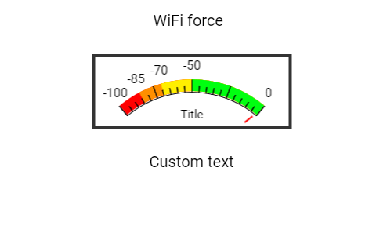

# GaugeSuper e Label: força do sinal Wi-Fi

Um **widget** é uma peça da tela, como um botão, uma barra ou uma etiqueta. Um ponteiro mostra a força do sinal da rede e um texto mostra a leitura numérica. É parecido com o medidor de sinal de um celular.

Este manual acompanha [gauge_label_wifi.ino](gauge_label_wifi.ino). A referência é o código local da **DisplayWX 1.0.33**, incluindo os `.h` e `.cpp` atuais dos widgets.



*Imagem que acompanha o exemplo. Ela ilustra a disposição das peças; valores, cores ativas e textos podem mudar durante a execução. Confira os estados iniciais descritos abaixo.*

## Caminho da leitura

1. [Entenda o que cada peça faz](#1-o-que-este-exemplo-faz).
2. [Prepare a placa, os fios e as bibliotecas](#2-prepare-a-placa-e-as-bibliotecas).
3. [Copie o programa completo](#3-programa-completo).
4. [Aprenda os objetos, as fichas, os callbacks e o loop](#4-o-programa-explicado-por-partes).
5. [Consulte os métodos disponíveis para seu programa](#5-métodos-dos-widgets-para-usar-no-seu-programa).
6. [Faça uma experiência](#6-experiência-opcional).
7. [Confira o resultado](#7-como-conferir-se-funcionou).

## 1. O que este exemplo faz

O programa conecta à rede informada em SSID e PASSWORD. Quando conectado, lê `WiFi.RSSI()`, envia o número ao medidor e ao Label. Nessa escala, -50 está mais perto de zero e representa sinal mais forte que -85.

| Peça no programa | Widget | Sua tarefa |
| --- | --- | --- |
| `widget1` | GaugeSuper | Medidor com escala de -100 a 0. |
| `txtforce` | Label | Texto RSSI com unidade dBm. |

**GaugeSuper:** Um medidor de ponteiro, parecido com o velocímetro de um carro, com faixas coloridas e números.

**Label:** Uma etiqueta de texto. Mostra palavras ou números com prefixo e sufixo, mas não recebe toques.

`connectWiFi()` espera até conseguir conectar; se nome ou senha estiver errado, continuará mostrando pontos na Serial. As listas `range0` e `colors0` escolhem as faixas coloridas. O medidor não mede a velocidade da internet.

## 2. Prepare a placa e as bibliotecas

Use uma placa **ESP32-S3**, display SPI **ST7796 de 320 × 480**, toque capacitivo **FT6336U**, cabo USB de dados e fios. A rotação 1 deixa uma área de desenho de **480 × 320 pixels**. Pixel é cada pontinho da imagem.

Na IDE Arduino, use a DisplayWX **1.0.33** deste projeto, **GFX Library for Arduino 1.6.5** e o pacote **esp32 by Espressif Systems 3.3.12**. O código da DisplayWX aceita as versões 3.3.11 e 3.3.12 desse pacote. Selecione o modelo ESP32-S3 da sua placa, sua porta USB e as opções de memória correspondentes ao hardware.

Abra o [user_setup.h da raiz da biblioteca](../../../user_setup.h), ao lado da pasta `src`. Deixe estas duas opções ativas:

```cpp
#define DISP_DEFAULT  // Display colorido.
#define TOUCH_FT6336  // Controlador FT6336U.
```

Desative as demais opções de display, toque e câmera colocando `//` no começo dessas linhas. Por exemplo: `// #define TOUCH_FT6236U`. O nome da opção correta é `TOUCH_FT6336`, sem U. Definir isso apenas no `.ino` não configura os outros arquivos da biblioteca.

### Ligações do display e do toque

| Sinal do módulo | GPIO do ESP32-S3 |
| --- | --- |
| MOSI / SDI do display | 11 |
| SCK / CLK | 12 |
| CS | 10 |
| DC / RS | 8 |
| RST do display | 9 |
| SDA do toque | 14 |
| SCL do toque | 13 |
| INT do toque | 18 |
| RST do toque | 17 |

`DISP_MISO = -1` significa que não há fio de leitura SPI. Una os GNDs. Alimente display e iluminação conforme o seu módulo; o sketch não controla um pino de backlight. Use sinais lógicos de 3,3 V. Faça a montagem com a alimentação desligada e ajuda de um adulto. Os números acima são GPIOs, não a posição física dos pinos no conector.

### Componentes deste exercício

Além da placa e tela, use uma rede Wi-Fi de 2,4 GHz acessível ao ESP32-S3. Substitua `SEU_SSID` e `SUA_SENHA` pelos dados da sua rede, mantendo as aspas. Não é preciso acesso à internet para ler a força do sinal do ponto de acesso.

### Como carregar

1. Copie a pasta inteira deste exemplo para uma pasta de trabalho. Mantenha o nome da pasta igual ao nome do `.ino`.
2. Abra o `.ino` na IDE Arduino e substitua seu conteúdo pelo **programa completo abaixo**. Mantenha os arquivos `.h` que acompanham o exemplo.
3. Configure o `user_setup.h`, a placa e a porta como indicado acima.
4. Confira os fios, clique em **Verificar** e depois em **Carregar**.
5. Abra o Monitor Serial em **115200 baud** e reinicie a placa para acompanhar o início. Se estiver usando a USB nativa do ESP32-S3, a opção **USB CDC On Boot**, quando disponível para sua placa, precisa estar habilitada para os diagnósticos nessa porta.

## 3. Programa completo

Copie o bloco inteiro, da primeira linha à última chave. Ele inclui a preparação da tela e todas as funções usadas. Os trechos isolados da próxima seção explicam este mesmo programa; não devem ser acrescentados novamente.

```cpp
#include <WiFi.h>

const char *SSID = "SEU_SSID";
const char *PASSWORD = "SUA_SENHA";

#if CONFIG_IDF_TARGET_ESP32S2 || CONFIG_IDF_TARGET_ESP32S3
#define VSPI FSPI
#endif

#include <Arduino_GFX_Library.h>
#include <SPI.h>

#include <displaywx.h>

#define FORMAT_SPIFFS_IF_FAILED false
const int DISPLAY_W = 480;
const int DISPLAY_H = 320;
const int DISP_FREQUENCY = 27000000;
const int TOUCH_MAP_X0 = 0;
const int TOUCH_MAP_Y0 = 0;
const int TOUCH_MAP_X1 = 320;
const int TOUCH_MAP_Y1 = 480;
const bool TOUCH_SWAP_XY = true;
const bool TOUCH_INVERT_X = false;
const bool TOUCH_INVERT_Y = true;
const int DISP_MOSI = 11;
const int DISP_MISO = -1;
const int DISP_SCLK = 12;
const int DISP_CS = 10;
const int DISP_DC = 8;
const int DISP_RST = 9;
const int TOUCH_SCL = 13;
const int TOUCH_SDA = 14;
const int TOUCH_INT = 18;
const int TOUCH_RST = 17;
const uint8_t rotationScreen =
    1;
const bool isIPS = true;

void screen0();
void loadWidgets();

#if defined(CONFIG_IDF_TARGET_ESP32S3)
SPIClass spi_shared(FSPI);
#else
SPIClass spi_shared(HSPI);
#endif
Arduino_DataBus *bus = nullptr;
Arduino_GFX *tft = nullptr;
DisplayWX myDisplay;

// widget1: Medidor com escala de -100 a 0.
GaugeSuper widget1(245, 165, 0);
const uint8_t qtdGauge = 1;
GaugeSuper *arrayGauge[qtdGauge] = {&widget1};
const uint8_t qtdIntervalG0 = 4;
int range0[qtdIntervalG0] = {-100, -85, -70, -50};
uint16_t colors0[qtdIntervalG0] = {CFK_COLOR01, CFK_COLOR04, CFK_COLOR06,
                                   CFK_COLOR12};
// txtforce: Texto RSSI com unidade dBm.
Label txtforce(190, 195, 0);
const uint8_t qtdLabel = 1;
Label *arrayLabel[qtdLabel] = {&txtforce};

void connectWiFi() {
  WiFi.mode(WIFI_STA);
  WiFi.begin(SSID, PASSWORD);

  Serial.print("Conectando ao Wi-Fi");
  while (WiFi.status() != WL_CONNECTED) {
    delay(500);
    Serial.print(".");
  }
  Serial.println();
  Serial.println("Conectado!");
  Serial.print("IP: ");
  Serial.println(WiFi.localIP());
  Serial.print("RSSI inicial (dBm): ");
  Serial.println(WiFi.RSSI());
}

void setup() {

  Serial.begin(115200);

  spi_shared.begin(DISP_SCLK, DISP_MISO, DISP_MOSI);
  bus = new Arduino_HWSPI(DISP_DC, DISP_CS, DISP_SCLK, DISP_MOSI, DISP_MISO,
                          &spi_shared);
  tft = new Arduino_ST7796(bus, DISP_RST, rotationScreen, isIPS, 320, 480);
  tft->begin(DISP_FREQUENCY);
  myDisplay.setDrawObject(tft);

  myDisplay.setTouchCorners(TOUCH_MAP_X0, TOUCH_MAP_X1, TOUCH_MAP_Y0,
                            TOUCH_MAP_Y1);
  myDisplay.setInvertAxis(TOUCH_INVERT_X, TOUCH_INVERT_Y);
  myDisplay.setSwapAxis(TOUCH_SWAP_XY);
  // Inicia o controlador de toque escolhido em user_setup.h.
  myDisplay.startTouchFT6336(DISPLAY_W, DISPLAY_H, rotationScreen, TOUCH_SDA,
                             TOUCH_SCL, TOUCH_INT, TOUCH_RST);

  loadWidgets();
  myDisplay.loadScreen(screen0);
  // Inicia o trabalho da biblioteca que atende o toque e atualiza a tela.
  myDisplay.createTask(false, 3);

  connectWiFi();
}

void loop() {

  if (WiFi.status() != WL_CONNECTED) {
    Serial.println("Wi-Fi desconectado. Reconectando...");
    connectWiFi();
  } else {
    int rssi = WiFi.RSSI();

    myDisplay.startCustomDraw();
    widget1.setValue(rssi);
    txtforce.setTextInt(rssi);
    myDisplay.finishCustomDraw();
  }
}

void screen0() {

  myDisplay.setBackgroundColor(CFK_WHITE);

  myDisplay.printText("WiFi force", 195, 17, TL_DATUM, CFK_BLACK, CFK_WHITE,
                      &RobotoRegular10pt7b);
  myDisplay.drawWidgetsOnScreen(0);
}

void loadWidgets() {

  GaugeConfig configGauge0 = {.title = "Title",
                              .intervals = range0,
                              .colors = colors0,
                              .fontFamily = &RobotoRegular8pt7b,
                              .minValue = -100,
                              .maxValue = 0,
                              .width = 255,
                              .height = 96,
                              .borderColor = CFK_GREY3,
                              .textColor = CFK_BLACK,
                              .backgroundColor = CFK_WHITE,
                              .titleColor = CFK_BLACK,
                              .needleColor = CFK_RED,
                              .markersColor = CFK_BLACK,
                              .amountIntervals = qtdIntervalG0,
                              .showLabels = true};
  // Aplica a ficha ao objeto; faça isso durante a preparação.
  widget1.setup(configGauge0);
  myDisplay.setGauge(arrayGauge, qtdGauge);

  LabelConfig configLabel0 = {.text = "-----",
                              .prefix = "RSSI: ",
                              .suffix = " dBm",
                              .fontFamily = &RobotoRegular10pt7b,
                              .datum = TL_DATUM,
                              .fontColor = CFK_BLACK,
                              .backgroundColor = CFK_WHITE};
  // Aplica a ficha ao objeto; faça isso durante a preparação.
  txtforce.setup(configLabel0);
  myDisplay.setLabel(arrayLabel, qtdLabel);
}
```

## 4. O programa explicado por partes

### 4.1 Objetos, variáveis e listas

Um **objeto** é uma peça que seu programa pode chamar pelo nome. Uma **variável** é uma caixinha que guarda um valor. `bool` guarda `true` ou `false`; `int` guarda um inteiro; `float` e `double` guardam números com parte decimal. `const` indica algo que não será trocado durante a execução.


```cpp
// widget1: Medidor com escala de -100 a 0.
GaugeSuper widget1(245, 165, 0);
// Quantidade de objetos desta lista.
const uint8_t qtdGauge = 1;
// Lista dos endereços dos widgets que a DisplayWX vai cuidar.
GaugeSuper *arrayGauge[qtdGauge] = {&widget1};
// Quantidade de objetos desta lista.
const uint8_t qtdIntervalG0 = 4;
int range0[qtdIntervalG0] = {-100, -85, -70, -50};
uint16_t colors0[qtdIntervalG0] = {CFK_COLOR01, CFK_COLOR04, CFK_COLOR06,
                                   CFK_COLOR12};
// txtforce: Texto RSSI com unidade dBm.
Label txtforce(190, 195, 0);
// Quantidade de objetos desta lista.
const uint8_t qtdLabel = 1;
// Lista dos endereços dos widgets que a DisplayWX vai cuidar.
Label *arrayLabel[qtdLabel] = {&txtforce};
```

| Objeto | Como interpretar a criação |
| --- | --- |
| `widget1` (GaugeSuper) | X = 245, Y = 165, tela = 0. Referência da posição: referência central inferior do medidor; o desenho cresce para cima e para os lados. |
| `txtforce` (Label) | X = 190, Y = 195, tela = 0. Referência da posição: ponto de alinhamento escolhido por datum. |

X cresce para a direita e Y cresce para baixo, a partir do canto superior esquerdo da tela. O número da tela decide em qual página a peça aparece. A primeira tela é 0.

O `&` antes do nome entrega o **endereço** do objeto, como informar onde fica uma casa. O `*` na declaração da lista indica que ela guarda endereços. `qtd...` precisa corresponder à quantidade de itens: ao acrescentar um widget, acrescente seu endereço e ajuste a quantidade. Mantenha os objetos e essas listas globais, fora das funções, para continuarem existindo enquanto a interface trabalha.

### 4.2 A ficha de configuração (`struct`)

A `struct` funciona como uma ficha: cada campo escolhe uma característica. O ponto em `.width` significa “preencha o campo largura”. Depois, `objeto.setup(ficha)` entrega a ficha ao widget. Configure cada peça uma vez em `loadWidgets()`, depois de preparar o display e antes de iniciar a tarefa.

#### `configGauge0`: ficha de `widget1`

```cpp
GaugeConfig configGauge0 = {.title = "Title",
                              .intervals = range0,
                              .colors = colors0,
                              .fontFamily = &RobotoRegular8pt7b,
                              .minValue = -100,
                              .maxValue = 0,
                              .width = 255,
                              .height = 96,
                              .borderColor = CFK_GREY3,
                              .textColor = CFK_BLACK,
                              .backgroundColor = CFK_WHITE,
                              .titleColor = CFK_BLACK,
                              .needleColor = CFK_RED,
                              .markersColor = CFK_BLACK,
                              .amountIntervals = qtdIntervalG0,
                              .showLabels = true};
// Aplica a ficha ao objeto; faça isso durante a preparação.
widget1.setup(configGauge0);
```

| Campo | Valor nesta ficha | Para que serve |
| --- | --- | --- |
| `title` | `"Title"` | Título do medidor, ou `nullptr` sem título. O GaugeSuper limita a 20 caracteres. |
| `intervals` | `range0` | Lista ordenada dos limites das faixas coloridas, dentro da escala. |
| `colors` | `colors0` | Lista de cores das faixas, na mesma ordem e quantidade de `intervals`. |
| `fontFamily` | `&RobotoRegular8pt7b` | Fonte das letras, por exemplo `&RobotoRegular10pt7b`. O `&` aponta para uma fonte que já existe. |
| `minValue` | `-100` | Menor valor da escala. Escolha um número menor que `maxValue`. |
| `maxValue` | `0` | Maior valor da escala. Escolha um número maior que `minValue`. |
| `width` | `255` | Largura em pixels, os pontinhos da imagem. Mantenha o desenho dentro da tela. |
| `height` | `96` | Altura em pixels. Reserve espaço suficiente para o desenho e as letras. |
| `borderColor` | `CFK_GREY3` | Cor da borda. |
| `textColor` | `CFK_BLACK` | Cor das letras/números. |
| `backgroundColor` | `CFK_WHITE` | Cor do fundo, por exemplo `CFK_WHITE`. Use a cor da área onde o widget aparece. |
| `titleColor` | `CFK_BLACK` | Cor do título. |
| `needleColor` | `CFK_RED` | Cor do ponteiro. |
| `markersColor` | `CFK_BLACK` | Cor das marcas da escala. |
| `amountIntervals` | `qtdIntervalG0` | Quantidade de faixas e cores. No GaugeSuper, no máximo 10; `0` desativa as faixas. |
| `showLabels` | `true` | `true` mostra os números das faixas; `false` esconde esses rótulos. |

Medidor com escala de -100 a 0.

#### `configLabel0`: ficha de `txtforce`

```cpp
LabelConfig configLabel0 = {.text = "-----",
                              .prefix = "RSSI: ",
                              .suffix = " dBm",
                              .fontFamily = &RobotoRegular10pt7b,
                              .datum = TL_DATUM,
                              .fontColor = CFK_BLACK,
                              .backgroundColor = CFK_WHITE};
// Aplica a ficha ao objeto; faça isso durante a preparação.
txtforce.setup(configLabel0);
```

| Campo | Valor nesta ficha | Para que serve |
| --- | --- | --- |
| `text` | `"-----"` | Texto inicial. Escreva entre aspas, por exemplo `"Olá"`. |
| `prefix` | `"RSSI: "` | Texto colocado antes do valor, como `"Valor: "`. `""` deixa vazio. |
| `suffix` | `" dBm"` | Texto colocado depois do valor, como `" V"`. `""` deixa vazio. |
| `fontFamily` | `&RobotoRegular10pt7b` | Fonte das letras, por exemplo `&RobotoRegular10pt7b`. O `&` aponta para uma fonte que já existe. |
| `datum` | `TL_DATUM` | Alinhamento do texto em relação a `(x,y)`: `TL_DATUM` usa o canto superior esquerdo; `TC_DATUM`, o centro do topo. |
| `fontColor` | `CFK_BLACK` | Cor das letras, usando os nomes `CFK_...`. |
| `backgroundColor` | `CFK_WHITE` | Cor do fundo, por exemplo `CFK_WHITE`. Use a cor da área onde o widget aparece. |

Texto RSSI com unidade dBm.

Após configurar, registre cada lista. É assim que a DisplayWX sabe quais peças precisa acompanhar:

```cpp
// Registra a lista e sua quantidade para a biblioteca encontrar estes widgets.
myDisplay.setGauge(arrayGauge, qtdGauge);
// Registra a lista e sua quantidade para a biblioteca encontrar estes widgets.
myDisplay.setLabel(arrayLabel, qtdLabel);
```

`nullptr` significa “não liguei nada aqui”. Por exemplo, sem callback não há uma ação do seu programa para executar; sem `subtitle`, não há Label associado. Uma cor `CFK_...` é um valor de cor pronto da biblioteca. Uma fonte como `&RobotoRegular10pt7b` escolhe o desenho das letras. Para começar, conserve as fontes, os tamanhos e a ordem dos campos do exemplo.

### 4.3 O início: `setup()`

O Arduino executa `setup()` uma vez ao ligar. Ele prepara a comunicação, o display, o toque, os widgets e os componentes extras. A tarefa criada no fim continua cuidando da interface enquanto o seu `loop()` trabalha.

```cpp
void setup() {

  // Abre as mensagens de diagnóstico no computador.
  Serial.begin(115200);

  // Inicia os fios de comunicação SPI do display.
  spi_shared.begin(DISP_SCLK, DISP_MISO, DISP_MOSI);
  bus = new Arduino_HWSPI(DISP_DC, DISP_CS, DISP_SCLK, DISP_MOSI, DISP_MISO,
                          &spi_shared);
  tft = new Arduino_ST7796(bus, DISP_RST, rotationScreen, isIPS, 320, 480);
  tft->begin(DISP_FREQUENCY);
  // Entrega à DisplayWX o objeto que desenha no display.
  myDisplay.setDrawObject(tft);

  // Informa a faixa de coordenadas recebida do toque.
  myDisplay.setTouchCorners(TOUCH_MAP_X0, TOUCH_MAP_X1, TOUCH_MAP_Y0,
                            TOUCH_MAP_Y1);
  myDisplay.setInvertAxis(TOUCH_INVERT_X, TOUCH_INVERT_Y);
  myDisplay.setSwapAxis(TOUCH_SWAP_XY);
  // Inicia o controlador de toque escolhido em user_setup.h.
  myDisplay.startTouchFT6336(DISPLAY_W, DISPLAY_H, rotationScreen, TOUCH_SDA,
                             TOUCH_SCL, TOUCH_INT, TOUCH_RST);

  // Preenche as fichas, configura e registra os widgets.
  loadWidgets();
  // Pede a troca de tela; passe o nome da função, sem ().
  myDisplay.loadScreen(screen0);
  // Inicia o trabalho da biblioteca que atende o toque e atualiza a tela.
  myDisplay.createTask(false, 3);

  connectWiFi();
}
```

As declarações como `void screen0();` no começo do programa são **avisos de que essas funções existem**. Elas permitem usar seus nomes nas fichas antes de chegar à parte que contém o corpo da função. Não apague esses avisos ao copiar trechos.

### 4.4 Callbacks: o que acontece após a ação

Um **callback** é a tarefa que você escolhe para acontecer quando um controle é acionado ou uma edição é confirmada. Na ficha, escreva o nome **sem `()`**. A biblioteca o chama no momento adequado. Evite esperas longas dentro dele: guarde um pedido em uma variável e faça a parte demorada no `loop()`, quando necessário.

Este sketch não associa callbacks a seus widgets. O programa entrega valores aos indicadores e textos no `loop()`. Tocar neles não cria uma leitura nova.

### 4.5 O trabalho repetido: `loop()`

O programa conecta à rede informada em SSID e PASSWORD. Quando conectado, lê `WiFi.RSSI()`, envia o número ao medidor e ao Label. Nessa escala, -50 está mais perto de zero e representa sinal mais forte que -85.

```cpp
void loop() {

  if (WiFi.status() != WL_CONNECTED) {
    Serial.println("Wi-Fi desconectado. Reconectando...");
    connectWiFi();
  } else {
    int rssi = WiFi.RSSI();

    // Reserva o desenho para esta sequência do seu programa.
    myDisplay.startCustomDraw();
    widget1.setValue(rssi);
    // Mostra um número inteiro na etiqueta.
    txtforce.setTextInt(rssi);
    // Devolve o desenho à tarefa da interface.
    myDisplay.finishCustomDraw();
  }
}
```

Mantenha `startCustomDraw()` e `finishCustomDraw()` em pares, como abrir e fechar um caderno de desenho. Deixe pausas, esperas de rede e tarefas demoradas fora desse par.

### 4.6 As telas

Cada função `screen...` pinta o fundo, coloca os textos fixos e manda desenhar os widgets daquela página. Troque de página com `myDisplay.loadScreen(screen0)` ou com a função da outra tela; passe o nome sem parênteses.

```cpp
void screen0() {

  // Pinta o fundo da tela com a cor escolhida.
  myDisplay.setBackgroundColor(CFK_WHITE);

  // Escreve um texto fixo; esse texto não é um widget interativo.
  myDisplay.printText("WiFi force", 195, 17, TL_DATUM, CFK_BLACK, CFK_WHITE,
                      &RobotoRegular10pt7b);
  // Desenha os widgets registrados para esse número de tela.
  myDisplay.drawWidgetsOnScreen(0);
}
```

### 4.7 Funções extras

#### `connectWiFi()`

Escolhe modo estação, inicia a conexão e espera o resultado. O `while` repete a espera de 500 ms. O endereço IP identifica a placa na rede; RSSI é a leitura de intensidade.

```cpp
void connectWiFi() {
  WiFi.mode(WIFI_STA);
  WiFi.begin(SSID, PASSWORD);

  Serial.print("Conectando ao Wi-Fi");
  while (WiFi.status() != WL_CONNECTED) {
    // Pausa em milissegundos: 1000 ms equivalem a um segundo.
    delay(500);
    Serial.print(".");
  }
  Serial.println();
  Serial.println("Conectado!");
  Serial.print("IP: ");
  Serial.println(WiFi.localIP());
  Serial.print("RSSI inicial (dBm): ");
  Serial.println(WiFi.RSSI());
}
```

## 5. Métodos dos widgets para usar no seu programa

Um **método** é uma ação que pertence a um objeto. Em `objeto.metodo(valor)`, primeiro vem o nome da peça, depois o ponto, a ação e suas informações entre parênteses. As tabelas usam objetos reais deste exemplo. Faça essas chamadas **depois da configuração**; a linha `setup(...)` pertence à preparação. Os nomes das fichas só existem dentro de `loadWidgets()`.

### GaugeSuper: métodos para seu programa

Um medidor de ponteiro, parecido com o velocímetro de um carro, com faixas coloridas e números.

| Método | Como usar | Resultado e cuidado |
| --- | --- | --- |
| `setup(config)` | `widget1.setup(configGauge0);` | Aplica a ficha de configuração após preparar o display. Não retorna valor. Configure no `loadWidgets()` antes de iniciar a tarefa. |
| `setValue(valor)` | `widget1.setValue(-60);` | Define o valor inteiro, limitado à escala. Nesta implementação, ignora atualizações se sua tela não está selecionada ou há teclado aberto. Não possui callback. |
| `show()` | `widget1.show();` | Torna visível na sua tela e pede atualização. Para TouchArea, volta a permitir toque; ela continua invisível. |
| `hide()` | `widget1.hide();` | Impede futuras atualizações visuais e, quando há toque, sua interação. Não apaga os pixels já desenhados: repinte a tela como explicado abaixo. |

Use intervalos ordenados e cores com a mesma quantidade. Não existe `getValue()` público; guarde a leitura em uma variável se precisar consultá-la depois.

### Label: métodos para seu programa

Uma etiqueta de texto. Mostra palavras ou números com prefixo e sufixo, mas não recebe toques.

| Método | Como usar | Resultado e cuidado |
| --- | --- | --- |
| `setup(config)` | `txtforce.setup(configLabel0);` | Aplica a ficha de configuração após preparar o display. Não retorna valor. Configure no `loadWidgets()` antes de iniciar a tarefa. |
| `setText(texto)` | `txtforce.setText("Pronto");` | Mostra texto de `const char*` ou `String`, montando prefixo + texto + sufixo. Não retorna valor. |
| `setPrefix(texto)` | `txtforce.setPrefix("Valor: ");` | Guarda o texto que vem antes. Chame depois `setText`, `setTextInt` ou `setTextFloat` para reconstruir o conteúdo exibido. |
| `setSuffix(texto)` | `txtforce.setSuffix(" V");` | Guarda o texto que vem depois. Atualize o conteúdo em seguida para mostrar a nova combinação. |
| `setTextInt(valor)` | `txtforce.setTextInt(42);` | Mostra um número inteiro com prefixo e sufixo. |
| `setTextFloat(valor, casas = 2)` | `txtforce.setTextFloat(3.25, 2);` | Mostra número decimal. O segundo argumento escolhe 0 a 5 casas; omitido, usa 2. |
| `setDecimalPlaces(casas)` | `txtforce.setDecimalPlaces(1);` | Guarda a precisão, limitada a 0–5. Não reformata sozinho o texto; `setTextFloat` define novamente a precisão com seu próprio argumento. |
| `setFontSize(escala)` | `txtforce.setFontSize(2);` | Define o fator de tamanho das letras; use 1 para normal. Não pede atualização sozinho: atualize o texto ou recarregue a tela depois. |
| `show()` | `txtforce.show();` | Torna visível na sua tela e pede atualização. Para TouchArea, volta a permitir toque; ela continua invisível. |
| `hide()` | `txtforce.hide();` | Impede futuras atualizações visuais e, quando há toque, sua interação. Não apaga os pixels já desenhados: repinte a tela como explicado abaixo. |

Para limpar prefixo ou sufixo, use `""`. Altere os dois antes de mandar o novo conteúdo. Um Label não mede nada: é o programa que fornece o valor.

### Esconder e mostrar na tela

`hide()` não funciona como uma borracha para os pixels que já foram pintados. Para remover o desenho da página atual, esconda a peça e peça que a página seja montada novamente. Para fazê-la voltar, use `show()`. O estado/valor continua guardado.

```cpp
// Execute uma vez, na tela 0 deste exemplo.
widget1.hide();
myDisplay.loadScreen(screen0);

// Em outra ação, quando quiser mostrar de novo:
widget1.show();
myDisplay.loadScreen(screen0);
```

Os dois blocos são ações separadas: se executar todos de uma vez, o widget voltará logo em seguida. Textos fixos feitos com `printText()` continuam aparecendo, pois pertencem à função de tela. Um widget da tela 1 só aparece quando você volta à tela 1.

O desenho periódico e a detecção de toque ficam a cargo da DisplayWX. Seu `.ino` configura, registra, consulta e altera as peças pelas chamadas acima; não precisa chamar rotinas internas de desenho ou de detecção.

## 6. Experiência opcional

Para um teste sem rede, substitua temporariamente a leitura por esse valor e retire a chamada que espera a conexão. Isso mostra como os dois widgets apresentam o mesmo número.

```cpp
widget1.setValue(-60);
txtforce.setTextInt(-60);
```

Mude uma coisa de cada vez. O programa completo da seção 3 continua sendo o ponto de partida para voltar ao comportamento original do exercício.

## 7. Como conferir se funcionou

1. Abra a Serial a 115200 e espere aparecer Conectado e o endereço IP.
2. Observe o texto RSSI e o ponteiro. Os valores variam com o ambiente.
3. Mude a distância em relação ao roteador e acompanhe a leitura, sem esperar uma mudança perfeitamente uniforme.

| Se acontecer... | Confira... |
| --- | --- |
| Erro ao compilar sobre tela, toque ou tipo desconhecido | Placa selecionada, versões instaladas e opções ativas no `user_setup.h` da raiz da biblioteca. Copie o programa inteiro. |
| Tela apagada ou sem desenho | Alimentação, GND, iluminação do módulo e fios/conectores do display. |
| Desenho correto, mas o toque não responde ou está deslocado | Controlador selecionado, SDA/SCL e configuração de rotação, limites e inversão dos eixos. Use os valores completos do exemplo para essa montagem. |
| Valor parece demorar para mudar | Confira o `delay()` no loop. Vários exemplos só enviam uma atualização a cada dois segundos. |
| Método com argumentos diferentes dá erro | Consulte a tabela da classe exata. Nem todos os `onClick` ou `setValue` recebem os mesmos argumentos. |

Este manual foi conferido com os arquivos locais da biblioteca. A validação descrita aqui é de código e documentação; a compilação para a sua placa e o ensaio físico devem ser feitos com a montagem indicada.

### Arquivos usados como referência

- [gauge_label_wifi.ino](gauge_label_wifi.ino).
- GaugeSuper: [declarações `.h`](../../../src/widgets/gauge/wgaugesuper.h) e [implementação `.cpp`](../../../src/widgets/gauge/wgaugesuper.cpp).
- Label: [declarações `.h`](../../../src/widgets/label/wlabel.h) e [implementação `.cpp`](../../../src/widgets/label/wlabel.cpp).
- [DisplayWX](../../../src/displaywx.h) e [implementação da integração](../../../src/displaywx.cpp).
