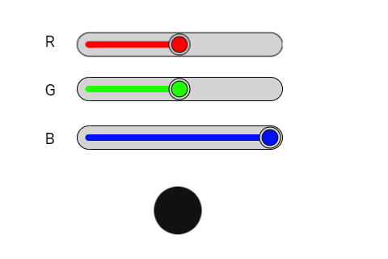

# HSlider: misturando vermelho, verde e azul

Um **widget** é uma peça da tela, como um botão, uma barra ou uma etiqueta. Três controles deslizantes misturam luz vermelha, verde e azul. O resultado aparece em um círculo desenhado na tela.

Este manual acompanha [hslider_rgb.ino](hslider_rgb.ino). A referência é o código local da **DisplayWX 1.0.33**, incluindo os `.h` e `.cpp` atuais dos widgets.



*Imagem que acompanha o exemplo. Ela ilustra a disposição das peças; valores, cores ativas e textos podem mudar durante a execução. Confira os estados iniciais descritos abaixo.*

## Caminho da leitura

1. [Entenda o que cada peça faz](#1-o-que-este-exemplo-faz).
2. [Prepare a placa, os fios e as bibliotecas](#2-prepare-a-placa-e-as-bibliotecas).
3. [Copie o programa completo](#3-programa-completo).
4. [Aprenda os objetos, as fichas, os callbacks e o loop](#4-o-programa-explicado-por-partes).
5. [Consulte os métodos disponíveis para seu programa](#5-métodos-dos-widgets-para-usar-no-seu-programa).
6. [Faça uma experiência](#6-experiência-opcional).
7. [Confira o resultado](#7-como-conferir-se-funcionou).

## 1. O que este exemplo faz

Cada controle vai de 0 a 255. Seu callback guarda o novo número e chama `updateColorCircle()`. Essa função calcula a nova cor e deixa um aviso em `isColorCircleChanged`. O `loop()` vê o aviso e pinta o círculo, com espera de até dois segundos neste exemplo.

| Peça no programa | Widget | Sua tarefa |
| --- | --- | --- |
| `slider1` | HSlider | Quantidade de vermelho (R). |
| `slider1copy` | HSlider | Quantidade de verde (G). |
| `slider1copy2` | HSlider | Quantidade de azul (B). |

**HSlider:** Um controle deslizante horizontal. Arrastar a bolinha escolhe um número entre o mínimo e o máximo.

Os três controles começam no mínimo e o círculo começa preto. A captura mostra outras posições de exemplo. Chamar `setValue(..., false)` muda o controle sem atualizar as variáveis de cor do callback; nesse caso, atualize essas variáveis também se quiser mudar a mistura.

## 2. Prepare a placa e as bibliotecas

Use uma placa **ESP32-S3**, display SPI **ST7796 de 320 × 480**, toque capacitivo **FT6336U**, cabo USB de dados e fios. A rotação 1 deixa uma área de desenho de **480 × 320 pixels**. Pixel é cada pontinho da imagem.

Na IDE Arduino, use a DisplayWX **1.0.33** deste projeto, **GFX Library for Arduino 1.6.5** e o pacote **esp32 by Espressif Systems 3.3.12**. O código da DisplayWX aceita as versões 3.3.11 e 3.3.12 desse pacote. Selecione o modelo ESP32-S3 da sua placa, sua porta USB e as opções de memória correspondentes ao hardware.

Abra o [user_setup.h da raiz da biblioteca](../../../user_setup.h), ao lado da pasta `src`. Deixe estas duas opções ativas:

```cpp
#define DISP_DEFAULT  // Display colorido.
#define TOUCH_FT6336  // Controlador FT6336U.
```

Desative as demais opções de display, toque e câmera colocando `//` no começo dessas linhas. Por exemplo: `// #define TOUCH_FT6236U`. O nome da opção correta é `TOUCH_FT6336`, sem U. Definir isso apenas no `.ino` não configura os outros arquivos da biblioteca.

### Ligações do display e do toque

| Sinal do módulo | GPIO do ESP32-S3 |
| --- | --- |
| MOSI / SDI do display | 11 |
| SCK / CLK | 12 |
| CS | 10 |
| DC / RS | 8 |
| RST do display | 9 |
| SDA do toque | 14 |
| SCL do toque | 13 |
| INT do toque | 18 |
| RST do toque | 17 |

`DISP_MISO = -1` significa que não há fio de leitura SPI. Una os GNDs. Alimente display e iluminação conforme o seu módulo; o sketch não controla um pino de backlight. Use sinais lógicos de 3,3 V. Faça a montagem com a alimentação desligada e ajuda de um adulto. Os números acima são GPIOs, não a posição física dos pinos no conector.

### Componentes deste exercício

Este exemplo usa apenas placa, display e toque. O círculo é um desenho feito com Arduino_GFX; não é um LED RGB externo e não precisa de fios extras.

### Como carregar

1. Copie a pasta inteira deste exemplo para uma pasta de trabalho. Mantenha o nome da pasta igual ao nome do `.ino`.
2. Abra o `.ino` na IDE Arduino e substitua seu conteúdo pelo **programa completo abaixo**. Mantenha os arquivos `.h` que acompanham o exemplo.
3. Configure o `user_setup.h`, a placa e a porta como indicado acima.
4. Confira os fios, clique em **Verificar** e depois em **Carregar**.
5. Abra o Monitor Serial em **115200 baud** e reinicie a placa para acompanhar o início. Se estiver usando a USB nativa do ESP32-S3, a opção **USB CDC On Boot**, quando disponível para sua placa, precisa estar habilitada para os diagnósticos nessa porta.

## 3. Programa completo

Copie o bloco inteiro, da primeira linha à última chave. Ele inclui a preparação da tela e todas as funções usadas. Os trechos isolados da próxima seção explicam este mesmo programa; não devem ser acrescentados novamente.

```cpp
#if CONFIG_IDF_TARGET_ESP32S2 || CONFIG_IDF_TARGET_ESP32S3
#define VSPI FSPI
#endif

#include <SPI.h>
#include <Arduino_GFX_Library.h>

#include <displaywx.h>

#define FORMAT_SPIFFS_IF_FAILED false
const int DISPLAY_W = 480;
const int DISPLAY_H = 320;
const int DISP_FREQUENCY = 27000000;
const int TOUCH_MAP_X0 = 0;
const int TOUCH_MAP_Y0 = 0;
const int TOUCH_MAP_X1 = 320;
const int TOUCH_MAP_Y1 = 480;
const bool TOUCH_SWAP_XY = true;
const bool TOUCH_INVERT_X = false;
const bool TOUCH_INVERT_Y = true;
const int DISP_MOSI = 11;
const int DISP_MISO = -1;
const int DISP_SCLK = 12;
const int DISP_CS = 10;
const int DISP_DC = 8;
const int DISP_RST = 9;
const int TOUCH_SCL = 13;
const int TOUCH_SDA = 14;
const int TOUCH_INT = 18;
const int TOUCH_RST = 17;
const uint8_t rotationScreen = 1;
const bool isIPS = true;

void screen0();
void loadWidgets();

void slider1_cb();
void slider1copy_cb();
void slider1copy2_cb();

uint16_t convertRGBto565(uint8_t red, uint8_t green, uint8_t blue){
    return (red >> 3) << 11 | (green >> 2) << 5 | (blue >> 3);
}

#if defined(CONFIG_IDF_TARGET_ESP32S3)
SPIClass spi_shared(FSPI);
#else
SPIClass spi_shared(HSPI);
#endif
Arduino_DataBus *bus = nullptr;
Arduino_GFX *tft = nullptr;
DisplayWX myDisplay;

// slider1: Quantidade de vermelho (R).
HSlider slider1(95, 40, 0);
// slider1copy: Quantidade de verde (G).
HSlider slider1copy(95, 95, 0);
// slider1copy2: Quantidade de azul (B).
HSlider slider1copy2(95, 155, 0);
const uint8_t qtdHSlider = 3;
HSlider *arrayHslider[qtdHSlider] = {&slider1, &slider1copy, &slider1copy2};
int hslider0_val = 0;
int hslider1_val = 0;
int hslider2_val = 0;

uint16_t colorCircle = CFK_BLACK;
bool isColorCircleChanged = false;
uint16_t circlePosX = 220;
uint16_t circlePosY = 260;
uint16_t circleRadius = 29;

void setup(){

    Serial.begin(115200);

    spi_shared.begin(DISP_SCLK, DISP_MISO, DISP_MOSI);
    bus = new Arduino_HWSPI(DISP_DC, DISP_CS, DISP_SCLK, DISP_MOSI, DISP_MISO, &spi_shared);
    tft = new Arduino_ST7796(bus, DISP_RST, rotationScreen, isIPS, 320, 480);
    tft->begin(DISP_FREQUENCY);
    myDisplay.setDrawObject(tft);

    myDisplay.setTouchCorners(TOUCH_MAP_X0, TOUCH_MAP_X1, TOUCH_MAP_Y0, TOUCH_MAP_Y1);
    myDisplay.setInvertAxis(TOUCH_INVERT_X, TOUCH_INVERT_Y);
    myDisplay.setSwapAxis(TOUCH_SWAP_XY);
    // Inicia o controlador de toque escolhido em user_setup.h.
    myDisplay.startTouchFT6336(DISPLAY_W, DISPLAY_H, rotationScreen, TOUCH_SDA, TOUCH_SCL, TOUCH_INT, TOUCH_RST);

    loadWidgets();
    myDisplay.loadScreen(screen0);
    // Inicia o trabalho da biblioteca que atende o toque e atualiza a tela.
    myDisplay.createTask(false, 3);
}

void loop(){

    myDisplay.startCustomDraw();
    if(isColorCircleChanged){
        tft->fillCircle(circlePosX, circlePosY, circleRadius, colorCircle);
        tft->drawCircle(circlePosX, circlePosY, circleRadius, CFK_BLACK);
        isColorCircleChanged = false;
    }
    myDisplay.finishCustomDraw();
    delay(2000);
}

void screen0(){

    myDisplay.setBackgroundColor(CFK_WHITE);
    myDisplay.printText("R", 55, 42, TL_DATUM, CFK_BLACK, CFK_WHITE, &RobotoRegular10pt7b);
    myDisplay.printText("G", 55, 102, TL_DATUM, CFK_BLACK, CFK_WHITE, &RobotoRegular10pt7b);
    myDisplay.printText("B", 55, 162, TL_DATUM, CFK_BLACK, CFK_WHITE, &RobotoRegular10pt7b);

    tft->fillCircle(circlePosX, circlePosY, circleRadius, colorCircle);
    tft->drawCircle(circlePosX, circlePosY, circleRadius, CFK_BLACK);
    myDisplay.drawWidgetsOnScreen(0);
}

void loadWidgets(){

    HSliderConfig configHSlider0 = {
            // Função chamada quando o usuário aciona este controle.
            .callback = slider1_cb,
            .subtitle = nullptr,
            .minValue = 0,
            .maxValue = 255,
            .radius = 15,
            .width = 254,
            .pressedColor = CFK_COLOR01,
            .backgroundColor = CFK_WHITE
        };
    // Aplica a ficha ao objeto; faça isso durante a preparação.
    slider1.setup(configHSlider0);
    HSliderConfig configHSlider1 = {
            // Função chamada quando o usuário aciona este controle.
            .callback = slider1copy_cb,
            .subtitle = nullptr,
            .minValue = 0,
            .maxValue = 255,
            .radius = 15,
            .width = 254,
            .pressedColor = CFK_COLOR11,
            .backgroundColor = CFK_WHITE
        };
    // Aplica a ficha ao objeto; faça isso durante a preparação.
    slider1copy.setup(configHSlider1);
    HSliderConfig configHSlider2 = {
            // Função chamada quando o usuário aciona este controle.
            .callback = slider1copy2_cb,
            .subtitle = nullptr,
            .minValue = 0,
            .maxValue = 255,
            .radius = 15,
            .width = 254,
            .pressedColor = CFK_COLOR22,
            .backgroundColor = CFK_WHITE
        };
    // Aplica a ficha ao objeto; faça isso durante a preparação.
    slider1copy2.setup(configHSlider2);
    myDisplay.setHSlider(arrayHslider,qtdHSlider);

}

void updateColorCircle(){
    colorCircle = convertRGBto565(hslider0_val, hslider1_val, hslider2_val);
    isColorCircleChanged = true;
}

void slider1_cb(){

    hslider0_val = slider1.getValue();
    updateColorCircle();
}

void slider1copy_cb(){

    hslider1_val = slider1copy.getValue();
    updateColorCircle();
}

void slider1copy2_cb(){

    hslider2_val = slider1copy2.getValue();
    updateColorCircle();
}
```

## 4. O programa explicado por partes

### 4.1 Objetos, variáveis e listas

Um **objeto** é uma peça que seu programa pode chamar pelo nome. Uma **variável** é uma caixinha que guarda um valor. `bool` guarda `true` ou `false`; `int` guarda um inteiro; `float` e `double` guardam números com parte decimal. `const` indica algo que não será trocado durante a execução.


```cpp
// slider1: Quantidade de vermelho (R).
HSlider slider1(95, 40, 0);
// slider1copy: Quantidade de verde (G).
HSlider slider1copy(95, 95, 0);
// slider1copy2: Quantidade de azul (B).
HSlider slider1copy2(95, 155, 0);
// Quantidade de objetos desta lista.
const uint8_t qtdHSlider = 3;
// Lista dos endereços dos widgets que a DisplayWX vai cuidar.
HSlider *arrayHslider[qtdHSlider] = {&slider1, &slider1copy, &slider1copy2};
int hslider0_val = 0;
int hslider1_val = 0;
int hslider2_val = 0;

uint16_t colorCircle = CFK_BLACK;
bool isColorCircleChanged = false;
uint16_t circlePosX = 220;
uint16_t circlePosY = 260;
uint16_t circleRadius = 29;
```

| Objeto | Como interpretar a criação |
| --- | --- |
| `slider1` (HSlider) | X = 95, Y = 40, tela = 0. Referência da posição: canto superior esquerdo. |
| `slider1copy` (HSlider) | X = 95, Y = 95, tela = 0. Referência da posição: canto superior esquerdo. |
| `slider1copy2` (HSlider) | X = 95, Y = 155, tela = 0. Referência da posição: canto superior esquerdo. |

X cresce para a direita e Y cresce para baixo, a partir do canto superior esquerdo da tela. O número da tela decide em qual página a peça aparece. A primeira tela é 0.

O `&` antes do nome entrega o **endereço** do objeto, como informar onde fica uma casa. O `*` na declaração da lista indica que ela guarda endereços. `qtd...` precisa corresponder à quantidade de itens: ao acrescentar um widget, acrescente seu endereço e ajuste a quantidade. Mantenha os objetos e essas listas globais, fora das funções, para continuarem existindo enquanto a interface trabalha.

### 4.2 A ficha de configuração (`struct`)

A `struct` funciona como uma ficha: cada campo escolhe uma característica. O ponto em `.width` significa “preencha o campo largura”. Depois, `objeto.setup(ficha)` entrega a ficha ao widget. Configure cada peça uma vez em `loadWidgets()`, depois de preparar o display e antes de iniciar a tarefa.

#### `configHSlider0`: ficha de `slider1`

```cpp
HSliderConfig configHSlider0 = {
            // Função chamada quando o usuário aciona este controle.
            .callback = slider1_cb,
            // Label que vai acompanhar o valor deste indicador.
            .subtitle = nullptr,
            .minValue = 0,
            .maxValue = 255,
            .radius = 15,
            .width = 254,
            .pressedColor = CFK_COLOR01,
            .backgroundColor = CFK_WHITE
        };
// Aplica a ficha ao objeto; faça isso durante a preparação.
slider1.setup(configHSlider0);
```

| Campo | Valor nesta ficha | Para que serve |
| --- | --- | --- |
| `callback` | `slider1_cb` | Nome da função chamada quando há uma ação. Escreva o nome sem `()`. `nullptr` significa sem callback. |
| `subtitle` | `nullptr` | Endereço de um Label para mostrar o valor, como `&meuTexto`; use `nullptr` se não quiser legenda. |
| `minValue` | `0` | Menor valor da escala. Escolha um número menor que `maxValue`. |
| `maxValue` | `255` | Maior valor da escala. Escolha um número maior que `minValue`. |
| `radius` | `15` | Raio da bolinha; use maior que 4. A altura do controle é duas vezes esse valor. |
| `width` | `254` | Largura em pixels, os pontinhos da imagem. Mantenha o desenho dentro da tela. |
| `pressedColor` | `CFK_COLOR01` | Cor usada quando o controle está ativo. Use um nome pronto `CFK_...`. |
| `backgroundColor` | `CFK_WHITE` | Cor do fundo, por exemplo `CFK_WHITE`. Use a cor da área onde o widget aparece. |

Quantidade de vermelho (R).

#### `configHSlider1`: ficha de `slider1copy`

```cpp
HSliderConfig configHSlider1 = {
            // Função chamada quando o usuário aciona este controle.
            .callback = slider1copy_cb,
            // Label que vai acompanhar o valor deste indicador.
            .subtitle = nullptr,
            .minValue = 0,
            .maxValue = 255,
            .radius = 15,
            .width = 254,
            .pressedColor = CFK_COLOR11,
            .backgroundColor = CFK_WHITE
        };
// Aplica a ficha ao objeto; faça isso durante a preparação.
slider1copy.setup(configHSlider1);
```

Quantidade de verde (G).

#### `configHSlider2`: ficha de `slider1copy2`

```cpp
HSliderConfig configHSlider2 = {
            // Função chamada quando o usuário aciona este controle.
            .callback = slider1copy2_cb,
            // Label que vai acompanhar o valor deste indicador.
            .subtitle = nullptr,
            .minValue = 0,
            .maxValue = 255,
            .radius = 15,
            .width = 254,
            .pressedColor = CFK_COLOR22,
            .backgroundColor = CFK_WHITE
        };
// Aplica a ficha ao objeto; faça isso durante a preparação.
slider1copy2.setup(configHSlider2);
```

Quantidade de azul (B).

Após configurar, registre cada lista. É assim que a DisplayWX sabe quais peças precisa acompanhar:

```cpp
// Registra a lista e sua quantidade para a biblioteca encontrar estes widgets.
myDisplay.setHSlider(arrayHslider,qtdHSlider);
```

`nullptr` significa “não liguei nada aqui”. Por exemplo, sem callback não há uma ação do seu programa para executar; sem `subtitle`, não há Label associado. Uma cor `CFK_...` é um valor de cor pronto da biblioteca. Uma fonte como `&RobotoRegular10pt7b` escolhe o desenho das letras. Para começar, conserve as fontes, os tamanhos e a ordem dos campos do exemplo.

### 4.3 O início: `setup()`

O Arduino executa `setup()` uma vez ao ligar. Ele prepara a comunicação, o display, o toque, os widgets e os componentes extras. A tarefa criada no fim continua cuidando da interface enquanto o seu `loop()` trabalha.

```cpp
void setup(){

    // Abre as mensagens de diagnóstico no computador.
    Serial.begin(115200);

    // Inicia os fios de comunicação SPI do display.
    spi_shared.begin(DISP_SCLK, DISP_MISO, DISP_MOSI);
    bus = new Arduino_HWSPI(DISP_DC, DISP_CS, DISP_SCLK, DISP_MOSI, DISP_MISO, &spi_shared);
    tft = new Arduino_ST7796(bus, DISP_RST, rotationScreen, isIPS, 320, 480);
    tft->begin(DISP_FREQUENCY);
    // Entrega à DisplayWX o objeto que desenha no display.
    myDisplay.setDrawObject(tft);

    // Informa a faixa de coordenadas recebida do toque.
    myDisplay.setTouchCorners(TOUCH_MAP_X0, TOUCH_MAP_X1, TOUCH_MAP_Y0, TOUCH_MAP_Y1);
    myDisplay.setInvertAxis(TOUCH_INVERT_X, TOUCH_INVERT_Y);
    myDisplay.setSwapAxis(TOUCH_SWAP_XY);
    // Inicia o controlador de toque escolhido em user_setup.h.
    myDisplay.startTouchFT6336(DISPLAY_W, DISPLAY_H, rotationScreen, TOUCH_SDA, TOUCH_SCL, TOUCH_INT, TOUCH_RST);

    // Preenche as fichas, configura e registra os widgets.
    loadWidgets();
    // Pede a troca de tela; passe o nome da função, sem ().
    myDisplay.loadScreen(screen0);
    // Inicia o trabalho da biblioteca que atende o toque e atualiza a tela.
    myDisplay.createTask(false, 3);
}
```

As declarações como `void screen0();` no começo do programa são **avisos de que essas funções existem**. Elas permitem usar seus nomes nas fichas antes de chegar à parte que contém o corpo da função. Não apague esses avisos ao copiar trechos.

### 4.4 Callbacks: o que acontece após a ação

Um **callback** é a tarefa que você escolhe para acontecer quando um controle é acionado ou uma edição é confirmada. Na ficha, escreva o nome **sem `()`**. A biblioteca o chama no momento adequado. Evite esperas longas dentro dele: guarde um pedido em uma variável e faça a parte demorada no `loop()`, quando necessário.

#### `slider1_cb()`

Quantidade de vermelho (R). Lê o valor atual do widget e o guarda para o restante do programa. Pede que a mistura de cores seja atualizada; o loop fará o desenho.

```cpp
void slider1_cb(){

    // Obtém o valor atual da caixa ou controle.
    hslider0_val = slider1.getValue();
    updateColorCircle();
}
```

#### `slider1copy_cb()`

Quantidade de verde (G). Lê o valor atual do widget e o guarda para o restante do programa. Pede que a mistura de cores seja atualizada; o loop fará o desenho.

```cpp
void slider1copy_cb(){

    // Obtém o valor atual da caixa ou controle.
    hslider1_val = slider1copy.getValue();
    updateColorCircle();
}
```

#### `slider1copy2_cb()`

Quantidade de azul (B). Lê o valor atual do widget e o guarda para o restante do programa. Pede que a mistura de cores seja atualizada; o loop fará o desenho.

```cpp
void slider1copy2_cb(){

    // Obtém o valor atual da caixa ou controle.
    hslider2_val = slider1copy2.getValue();
    updateColorCircle();
}
```

As mensagens da `Serial` servem para observar o programa; os widgets não precisam delas para desenhar.

### 4.5 O trabalho repetido: `loop()`

Cada controle vai de 0 a 255. Seu callback guarda o novo número e chama `updateColorCircle()`. Essa função calcula a nova cor e deixa um aviso em `isColorCircleChanged`. O `loop()` vê o aviso e pinta o círculo, com espera de até dois segundos neste exemplo.

```cpp
void loop(){

    // Reserva o desenho para esta sequência do seu programa.
    myDisplay.startCustomDraw();
    if(isColorCircleChanged){
        tft->fillCircle(circlePosX, circlePosY, circleRadius, colorCircle);
        tft->drawCircle(circlePosX, circlePosY, circleRadius, CFK_BLACK);
        isColorCircleChanged = false;
    }
    // Devolve o desenho à tarefa da interface.
    myDisplay.finishCustomDraw();
    // Pausa em milissegundos: 1000 ms equivalem a um segundo.
    delay(2000);
}
```

Mantenha `startCustomDraw()` e `finishCustomDraw()` em pares, como abrir e fechar um caderno de desenho. Deixe pausas, esperas de rede e tarefas demoradas fora desse par.

### 4.6 As telas

Cada função `screen...` pinta o fundo, coloca os textos fixos e manda desenhar os widgets daquela página. Troque de página com `myDisplay.loadScreen(screen0)` ou com a função da outra tela; passe o nome sem parênteses.

```cpp
void screen0(){

    // Pinta o fundo da tela com a cor escolhida.
    myDisplay.setBackgroundColor(CFK_WHITE);
    // Escreve um texto fixo; esse texto não é um widget interativo.
    myDisplay.printText("R", 55, 42, TL_DATUM, CFK_BLACK, CFK_WHITE, &RobotoRegular10pt7b);
    // Escreve um texto fixo; esse texto não é um widget interativo.
    myDisplay.printText("G", 55, 102, TL_DATUM, CFK_BLACK, CFK_WHITE, &RobotoRegular10pt7b);
    // Escreve um texto fixo; esse texto não é um widget interativo.
    myDisplay.printText("B", 55, 162, TL_DATUM, CFK_BLACK, CFK_WHITE, &RobotoRegular10pt7b);

    tft->fillCircle(circlePosX, circlePosY, circleRadius, colorCircle);
    tft->drawCircle(circlePosX, circlePosY, circleRadius, CFK_BLACK);
    // Desenha os widgets registrados para esse número de tela.
    myDisplay.drawWidgetsOnScreen(0);
}
```

### 4.7 Funções extras

#### `convertRGBto565()`

Recebe R, G e B de 0 a 255 e empacota a cor no formato RGB565 do display: 5 bits para vermelho, 6 para verde e 5 para azul. Você pode usar essa função pronta, sem decorar as operações de bits.

```cpp
uint16_t convertRGBto565(uint8_t red, uint8_t green, uint8_t blue){
    return (red >> 3) << 11 | (green >> 2) << 5 | (blue >> 3);
}
```

#### `updateColorCircle()`

Combina os três números e marca o aviso de mudança. O aviso funciona como um bilhete: “há uma nova cor para desenhar”.

```cpp
void updateColorCircle(){
    colorCircle = convertRGBto565(hslider0_val, hslider1_val, hslider2_val);
    isColorCircleChanged = true;
}
```

## 5. Métodos dos widgets para usar no seu programa

Um **método** é uma ação que pertence a um objeto. Em `objeto.metodo(valor)`, primeiro vem o nome da peça, depois o ponto, a ação e suas informações entre parênteses. As tabelas usam objetos reais deste exemplo. Faça essas chamadas **depois da configuração**; a linha `setup(...)` pertence à preparação. Os nomes das fichas só existem dentro de `loadWidgets()`.

### HSlider: métodos para seu programa

Um controle deslizante horizontal. Arrastar a bolinha escolhe um número entre o mínimo e o máximo.

| Método | Como usar | Resultado e cuidado |
| --- | --- | --- |
| `setup(config)` | `slider1.setup(configHSlider0);` | Aplica a ficha de configuração após preparar o display. Não retorna valor. Configure no `loadWidgets()` antes de iniciar a tarefa. |
| `getValue()` | `int valor = slider1.getValue();` | Retorna o número inteiro selecionado. |
| `setValue(valor, triggerCallback = true)` | `slider1.setValue(128, false);` | Limita o número à escala e atualiza o controle. O segundo argumento `false` evita o callback; com `true`, pode chamá-lo mesmo repetindo o valor. |
| `setEnabled(valor)` | `slider1.setEnabled(false);` | Método herdado: bloqueia o toque com false e permite com true. Não altera o valor nem executa callback. |
| `isEnabled()` | `bool ativo = slider1.isEnabled();` | Consulta a habilitação para toque. |
| `lock()` | `slider1.lock();` | Bloqueia a interação por toque enquanto você não chamar unlock(). Não é uma trava para organizar tarefas do processador. |
| `unlock()` | `slider1.unlock();` | Remove esse bloqueio de toque; não desfaz setEnabled(false). |
| `isLocked()` | `bool bloqueado = slider1.isLocked();` | Consulta se lock() está ativo. |
| `show()` | `slider1.show();` | Torna visível na sua tela e pede atualização. Para TouchArea, volta a permitir toque; ela continua invisível. |
| `hide()` | `slider1.hide();` | Impede futuras atualizações visuais e, quando há toque, sua interação. Não apaga os pixels já desenhados: repinte a tela como explicado abaixo. |

Começa no mínimo da escala. Use `minValue < maxValue`, raio maior que 4 e largura maior que duas vezes o raio. A altura resulta de duas vezes o raio. O Label de `subtitle`, quando usado, acompanha o valor.

### Como escolher se o callback deve acontecer

Nos métodos que mostram `triggerCallback = true`, omitir o último argumento permite solicitar o callback. Passar `false` evita o callback **daquela chamada**; não apaga callbacks já pendentes. A biblioteca executa os callbacks agendados por sua tarefa, então não conte com uma variável do callback já atualizada imediatamente na linha seguinte.

Se o callback comanda um pino ou copia um valor para uma variável, uma mudança silenciosa não fará essa outra tarefa. Escolha uma chamada com callback ou atualize o pino/variável explicitamente. A regra para repetir o mesmo valor está na tabela de cada classe; não é igual em todos os widgets. Não coloque setters com callback dentro do próprio callback sem necessidade, pois isso pode criar chamadas repetidas.

### Esconder e mostrar na tela

`hide()` não funciona como uma borracha para os pixels que já foram pintados. Para remover o desenho da página atual, esconda a peça e peça que a página seja montada novamente. Para fazê-la voltar, use `show()`. O estado/valor continua guardado.

```cpp
// Execute uma vez, na tela 0 deste exemplo.
slider1.hide();
myDisplay.loadScreen(screen0);

// Em outra ação, quando quiser mostrar de novo:
slider1.show();
myDisplay.loadScreen(screen0);
```

Os dois blocos são ações separadas: se executar todos de uma vez, o widget voltará logo em seguida. Textos fixos feitos com `printText()` continuam aparecendo, pois pertencem à função de tela. Um widget da tela 1 só aparece quando você volta à tela 1.

O desenho periódico e a detecção de toque ficam a cargo da DisplayWX. Seu `.ino` configura, registra, consulta e altera as peças pelas chamadas acima; não precisa chamar rotinas internas de desenho ou de detecção.

## 6. Experiência opcional

Execute uma vez com a tarefa ativa: o callback atualiza a parcela vermelha. O círculo só será pintado no próximo ciclo do loop.

```cpp
slider1.setValue(255);
```

Para executar esse trecho uma vez sem repeti-lo em cada volta, coloque-o no lugar do comentário abaixo **dentro do loop existente**. Digite `t` no Monitor Serial e envie. Preserve as outras tarefas do loop; o trecho só roda quando chega essa letra.

```cpp
if (Serial.available() > 0) {
    char comando = Serial.read();
    if (comando == 't') {
        // Cole aqui o trecho da experiência.
    }
}
```

Mude uma coisa de cada vez. O programa completo da seção 3 continua sendo o ponto de partida para voltar ao comportamento original do exercício.

## 7. Como conferir se funcionou

1. Arraste R ao máximo e deixe G e B no mínimo: depois da atualização o círculo fica vermelho.
2. Coloque os três no máximo: o círculo fica branco, com contorno preto.
3. Coloque os três no mínimo: o círculo fica preto.

| Se acontecer... | Confira... |
| --- | --- |
| Erro ao compilar sobre tela, toque ou tipo desconhecido | Placa selecionada, versões instaladas e opções ativas no `user_setup.h` da raiz da biblioteca. Copie o programa inteiro. |
| Tela apagada ou sem desenho | Alimentação, GND, iluminação do módulo e fios/conectores do display. |
| Desenho correto, mas o toque não responde ou está deslocado | Controlador selecionado, SDA/SCL e configuração de rotação, limites e inversão dos eixos. Use os valores completos do exemplo para essa montagem. |
| Método com argumentos diferentes dá erro | Consulte a tabela da classe exata. Nem todos os `onClick` ou `setValue` recebem os mesmos argumentos. |

Este manual foi conferido com os arquivos locais da biblioteca. A validação descrita aqui é de código e documentação; a compilação para a sua placa e o ensaio físico devem ser feitos com a montagem indicada.

### Arquivos usados como referência

- [hslider_rgb.ino](hslider_rgb.ino).
- HSlider: [declarações `.h`](../../../src/widgets/hslider/whslider.h) e [implementação `.cpp`](../../../src/widgets/hslider/whslider.cpp).
- [DisplayWX](../../../src/displaywx.h) e [implementação da integração](../../../src/displaywx.cpp).
- [WidgetBase](../../../src/widgets/widgetbase.h) e [implementação](../../../src/widgets/widgetbase.cpp), para habilitação e bloqueio herdados.
