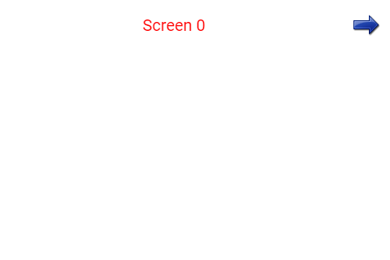

# Image: setas para mudar de tela

Um **widget** é uma peça da tela, como um botão, uma barra ou uma etiqueta. Uma seta leva da tela 0 para a tela 1. A outra traz você de volta. As imagens recebem o toque como se fossem botões.

Este manual acompanha [image_navigation.ino](image_navigation.ino). A referência é o código local da **DisplayWX 1.0.33**, incluindo os `.h` e `.cpp` atuais dos widgets.



*Imagem que acompanha o exemplo. Ela ilustra a disposição das peças; valores, cores ativas e textos podem mudar durante a execução. Confira os estados iniciais descritos abaixo.*

.png>)

*Segunda página do mesmo exemplo.*

## Caminho da leitura

1. [Entenda o que cada peça faz](#1-o-que-este-exemplo-faz).
2. [Prepare a placa, os fios e as bibliotecas](#2-prepare-a-placa-e-as-bibliotecas).
3. [Copie o programa completo](#3-programa-completo).
4. [Aprenda os objetos, as fichas, os callbacks e o loop](#4-o-programa-explicado-por-partes).
5. [Consulte os métodos disponíveis para seu programa](#5-métodos-dos-widgets-para-usar-no-seu-programa).
6. [Faça uma experiência](#6-experiência-opcional).
7. [Confira o resultado](#7-como-conferir-se-funcionou).

## 1. O que este exemplo faz

O callback da seta direita pede `loadScreen(screen1)`. O da esquerda pede `loadScreen(screen0)`. Cada função de tela limpa o fundo, escreve seu título e desenha somente os widgets daquele número de tela.

| Peça no programa | Widget | Sua tarefa |
| --- | --- | --- |
| `irightpng` | Image | Seta para a direita, disponível na tela 0. |
| `ileftpng` | Image | Seta para a esquerda, disponível na tela 1. |

**Image:** Uma imagem que também pode funcionar como botão. Neste exemplo, duas setas mudam de tela.

O programa completo abaixo é o `.ino`; os dois arquivos `.h` vinculados são seus recursos obrigatórios. As setas têm 32 × 32 pixels. Alterar `.width` e `.height` não redimensiona a lista de pixels: use os tamanhos que acompanham cada imagem.

Faça toques curtos, tirando o dedo antes do próximo. Alguns controles podem repetir a ação se você mantiver o dedo sobre eles. Arraste apenas os controles que foram feitos para deslizar.

## 2. Prepare a placa e as bibliotecas

Use uma placa **ESP32-S3**, display SPI **ST7796 de 320 × 480**, toque capacitivo **FT6336U**, cabo USB de dados e fios. A rotação 1 deixa uma área de desenho de **480 × 320 pixels**. Pixel é cada pontinho da imagem.

Na IDE Arduino, use a DisplayWX **1.0.33** deste projeto, **GFX Library for Arduino 1.6.5** e o pacote **esp32 by Espressif Systems 3.3.12**. O código da DisplayWX aceita as versões 3.3.11 e 3.3.12 desse pacote. Selecione o modelo ESP32-S3 da sua placa, sua porta USB e as opções de memória correspondentes ao hardware.

Abra o [user_setup.h da raiz da biblioteca](../../../user_setup.h), ao lado da pasta `src`. Deixe estas duas opções ativas:

```cpp
#define DISP_DEFAULT  // Display colorido.
#define TOUCH_FT6336  // Controlador FT6336U.
```

Desative as demais opções de display, toque e câmera colocando `//` no começo dessas linhas. Por exemplo: `// #define TOUCH_FT6236U`. O nome da opção correta é `TOUCH_FT6336`, sem U. Definir isso apenas no `.ino` não configura os outros arquivos da biblioteca.

### Ligações do display e do toque

| Sinal do módulo | GPIO do ESP32-S3 |
| --- | --- |
| MOSI / SDI do display | 11 |
| SCK / CLK | 12 |
| CS | 10 |
| DC / RS | 8 |
| RST do display | 9 |
| SDA do toque | 14 |
| SCL do toque | 13 |
| INT do toque | 18 |
| RST do toque | 17 |

`DISP_MISO = -1` significa que não há fio de leitura SPI. Una os GNDs. Alimente display e iluminação conforme o seu módulo; o sketch não controla um pino de backlight. Use sinais lógicos de 3,3 V. Faça a montagem com a alimentação desligada e ajuda de um adulto. Os números acima são GPIOs, não a posição física dos pinos no conector.

### Componentes deste exercício

Copie a pasta inteira do exemplo para preservar [irightpng.h](irightpng.h) e [ileftpng.h](ileftpng.h) ao lado do `.ino`. Eles contêm pixels, máscara, largura e altura das setas. Não é necessário cartão SD nem carregar arquivos no SPIFFS para este exemplo.

### Como carregar

1. Copie a pasta inteira deste exemplo para uma pasta de trabalho. Mantenha o nome da pasta igual ao nome do `.ino`.
2. Abra o `.ino` na IDE Arduino e substitua seu conteúdo pelo **programa completo abaixo**. Mantenha os arquivos `.h` que acompanham o exemplo.
3. Configure o `user_setup.h`, a placa e a porta como indicado acima.
4. Confira os fios, clique em **Verificar** e depois em **Carregar**.
5. Abra o Monitor Serial em **115200 baud** e reinicie a placa para acompanhar o início. Se estiver usando a USB nativa do ESP32-S3, a opção **USB CDC On Boot**, quando disponível para sua placa, precisa estar habilitada para os diagnósticos nessa porta.

## 3. Programa completo

Copie o bloco inteiro, da primeira linha à última chave. Ele inclui a preparação da tela e todas as funções usadas. Os trechos isolados da próxima seção explicam este mesmo programa; não devem ser acrescentados novamente.

```cpp
#include "irightpng.h"
#include "ileftpng.h"

#if CONFIG_IDF_TARGET_ESP32S2 || CONFIG_IDF_TARGET_ESP32S3
#define VSPI FSPI
#endif

#include <SPI.h>
#include <Arduino_GFX_Library.h>

#include <displaywx.h>

#define FORMAT_SPIFFS_IF_FAILED false
const int DISPLAY_W = 480;
const int DISPLAY_H = 320;
const int DISP_FREQUENCY = 27000000;
const int TOUCH_MAP_X0 = 0;
const int TOUCH_MAP_Y0 = 0;
const int TOUCH_MAP_X1 = 320;
const int TOUCH_MAP_Y1 = 480;
const bool TOUCH_SWAP_XY = true;
const bool TOUCH_INVERT_X = false;
const bool TOUCH_INVERT_Y = true;
const int DISP_MOSI = 11;
const int DISP_MISO = -1;
const int DISP_SCLK = 12;
const int DISP_CS = 10;
const int DISP_DC = 8;
const int DISP_RST = 9;
const int TOUCH_SCL = 13;
const int TOUCH_SDA = 14;
const int TOUCH_INT = 18;
const int TOUCH_RST = 17;
const uint8_t rotationScreen = 1;
const bool isIPS = true;

void screen0();
void screen1();
void loadWidgets();

void irightpng_cb();
void ileftpng_cb();

#if defined(CONFIG_IDF_TARGET_ESP32S3)
SPIClass spi_shared(FSPI);
#else
SPIClass spi_shared(HSPI);
#endif
Arduino_DataBus *bus = nullptr;
Arduino_GFX *tft = nullptr;
DisplayWX myDisplay;

// irightpng: Seta para a direita, disponível na tela 0.
Image irightpng(435, 15, 0);
// ileftpng: Seta para a esquerda, disponível na tela 1.
Image ileftpng(10, 10, 1);
const uint8_t qtdImagem = 2;
Image *arrayImagem[qtdImagem] = {&irightpng, &ileftpng};

void setup(){

    Serial.begin(115200);

    spi_shared.begin(DISP_SCLK, DISP_MISO, DISP_MOSI);
    bus = new Arduino_HWSPI(DISP_DC, DISP_CS, DISP_SCLK, DISP_MOSI, DISP_MISO, &spi_shared);
    tft = new Arduino_ST7796(bus, DISP_RST, rotationScreen, isIPS, 320, 480);
    tft->begin(DISP_FREQUENCY);
    myDisplay.setDrawObject(tft);

    myDisplay.setTouchCorners(TOUCH_MAP_X0, TOUCH_MAP_X1, TOUCH_MAP_Y0, TOUCH_MAP_Y1);
    myDisplay.setInvertAxis(TOUCH_INVERT_X, TOUCH_INVERT_Y);
    myDisplay.setSwapAxis(TOUCH_SWAP_XY);
    // Inicia o controlador de toque escolhido em user_setup.h.
    myDisplay.startTouchFT6336(DISPLAY_W, DISPLAY_H, rotationScreen, TOUCH_SDA, TOUCH_SCL, TOUCH_INT, TOUCH_RST);

    loadWidgets();
    myDisplay.loadScreen(screen0);
    // Inicia o trabalho da biblioteca que atende o toque e atualiza a tela.
    myDisplay.createTask(false, 3);
}

void loop(){

}

void screen0(){

    myDisplay.setBackgroundColor(CFK_WHITE);
    myDisplay.printText("Screen 0", 175, 22, TL_DATUM, CFK_COLOR01, CFK_WHITE, &RobotoRegular10pt7b);

    myDisplay.drawWidgetsOnScreen(0);
}
void screen1(){

    myDisplay.setBackgroundColor(CFK_WHITE);
    myDisplay.printText("Screen 1", 175, 22, TL_DATUM, CFK_COLOR01, CFK_WHITE, &RobotoRegular10pt7b);

    myDisplay.drawWidgetsOnScreen(1);
}

void loadWidgets(){

    ImageFromPixelsConfig configImage0 = {
            .pixels = irightpngPixels,
            .maskAlpha = irightpngMask,
            // Função chamada quando o usuário confirma/aciona este controle.
            .cb = irightpng_cb,
            .angle = 0,
            .width = irightpngW,
            .height = irightpngH,
            .backgroundColor = CFK_WHITE
        };
    // Aplica a ficha ao objeto; faça isso durante a preparação.
    irightpng.setupFromPixels(configImage0);
    ImageFromPixelsConfig configImage1 = {
            .pixels = ileftpngPixels,
            .maskAlpha = ileftpngMask,
            // Função chamada quando o usuário confirma/aciona este controle.
            .cb = ileftpng_cb,
            .angle = 0,
            .width = ileftpngW,
            .height = ileftpngH,
            .backgroundColor = CFK_WHITE
        };
    // Aplica a ficha ao objeto; faça isso durante a preparação.
    ileftpng.setupFromPixels(configImage1);
    myDisplay.setImage(arrayImagem,qtdImagem);

}

void irightpng_cb(){

    Serial.println("Image Rightpng clicked");
    myDisplay.loadScreen(screen1);
}

void ileftpng_cb(){

    Serial.println("Image Leftpng clicked");
    myDisplay.loadScreen(screen0);
}
```

## 4. O programa explicado por partes

### 4.1 Objetos, variáveis e listas

Um **objeto** é uma peça que seu programa pode chamar pelo nome. Uma **variável** é uma caixinha que guarda um valor. `bool` guarda `true` ou `false`; `int` guarda um inteiro; `float` e `double` guardam números com parte decimal. `const` indica algo que não será trocado durante a execução.


```cpp
// irightpng: Seta para a direita, disponível na tela 0.
Image irightpng(435, 15, 0);
// ileftpng: Seta para a esquerda, disponível na tela 1.
Image ileftpng(10, 10, 1);
// Quantidade de objetos desta lista.
const uint8_t qtdImagem = 2;
// Lista dos endereços dos widgets que a DisplayWX vai cuidar.
Image *arrayImagem[qtdImagem] = {&irightpng, &ileftpng};
```

| Objeto | Como interpretar a criação |
| --- | --- |
| `irightpng` (Image) | X = 435, Y = 15, tela = 0. Referência da posição: canto superior esquerdo. |
| `ileftpng` (Image) | X = 10, Y = 10, tela = 1. Referência da posição: canto superior esquerdo. |

X cresce para a direita e Y cresce para baixo, a partir do canto superior esquerdo da tela. O número da tela decide em qual página a peça aparece. A primeira tela é 0.

O `&` antes do nome entrega o **endereço** do objeto, como informar onde fica uma casa. O `*` na declaração da lista indica que ela guarda endereços. `qtd...` precisa corresponder à quantidade de itens: ao acrescentar um widget, acrescente seu endereço e ajuste a quantidade. Mantenha os objetos e essas listas globais, fora das funções, para continuarem existindo enquanto a interface trabalha.

### 4.2 A ficha de configuração (`struct`)

A `struct` funciona como uma ficha: cada campo escolhe uma característica. O ponto em `.width` significa “preencha o campo largura”. Depois, `objeto.setup(ficha)` entrega a ficha ao widget. Configure cada peça uma vez em `loadWidgets()`, depois de preparar o display e antes de iniciar a tarefa.

#### `configImage0`: ficha de `irightpng`

```cpp
ImageFromPixelsConfig configImage0 = {
            // Pixels guardados no arquivo .h da figura.
            .pixels = irightpngPixels,
            // Máscara que escolhe quais pixels ficam transparentes.
            .maskAlpha = irightpngMask,
            // Função chamada quando o usuário confirma/aciona este controle.
            .cb = irightpng_cb,
            .angle = 0,
            .width = irightpngW,
            .height = irightpngH,
            .backgroundColor = CFK_WHITE
        };
// Aplica a ficha ao objeto; faça isso durante a preparação.
irightpng.setupFromPixels(configImage0);
```

| Campo | Valor nesta ficha | Para que serve |
| --- | --- | --- |
| `pixels` | `irightpngPixels` | Lista de pixels da imagem, fornecida pelo arquivo `.h`. Mantenha essa lista disponível durante todo o programa. |
| `maskAlpha` | `irightpngMask` | Máscara de transparência fornecida pelo arquivo `.h`, ou `nullptr` sem máscara. |
| `cb` | `irightpng_cb` | Nome da função chamada após a ação. Escreva sem `()`, ou use `nullptr` para não associar uma ação. |
| `angle` | `0` | Rotação em graus. `0` mantém a imagem sem rotação. |
| `width` | `irightpngW` | Largura em pixels, os pontinhos da imagem. Mantenha o desenho dentro da tela. |
| `height` | `irightpngH` | Altura em pixels. Reserve espaço suficiente para o desenho e as letras. |
| `backgroundColor` | `CFK_WHITE` | Cor do fundo, por exemplo `CFK_WHITE`. Use a cor da área onde o widget aparece. |

Seta para a direita, disponível na tela 0.

#### `configImage1`: ficha de `ileftpng`

```cpp
ImageFromPixelsConfig configImage1 = {
            // Pixels guardados no arquivo .h da figura.
            .pixels = ileftpngPixels,
            // Máscara que escolhe quais pixels ficam transparentes.
            .maskAlpha = ileftpngMask,
            // Função chamada quando o usuário confirma/aciona este controle.
            .cb = ileftpng_cb,
            .angle = 0,
            .width = ileftpngW,
            .height = ileftpngH,
            .backgroundColor = CFK_WHITE
        };
// Aplica a ficha ao objeto; faça isso durante a preparação.
ileftpng.setupFromPixels(configImage1);
```

Seta para a esquerda, disponível na tela 1.

Após configurar, registre cada lista. É assim que a DisplayWX sabe quais peças precisa acompanhar:

```cpp
// Registra a lista e sua quantidade para a biblioteca encontrar estes widgets.
myDisplay.setImage(arrayImagem,qtdImagem);
```

`nullptr` significa “não liguei nada aqui”. Por exemplo, sem callback não há uma ação do seu programa para executar; sem `subtitle`, não há Label associado. Uma cor `CFK_...` é um valor de cor pronto da biblioteca. Uma fonte como `&RobotoRegular10pt7b` escolhe o desenho das letras. Para começar, conserve as fontes, os tamanhos e a ordem dos campos do exemplo.

### 4.3 O início: `setup()`

O Arduino executa `setup()` uma vez ao ligar. Ele prepara a comunicação, o display, o toque, os widgets e os componentes extras. A tarefa criada no fim continua cuidando da interface enquanto o seu `loop()` trabalha.

```cpp
void setup(){

    // Abre as mensagens de diagnóstico no computador.
    Serial.begin(115200);

    // Inicia os fios de comunicação SPI do display.
    spi_shared.begin(DISP_SCLK, DISP_MISO, DISP_MOSI);
    bus = new Arduino_HWSPI(DISP_DC, DISP_CS, DISP_SCLK, DISP_MOSI, DISP_MISO, &spi_shared);
    tft = new Arduino_ST7796(bus, DISP_RST, rotationScreen, isIPS, 320, 480);
    tft->begin(DISP_FREQUENCY);
    // Entrega à DisplayWX o objeto que desenha no display.
    myDisplay.setDrawObject(tft);

    // Informa a faixa de coordenadas recebida do toque.
    myDisplay.setTouchCorners(TOUCH_MAP_X0, TOUCH_MAP_X1, TOUCH_MAP_Y0, TOUCH_MAP_Y1);
    myDisplay.setInvertAxis(TOUCH_INVERT_X, TOUCH_INVERT_Y);
    myDisplay.setSwapAxis(TOUCH_SWAP_XY);
    // Inicia o controlador de toque escolhido em user_setup.h.
    myDisplay.startTouchFT6336(DISPLAY_W, DISPLAY_H, rotationScreen, TOUCH_SDA, TOUCH_SCL, TOUCH_INT, TOUCH_RST);

    // Preenche as fichas, configura e registra os widgets.
    loadWidgets();
    // Pede a troca de tela; passe o nome da função, sem ().
    myDisplay.loadScreen(screen0);
    // Inicia o trabalho da biblioteca que atende o toque e atualiza a tela.
    myDisplay.createTask(false, 3);
}
```

As declarações como `void screen0();` no começo do programa são **avisos de que essas funções existem**. Elas permitem usar seus nomes nas fichas antes de chegar à parte que contém o corpo da função. Não apague esses avisos ao copiar trechos.

### 4.4 Callbacks: o que acontece após a ação

Um **callback** é a tarefa que você escolhe para acontecer quando um controle é acionado ou uma edição é confirmada. Na ficha, escreva o nome **sem `()`**. A biblioteca o chama no momento adequado. Evite esperas longas dentro dele: guarde um pedido em uma variável e faça a parte demorada no `loop()`, quando necessário.

#### `irightpng_cb()`

Pede à DisplayWX a tela 1; a função é passada pelo nome, sem parênteses.

```cpp
void irightpng_cb(){

    Serial.println("Image Rightpng clicked");
    // Pede a troca de tela; passe o nome da função, sem ().
    myDisplay.loadScreen(screen1);
}
```

#### `ileftpng_cb()`

Pede a tela 0, completando a navegação de volta.

```cpp
void ileftpng_cb(){

    Serial.println("Image Leftpng clicked");
    // Pede a troca de tela; passe o nome da função, sem ().
    myDisplay.loadScreen(screen0);
}
```

As mensagens da `Serial` servem para observar o programa; os widgets não precisam delas para desenhar.

### 4.5 O trabalho repetido: `loop()`

O callback da seta direita pede `loadScreen(screen1)`. O da esquerda pede `loadScreen(screen0)`. Cada função de tela limpa o fundo, escreve seu título e desenha somente os widgets daquele número de tela.

```cpp
void loop(){

}
```

O corpo vazio é intencional: a tarefa da DisplayWX continua atendendo o toque. Não é necessário consultar o toque manualmente dentro do loop.

### 4.6 As telas

Cada função `screen...` pinta o fundo, coloca os textos fixos e manda desenhar os widgets daquela página. Troque de página com `myDisplay.loadScreen(screen0)` ou com a função da outra tela; passe o nome sem parênteses.

```cpp
void screen0(){

    // Pinta o fundo da tela com a cor escolhida.
    myDisplay.setBackgroundColor(CFK_WHITE);
    // Escreve um texto fixo; esse texto não é um widget interativo.
    myDisplay.printText("Screen 0", 175, 22, TL_DATUM, CFK_COLOR01, CFK_WHITE, &RobotoRegular10pt7b);

    // Desenha os widgets registrados para esse número de tela.
    myDisplay.drawWidgetsOnScreen(0);
}
```


```cpp
void screen1(){

    // Pinta o fundo da tela com a cor escolhida.
    myDisplay.setBackgroundColor(CFK_WHITE);
    // Escreve um texto fixo; esse texto não é um widget interativo.
    myDisplay.printText("Screen 1", 175, 22, TL_DATUM, CFK_COLOR01, CFK_WHITE, &RobotoRegular10pt7b);

    // Desenha os widgets registrados para esse número de tela.
    myDisplay.drawWidgetsOnScreen(1);
}
```

### 4.7 Funções extras

Este exemplo não precisa de outras funções próprias além das que acabamos de estudar. As funções como `digitalWrite`, `delay` e `analogRead` pertencem ao ambiente Arduino.

## 5. Métodos dos widgets para usar no seu programa

Um **método** é uma ação que pertence a um objeto. Em `objeto.metodo(valor)`, primeiro vem o nome da peça, depois o ponto, a ação e suas informações entre parênteses. As tabelas usam objetos reais deste exemplo. Faça essas chamadas **depois da configuração**; a linha `setup(...)` pertence à preparação. Os nomes das fichas só existem dentro de `loadWidgets()`.

### Image: métodos para seu programa

Uma imagem que também pode funcionar como botão. Neste exemplo, duas setas mudam de tela.

| Método | Como usar | Resultado e cuidado |
| --- | --- | --- |
| `setupFromPixels(config)` | `irightpng.setupFromPixels(configImage0);` | Configura uma vez a partir das listas de pixels e máscara existentes no programa. Não retorna valor. |
| `setupFromFile(config)` | `irightpng.setupFromFile(configArquivo);` | Carrega uma imagem do armazenamento. Não retorna o resultado; prefira a versão Safe se precisar detectar erro. |
| `setupFromFileSafe(config)` | `bool ok = irightpng.setupFromFileSafe(configArquivo);` | Retorna `true` se carregou ou `false` se falhou. Use em uma imagem ainda não configurada, com armazenamento preparado e arquivo válido. |
| `setDrawBackground(valor)` | `irightpng.setDrawBackground(true);` | Escolhe se a imagem deve pintar o fundo ao ser desenhada. `false` evita essa pintura. Recarregue a tela para aplicar visualmente. |
| `setEnabled(valor)` | `irightpng.setEnabled(false);` | Método herdado: bloqueia o toque com false e permite com true. Não altera o valor nem executa callback. |
| `isEnabled()` | `bool ativo = irightpng.isEnabled();` | Consulta a habilitação para toque. |
| `lock()` | `irightpng.lock();` | Bloqueia a interação por toque enquanto você não chamar unlock(). Não é uma trava para organizar tarefas do processador. |
| `unlock()` | `irightpng.unlock();` | Remove esse bloqueio de toque; não desfaz setEnabled(false). |
| `isLocked()` | `bool bloqueado = irightpng.isLocked();` | Consulta se lock() está ativo. |
| `show()` | `irightpng.show();` | Torna visível na sua tela e pede atualização. Para TouchArea, volta a permitir toque; ela continua invisível. |
| `hide()` | `irightpng.hide();` | Impede futuras atualizações visuais e, quando há toque, sua interação. Não apaga os pixels já desenhados: repinte a tela como explicado abaixo. |

Os arquivos `.h` das setas fazem parte deste sketch: copie-os junto. Os pixels e a máscara devem continuar existindo; a classe guarda seus endereços. As opções por arquivo leem o formato binário da DisplayWX (como `.fki`), não um PNG/JPEG comum. Não basta renomear a extensão. `SourceFile::EMBED` não é aceito na configuração por arquivo; use `setupFromPixels()` para imagens embutidas.

### Esconder e mostrar na tela

`hide()` não funciona como uma borracha para os pixels que já foram pintados. Para remover o desenho da página atual, esconda a peça e peça que a página seja montada novamente. Para fazê-la voltar, use `show()`. O estado/valor continua guardado.

```cpp
// Execute uma vez, na tela 0 deste exemplo.
irightpng.hide();
myDisplay.loadScreen(screen0);

// Em outra ação, quando quiser mostrar de novo:
irightpng.show();
myDisplay.loadScreen(screen0);
```

Os dois blocos são ações separadas: se executar todos de uma vez, o widget voltará logo em seguida. Textos fixos feitos com `printText()` continuam aparecendo, pois pertencem à função de tela. Um widget da tela 1 só aparece quando você volta à tela 1.

### Opção intermediária: imagem em arquivo

As setas deste exemplo usam pixels embutidos e não precisam de armazenamento. Para outro projeto, `setupFromFileSafe()` permite conferir se uma imagem foi carregada. Antes, prepare SD/SPIFFS/FATFS, habilite o armazenamento correspondente na biblioteca e coloque nele um arquivo binário compatível com a DisplayWX. Esta ficha seria usada **no lugar** da ficha de pixels de uma imagem ainda não configurada:

```cpp
ImageFromFileConfig configArquivo = {
    .path = "/figura.fki",
    .cb = irightpng_cb,
    .source = SourceFile::SPIFFS,
    .backgroundColor = CFK_WHITE
};
bool ok = irightpng.setupFromFileSafe(configArquivo);
if (!ok) {
    Serial.println("Confira o arquivo e o armazenamento");
}
```

Não cole essa opção depois de `setupFromPixels()`: a imagem já estará configurada. Os arquivos `.h` das setas são o caminho completo e reproduzível do exercício principal. As rotinas de métricas de desempenho ficam fora deste manual de uso básico/intermediário.

O desenho periódico e a detecção de toque ficam a cargo da DisplayWX. Seu `.ino` configura, registra, consulta e altera as peças pelas chamadas acima; não precisa chamar rotinas internas de desenho ou de detecção.

## 6. Experiência opcional

Execute uma vez em resposta a uma ação para navegar pelo código. Não chame `screen1()` diretamente no loop; entregue a função à DisplayWX.

```cpp
myDisplay.loadScreen(screen1);
```

Para executar esse trecho uma vez sem repeti-lo em cada volta, coloque-o no lugar do comentário abaixo **dentro do loop existente**. Digite `t` no Monitor Serial e envie. Preserve as outras tarefas do loop; o trecho só roda quando chega essa letra.

```cpp
if (Serial.available() > 0) {
    char comando = Serial.read();
    if (comando == 't') {
        // Cole aqui o trecho da experiência.
    }
}
```

Mude uma coisa de cada vez. O programa completo da seção 3 continua sendo o ponto de partida para voltar ao comportamento original do exercício.

## 7. Como conferir se funcionou

1. Ao iniciar, aparece Screen 0 e a seta direita no topo.
2. Toque na seta direita: aparece Screen 1 com a seta esquerda.
3. Toque na seta esquerda: retorna à primeira tela.

| Se acontecer... | Confira... |
| --- | --- |
| Erro ao compilar sobre tela, toque ou tipo desconhecido | Placa selecionada, versões instaladas e opções ativas no `user_setup.h` da raiz da biblioteca. Copie o programa inteiro. |
| Tela apagada ou sem desenho | Alimentação, GND, iluminação do módulo e fios/conectores do display. |
| Desenho correto, mas o toque não responde ou está deslocado | Controlador selecionado, SDA/SCL e configuração de rotação, limites e inversão dos eixos. Use os valores completos do exemplo para essa montagem. |
| Método com argumentos diferentes dá erro | Consulte a tabela da classe exata. Nem todos os `onClick` ou `setValue` recebem os mesmos argumentos. |

Este manual foi conferido com os arquivos locais da biblioteca. A validação descrita aqui é de código e documentação; a compilação para a sua placa e o ensaio físico devem ser feitos com a montagem indicada.

### Arquivos usados como referência

- [image_navigation.ino](image_navigation.ino).
- Image: [declarações `.h`](../../../src/widgets/image/wimage.h) e [implementação `.cpp`](../../../src/widgets/image/wimage.cpp).
- [DisplayWX](../../../src/displaywx.h) e [implementação da integração](../../../src/displaywx.cpp).
- [WidgetBase](../../../src/widgets/widgetbase.h) e [implementação](../../../src/widgets/widgetbase.cpp), para habilitação e bloqueio herdados.
