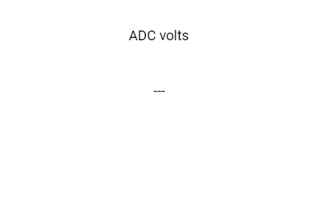

# Label: mostrando uma leitura em volts

Um **widget** é uma peça da tela, como um botão, uma barra ou uma etiqueta. Uma etiqueta mostra um número com duas casas decimais, com Voltage: antes e V depois.

Este manual acompanha [label_voltage.ino](label_voltage.ino). A referência é o código local da **DisplayWX 1.0.33**, incluindo os `.h` e `.cpp` atuais dos widgets.



*Imagem que acompanha o exemplo. Ela ilustra a disposição das peças; valores, cores ativas e textos podem mudar durante a execução. Confira os estados iniciais descritos abaixo.*

## Caminho da leitura

1. [Entenda o que cada peça faz](#1-o-que-este-exemplo-faz).
2. [Prepare a placa, os fios e as bibliotecas](#2-prepare-a-placa-e-as-bibliotecas).
3. [Copie o programa completo](#3-programa-completo).
4. [Aprenda os objetos, as fichas, os callbacks e o loop](#4-o-programa-explicado-por-partes).
5. [Consulte os métodos disponíveis para seu programa](#5-métodos-dos-widgets-para-usar-no-seu-programa).
6. [Faça uma experiência](#6-experiência-opcional).
7. [Confira o resultado](#7-como-conferir-se-funcionou).

## 1. O que este exemplo faz

A cada dois segundos, o programa lê o GPIO analógico, calcula uma aproximação da tensão e chama `setTextFloat(voltage, 2)`. O Label reúne prefixo, número e sufixo em uma única mensagem.

| Peça no programa | Widget | Sua tarefa |
| --- | --- | --- |
| `txtvolts` | Label | Exibe o valor calculado da leitura analógica. |

**Label:** Uma etiqueta de texto. Mostra palavras ou números com prefixo e sufixo, mas não recebe toques.

A conta `adc * (3.3 / 4095)` é uma aproximação didática. O ADC real tem faixa, atenuação e erros próprios; este exemplo não é um voltímetro calibrado. O alinhamento `TC_DATUM` centraliza o texto em X = 230.

## 2. Prepare a placa e as bibliotecas

Use uma placa **ESP32-S3**, display SPI **ST7796 de 320 × 480**, toque capacitivo **FT6336U**, cabo USB de dados e fios. A rotação 1 deixa uma área de desenho de **480 × 320 pixels**. Pixel é cada pontinho da imagem.

Na IDE Arduino, use a DisplayWX **1.0.33** deste projeto, **GFX Library for Arduino 1.6.5** e o pacote **esp32 by Espressif Systems 3.3.12**. O código da DisplayWX aceita as versões 3.3.11 e 3.3.12 desse pacote. Selecione o modelo ESP32-S3 da sua placa, sua porta USB e as opções de memória correspondentes ao hardware.

Abra o [user_setup.h da raiz da biblioteca](../../../user_setup.h), ao lado da pasta `src`. Deixe estas duas opções ativas:

```cpp
#define DISP_DEFAULT  // Display colorido.
#define TOUCH_FT6336  // Controlador FT6336U.
```

Desative as demais opções de display, toque e câmera colocando `//` no começo dessas linhas. Por exemplo: `// #define TOUCH_FT6236U`. O nome da opção correta é `TOUCH_FT6336`, sem U. Definir isso apenas no `.ino` não configura os outros arquivos da biblioteca.

### Ligações do display e do toque

| Sinal do módulo | GPIO do ESP32-S3 |
| --- | --- |
| MOSI / SDI do display | 11 |
| SCK / CLK | 12 |
| CS | 10 |
| DC / RS | 8 |
| RST do display | 9 |
| SDA do toque | 14 |
| SCL do toque | 13 |
| INT do toque | 18 |
| RST do toque | 17 |

`DISP_MISO = -1` significa que não há fio de leitura SPI. Una os GNDs. Alimente display e iluminação conforme o seu módulo; o sketch não controla um pino de backlight. Use sinais lógicos de 3,3 V. Faça a montagem com a alimentação desligada e ajuda de um adulto. Os números acima são GPIOs, não a posição física dos pinos no conector.

### Componentes deste exercício

Use um potenciômetro de 10 kΩ: extremos em 3,3 V e GND, terminal central no GPIO 16. O sinal de entrada precisa permanecer na faixa permitida pelo ESP32-S3; não conecte 5 V.

| Nome no programa | GPIO no código abaixo | Ligação |
| --- | --- | --- |
| `pinAdc` | 16 | Terminal central do potenciômetro |

Confira que esses GPIOs estão expostos e livres na sua placa. GPIOs 17 e 18 ficam reservados ao toque nesta montagem.

### Como carregar

1. Copie a pasta inteira deste exemplo para uma pasta de trabalho. Mantenha o nome da pasta igual ao nome do `.ino`.
2. Abra o `.ino` na IDE Arduino e substitua seu conteúdo pelo **programa completo abaixo**. Mantenha os arquivos `.h` que acompanham o exemplo.
3. Configure o `user_setup.h`, a placa e a porta como indicado acima.
4. Confira os fios, clique em **Verificar** e depois em **Carregar**.
5. Abra o Monitor Serial em **115200 baud** e reinicie a placa para acompanhar o início. Se estiver usando a USB nativa do ESP32-S3, a opção **USB CDC On Boot**, quando disponível para sua placa, precisa estar habilitada para os diagnósticos nessa porta.

## 3. Programa completo

Copie o bloco inteiro, da primeira linha à última chave. Ele inclui a preparação da tela e todas as funções usadas. Os trechos isolados da próxima seção explicam este mesmo programa; não devem ser acrescentados novamente.

```cpp
#if CONFIG_IDF_TARGET_ESP32S2 || CONFIG_IDF_TARGET_ESP32S3
#define VSPI FSPI
#endif

#include <SPI.h>
#include <Arduino_GFX_Library.h>

#include <displaywx.h>

#define FORMAT_SPIFFS_IF_FAILED false
const int DISPLAY_W = 480;
const int DISPLAY_H = 320;
const int DISP_FREQUENCY = 27000000;
const int TOUCH_MAP_X0 = 0;
const int TOUCH_MAP_Y0 = 0;
const int TOUCH_MAP_X1 = 320;
const int TOUCH_MAP_Y1 = 480;
const bool TOUCH_SWAP_XY = true;
const bool TOUCH_INVERT_X = false;
const bool TOUCH_INVERT_Y = true;
const int DISP_MOSI = 11;
const int DISP_MISO = -1;
const int DISP_SCLK = 12;
const int DISP_CS = 10;
const int DISP_DC = 8;
const int DISP_RST = 9;
const int TOUCH_SCL = 13;
const int TOUCH_SDA = 14;
const int TOUCH_INT = 18;
const int TOUCH_RST = 17;
const uint8_t rotationScreen = 1;
const bool isIPS = true;

void screen0();
void loadWidgets();

#if defined(CONFIG_IDF_TARGET_ESP32S3)
SPIClass spi_shared(FSPI);
#else
SPIClass spi_shared(HSPI);
#endif
Arduino_DataBus *bus = nullptr;
Arduino_GFX *tft = nullptr;
DisplayWX myDisplay;

// txtvolts: Exibe o valor calculado da leitura analógica.
Label txtvolts(230, 120, 0);
const uint8_t qtdLabel = 1;
Label *arrayLabel[qtdLabel] = {&txtvolts};

float convertADCtoVolts(int adcValue){
    return (float)adcValue * (3.3 / 4095.0);
}

const int pinAdc = 16;

void setup(){

    Serial.begin(115200);

    spi_shared.begin(DISP_SCLK, DISP_MISO, DISP_MOSI);
    bus = new Arduino_HWSPI(DISP_DC, DISP_CS, DISP_SCLK, DISP_MOSI, DISP_MISO, &spi_shared);
    tft = new Arduino_ST7796(bus, DISP_RST, rotationScreen, isIPS, 320, 480);
    tft->begin(DISP_FREQUENCY);
    myDisplay.setDrawObject(tft);

    myDisplay.setTouchCorners(TOUCH_MAP_X0, TOUCH_MAP_X1, TOUCH_MAP_Y0, TOUCH_MAP_Y1);
    myDisplay.setInvertAxis(TOUCH_INVERT_X, TOUCH_INVERT_Y);
    myDisplay.setSwapAxis(TOUCH_SWAP_XY);
    // Inicia o controlador de toque escolhido em user_setup.h.
    myDisplay.startTouchFT6336(DISPLAY_W, DISPLAY_H, rotationScreen, TOUCH_SDA, TOUCH_SCL, TOUCH_INT, TOUCH_RST);

    loadWidgets();
    myDisplay.loadScreen(screen0);
    // Inicia o trabalho da biblioteca que atende o toque e atualiza a tela.
    myDisplay.createTask(false, 3);
}

void loop(){

    int valueAdc = analogRead(pinAdc);
    float voltage = convertADCtoVolts(valueAdc);

    myDisplay.startCustomDraw();
    txtvolts.setTextFloat(voltage, 2);
    myDisplay.finishCustomDraw();
    delay(2000);
}

void screen0(){

    myDisplay.setBackgroundColor(CFK_WHITE);
    myDisplay.printText("ADC volts", 185, 42, TL_DATUM, CFK_BLACK, CFK_WHITE, &RobotoRegular10pt7b);

    myDisplay.drawWidgetsOnScreen(0);
}

void loadWidgets(){

    LabelConfig configLabel0 = {
            .text = "---",
            .prefix = "Voltage: ",
            .suffix = " V",
            .fontFamily = &RobotoRegular10pt7b,
            .datum = TC_DATUM,
            .fontColor = CFK_BLACK,
            .backgroundColor = CFK_WHITE
        };
    // Aplica a ficha ao objeto; faça isso durante a preparação.
    txtvolts.setup(configLabel0);
    myDisplay.setLabel(arrayLabel,qtdLabel);

}
```

## 4. O programa explicado por partes

### 4.1 Objetos, variáveis e listas

Um **objeto** é uma peça que seu programa pode chamar pelo nome. Uma **variável** é uma caixinha que guarda um valor. `bool` guarda `true` ou `false`; `int` guarda um inteiro; `float` e `double` guardam números com parte decimal. `const` indica algo que não será trocado durante a execução.


```cpp
// txtvolts: Exibe o valor calculado da leitura analógica.
Label txtvolts(230, 120, 0);
// Quantidade de objetos desta lista.
const uint8_t qtdLabel = 1;
// Lista dos endereços dos widgets que a DisplayWX vai cuidar.
Label *arrayLabel[qtdLabel] = {&txtvolts};


const int pinAdc = 16;
```

| Objeto | Como interpretar a criação |
| --- | --- |
| `txtvolts` (Label) | X = 230, Y = 120, tela = 0. Referência da posição: ponto de alinhamento escolhido por datum. |

X cresce para a direita e Y cresce para baixo, a partir do canto superior esquerdo da tela. O número da tela decide em qual página a peça aparece. A primeira tela é 0.

O `&` antes do nome entrega o **endereço** do objeto, como informar onde fica uma casa. O `*` na declaração da lista indica que ela guarda endereços. `qtd...` precisa corresponder à quantidade de itens: ao acrescentar um widget, acrescente seu endereço e ajuste a quantidade. Mantenha os objetos e essas listas globais, fora das funções, para continuarem existindo enquanto a interface trabalha.

### 4.2 A ficha de configuração (`struct`)

A `struct` funciona como uma ficha: cada campo escolhe uma característica. O ponto em `.width` significa “preencha o campo largura”. Depois, `objeto.setup(ficha)` entrega a ficha ao widget. Configure cada peça uma vez em `loadWidgets()`, depois de preparar o display e antes de iniciar a tarefa.

#### `configLabel0`: ficha de `txtvolts`

```cpp
LabelConfig configLabel0 = {
            .text = "---",
            .prefix = "Voltage: ",
            .suffix = " V",
            .fontFamily = &RobotoRegular10pt7b,
            .datum = TC_DATUM,
            .fontColor = CFK_BLACK,
            .backgroundColor = CFK_WHITE
        };
// Aplica a ficha ao objeto; faça isso durante a preparação.
txtvolts.setup(configLabel0);
```

| Campo | Valor nesta ficha | Para que serve |
| --- | --- | --- |
| `text` | `"---"` | Texto inicial. Escreva entre aspas, por exemplo `"Olá"`. |
| `prefix` | `"Voltage: "` | Texto colocado antes do valor, como `"Valor: "`. `""` deixa vazio. |
| `suffix` | `" V"` | Texto colocado depois do valor, como `" V"`. `""` deixa vazio. |
| `fontFamily` | `&RobotoRegular10pt7b` | Fonte das letras, por exemplo `&RobotoRegular10pt7b`. O `&` aponta para uma fonte que já existe. |
| `datum` | `TC_DATUM` | Alinhamento do texto em relação a `(x,y)`: `TL_DATUM` usa o canto superior esquerdo; `TC_DATUM`, o centro do topo. |
| `fontColor` | `CFK_BLACK` | Cor das letras, usando os nomes `CFK_...`. |
| `backgroundColor` | `CFK_WHITE` | Cor do fundo, por exemplo `CFK_WHITE`. Use a cor da área onde o widget aparece. |

Exibe o valor calculado da leitura analógica.

Após configurar, registre cada lista. É assim que a DisplayWX sabe quais peças precisa acompanhar:

```cpp
// Registra a lista e sua quantidade para a biblioteca encontrar estes widgets.
myDisplay.setLabel(arrayLabel,qtdLabel);
```

`nullptr` significa “não liguei nada aqui”. Por exemplo, sem callback não há uma ação do seu programa para executar; sem `subtitle`, não há Label associado. Uma cor `CFK_...` é um valor de cor pronto da biblioteca. Uma fonte como `&RobotoRegular10pt7b` escolhe o desenho das letras. Para começar, conserve as fontes, os tamanhos e a ordem dos campos do exemplo.

### 4.3 O início: `setup()`

O Arduino executa `setup()` uma vez ao ligar. Ele prepara a comunicação, o display, o toque, os widgets e os componentes extras. A tarefa criada no fim continua cuidando da interface enquanto o seu `loop()` trabalha.

```cpp
void setup(){

    // Abre as mensagens de diagnóstico no computador.
    Serial.begin(115200);

    // Inicia os fios de comunicação SPI do display.
    spi_shared.begin(DISP_SCLK, DISP_MISO, DISP_MOSI);
    bus = new Arduino_HWSPI(DISP_DC, DISP_CS, DISP_SCLK, DISP_MOSI, DISP_MISO, &spi_shared);
    tft = new Arduino_ST7796(bus, DISP_RST, rotationScreen, isIPS, 320, 480);
    tft->begin(DISP_FREQUENCY);
    // Entrega à DisplayWX o objeto que desenha no display.
    myDisplay.setDrawObject(tft);

    // Informa a faixa de coordenadas recebida do toque.
    myDisplay.setTouchCorners(TOUCH_MAP_X0, TOUCH_MAP_X1, TOUCH_MAP_Y0, TOUCH_MAP_Y1);
    myDisplay.setInvertAxis(TOUCH_INVERT_X, TOUCH_INVERT_Y);
    myDisplay.setSwapAxis(TOUCH_SWAP_XY);
    // Inicia o controlador de toque escolhido em user_setup.h.
    myDisplay.startTouchFT6336(DISPLAY_W, DISPLAY_H, rotationScreen, TOUCH_SDA, TOUCH_SCL, TOUCH_INT, TOUCH_RST);

    // Preenche as fichas, configura e registra os widgets.
    loadWidgets();
    // Pede a troca de tela; passe o nome da função, sem ().
    myDisplay.loadScreen(screen0);
    // Inicia o trabalho da biblioteca que atende o toque e atualiza a tela.
    myDisplay.createTask(false, 3);
}
```

As declarações como `void screen0();` no começo do programa são **avisos de que essas funções existem**. Elas permitem usar seus nomes nas fichas antes de chegar à parte que contém o corpo da função. Não apague esses avisos ao copiar trechos.

### 4.4 Callbacks: o que acontece após a ação

Um **callback** é a tarefa que você escolhe para acontecer quando um controle é acionado ou uma edição é confirmada. Na ficha, escreva o nome **sem `()`**. A biblioteca o chama no momento adequado. Evite esperas longas dentro dele: guarde um pedido em uma variável e faça a parte demorada no `loop()`, quando necessário.

Este sketch não associa callbacks a seus widgets. O programa entrega valores aos indicadores e textos no `loop()`. Tocar neles não cria uma leitura nova.

### 4.5 O trabalho repetido: `loop()`

A cada dois segundos, o programa lê o GPIO analógico, calcula uma aproximação da tensão e chama `setTextFloat(voltage, 2)`. O Label reúne prefixo, número e sufixo em uma única mensagem.

```cpp
void loop(){

    // Lê a entrada analógica: nesta configuração, de 0 a 4095.
    int valueAdc = analogRead(pinAdc);
    float voltage = convertADCtoVolts(valueAdc);

    // Reserva o desenho para esta sequência do seu programa.
    myDisplay.startCustomDraw();
    // Mostra o número decimal com a quantidade indicada de casas.
    txtvolts.setTextFloat(voltage, 2);
    // Devolve o desenho à tarefa da interface.
    myDisplay.finishCustomDraw();
    // Pausa em milissegundos: 1000 ms equivalem a um segundo.
    delay(2000);
}
```

Mantenha `startCustomDraw()` e `finishCustomDraw()` em pares, como abrir e fechar um caderno de desenho. Deixe pausas, esperas de rede e tarefas demoradas fora desse par.

`analogRead()` fornece uma contagem. `map()` troca a escala por uma conta: por exemplo, 0–4095 pode virar 0–100. Não transforma o widget em um sensor; a leitura continua vindo do pino físico.

### 4.6 As telas

Cada função `screen...` pinta o fundo, coloca os textos fixos e manda desenhar os widgets daquela página. Troque de página com `myDisplay.loadScreen(screen0)` ou com a função da outra tela; passe o nome sem parênteses.

```cpp
void screen0(){

    // Pinta o fundo da tela com a cor escolhida.
    myDisplay.setBackgroundColor(CFK_WHITE);
    // Escreve um texto fixo; esse texto não é um widget interativo.
    myDisplay.printText("ADC volts", 185, 42, TL_DATUM, CFK_BLACK, CFK_WHITE, &RobotoRegular10pt7b);

    // Desenha os widgets registrados para esse número de tela.
    myDisplay.drawWidgetsOnScreen(0);
}
```

### 4.7 Funções extras

#### `convertADCtoVolts()`

Multiplica a fração da leitura por 3,3. Por exemplo, a metade da contagem máxima corresponde aproximadamente a 1,65 nesta conta. O retorno `float` guarda um número com parte decimal.

```cpp
float convertADCtoVolts(int adcValue){
    return (float)adcValue * (3.3 / 4095.0);
}
```

## 5. Métodos dos widgets para usar no seu programa

Um **método** é uma ação que pertence a um objeto. Em `objeto.metodo(valor)`, primeiro vem o nome da peça, depois o ponto, a ação e suas informações entre parênteses. As tabelas usam objetos reais deste exemplo. Faça essas chamadas **depois da configuração**; a linha `setup(...)` pertence à preparação. Os nomes das fichas só existem dentro de `loadWidgets()`.

### Label: métodos para seu programa

Uma etiqueta de texto. Mostra palavras ou números com prefixo e sufixo, mas não recebe toques.

| Método | Como usar | Resultado e cuidado |
| --- | --- | --- |
| `setup(config)` | `txtvolts.setup(configLabel0);` | Aplica a ficha de configuração após preparar o display. Não retorna valor. Configure no `loadWidgets()` antes de iniciar a tarefa. |
| `setText(texto)` | `txtvolts.setText("Pronto");` | Mostra texto de `const char*` ou `String`, montando prefixo + texto + sufixo. Não retorna valor. |
| `setPrefix(texto)` | `txtvolts.setPrefix("Valor: ");` | Guarda o texto que vem antes. Chame depois `setText`, `setTextInt` ou `setTextFloat` para reconstruir o conteúdo exibido. |
| `setSuffix(texto)` | `txtvolts.setSuffix(" V");` | Guarda o texto que vem depois. Atualize o conteúdo em seguida para mostrar a nova combinação. |
| `setTextInt(valor)` | `txtvolts.setTextInt(42);` | Mostra um número inteiro com prefixo e sufixo. |
| `setTextFloat(valor, casas = 2)` | `txtvolts.setTextFloat(3.25, 2);` | Mostra número decimal. O segundo argumento escolhe 0 a 5 casas; omitido, usa 2. |
| `setDecimalPlaces(casas)` | `txtvolts.setDecimalPlaces(1);` | Guarda a precisão, limitada a 0–5. Não reformata sozinho o texto; `setTextFloat` define novamente a precisão com seu próprio argumento. |
| `setFontSize(escala)` | `txtvolts.setFontSize(2);` | Define o fator de tamanho das letras; use 1 para normal. Não pede atualização sozinho: atualize o texto ou recarregue a tela depois. |
| `show()` | `txtvolts.show();` | Torna visível na sua tela e pede atualização. Para TouchArea, volta a permitir toque; ela continua invisível. |
| `hide()` | `txtvolts.hide();` | Impede futuras atualizações visuais e, quando há toque, sua interação. Não apaga os pixels já desenhados: repinte a tela como explicado abaixo. |

Para limpar prefixo ou sufixo, use `""`. Altere os dois antes de mandar o novo conteúdo. Um Label não mede nada: é o programa que fornece o valor.

### Esconder e mostrar na tela

`hide()` não funciona como uma borracha para os pixels que já foram pintados. Para remover o desenho da página atual, esconda a peça e peça que a página seja montada novamente. Para fazê-la voltar, use `show()`. O estado/valor continua guardado.

```cpp
// Execute uma vez, na tela 0 deste exemplo.
txtvolts.hide();
myDisplay.loadScreen(screen0);

// Em outra ação, quando quiser mostrar de novo:
txtvolts.show();
myDisplay.loadScreen(screen0);
```

Os dois blocos são ações separadas: se executar todos de uma vez, o widget voltará logo em seguida. Textos fixos feitos com `printText()` continuam aparecendo, pois pertencem à função de tela. Um widget da tela 1 só aparece quando você volta à tela 1.

O desenho periódico e a detecção de toque ficam a cargo da DisplayWX. Seu `.ino` configura, registra, consulta e altera as peças pelas chamadas acima; não precisa chamar rotinas internas de desenho ou de detecção.

## 6. Experiência opcional

Substitua temporariamente a atualização do loop por esta linha para mostrar Voltage: 1.25 V.

```cpp
txtvolts.setTextFloat(1.25, 2);
```

Mude uma coisa de cada vez. O programa completo da seção 3 continua sendo o ponto de partida para voltar ao comportamento original do exercício.

## 7. Como conferir se funcionou

1. Ao iniciar, aparece o título ADC volts e o valor é atualizado pelo loop.
2. Gire o potenciômetro e espere até dois segundos. O número deve variar.
3. Confira o prefixo Voltage: e o sufixo V ao redor do número.

| Se acontecer... | Confira... |
| --- | --- |
| Erro ao compilar sobre tela, toque ou tipo desconhecido | Placa selecionada, versões instaladas e opções ativas no `user_setup.h` da raiz da biblioteca. Copie o programa inteiro. |
| Tela apagada ou sem desenho | Alimentação, GND, iluminação do módulo e fios/conectores do display. |
| Desenho correto, mas o toque não responde ou está deslocado | Controlador selecionado, SDA/SCL e configuração de rotação, limites e inversão dos eixos. Use os valores completos do exemplo para essa montagem. |
| Tela funciona, mas o componente externo não acompanha | Use os GPIOs da tabela deste manual, GND comum e a polaridade correta. Uma mudança com callback desativado pode atualizar só o widget. |
| Valor parece demorar para mudar | Confira o `delay()` no loop. Vários exemplos só enviam uma atualização a cada dois segundos. |
| Método com argumentos diferentes dá erro | Consulte a tabela da classe exata. Nem todos os `onClick` ou `setValue` recebem os mesmos argumentos. |

Este manual foi conferido com os arquivos locais da biblioteca. A validação descrita aqui é de código e documentação; a compilação para a sua placa e o ensaio físico devem ser feitos com a montagem indicada.

### Arquivos usados como referência

- [label_voltage.ino](label_voltage.ino).
- Label: [declarações `.h`](../../../src/widgets/label/wlabel.h) e [implementação `.cpp`](../../../src/widgets/label/wlabel.cpp).
- [DisplayWX](../../../src/displaywx.h) e [implementação da integração](../../../src/displaywx.cpp).
