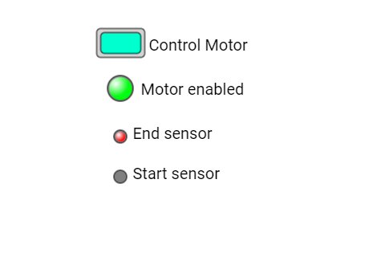

# Led e RectButton: comando e indicadores de um motor

Um **widget** é uma peça da tela, como um botão, uma barra ou uma etiqueta. Um botão controla uma saída de habilitação. Três luzes desenhadas mostram esse comando e as leituras de dois sensores.

Este manual acompanha [led_rectbutton_motor.ino](led_rectbutton_motor.ino). A referência é o código local da **DisplayWX 1.0.33**, incluindo os `.h` e `.cpp` atuais dos widgets.



*Imagem que acompanha o exemplo. Ela ilustra a disposição das peças; valores, cores ativas e textos podem mudar durante a execução. Confira os estados iniciais descritos abaixo.*

## Caminho da leitura

1. [Entenda o que cada peça faz](#1-o-que-este-exemplo-faz).
2. [Prepare a placa, os fios e as bibliotecas](#2-prepare-a-placa-e-as-bibliotecas).
3. [Copie o programa completo](#3-programa-completo).
4. [Aprenda os objetos, as fichas, os callbacks e o loop](#4-o-programa-explicado-por-partes).
5. [Consulte os métodos disponíveis para seu programa](#5-métodos-dos-widgets-para-usar-no-seu-programa).
6. [Faça uma experiência](#6-experiência-opcional).
7. [Confira o resultado](#7-como-conferir-se-funcionou).

## 1. O que este exemplo faz

O callback do botão atualiza `motorEnabledState` e o pino de saída. A cada dois segundos, o loop lê os dois sensores e passa os três estados para os LEDs desenhados.

| Peça no programa | Widget | Sua tarefa |
| --- | --- | --- |
| `led1` | Led | Mostra o comando de habilitação. |
| `led2` | Led | Mostra a entrada End sensor. |
| `led3` | Led | Mostra a entrada Start sensor. |
| `btncontrolmotor` | RectButton | Escolhe ligar/desligar a saída de habilitação. |

**Led:** Uma luz desenhada na tela para indicar ligado/desligado. Ela não aciona um pino físico e não recebe toque.

**RectButton:** Um botão retangular que guarda ligado/desligado. O texto ao lado é desenhado separadamente.

Os sensores apenas alimentam os indicadores neste sketch: eles NÃO desligam automaticamente o motor. Os LEDs 1 e 2 têm estado inicial true na ficha, mas o primeiro ciclo do loop substitui esses estados pelos valores atuais. O LED Motor enabled mostra o comando, não uma confirmação de rotação.

Faça toques curtos, tirando o dedo antes do próximo. Alguns controles podem repetir a ação se você mantiver o dedo sobre eles. Arraste apenas os controles que foram feitos para deslizar.

## 2. Prepare a placa e as bibliotecas

Use uma placa **ESP32-S3**, display SPI **ST7796 de 320 × 480**, toque capacitivo **FT6336U**, cabo USB de dados e fios. A rotação 1 deixa uma área de desenho de **480 × 320 pixels**. Pixel é cada pontinho da imagem.

Na IDE Arduino, use a DisplayWX **1.0.33** deste projeto, **GFX Library for Arduino 1.6.5** e o pacote **esp32 by Espressif Systems 3.3.12**. O código da DisplayWX aceita as versões 3.3.11 e 3.3.12 desse pacote. Selecione o modelo ESP32-S3 da sua placa, sua porta USB e as opções de memória correspondentes ao hardware.

Abra o [user_setup.h da raiz da biblioteca](../../../user_setup.h), ao lado da pasta `src`. Deixe estas duas opções ativas:

```cpp
#define DISP_DEFAULT  // Display colorido.
#define TOUCH_FT6336  // Controlador FT6336U.
```

Desative as demais opções de display, toque e câmera colocando `//` no começo dessas linhas. Por exemplo: `// #define TOUCH_FT6236U`. O nome da opção correta é `TOUCH_FT6336`, sem U. Definir isso apenas no `.ino` não configura os outros arquivos da biblioteca.

### Ligações do display e do toque

| Sinal do módulo | GPIO do ESP32-S3 |
| --- | --- |
| MOSI / SDI do display | 11 |
| SCK / CLK | 12 |
| CS | 10 |
| DC / RS | 8 |
| RST do display | 9 |
| SDA do toque | 14 |
| SCL do toque | 13 |
| INT do toque | 18 |
| RST do toque | 17 |

`DISP_MISO = -1` significa que não há fio de leitura SPI. Una os GNDs. Alimente display e iluminação conforme o seu módulo; o sketch não controla um pino de backlight. Use sinais lógicos de 3,3 V. Faça a montagem com a alimentação desligada e ajuda de um adulto. Os números acima são GPIOs, não a posição física dos pinos no conector.

### Componentes deste exercício

Para reproduzir a interface sem motor, use um LED com resistor de 330 Ω na saída de habilitação. Para cada entrada, use uma chave entre 3,3 V e o GPIO com resistor de 10 kΩ do GPIO para GND, evitando entrada solta. Se usar um driver de motor, sua entrada precisa aceitar lógica de 3,3 V e a polaridade HIGH para habilitar usada aqui. O motor fica no driver com alimentação adequada, não no GPIO.

| Nome no programa | GPIO no `.ino` e neste manual | Ligação |
| --- | --- | --- |
| `pinMotorEnable` | 16 | LED de teste ou entrada de habilitação do driver |
| `pinEndSensor` | 21 | Chave/sensor de fim, sinal 0–3,3 V |
| `pinStartSensor` | 47 | Chave/sensor de início, sinal 0–3,3 V |

Os GPIOs desta tabela já estão definidos no `.ino` e nos trechos de código deste manual. Os pinos do display, da iluminação e do toque foram preservados; GPIOs 17 e 18 ficam reservados ao toque nesta montagem. Confira que os GPIOs dos periféricos estão expostos e livres na sua placa.

### Como carregar

1. Copie a pasta inteira deste exemplo para uma pasta de trabalho. Mantenha o nome da pasta igual ao nome do `.ino`.
2. Abra o `.ino` na IDE Arduino e substitua seu conteúdo pelo **programa completo abaixo**. Mantenha os arquivos `.h` que acompanham o exemplo.
3. Configure o `user_setup.h`, a placa e a porta como indicado acima.
4. Confira os fios, clique em **Verificar** e depois em **Carregar**.
5. Abra o Monitor Serial em **115200 baud** e reinicie a placa para acompanhar o início. Se estiver usando a USB nativa do ESP32-S3, a opção **USB CDC On Boot**, quando disponível para sua placa, precisa estar habilitada para os diagnósticos nessa porta.

### Ajustes desta versão didática

O programa abaixo mantém os widgets e a proposta do `.ino`, com estes ajustes explícitos para a montagem descrita:

- A inicialização dos pinos ou da Serial2 vem antes de `createTask()`, para que os callbacks encontrem o hardware pronto. As saídas começam em LOW quando não havia estado inicial explícito.

As ligações são as mesmas no `.ino` e neste manual. Para reproduzir também os ajustes didáticos acima, copie o programa completo a seguir.

## 3. Programa completo

Copie o bloco inteiro, da primeira linha à última chave. Ele inclui a preparação da tela e todas as funções usadas. Os trechos isolados da próxima seção explicam este mesmo programa; não devem ser acrescentados novamente.

```cpp
#if CONFIG_IDF_TARGET_ESP32S2 || CONFIG_IDF_TARGET_ESP32S3
#define VSPI FSPI
#endif

#include <SPI.h>
#include <Arduino_GFX_Library.h>

#include <displaywx.h>

#define FORMAT_SPIFFS_IF_FAILED false
const int DISPLAY_W = 480;
const int DISPLAY_H = 320;
const int DISP_FREQUENCY = 27000000;
const int TOUCH_MAP_X0 = 0;
const int TOUCH_MAP_Y0 = 0;
const int TOUCH_MAP_X1 = 320;
const int TOUCH_MAP_Y1 = 480;
const bool TOUCH_SWAP_XY = true;
const bool TOUCH_INVERT_X = false;
const bool TOUCH_INVERT_Y = true;
const int DISP_MOSI = 11;
const int DISP_MISO = -1;
const int DISP_SCLK = 12;
const int DISP_CS = 10;
const int DISP_DC = 8;
const int DISP_RST = 9;
const int TOUCH_SCL = 13;
const int TOUCH_SDA = 14;
const int TOUCH_INT = 18;
const int TOUCH_RST = 17;
const uint8_t rotationScreen = 1;
const bool isIPS = true;

void screen0();
void loadWidgets();

void btncontrolmotor_cb();

#if defined(CONFIG_IDF_TARGET_ESP32S3)
SPIClass spi_shared(FSPI);
#else
SPIClass spi_shared(HSPI);
#endif
Arduino_DataBus *bus = nullptr;
Arduino_GFX *tft = nullptr;
DisplayWX myDisplay;

// led1: Mostra o comando de habilitação.
Led led1(150, 110, 0);
// led2: Mostra a entrada End sensor.
Led led2(150, 170, 0);
// led3: Mostra a entrada Start sensor.
Led led3(150, 220, 0);
const uint8_t qtdLed = 3;
Led *arrayLed[qtdLed] = {&led1, &led2, &led3};
// btncontrolmotor: Escolhe ligar/desligar a saída de habilitação.
RectButton btncontrolmotor(120, 35, 0);
const uint8_t qtdRectBtn = 1;
RectButton *arrayRectbtn[qtdRectBtn] = {&btncontrolmotor};

const int pinMotorEnable = 16;
const int pinEndSensor = 21;
const int pinStartSensor = 47;
bool motorEnabledState = false;

void setup(){

    Serial.begin(115200);

    spi_shared.begin(DISP_SCLK, DISP_MISO, DISP_MOSI);
    bus = new Arduino_HWSPI(DISP_DC, DISP_CS, DISP_SCLK, DISP_MOSI, DISP_MISO, &spi_shared);
    tft = new Arduino_ST7796(bus, DISP_RST, rotationScreen, isIPS, 320, 480);
    tft->begin(DISP_FREQUENCY);
    myDisplay.setDrawObject(tft);

    myDisplay.setTouchCorners(TOUCH_MAP_X0, TOUCH_MAP_X1, TOUCH_MAP_Y0, TOUCH_MAP_Y1);
    myDisplay.setInvertAxis(TOUCH_INVERT_X, TOUCH_INVERT_Y);
    myDisplay.setSwapAxis(TOUCH_SWAP_XY);
    // Inicia o controlador de toque escolhido em user_setup.h.
    myDisplay.startTouchFT6336(DISPLAY_W, DISPLAY_H, rotationScreen, TOUCH_SDA, TOUCH_SCL, TOUCH_INT, TOUCH_RST);

    loadWidgets();
    myDisplay.loadScreen(screen0);

    pinMode(pinMotorEnable, OUTPUT);
    pinMode(pinEndSensor, INPUT);
    pinMode(pinStartSensor, INPUT);
    digitalWrite(pinMotorEnable, motorEnabledState ? HIGH : LOW);
    // Inicia o trabalho da biblioteca que atende o toque e atualiza a tela.
    myDisplay.createTask(false, 3);

}

void loop(){

    bool endSensor = digitalRead(pinEndSensor);
    bool startSensor = digitalRead(pinStartSensor);
    myDisplay.startCustomDraw();
    led1.setState(motorEnabledState);
    led2.setState(endSensor);
    led3.setState(startSensor);
    myDisplay.finishCustomDraw();
    delay(2000);
}

void screen0(){

    myDisplay.setBackgroundColor(CFK_WHITE);

    myDisplay.printText("Motor enabled", 175, 102, TL_DATUM, CFK_BLACK, CFK_WHITE, &RobotoRegular10pt7b);
    myDisplay.printText("End sensor", 165, 157, TL_DATUM, CFK_BLACK, CFK_WHITE, &RobotoRegular10pt7b);
    myDisplay.printText("Start sensor", 165, 207, TL_DATUM, CFK_BLACK, CFK_WHITE, &RobotoRegular10pt7b);

    myDisplay.printText("Control Motor", 185, 47, TL_DATUM, CFK_BLACK, CFK_WHITE, &RobotoRegular10pt7b);
    myDisplay.drawWidgetsOnScreen(0);
}

void loadWidgets(){

    LedConfig configLed0 = {
            .radius = 16,
            .colorOn = CFK_COLOR12,
            .colorOff = CFK_GREY3,
            .initialState = true
        };
    // Aplica a ficha ao objeto; faça isso durante a preparação.
    led1.setup(configLed0);
    LedConfig configLed1 = {
            .radius = 8,
            .colorOn = CFK_COLOR01,
            .colorOff = CFK_GREY3,
            .initialState = true
        };
    // Aplica a ficha ao objeto; faça isso durante a preparação.
    led2.setup(configLed1);
    LedConfig configLed2 = {
            .radius = 8,
            .colorOn = CFK_COLOR01,
            .colorOff = CFK_GREY3,
            .initialState = false
        };
    // Aplica a ficha ao objeto; faça isso durante a preparação.
    led3.setup(configLed2);
    myDisplay.setLed(arrayLed,qtdLed);

    RectButtonConfig configRectButton0 = {
            // Função chamada quando o usuário aciona este controle.
            .callback = btncontrolmotor_cb,
            .width = 60,
            .height = 36,
            .pressedColor = CFK_COLOR16
        };

// Aplica a ficha ao objeto; faça isso durante a preparação.
btncontrolmotor.setup(configRectButton0);
    myDisplay.setRectButton(arrayRectbtn,qtdRectBtn);

}

void btncontrolmotor_cb(){

    bool myValue = btncontrolmotor.getStatus();
    Serial.print("New value for rectbutton is: ");Serial.println(myValue);
    motorEnabledState = myValue;
    digitalWrite(pinMotorEnable, motorEnabledState ? HIGH : LOW);
}
```

## 4. O programa explicado por partes

### 4.1 Objetos, variáveis e listas

Um **objeto** é uma peça que seu programa pode chamar pelo nome. Uma **variável** é uma caixinha que guarda um valor. `bool` guarda `true` ou `false`; `int` guarda um inteiro; `float` e `double` guardam números com parte decimal. `const` indica algo que não será trocado durante a execução.


```cpp
// led1: Mostra o comando de habilitação.
Led led1(150, 110, 0);
// led2: Mostra a entrada End sensor.
Led led2(150, 170, 0);
// led3: Mostra a entrada Start sensor.
Led led3(150, 220, 0);
// Quantidade de objetos desta lista.
const uint8_t qtdLed = 3;
// Lista dos endereços dos widgets que a DisplayWX vai cuidar.
Led *arrayLed[qtdLed] = {&led1, &led2, &led3};
// btncontrolmotor: Escolhe ligar/desligar a saída de habilitação.
RectButton btncontrolmotor(120, 35, 0);
// Quantidade de objetos desta lista.
const uint8_t qtdRectBtn = 1;
// Lista dos endereços dos widgets que a DisplayWX vai cuidar.
RectButton *arrayRectbtn[qtdRectBtn] = {&btncontrolmotor};

const int pinMotorEnable = 16;
const int pinEndSensor = 21;
const int pinStartSensor = 47;
bool motorEnabledState = false;
```

| Objeto | Como interpretar a criação |
| --- | --- |
| `led1` (Led) | X = 150, Y = 110, tela = 0. Referência da posição: centro do círculo. |
| `led2` (Led) | X = 150, Y = 170, tela = 0. Referência da posição: centro do círculo. |
| `led3` (Led) | X = 150, Y = 220, tela = 0. Referência da posição: centro do círculo. |
| `btncontrolmotor` (RectButton) | X = 120, Y = 35, tela = 0. Referência da posição: canto superior esquerdo. |

X cresce para a direita e Y cresce para baixo, a partir do canto superior esquerdo da tela. O número da tela decide em qual página a peça aparece. A primeira tela é 0.

O `&` antes do nome entrega o **endereço** do objeto, como informar onde fica uma casa. O `*` na declaração da lista indica que ela guarda endereços. `qtd...` precisa corresponder à quantidade de itens: ao acrescentar um widget, acrescente seu endereço e ajuste a quantidade. Mantenha os objetos e essas listas globais, fora das funções, para continuarem existindo enquanto a interface trabalha.

### 4.2 A ficha de configuração (`struct`)

A `struct` funciona como uma ficha: cada campo escolhe uma característica. O ponto em `.width` significa “preencha o campo largura”. Depois, `objeto.setup(ficha)` entrega a ficha ao widget. Configure cada peça uma vez em `loadWidgets()`, depois de preparar o display e antes de iniciar a tarefa.

#### `configLed0`: ficha de `led1`

```cpp
LedConfig configLed0 = {
            .radius = 16,
            .colorOn = CFK_COLOR12,
            .colorOff = CFK_GREY3,
            .initialState = true
        };
// Aplica a ficha ao objeto; faça isso durante a preparação.
led1.setup(configLed0);
```

| Campo | Valor nesta ficha | Para que serve |
| --- | --- | --- |
| `radius` | `16` | Raio em pixels: distância do centro até a borda do círculo. |
| `colorOn` | `CFK_COLOR12` | Cor do LED desenhado quando ligado. |
| `colorOff` | `CFK_GREY3` | Cor do LED desenhado quando desligado; `0` usa a escolha automática. |
| `initialState` | `true` | Estado inicial: `true` ligado; `false` desligado. |

Mostra o comando de habilitação.

#### `configLed1`: ficha de `led2`

```cpp
LedConfig configLed1 = {
            .radius = 8,
            .colorOn = CFK_COLOR01,
            .colorOff = CFK_GREY3,
            .initialState = true
        };
// Aplica a ficha ao objeto; faça isso durante a preparação.
led2.setup(configLed1);
```

Mostra a entrada End sensor.

#### `configLed2`: ficha de `led3`

```cpp
LedConfig configLed2 = {
            .radius = 8,
            .colorOn = CFK_COLOR01,
            .colorOff = CFK_GREY3,
            .initialState = false
        };
// Aplica a ficha ao objeto; faça isso durante a preparação.
led3.setup(configLed2);
```

Mostra a entrada Start sensor.

#### `configRectButton0`: ficha de `btncontrolmotor`

```cpp
RectButtonConfig configRectButton0 = {
            // Função chamada quando o usuário aciona este controle.
            .callback = btncontrolmotor_cb,
            .width = 60,
            .height = 36,
            .pressedColor = CFK_COLOR16
        };
// Aplica a ficha ao objeto; faça isso durante a preparação.
btncontrolmotor.setup(configRectButton0);
```

| Campo | Valor nesta ficha | Para que serve |
| --- | --- | --- |
| `callback` | `btncontrolmotor_cb` | Nome da função chamada quando há uma ação. Escreva o nome sem `()`. `nullptr` significa sem callback. |
| `width` | `60` | Largura em pixels, os pontinhos da imagem. Mantenha o desenho dentro da tela. |
| `height` | `36` | Altura em pixels. Reserve espaço suficiente para o desenho e as letras. |
| `pressedColor` | `CFK_COLOR16` | Cor usada quando o controle está ativo. Use um nome pronto `CFK_...`. |

Escolhe ligar/desligar a saída de habilitação.

Após configurar, registre cada lista. É assim que a DisplayWX sabe quais peças precisa acompanhar:

```cpp
// Registra a lista e sua quantidade para a biblioteca encontrar estes widgets.
myDisplay.setLed(arrayLed,qtdLed);
// Registra a lista e sua quantidade para a biblioteca encontrar estes widgets.
myDisplay.setRectButton(arrayRectbtn,qtdRectBtn);
```

`nullptr` significa “não liguei nada aqui”. Por exemplo, sem callback não há uma ação do seu programa para executar; sem `subtitle`, não há Label associado. Uma cor `CFK_...` é um valor de cor pronto da biblioteca. Uma fonte como `&RobotoRegular10pt7b` escolhe o desenho das letras. Para começar, conserve as fontes, os tamanhos e a ordem dos campos do exemplo.

### 4.3 O início: `setup()`

O Arduino executa `setup()` uma vez ao ligar. Ele prepara a comunicação, o display, o toque, os widgets e os componentes extras. A tarefa criada no fim continua cuidando da interface enquanto o seu `loop()` trabalha.

```cpp
void setup(){

    // Abre as mensagens de diagnóstico no computador.
    Serial.begin(115200);

    // Inicia os fios de comunicação SPI do display.
    spi_shared.begin(DISP_SCLK, DISP_MISO, DISP_MOSI);
    bus = new Arduino_HWSPI(DISP_DC, DISP_CS, DISP_SCLK, DISP_MOSI, DISP_MISO, &spi_shared);
    tft = new Arduino_ST7796(bus, DISP_RST, rotationScreen, isIPS, 320, 480);
    tft->begin(DISP_FREQUENCY);
    // Entrega à DisplayWX o objeto que desenha no display.
    myDisplay.setDrawObject(tft);

    // Informa a faixa de coordenadas recebida do toque.
    myDisplay.setTouchCorners(TOUCH_MAP_X0, TOUCH_MAP_X1, TOUCH_MAP_Y0, TOUCH_MAP_Y1);
    myDisplay.setInvertAxis(TOUCH_INVERT_X, TOUCH_INVERT_Y);
    myDisplay.setSwapAxis(TOUCH_SWAP_XY);
    // Inicia o controlador de toque escolhido em user_setup.h.
    myDisplay.startTouchFT6336(DISPLAY_W, DISPLAY_H, rotationScreen, TOUCH_SDA, TOUCH_SCL, TOUCH_INT, TOUCH_RST);

    // Preenche as fichas, configura e registra os widgets.
    loadWidgets();
    // Pede a troca de tela; passe o nome da função, sem ().
    myDisplay.loadScreen(screen0);

    // OUTPUT comanda uma saída; INPUT lê um sinal externo.
    pinMode(pinMotorEnable, OUTPUT);
    // OUTPUT comanda uma saída; INPUT lê um sinal externo.
    pinMode(pinEndSensor, INPUT);
    // OUTPUT comanda uma saída; INPUT lê um sinal externo.
    pinMode(pinStartSensor, INPUT);
    // Comanda uma saída física: HIGH liga o sinal; LOW o desliga.
    digitalWrite(pinMotorEnable, motorEnabledState ? HIGH : LOW);
    // Inicia o trabalho da biblioteca que atende o toque e atualiza a tela.
    myDisplay.createTask(false, 3);

}
```

As declarações como `void screen0();` no começo do programa são **avisos de que essas funções existem**. Elas permitem usar seus nomes nas fichas antes de chegar à parte que contém o corpo da função. Não apague esses avisos ao copiar trechos.

### 4.4 Callbacks: o que acontece após a ação

Um **callback** é a tarefa que você escolhe para acontecer quando um controle é acionado ou uma edição é confirmada. Na ficha, escreva o nome **sem `()`**. A biblioteca o chama no momento adequado. Evite esperas longas dentro dele: guarde um pedido em uma variável e faça a parte demorada no `loop()`, quando necessário.

#### `btncontrolmotor_cb()`

Escolhe ligar/desligar a saída de habilitação. Lê o estado escolhido; `true` significa ligado/marcado e `false`, desligado/desmarcado. Escreve o nível da saída física. `HIGH` é nível alto e `LOW`, baixo. A mensagem na Serial ajuda a conferir que a ação aconteceu.

```cpp
void btncontrolmotor_cb(){

    // Lê o estado ligado/marcado que o widget guardou.
    bool myValue = btncontrolmotor.getStatus();
    Serial.print("New value for rectbutton is: ");Serial.println(myValue);
    motorEnabledState = myValue;
    // Comanda uma saída física: HIGH liga o sinal; LOW o desliga.
    digitalWrite(pinMotorEnable, motorEnabledState ? HIGH : LOW);
}
```

Quando aparecer `condicao ? HIGH : LOW`, leia assim: “se a condição for verdadeira, use HIGH; se for falsa, use LOW”. As mensagens da `Serial` servem para observar o programa; os widgets não precisam delas para desenhar.

### 4.5 O trabalho repetido: `loop()`

O callback do botão atualiza `motorEnabledState` e o pino de saída. A cada dois segundos, o loop lê os dois sensores e passa os três estados para os LEDs desenhados.

```cpp
void loop(){

    // Lê se o pino está em nível alto ou baixo.
    bool endSensor = digitalRead(pinEndSensor);
    // Lê se o pino está em nível alto ou baixo.
    bool startSensor = digitalRead(pinStartSensor);
    // Reserva o desenho para esta sequência do seu programa.
    myDisplay.startCustomDraw();
    // Atualiza a luz desenhada; não escreve em um GPIO.
    led1.setState(motorEnabledState);
    // Atualiza a luz desenhada; não escreve em um GPIO.
    led2.setState(endSensor);
    // Atualiza a luz desenhada; não escreve em um GPIO.
    led3.setState(startSensor);
    // Devolve o desenho à tarefa da interface.
    myDisplay.finishCustomDraw();
    // Pausa em milissegundos: 1000 ms equivalem a um segundo.
    delay(2000);
}
```

Mantenha `startCustomDraw()` e `finishCustomDraw()` em pares, como abrir e fechar um caderno de desenho. Deixe pausas, esperas de rede e tarefas demoradas fora desse par.

### 4.6 As telas

Cada função `screen...` pinta o fundo, coloca os textos fixos e manda desenhar os widgets daquela página. Troque de página com `myDisplay.loadScreen(screen0)` ou com a função da outra tela; passe o nome sem parênteses.

```cpp
void screen0(){

    // Pinta o fundo da tela com a cor escolhida.
    myDisplay.setBackgroundColor(CFK_WHITE);

    // Escreve um texto fixo; esse texto não é um widget interativo.
    myDisplay.printText("Motor enabled", 175, 102, TL_DATUM, CFK_BLACK, CFK_WHITE, &RobotoRegular10pt7b);
    // Escreve um texto fixo; esse texto não é um widget interativo.
    myDisplay.printText("End sensor", 165, 157, TL_DATUM, CFK_BLACK, CFK_WHITE, &RobotoRegular10pt7b);
    // Escreve um texto fixo; esse texto não é um widget interativo.
    myDisplay.printText("Start sensor", 165, 207, TL_DATUM, CFK_BLACK, CFK_WHITE, &RobotoRegular10pt7b);

    // Escreve um texto fixo; esse texto não é um widget interativo.
    myDisplay.printText("Control Motor", 185, 47, TL_DATUM, CFK_BLACK, CFK_WHITE, &RobotoRegular10pt7b);
    // Desenha os widgets registrados para esse número de tela.
    myDisplay.drawWidgetsOnScreen(0);
}
```

### 4.7 Funções extras

Este exemplo não precisa de outras funções próprias além das que acabamos de estudar. As funções como `digitalWrite`, `delay` e `analogRead` pertencem ao ambiente Arduino.

## 5. Métodos dos widgets para usar no seu programa

Um **método** é uma ação que pertence a um objeto. Em `objeto.metodo(valor)`, primeiro vem o nome da peça, depois o ponto, a ação e suas informações entre parênteses. As tabelas usam objetos reais deste exemplo. Faça essas chamadas **depois da configuração**; a linha `setup(...)` pertence à preparação. Os nomes das fichas só existem dentro de `loadWidgets()`.

### Led: métodos para seu programa

Uma luz desenhada na tela para indicar ligado/desligado. Ela não aciona um pino físico e não recebe toque.

| Método | Como usar | Resultado e cuidado |
| --- | --- | --- |
| `setup(config)` | `led1.setup(configLed0);` | Aplica a ficha de configuração após preparar o display. Não retorna valor. Configure no `loadWidgets()` antes de iniciar a tarefa. |
| `setState(valor)` | `led1.setState(true);` | Liga o indicador com `true` ou desliga com `false`. Só pede atualização se o estado mudou; não chama callback. |
| `getState()` | `bool aceso = led1.getState();` | Retorna o estado do indicador, sem ler nenhum GPIO. |
| `setColor(cor)` | `led1.setColor(CFK_GREEN);` | Troca a cor usada quando ligado e pede atualização visual. |
| `show()` | `led1.show();` | Torna visível na sua tela e pede atualização. Para TouchArea, volta a permitir toque; ela continua invisível. |
| `hide()` | `led1.hide();` | Impede futuras atualizações visuais e, quando há toque, sua interação. Não apaga os pixels já desenhados: repinte a tela como explicado abaixo. |

O raio deve ser positivo; 5 a 50 pixels é uma faixa prática. Para ligar um LED físico, seu programa ainda precisa de `digitalWrite()`.

### RectButton: métodos para seu programa

Um botão retangular que guarda ligado/desligado. O texto ao lado é desenhado separadamente.

| Método | Como usar | Resultado e cuidado |
| --- | --- | --- |
| `setup(config)` | `btncontrolmotor.setup(configRectButton0);` | Aplica a ficha de configuração após preparar o display. Não retorna valor. Configure no `loadWidgets()` antes de iniciar a tarefa. |
| `getStatus()` | `bool ligado = btncontrolmotor.getStatus();` | Retorna o estado atual. |
| `setStatus(valor, triggerCallback = true)` | `btncontrolmotor.setStatus(true, false);` | Define o estado, pede atualização visual e, se permitido, agenda callback mesmo se o valor já era igual. |
| `onClick(triggerCallback = true)` | `btncontrolmotor.onClick(false);` | Inverte o estado e atualiza a aparência. `false` evita somente o callback desta chamada. |
| `changeState()` | `btncontrolmotor.changeState();` | Inverte apenas o estado guardado, sem callback nem pedido de atualização visual. Prefira `onClick(false)` quando quiser também atualizar a imagem. |
| `getEnabled()` | `bool podeTocar = btncontrolmotor.getEnabled();` | Consulta a habilitação para toque. |
| `setEnabled(valor)` | `btncontrolmotor.setEnabled(false);` | Bloqueia (`false`) ou permite (`true`) o toque. As chamadas pelo código continuam possíveis. |
| `show()` | `btncontrolmotor.show();` | Torna visível na sua tela e pede atualização. Para TouchArea, volta a permitir toque; ela continua invisível. |
| `hide()` | `btncontrolmotor.hide();` | Impede futuras atualizações visuais e, quando há toque, sua interação. Não apaga os pixels já desenhados: repinte a tela como explicado abaixo. |

Começa desligado. Mantenha largura e altura maiores que 12 pixels para reservar espaço para as bordas. Uma segunda chamada de `setup()` é ignorada.

### Como escolher se o callback deve acontecer

Nos métodos que mostram `triggerCallback = true`, omitir o último argumento permite solicitar o callback. Passar `false` evita o callback **daquela chamada**; não apaga callbacks já pendentes. A biblioteca executa os callbacks agendados por sua tarefa, então não conte com uma variável do callback já atualizada imediatamente na linha seguinte.

Se o callback comanda um pino ou copia um valor para uma variável, uma mudança silenciosa não fará essa outra tarefa. Escolha uma chamada com callback ou atualize o pino/variável explicitamente. A regra para repetir o mesmo valor está na tabela de cada classe; não é igual em todos os widgets. Não coloque setters com callback dentro do próprio callback sem necessidade, pois isso pode criar chamadas repetidas.

### Esconder e mostrar na tela

`hide()` não funciona como uma borracha para os pixels que já foram pintados. Para remover o desenho da página atual, esconda a peça e peça que a página seja montada novamente. Para fazê-la voltar, use `show()`. O estado/valor continua guardado.

```cpp
// Execute uma vez, na tela 0 deste exemplo.
led1.hide();
myDisplay.loadScreen(screen0);

// Em outra ação, quando quiser mostrar de novo:
led1.show();
myDisplay.loadScreen(screen0);
```

Os dois blocos são ações separadas: se executar todos de uma vez, o widget voltará logo em seguida. Textos fixos feitos com `printText()` continuam aparecendo, pois pertencem à função de tela. Um widget da tela 1 só aparece quando você volta à tela 1.

O desenho periódico e a detecção de toque ficam a cargo da DisplayWX. Seu `.ino` configura, registra, consulta e altera as peças pelas chamadas acima; não precisa chamar rotinas internas de desenho ou de detecção.

## 6. Experiência opcional

Solicita o estado desligado e o callback, que desliga a saída. Usar o segundo argumento false mudaria somente o botão.

```cpp
btncontrolmotor.setStatus(false);
```

Para executar esse trecho uma vez sem repeti-lo em cada volta, coloque-o no lugar do comentário abaixo **dentro do loop existente**. Digite `t` no Monitor Serial e envie. Preserve as outras tarefas do loop; o trecho só roda quando chega essa letra.

```cpp
if (Serial.available() > 0) {
    char comando = Serial.read();
    if (comando == 't') {
        // Cole aqui o trecho da experiência.
    }
}
```

Mude uma coisa de cada vez. O programa completo da seção 3 continua sendo o ponto de partida para voltar ao comportamento original do exercício.

## 7. Como conferir se funcionou

1. Toque no botão: a saída de habilitação muda imediatamente no callback.
2. Espere até dois segundos para o LED desenhado acompanhar o comando.
3. Acione cada chave de sensor: somente o indicador correspondente deve mudar no próximo ciclo.

| Se acontecer... | Confira... |
| --- | --- |
| Erro ao compilar sobre tela, toque ou tipo desconhecido | Placa selecionada, versões instaladas e opções ativas no `user_setup.h` da raiz da biblioteca. Copie o programa inteiro. |
| Tela apagada ou sem desenho | Alimentação, GND, iluminação do módulo e fios/conectores do display. |
| Desenho correto, mas o toque não responde ou está deslocado | Controlador selecionado, SDA/SCL e configuração de rotação, limites e inversão dos eixos. Use os valores completos do exemplo para essa montagem. |
| Tela funciona, mas o componente externo não acompanha | Use os GPIOs da tabela deste manual, GND comum e a polaridade correta. Uma mudança com callback desativado pode atualizar só o widget. |
| Valor parece demorar para mudar | Confira o `delay()` no loop. Vários exemplos só enviam uma atualização a cada dois segundos. |
| Método com argumentos diferentes dá erro | Consulte a tabela da classe exata. Nem todos os `onClick` ou `setValue` recebem os mesmos argumentos. |

Este manual foi conferido com os arquivos locais da biblioteca. A validação descrita aqui é de código e documentação; a compilação para a sua placa e o ensaio físico devem ser feitos com a montagem indicada.

### Arquivos usados como referência

- [led_rectbutton_motor.ino](led_rectbutton_motor.ino).
- Led: [declarações `.h`](../../../src/widgets/led/wled.h) e [implementação `.cpp`](../../../src/widgets/led/wled.cpp).
- RectButton: [declarações `.h`](../../../src/widgets/rectbutton/wrectbutton.h) e [implementação `.cpp`](../../../src/widgets/rectbutton/wrectbutton.cpp).
- [DisplayWX](../../../src/displaywx.h) e [implementação da integração](../../../src/displaywx.cpp).
