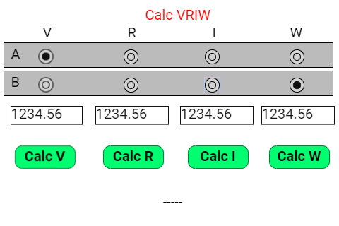

# NumberBox e RadioGroup: calculadora de V, R, I e W

Um **widget** é uma peça da tela, como um botão, uma barra ou uma etiqueta. Quatro caixas guardam tensão, resistência, corrente e potência. Duas linhas de opções escolhem quais valores são conhecidos. Os botões calculam a grandeza que falta.

Este manual acompanha [numberbox_radiogroup_calculator.ino](numberbox_radiogroup_calculator.ino). A referência é o código local da **DisplayWX 1.0.33**, incluindo os `.h` e `.cpp` atuais dos widgets.



*Imagem que acompanha o exemplo. Ela ilustra a disposição das peças; valores, cores ativas e textos podem mudar durante a execução. Confira os estados iniciais descritos abaixo.*

## Caminho da leitura

1. [Entenda o que cada peça faz](#1-o-que-este-exemplo-faz).
2. [Prepare a placa, os fios e as bibliotecas](#2-prepare-a-placa-e-as-bibliotecas).
3. [Copie o programa completo](#3-programa-completo).
4. [Aprenda os objetos, as fichas, os callbacks e o loop](#4-o-programa-explicado-por-partes).
5. [Consulte os métodos disponíveis para seu programa](#5-métodos-dos-widgets-para-usar-no-seu-programa).
6. [Faça uma experiência](#6-experiência-opcional).
7. [Confira o resultado](#7-como-conferir-se-funcionou).

## 1. O que este exemplo faz

Primeiro edite e confirme dois valores nas caixas. Depois selecione seus tipos nas linhas A e B, usando opções diferentes. Por fim toque no botão da grandeza que deseja descobrir. Os grupos retornam IDs: 1 = V, 2 = R, 3 = I e 4 = W.

| Peça no programa | Widget | Sua tarefa |
| --- | --- | --- |
| `txtresult` | Label | Mostra o resultado e a unidade. |
| `inputvolts` | NumberBox | Valor conhecido de tensão V. |
| `inputohms` | NumberBox | Valor conhecido de resistência R. |
| `inputamps` | NumberBox | Valor conhecido de corrente I. |
| `inputwatts` | NumberBox | Valor conhecido de potência W. |
| `grupo1` | RadioGroup | Escolhe a primeira grandeza conhecida (linha A). |
| `grupo2` | RadioGroup | Escolhe a segunda grandeza conhecida (linha B). |
| `btnvolts` | TextButton | Calcula tensão. |
| `btnohms` | TextButton | Calcula resistência. |
| `btnamps` | TextButton | Calcula corrente. |
| `btnwatts` | TextButton | Calcula potência. |

**Label:** Uma etiqueta de texto. Mostra palavras ou números com prefixo e sufixo, mas não recebe toques.

**NumberBox:** Uma caixa para digitar um número usando o teclado numérico que aparece na tela.

**RadioGroup:** Um grupo de opções em que apenas uma fica selecionada por vez. Grupos diferentes são independentes.

**TextButton:** Um botão com palavras escritas dentro. Ele executa uma ação, como somar, navegar ou conectar.

Use valores positivos e maiores que zero nos testes. O sketch não verifica divisões por zero nem raízes de números negativos. Combinações de tipos não previstas mostram Invalid combination. Inicialmente A e B selecionam V; isso ainda não é um par válido para calcular. As caixas começam em 1, embora a imagem mostre outros números.

Faça toques curtos, tirando o dedo antes do próximo. Alguns controles podem repetir a ação se você mantiver o dedo sobre eles. Arraste apenas os controles que foram feitos para deslizar.

## 2. Prepare a placa e as bibliotecas

Use uma placa **ESP32-S3**, display SPI **ST7796 de 320 × 480**, toque capacitivo **FT6336U**, cabo USB de dados e fios. A rotação 1 deixa uma área de desenho de **480 × 320 pixels**. Pixel é cada pontinho da imagem.

Na IDE Arduino, use a DisplayWX **1.0.33** deste projeto, **GFX Library for Arduino 1.6.5** e o pacote **esp32 by Espressif Systems 3.3.12**. O código da DisplayWX aceita as versões 3.3.11 e 3.3.12 desse pacote. Selecione o modelo ESP32-S3 da sua placa, sua porta USB e as opções de memória correspondentes ao hardware.

Abra o [user_setup.h da raiz da biblioteca](../../../user_setup.h), ao lado da pasta `src`. Deixe estas duas opções ativas:

```cpp
#define DISP_DEFAULT  // Display colorido.
#define TOUCH_FT6336  // Controlador FT6336U.
```

Desative as demais opções de display, toque e câmera colocando `//` no começo dessas linhas. Por exemplo: `// #define TOUCH_FT6236U`. O nome da opção correta é `TOUCH_FT6336`, sem U. Definir isso apenas no `.ino` não configura os outros arquivos da biblioteca.

### Ligações do display e do toque

| Sinal do módulo | GPIO do ESP32-S3 |
| --- | --- |
| MOSI / SDI do display | 11 |
| SCK / CLK | 12 |
| CS | 10 |
| DC / RS | 8 |
| RST do display | 9 |
| SDA do toque | 14 |
| SCL do toque | 13 |
| INT do toque | 18 |
| RST do toque | 17 |

`DISP_MISO = -1` significa que não há fio de leitura SPI. Una os GNDs. Alimente display e iluminação conforme o seu módulo; o sketch não controla um pino de backlight. Use sinais lógicos de 3,3 V. Faça a montagem com a alimentação desligada e ajuda de um adulto. Os números acima são GPIOs, não a posição física dos pinos no conector.

### Componentes deste exercício

Este é um exercício de cálculo na tela, sem circuito elétrico ligado à placa. Os valores digitados não são medidos por sensores. O teclado numérico é preparado pela DisplayWX; suas cores vêm das variáveis de Numpad presentes no sketch.

### Como carregar

1. Copie a pasta inteira deste exemplo para uma pasta de trabalho. Mantenha o nome da pasta igual ao nome do `.ino`.
2. Abra o `.ino` na IDE Arduino e substitua seu conteúdo pelo **programa completo abaixo**. Mantenha os arquivos `.h` que acompanham o exemplo.
3. Configure o `user_setup.h`, a placa e a porta como indicado acima.
4. Confira os fios, clique em **Verificar** e depois em **Carregar**.
5. Abra o Monitor Serial em **115200 baud** e reinicie a placa para acompanhar o início. Se estiver usando a USB nativa do ESP32-S3, a opção **USB CDC On Boot**, quando disponível para sua placa, precisa estar habilitada para os diagnósticos nessa porta.

### Ajustes desta versão didática

O programa abaixo mantém os widgets e a proposta do `.ino`, com estes ajustes explícitos para a montagem descrita:

- O `#include <math.h>` deixa explícito o uso de `sqrt` nas contas com raiz quadrada.

O `.ino` original da pasta continua disponível no link do início. Para usar as ligações deste manual, copie esta versão completa.

## 3. Programa completo

Copie o bloco inteiro, da primeira linha à última chave. Ele inclui a preparação da tela e todas as funções usadas. Os trechos isolados da próxima seção explicam este mesmo programa; não devem ser acrescentados novamente.

```cpp
#define ID_VOLTS 1
#define ID_OHMS 2
#define ID_AMPS 3
#define ID_WATTS 4

#if CONFIG_IDF_TARGET_ESP32S2 || CONFIG_IDF_TARGET_ESP32S3
#define VSPI FSPI
#endif

#include <SPI.h>
#include <math.h>
#include <Arduino_GFX_Library.h>

#include <displaywx.h>

#define FORMAT_SPIFFS_IF_FAILED false
const int DISPLAY_W = 480;
const int DISPLAY_H = 320;
const int DISP_FREQUENCY = 27000000;
const int TOUCH_MAP_X0 = 0;
const int TOUCH_MAP_Y0 = 0;
const int TOUCH_MAP_X1 = 320;
const int TOUCH_MAP_Y1 = 480;
const bool TOUCH_SWAP_XY = true;
const bool TOUCH_INVERT_X = false;
const bool TOUCH_INVERT_Y = true;
const int DISP_MOSI = 11;
const int DISP_MISO = -1;
const int DISP_SCLK = 12;
const int DISP_CS = 10;
const int DISP_DC = 8;
const int DISP_RST = 9;
const int TOUCH_SCL = 13;
const int TOUCH_SDA = 14;
const int TOUCH_INT = 18;
const int TOUCH_RST = 17;
const uint8_t rotationScreen = 1;
const bool isIPS = true;

void screen0();
void loadWidgets();

void inputvolts_cb();
void inputohms_cb();
void inputamps_cb();
void inputwatts_cb();
void btnvolts_cb();
void btnohms_cb();
void btnamps_cb();
void btnwatts_cb();
void callbackOfGroup_grupo1();
void callbackOfGroup_grupo2();

#if defined(CONFIG_IDF_TARGET_ESP32S3)
SPIClass spi_shared(FSPI);
#else
SPIClass spi_shared(HSPI);
#endif
Arduino_DataBus *bus = nullptr;
Arduino_GFX *tft = nullptr;
DisplayWX myDisplay;

// txtresult: Mostra o resultado e a unidade.
Label txtresult(245, 275, 0);
const uint8_t qtdLabel = 1;
Label *arrayLabel[qtdLabel] = {&txtresult};
// inputvolts: Valor conhecido de tensão V.
NumberBox inputvolts(15, 150, 0);
// inputohms: Valor conhecido de resistência R.
NumberBox inputohms(135, 150, 0);
// inputamps: Valor conhecido de corrente I.
NumberBox inputamps(255, 150, 0);
// inputwatts: Valor conhecido de potência W.
NumberBox inputwatts(370, 150, 0);
const uint8_t qtdNumberbox = 4;
NumberBox *arrayNumberbox[qtdNumberbox] = {&inputvolts, &inputohms, &inputamps, &inputwatts};
float voltsValue = 1;
float resistenceValue = 1;
float ampsValue = 1;
float wattsValue = 1;
// grupo1: Escolhe a primeira grandeza conhecida (linha A).
RadioGroup grupo1(0);
// grupo2: Escolhe a segunda grandeza conhecida (linha B).
RadioGroup grupo2(0);
const uint8_t qtdRadioGroup = 2;
RadioGroup *arrayRadio[qtdRadioGroup] = {&grupo1, &grupo2};
radio_t radiosOfGroup_grupo1[4] = {{65, 80, CFK_GREY1, 1},{185, 80, CFK_GREY1, 2},{300, 80, CFK_GREY1, 3},{420, 80, CFK_GREY1, 4}};
uint16_t radiog1 = 1;
radio_t radiosOfGroup_grupo2[4] = {{65, 120, CFK_GREY1, 1},{185, 120, CFK_GREY1, 2},{300, 120, CFK_GREY1, 3},{420, 120, CFK_GREY1, 4}};
uint16_t radiog2 = 1;
// btnvolts: Calcula tensão.
TextButton btnvolts(20, 205, 0);
// btnohms: Calcula resistência.
TextButton btnohms(145, 205, 0);
// btnamps: Calcula corrente.
TextButton btnamps(265, 205, 0);
// btnwatts: Calcula potência.
TextButton btnwatts(380, 205, 0);
const uint8_t qtdTextButton = 4;
TextButton *arrayTextButton[qtdTextButton] = {&btnvolts, &btnohms, &btnamps, &btnwatts};

void setup(){

    Serial.begin(115200);

    spi_shared.begin(DISP_SCLK, DISP_MISO, DISP_MOSI);
    bus = new Arduino_HWSPI(DISP_DC, DISP_CS, DISP_SCLK, DISP_MOSI, DISP_MISO, &spi_shared);
    tft = new Arduino_ST7796(bus, DISP_RST, rotationScreen, isIPS, 320, 480);
    tft->begin(DISP_FREQUENCY);
    myDisplay.setDrawObject(tft);

    myDisplay.setTouchCorners(TOUCH_MAP_X0, TOUCH_MAP_X1, TOUCH_MAP_Y0, TOUCH_MAP_Y1);
    myDisplay.setInvertAxis(TOUCH_INVERT_X, TOUCH_INVERT_Y);
    myDisplay.setSwapAxis(TOUCH_SWAP_XY);
    // Inicia o controlador de toque escolhido em user_setup.h.
    myDisplay.startTouchFT6336(DISPLAY_W, DISPLAY_H, rotationScreen, TOUCH_SDA, TOUCH_SCL, TOUCH_INT, TOUCH_RST);
    myDisplay.enableTouchLog();
    loadWidgets();
    myDisplay.loadScreen(screen0);
    // Inicia o trabalho da biblioteca que atende o toque e atualiza a tela.
    myDisplay.createTask(false, 3);
}

void loop(){

    myDisplay.startCustomDraw();

    myDisplay.finishCustomDraw();
    delay(2000);
}

void screen0(){

    myDisplay.setBackgroundColor(CFK_WHITE);
    tft->fillRect(5, 100, 466, 35, CFK_GREY11);
    tft->drawRect(5, 100, 466, 35, CFK_BLACK);
    tft->fillRect(5, 60, 466, 35, CFK_GREY11);
    tft->drawRect(5, 60, 466, 35, CFK_BLACK);
    myDisplay.printText("Calc VRIW", 205, 12, TL_DATUM, CFK_COLOR01, CFK_WHITE, &RobotoRegular10pt7b);

    myDisplay.printText("V", 60, 37, TL_DATUM, CFK_BLACK, CFK_WHITE, &RobotoRegular10pt7b);
    myDisplay.printText("R", 180, 37, TL_DATUM, CFK_BLACK, CFK_WHITE, &RobotoRegular10pt7b);
    myDisplay.printText("I", 300, 37, TL_DATUM, CFK_BLACK, CFK_WHITE, &RobotoRegular10pt7b);
    myDisplay.printText("W", 410, 37, TL_DATUM, CFK_BLACK, CFK_WHITE, &RobotoRegular10pt7b);

    myDisplay.printText("A", 15, 67, TL_DATUM, CFK_BLACK, CFK_GREY11, &RobotoRegular10pt7b);
    myDisplay.printText("B", 15, 107, TL_DATUM, CFK_BLACK, CFK_GREY11, &RobotoRegular10pt7b);
    myDisplay.drawWidgetsOnScreen(0);
}

void loadWidgets(){

    LabelConfig configLabel0 = {
            .text = "-----",
            .prefix = "Result: ",
            .suffix = "",
            .fontFamily = &RobotoRegular10pt7b,
            .datum = TC_DATUM,
            .fontColor = CFK_BLACK,
            .backgroundColor = CFK_WHITE
        };
    // Aplica a ficha ao objeto; faça isso durante a preparação.
    txtresult.setup(configLabel0);
    myDisplay.setLabel(arrayLabel,qtdLabel);

    Numpad::m_backgroundColor = CFK_GREY3;
    Numpad::m_letterColor = CFK_BLACK;
    Numpad::m_keyColor = CFK_GREY13;

    NumberBoxConfig configNumberBox0 = {
            // Tela para onde o teclado deve voltar ao fechar.
            .funcPtr = screen0,
            // Função chamada quando o usuário aciona este controle.
            .callback = inputvolts_cb,
            .font = &RobotoRegular10pt7b,
            .startValue = voltsValue,
            .width = 101,
            .height = 25,
            .letterColor = CFK_GREY1,
            .backgroundColor = CFK_WHITE,
            .decimalPlaces = 2
        };
    // Aplica a ficha ao objeto; faça isso durante a preparação.
    inputvolts.setup(configNumberBox0);
    NumberBoxConfig configNumberBox1 = {
            // Tela para onde o teclado deve voltar ao fechar.
            .funcPtr = screen0,
            // Função chamada quando o usuário aciona este controle.
            .callback = inputohms_cb,
            .font = &RobotoRegular10pt7b,
            .startValue = resistenceValue,
            .width = 103,
            .height = 25,
            .letterColor = CFK_GREY1,
            .backgroundColor = CFK_WHITE,
            .decimalPlaces = 2
        };
    // Aplica a ficha ao objeto; faça isso durante a preparação.
    inputohms.setup(configNumberBox1);
    NumberBoxConfig configNumberBox2 = {
            // Tela para onde o teclado deve voltar ao fechar.
            .funcPtr = screen0,
            // Função chamada quando o usuário aciona este controle.
            .callback = inputamps_cb,
            .font = &RobotoRegular10pt7b,
            .startValue = ampsValue,
            .width = 103,
            .height = 25,
            .letterColor = CFK_GREY1,
            .backgroundColor = CFK_WHITE,
            .decimalPlaces = 2
        };
    // Aplica a ficha ao objeto; faça isso durante a preparação.
    inputamps.setup(configNumberBox2);
    NumberBoxConfig configNumberBox3 = {
            // Tela para onde o teclado deve voltar ao fechar.
            .funcPtr = screen0,
            // Função chamada quando o usuário aciona este controle.
            .callback = inputwatts_cb,
            .font = &RobotoRegular10pt7b,
            .startValue = wattsValue,
            .width = 103,
            .height = 25,
            .letterColor = CFK_GREY1,
            .backgroundColor = CFK_WHITE,
            .decimalPlaces = 2
        };
    // Aplica a ficha ao objeto; faça isso durante a preparação.
    inputwatts.setup(configNumberBox3);
    myDisplay.setNumberbox(arrayNumberbox,qtdNumberbox);

    RadioGroupConfig configRadioGroup0 = {
            .buttons = radiosOfGroup_grupo1,
            // Função chamada quando o usuário aciona este controle.
            .callback = callbackOfGroup_grupo1,
            .radius = 10,
            .group = 1,
            .amount = 4,
            .defaultClickedId = 1
        };
    // Aplica a ficha ao objeto; faça isso durante a preparação.
    grupo1.setup(configRadioGroup0);
    RadioGroupConfig configRadioGroup1 = {
            .buttons = radiosOfGroup_grupo2,
            // Função chamada quando o usuário aciona este controle.
            .callback = callbackOfGroup_grupo2,
            .radius = 10,
            .group = 2,
            .amount = 4,
            .defaultClickedId = 1
        };
    // Aplica a ficha ao objeto; faça isso durante a preparação.
    grupo2.setup(configRadioGroup1);
    myDisplay.setRadioGroup(arrayRadio,qtdRadioGroup);

    TextButtonConfig configTextButton0 = {
            .text = "Calc V",
            // Função chamada quando o usuário aciona este controle.
            .callback = btnvolts_cb,
            .fontFamily = &RobotoBold10pt7b,
            .width = 87,
            .height = 34,
            .radius = 10,
            .backgroundColor = CFK_COLOR14,
            .textColor = CFK_BLACK
        };

    // Aplica a ficha ao objeto; faça isso durante a preparação.
    btnvolts.setup(configTextButton0);
    TextButtonConfig configTextButton1 = {
            .text = "Calc R",
            // Função chamada quando o usuário aciona este controle.
            .callback = btnohms_cb,
            .fontFamily = &RobotoBold10pt7b,
            .width = 87,
            .height = 34,
            .radius = 10,
            .backgroundColor = CFK_COLOR14,
            .textColor = CFK_BLACK
        };

    // Aplica a ficha ao objeto; faça isso durante a preparação.
    btnohms.setup(configTextButton1);
    TextButtonConfig configTextButton2 = {
            .text = "Calc I",
            // Função chamada quando o usuário aciona este controle.
            .callback = btnamps_cb,
            .fontFamily = &RobotoBold10pt7b,
            .width = 87,
            .height = 34,
            .radius = 10,
            .backgroundColor = CFK_COLOR14,
            .textColor = CFK_BLACK
        };

    // Aplica a ficha ao objeto; faça isso durante a preparação.
    btnamps.setup(configTextButton2);
    TextButtonConfig configTextButton3 = {
            .text = "Calc W",
            // Função chamada quando o usuário aciona este controle.
            .callback = btnwatts_cb,
            .fontFamily = &RobotoBold10pt7b,
            .width = 87,
            .height = 34,
            .radius = 10,
            .backgroundColor = CFK_COLOR14,
            .textColor = CFK_BLACK
        };

    // Aplica a ficha ao objeto; faça isso durante a preparação.
    btnwatts.setup(configTextButton3);
    myDisplay.setTextButton(arrayTextButton,qtdTextButton);

}

void calculateVolts(){
    if((radiog1 == ID_OHMS && radiog2 == ID_AMPS) || (radiog1 == ID_AMPS && radiog2 == ID_OHMS)){
        float results = resistenceValue * ampsValue;
        txtresult.setPrefix("Result:");
        txtresult.setSuffix(" V");
        txtresult.setTextFloat(results, 2);
    }else if((radiog1 == ID_OHMS && radiog2 == ID_WATTS) || (radiog1 == ID_WATTS && radiog2 == ID_OHMS)){
        float results = sqrt(wattsValue * resistenceValue);
        txtresult.setPrefix("Result:");
        txtresult.setSuffix(" V");
        txtresult.setTextFloat(results, 2);
    }else if((radiog1 == ID_AMPS && radiog2 == ID_WATTS) || (radiog1 == ID_WATTS && radiog2 == ID_AMPS)){
        float results = wattsValue / ampsValue;
        txtresult.setPrefix("Result:");
        txtresult.setSuffix(" V");
        txtresult.setTextFloat(results, 2);
    }else{
        txtresult.setPrefix("");
        txtresult.setSuffix("");
        txtresult.setText("Invalid combination");
    }
}

void calculateOhms(){
    if((radiog1 == ID_VOLTS && radiog2 == ID_AMPS) || (radiog1 == ID_AMPS && radiog2 == ID_VOLTS)){
        float results = voltsValue / ampsValue;
        txtresult.setPrefix("Result:");
        txtresult.setSuffix(" Ohms");
        txtresult.setTextFloat(results, 2);
    }else if((radiog1 == ID_VOLTS && radiog2 == ID_WATTS) || (radiog1 == ID_WATTS && radiog2 == ID_VOLTS)){
        float results = voltsValue * voltsValue / wattsValue;
        txtresult.setPrefix("Result:");
        txtresult.setSuffix(" Ohms");
        txtresult.setTextFloat(results, 2);
    }else if((radiog1 == ID_AMPS && radiog2 == ID_WATTS) || (radiog1 == ID_WATTS && radiog2 == ID_AMPS)){
        float results = wattsValue / (ampsValue * ampsValue);
        txtresult.setPrefix("Result:");
        txtresult.setSuffix(" Ohms");
        txtresult.setTextFloat(results, 2);
    }else{
        txtresult.setPrefix("");
        txtresult.setSuffix("");
        txtresult.setText("Invalid combination");
    }
}

void calculateAmps(){
    if((radiog1 == ID_VOLTS && radiog2 == ID_OHMS) || (radiog1 == ID_OHMS && radiog2 == ID_VOLTS)){
        float results = voltsValue / resistenceValue;
        txtresult.setPrefix("Result:");
        txtresult.setSuffix(" Amps");
        txtresult.setTextFloat(results, 2);
    }else if((radiog1 == ID_VOLTS && radiog2 == ID_WATTS) || (radiog1 == ID_WATTS && radiog2 == ID_VOLTS)){
        float results = wattsValue / voltsValue;
        txtresult.setPrefix("Result:");
        txtresult.setSuffix(" Amps");
        txtresult.setTextFloat(results, 2);
    }else if((radiog1 == ID_OHMS && radiog2 == ID_WATTS) || (radiog1 == ID_WATTS && radiog2 == ID_OHMS)){
        float results = sqrt(wattsValue / resistenceValue);
        txtresult.setPrefix("Result:");
        txtresult.setSuffix(" Amps");
        txtresult.setTextFloat(results, 2);
    }else{
        txtresult.setPrefix("");
        txtresult.setSuffix("");
        txtresult.setText("Invalid combination");
    }
}

void calculateWatts(){
    if((radiog1 == ID_VOLTS && radiog2 == ID_OHMS) || (radiog1 == ID_OHMS && radiog2 == ID_VOLTS)){
        float results = voltsValue * voltsValue / resistenceValue;
        txtresult.setPrefix("Result:");
        txtresult.setSuffix(" Watts");
        txtresult.setTextFloat(results, 2);
    }
    else if((radiog1 == ID_VOLTS && radiog2 == ID_AMPS) || (radiog1 == ID_AMPS && radiog2 == ID_VOLTS)){
        float results = voltsValue * ampsValue;
        txtresult.setPrefix("Result:");
        txtresult.setSuffix(" Watts");
        txtresult.setTextFloat(results, 2);
    }
    else if((radiog1 == ID_OHMS && radiog2 == ID_AMPS) || (radiog1 == ID_AMPS && radiog2 == ID_OHMS)){
        float results = ampsValue * ampsValue * resistenceValue;
        txtresult.setPrefix("Result:");
        txtresult.setSuffix(" Watts");
        txtresult.setTextFloat(results, 2);
    }
    else{
        txtresult.setPrefix("");
        txtresult.setSuffix("");
        txtresult.setText("Invalid combination");
    }
}

void inputvolts_cb(){

    voltsValue = inputvolts.getValue();
}

void inputohms_cb(){

    resistenceValue = inputohms.getValue();
}

void inputamps_cb(){

    ampsValue = inputamps.getValue();
}

void inputwatts_cb(){

    wattsValue = inputwatts.getValue();
}

void callbackOfGroup_grupo1(){

    radiog1 = grupo1.getSelected();
}

void callbackOfGroup_grupo2(){

    radiog2 = grupo2.getSelected();
}

void btnvolts_cb(){

    Serial.print("Clicked on: ");Serial.println("btnvolts_cb");
    calculateVolts();
}

void btnohms_cb(){

    Serial.print("Clicked on: ");Serial.println("btnohms_cb");
    calculateOhms();
}

void btnamps_cb(){

    Serial.print("Clicked on: ");Serial.println("btnamps_cb");
    calculateAmps();
}

void btnwatts_cb(){

    Serial.print("Clicked on: ");Serial.println("btnwatts_cb");
    calculateWatts();
}
```

## 4. O programa explicado por partes

### 4.1 Objetos, variáveis e listas

Um **objeto** é uma peça que seu programa pode chamar pelo nome. Uma **variável** é uma caixinha que guarda um valor. `bool` guarda `true` ou `false`; `int` guarda um inteiro; `float` e `double` guardam números com parte decimal. `const` indica algo que não será trocado durante a execução.


```cpp
// txtresult: Mostra o resultado e a unidade.
Label txtresult(245, 275, 0);
// Quantidade de objetos desta lista.
const uint8_t qtdLabel = 1;
// Lista dos endereços dos widgets que a DisplayWX vai cuidar.
Label *arrayLabel[qtdLabel] = {&txtresult};
// inputvolts: Valor conhecido de tensão V.
NumberBox inputvolts(15, 150, 0);
// inputohms: Valor conhecido de resistência R.
NumberBox inputohms(135, 150, 0);
// inputamps: Valor conhecido de corrente I.
NumberBox inputamps(255, 150, 0);
// inputwatts: Valor conhecido de potência W.
NumberBox inputwatts(370, 150, 0);
// Quantidade de objetos desta lista.
const uint8_t qtdNumberbox = 4;
// Lista dos endereços dos widgets que a DisplayWX vai cuidar.
NumberBox *arrayNumberbox[qtdNumberbox] = {&inputvolts, &inputohms, &inputamps, &inputwatts};
float voltsValue = 1;
float resistenceValue = 1;
float ampsValue = 1;
float wattsValue = 1;
// grupo1: Escolhe a primeira grandeza conhecida (linha A).
RadioGroup grupo1(0);
// grupo2: Escolhe a segunda grandeza conhecida (linha B).
RadioGroup grupo2(0);
// Quantidade de objetos desta lista.
const uint8_t qtdRadioGroup = 2;
// Lista dos endereços dos widgets que a DisplayWX vai cuidar.
RadioGroup *arrayRadio[qtdRadioGroup] = {&grupo1, &grupo2};
// Cada opção guarda {X, Y, cor, ID}; só uma por grupo fica marcada.
radio_t radiosOfGroup_grupo1[4] = {{65, 80, CFK_GREY1, 1},{185, 80, CFK_GREY1, 2},{300, 80, CFK_GREY1, 3},{420, 80, CFK_GREY1, 4}};
uint16_t radiog1 = 1;
// Cada opção guarda {X, Y, cor, ID}; só uma por grupo fica marcada.
radio_t radiosOfGroup_grupo2[4] = {{65, 120, CFK_GREY1, 1},{185, 120, CFK_GREY1, 2},{300, 120, CFK_GREY1, 3},{420, 120, CFK_GREY1, 4}};
uint16_t radiog2 = 1;
// btnvolts: Calcula tensão.
TextButton btnvolts(20, 205, 0);
// btnohms: Calcula resistência.
TextButton btnohms(145, 205, 0);
// btnamps: Calcula corrente.
TextButton btnamps(265, 205, 0);
// btnwatts: Calcula potência.
TextButton btnwatts(380, 205, 0);
// Quantidade de objetos desta lista.
const uint8_t qtdTextButton = 4;
// Lista dos endereços dos widgets que a DisplayWX vai cuidar.
TextButton *arrayTextButton[qtdTextButton] = {&btnvolts, &btnohms, &btnamps, &btnwatts};
```

| Objeto | Como interpretar a criação |
| --- | --- |
| `txtresult` (Label) | X = 245, Y = 275, tela = 0. Referência da posição: ponto de alinhamento escolhido por datum. |
| `inputvolts` (NumberBox) | X = 15, Y = 150, tela = 0. Referência da posição: canto superior esquerdo. |
| `inputohms` (NumberBox) | X = 135, Y = 150, tela = 0. Referência da posição: canto superior esquerdo. |
| `inputamps` (NumberBox) | X = 255, Y = 150, tela = 0. Referência da posição: canto superior esquerdo. |
| `inputwatts` (NumberBox) | X = 370, Y = 150, tela = 0. Referência da posição: canto superior esquerdo. |
| `grupo1` (RadioGroup) | `0` é o número da tela. As posições estão na lista `radio_t`. |
| `grupo2` (RadioGroup) | `0` é o número da tela. As posições estão na lista `radio_t`. |
| `btnvolts` (TextButton) | X = 20, Y = 205, tela = 0. Referência da posição: canto superior esquerdo. |
| `btnohms` (TextButton) | X = 145, Y = 205, tela = 0. Referência da posição: canto superior esquerdo. |
| `btnamps` (TextButton) | X = 265, Y = 205, tela = 0. Referência da posição: canto superior esquerdo. |
| `btnwatts` (TextButton) | X = 380, Y = 205, tela = 0. Referência da posição: canto superior esquerdo. |

X cresce para a direita e Y cresce para baixo, a partir do canto superior esquerdo da tela. O número da tela decide em qual página a peça aparece. A primeira tela é 0.

O `&` antes do nome entrega o **endereço** do objeto, como informar onde fica uma casa. O `*` na declaração da lista indica que ela guarda endereços. `qtd...` precisa corresponder à quantidade de itens: ao acrescentar um widget, acrescente seu endereço e ajuste a quantidade. Mantenha os objetos e essas listas globais, fora das funções, para continuarem existindo enquanto a interface trabalha.

### 4.2 A ficha de configuração (`struct`)

A `struct` funciona como uma ficha: cada campo escolhe uma característica. O ponto em `.width` significa “preencha o campo largura”. Depois, `objeto.setup(ficha)` entrega a ficha ao widget. Configure cada peça uma vez em `loadWidgets()`, depois de preparar o display e antes de iniciar a tarefa.

#### `configLabel0`: ficha de `txtresult`

```cpp
LabelConfig configLabel0 = {
            .text = "-----",
            .prefix = "Result: ",
            .suffix = "",
            .fontFamily = &RobotoRegular10pt7b,
            .datum = TC_DATUM,
            .fontColor = CFK_BLACK,
            .backgroundColor = CFK_WHITE
        };
// Aplica a ficha ao objeto; faça isso durante a preparação.
txtresult.setup(configLabel0);
```

| Campo | Valor nesta ficha | Para que serve |
| --- | --- | --- |
| `text` | `"-----"` | Texto inicial. Escreva entre aspas, por exemplo `"Olá"`. |
| `prefix` | `"Result: "` | Texto colocado antes do valor, como `"Valor: "`. `""` deixa vazio. |
| `suffix` | `""` | Texto colocado depois do valor, como `" V"`. `""` deixa vazio. |
| `fontFamily` | `&RobotoRegular10pt7b` | Fonte das letras, por exemplo `&RobotoRegular10pt7b`. O `&` aponta para uma fonte que já existe. |
| `datum` | `TC_DATUM` | Alinhamento do texto em relação a `(x,y)`: `TL_DATUM` usa o canto superior esquerdo; `TC_DATUM`, o centro do topo. |
| `fontColor` | `CFK_BLACK` | Cor das letras, usando os nomes `CFK_...`. |
| `backgroundColor` | `CFK_WHITE` | Cor do fundo, por exemplo `CFK_WHITE`. Use a cor da área onde o widget aparece. |

Mostra o resultado e a unidade.

#### `configNumberBox0`: ficha de `inputvolts`

```cpp
NumberBoxConfig configNumberBox0 = {
            // Tela para onde o teclado deve voltar ao fechar.
            .funcPtr = screen0,
            // Função chamada quando o usuário aciona este controle.
            .callback = inputvolts_cb,
            .font = &RobotoRegular10pt7b,
            // Valor que aparece ao iniciar a caixa.
            .startValue = voltsValue,
            .width = 101,
            .height = 25,
            .letterColor = CFK_GREY1,
            .backgroundColor = CFK_WHITE,
            .decimalPlaces = 2
        };
// Aplica a ficha ao objeto; faça isso durante a preparação.
inputvolts.setup(configNumberBox0);
```

| Campo | Valor nesta ficha | Para que serve |
| --- | --- | --- |
| `funcPtr` | `screen0` | Função que monta a tela de retorno, como `screen0`, sem `()`. O teclado usa essa tela ao fechar. |
| `callback` | `inputvolts_cb` | Nome da função chamada quando há uma ação. Escreva o nome sem `()`. `nullptr` significa sem callback. |
| `font` | `&RobotoRegular10pt7b` | Fonte das letras. O `&` antes do nome aponta para a fonte escolhida. |
| `startValue` | `voltsValue` | Valor mostrado ao iniciar o widget. |
| `width` | `101` | Largura em pixels, os pontinhos da imagem. Mantenha o desenho dentro da tela. |
| `height` | `25` | Altura em pixels. Reserve espaço suficiente para o desenho e as letras. |
| `letterColor` | `CFK_GREY1` | Cor das letras ou números da caixa. |
| `backgroundColor` | `CFK_WHITE` | Cor do fundo, por exemplo `CFK_WHITE`. Use a cor da área onde o widget aparece. |
| `decimalPlaces` | `2` | Quantidade de casas após o ponto decimal. |

Valor conhecido de tensão V.

#### `configNumberBox1`: ficha de `inputohms`

```cpp
NumberBoxConfig configNumberBox1 = {
            // Tela para onde o teclado deve voltar ao fechar.
            .funcPtr = screen0,
            // Função chamada quando o usuário aciona este controle.
            .callback = inputohms_cb,
            .font = &RobotoRegular10pt7b,
            // Valor que aparece ao iniciar a caixa.
            .startValue = resistenceValue,
            .width = 103,
            .height = 25,
            .letterColor = CFK_GREY1,
            .backgroundColor = CFK_WHITE,
            .decimalPlaces = 2
        };
// Aplica a ficha ao objeto; faça isso durante a preparação.
inputohms.setup(configNumberBox1);
```

Valor conhecido de resistência R.

#### `configNumberBox2`: ficha de `inputamps`

```cpp
NumberBoxConfig configNumberBox2 = {
            // Tela para onde o teclado deve voltar ao fechar.
            .funcPtr = screen0,
            // Função chamada quando o usuário aciona este controle.
            .callback = inputamps_cb,
            .font = &RobotoRegular10pt7b,
            // Valor que aparece ao iniciar a caixa.
            .startValue = ampsValue,
            .width = 103,
            .height = 25,
            .letterColor = CFK_GREY1,
            .backgroundColor = CFK_WHITE,
            .decimalPlaces = 2
        };
// Aplica a ficha ao objeto; faça isso durante a preparação.
inputamps.setup(configNumberBox2);
```

Valor conhecido de corrente I.

#### `configNumberBox3`: ficha de `inputwatts`

```cpp
NumberBoxConfig configNumberBox3 = {
            // Tela para onde o teclado deve voltar ao fechar.
            .funcPtr = screen0,
            // Função chamada quando o usuário aciona este controle.
            .callback = inputwatts_cb,
            .font = &RobotoRegular10pt7b,
            // Valor que aparece ao iniciar a caixa.
            .startValue = wattsValue,
            .width = 103,
            .height = 25,
            .letterColor = CFK_GREY1,
            .backgroundColor = CFK_WHITE,
            .decimalPlaces = 2
        };
// Aplica a ficha ao objeto; faça isso durante a preparação.
inputwatts.setup(configNumberBox3);
```

Valor conhecido de potência W.

#### `configRadioGroup0`: ficha de `grupo1`

```cpp
RadioGroupConfig configRadioGroup0 = {
            .buttons = radiosOfGroup_grupo1,
            // Função chamada quando o usuário aciona este controle.
            .callback = callbackOfGroup_grupo1,
            .radius = 10,
            .group = 1,
            .amount = 4,
            // ID da opção que começa selecionada.
            .defaultClickedId = 1
        };
// Aplica a ficha ao objeto; faça isso durante a preparação.
grupo1.setup(configRadioGroup0);
```

| Campo | Valor nesta ficha | Para que serve |
| --- | --- | --- |
| `buttons` | `radiosOfGroup_grupo1` | Lista de opções `radio_t`. Cada item guarda X, Y, cor e ID. |
| `callback` | `callbackOfGroup_grupo1` | Nome da função chamada quando há uma ação. Escreva o nome sem `()`. `nullptr` significa sem callback. |
| `radius` | `10` | Raio de cada bolinha; X e Y ficam na lista radio_t. |
| `group` | `1` | Identificador do grupo. Use números diferentes para grupos diferentes. |
| `amount` | `4` | Quantidade de opções presentes na lista `buttons`. |
| `defaultClickedId` | `1` | ID que começa selecionado. Precisa existir na lista. |

Escolhe a primeira grandeza conhecida (linha A).

#### `configRadioGroup1`: ficha de `grupo2`

```cpp
RadioGroupConfig configRadioGroup1 = {
            .buttons = radiosOfGroup_grupo2,
            // Função chamada quando o usuário aciona este controle.
            .callback = callbackOfGroup_grupo2,
            .radius = 10,
            .group = 2,
            .amount = 4,
            // ID da opção que começa selecionada.
            .defaultClickedId = 1
        };
// Aplica a ficha ao objeto; faça isso durante a preparação.
grupo2.setup(configRadioGroup1);
```

Escolhe a segunda grandeza conhecida (linha B).

#### `configTextButton0`: ficha de `btnvolts`

```cpp
TextButtonConfig configTextButton0 = {
            .text = "Calc V",
            // Função chamada quando o usuário aciona este controle.
            .callback = btnvolts_cb,
            .fontFamily = &RobotoBold10pt7b,
            .width = 87,
            .height = 34,
            .radius = 10,
            .backgroundColor = CFK_COLOR14,
            .textColor = CFK_BLACK
        };
// Aplica a ficha ao objeto; faça isso durante a preparação.
btnvolts.setup(configTextButton0);
```

| Campo | Valor nesta ficha | Para que serve |
| --- | --- | --- |
| `text` | `"Calc V"` | Texto inicial. Escreva entre aspas, por exemplo `"Olá"`. |
| `callback` | `btnvolts_cb` | Nome da função chamada quando há uma ação. Escreva o nome sem `()`. `nullptr` significa sem callback. |
| `fontFamily` | `&RobotoBold10pt7b` | Fonte das letras, por exemplo `&RobotoRegular10pt7b`. O `&` aponta para uma fonte que já existe. |
| `width` | `87` | Largura em pixels, os pontinhos da imagem. Mantenha o desenho dentro da tela. |
| `height` | `34` | Altura em pixels. Reserve espaço suficiente para o desenho e as letras. |
| `radius` | `10` | Raio do arredondamento dos cantos, não o tamanho do botão. |
| `backgroundColor` | `CFK_COLOR14` | Cor do fundo, por exemplo `CFK_WHITE`. Use a cor da área onde o widget aparece. |
| `textColor` | `CFK_BLACK` | Cor das letras/números. |

Calcula tensão.

#### `configTextButton1`: ficha de `btnohms`

```cpp
TextButtonConfig configTextButton1 = {
            .text = "Calc R",
            // Função chamada quando o usuário aciona este controle.
            .callback = btnohms_cb,
            .fontFamily = &RobotoBold10pt7b,
            .width = 87,
            .height = 34,
            .radius = 10,
            .backgroundColor = CFK_COLOR14,
            .textColor = CFK_BLACK
        };
// Aplica a ficha ao objeto; faça isso durante a preparação.
btnohms.setup(configTextButton1);
```

Calcula resistência.

#### `configTextButton2`: ficha de `btnamps`

```cpp
TextButtonConfig configTextButton2 = {
            .text = "Calc I",
            // Função chamada quando o usuário aciona este controle.
            .callback = btnamps_cb,
            .fontFamily = &RobotoBold10pt7b,
            .width = 87,
            .height = 34,
            .radius = 10,
            .backgroundColor = CFK_COLOR14,
            .textColor = CFK_BLACK
        };
// Aplica a ficha ao objeto; faça isso durante a preparação.
btnamps.setup(configTextButton2);
```

Calcula corrente.

#### `configTextButton3`: ficha de `btnwatts`

```cpp
TextButtonConfig configTextButton3 = {
            .text = "Calc W",
            // Função chamada quando o usuário aciona este controle.
            .callback = btnwatts_cb,
            .fontFamily = &RobotoBold10pt7b,
            .width = 87,
            .height = 34,
            .radius = 10,
            .backgroundColor = CFK_COLOR14,
            .textColor = CFK_BLACK
        };
// Aplica a ficha ao objeto; faça isso durante a preparação.
btnwatts.setup(configTextButton3);
```

Calcula potência.

Após configurar, registre cada lista. É assim que a DisplayWX sabe quais peças precisa acompanhar:

```cpp
// Registra a lista e sua quantidade para a biblioteca encontrar estes widgets.
myDisplay.setLabel(arrayLabel,qtdLabel);
// Registra a lista e sua quantidade para a biblioteca encontrar estes widgets.
myDisplay.setNumberbox(arrayNumberbox,qtdNumberbox);
// Registra a lista e sua quantidade para a biblioteca encontrar estes widgets.
myDisplay.setRadioGroup(arrayRadio,qtdRadioGroup);
// Registra a lista e sua quantidade para a biblioteca encontrar estes widgets.
myDisplay.setTextButton(arrayTextButton,qtdTextButton);
```

`nullptr` significa “não liguei nada aqui”. Por exemplo, sem callback não há uma ação do seu programa para executar; sem `subtitle`, não há Label associado. Uma cor `CFK_...` é um valor de cor pronto da biblioteca. Uma fonte como `&RobotoRegular10pt7b` escolhe o desenho das letras. Para começar, conserve as fontes, os tamanhos e a ordem dos campos do exemplo.

### 4.3 O início: `setup()`

O Arduino executa `setup()` uma vez ao ligar. Ele prepara a comunicação, o display, o toque, os widgets e os componentes extras. A tarefa criada no fim continua cuidando da interface enquanto o seu `loop()` trabalha.

```cpp
void setup(){

    // Abre as mensagens de diagnóstico no computador.
    Serial.begin(115200);

    // Inicia os fios de comunicação SPI do display.
    spi_shared.begin(DISP_SCLK, DISP_MISO, DISP_MOSI);
    bus = new Arduino_HWSPI(DISP_DC, DISP_CS, DISP_SCLK, DISP_MOSI, DISP_MISO, &spi_shared);
    tft = new Arduino_ST7796(bus, DISP_RST, rotationScreen, isIPS, 320, 480);
    tft->begin(DISP_FREQUENCY);
    // Entrega à DisplayWX o objeto que desenha no display.
    myDisplay.setDrawObject(tft);

    // Informa a faixa de coordenadas recebida do toque.
    myDisplay.setTouchCorners(TOUCH_MAP_X0, TOUCH_MAP_X1, TOUCH_MAP_Y0, TOUCH_MAP_Y1);
    myDisplay.setInvertAxis(TOUCH_INVERT_X, TOUCH_INVERT_Y);
    myDisplay.setSwapAxis(TOUCH_SWAP_XY);
    // Inicia o controlador de toque escolhido em user_setup.h.
    myDisplay.startTouchFT6336(DISPLAY_W, DISPLAY_H, rotationScreen, TOUCH_SDA, TOUCH_SCL, TOUCH_INT, TOUCH_RST);
    myDisplay.enableTouchLog();
    // Preenche as fichas, configura e registra os widgets.
    loadWidgets();
    // Pede a troca de tela; passe o nome da função, sem ().
    myDisplay.loadScreen(screen0);
    // Inicia o trabalho da biblioteca que atende o toque e atualiza a tela.
    myDisplay.createTask(false, 3);
}
```

As declarações como `void screen0();` no começo do programa são **avisos de que essas funções existem**. Elas permitem usar seus nomes nas fichas antes de chegar à parte que contém o corpo da função. Não apague esses avisos ao copiar trechos.

### 4.4 Callbacks: o que acontece após a ação

Um **callback** é a tarefa que você escolhe para acontecer quando um controle é acionado ou uma edição é confirmada. Na ficha, escreva o nome **sem `()`**. A biblioteca o chama no momento adequado. Evite esperas longas dentro dele: guarde um pedido em uma variável e faça a parte demorada no `loop()`, quando necessário.

#### `inputvolts_cb()`

Valor conhecido de tensão V. Lê o valor atual do widget e o guarda para o restante do programa.

```cpp
void inputvolts_cb(){

    // Obtém o valor atual da caixa ou controle.
    voltsValue = inputvolts.getValue();
}
```

#### `inputohms_cb()`

Valor conhecido de resistência R. Lê o valor atual do widget e o guarda para o restante do programa.

```cpp
void inputohms_cb(){

    // Obtém o valor atual da caixa ou controle.
    resistenceValue = inputohms.getValue();
}
```

#### `inputamps_cb()`

Valor conhecido de corrente I. Lê o valor atual do widget e o guarda para o restante do programa.

```cpp
void inputamps_cb(){

    // Obtém o valor atual da caixa ou controle.
    ampsValue = inputamps.getValue();
}
```

#### `inputwatts_cb()`

Valor conhecido de potência W. Lê o valor atual do widget e o guarda para o restante do programa.

```cpp
void inputwatts_cb(){

    // Obtém o valor atual da caixa ou controle.
    wattsValue = inputwatts.getValue();
}
```

#### `callbackOfGroup_grupo1()`

Escolhe a primeira grandeza conhecida (linha A). Lê o ID selecionado e escolhe a ação correspondente.

```cpp
void callbackOfGroup_grupo1(){

    // Lê o ID da opção escolhida no grupo.
    radiog1 = grupo1.getSelected();
}
```

#### `callbackOfGroup_grupo2()`

Escolhe a segunda grandeza conhecida (linha B). Lê o ID selecionado e escolhe a ação correspondente.

```cpp
void callbackOfGroup_grupo2(){

    // Lê o ID da opção escolhida no grupo.
    radiog2 = grupo2.getSelected();
}
```

#### `btnvolts_cb()`

Calcula tensão. Chama a função de cálculo mostrada na parte das funções extras. A mensagem na Serial ajuda a conferir que a ação aconteceu.

```cpp
void btnvolts_cb(){

    Serial.print("Clicked on: ");Serial.println("btnvolts_cb");
    calculateVolts();
}
```

#### `btnohms_cb()`

Calcula resistência. Chama a função de cálculo mostrada na parte das funções extras. A mensagem na Serial ajuda a conferir que a ação aconteceu.

```cpp
void btnohms_cb(){

    Serial.print("Clicked on: ");Serial.println("btnohms_cb");
    calculateOhms();
}
```

#### `btnamps_cb()`

Calcula corrente. Chama a função de cálculo mostrada na parte das funções extras. A mensagem na Serial ajuda a conferir que a ação aconteceu.

```cpp
void btnamps_cb(){

    Serial.print("Clicked on: ");Serial.println("btnamps_cb");
    calculateAmps();
}
```

#### `btnwatts_cb()`

Calcula potência. Chama a função de cálculo mostrada na parte das funções extras. A mensagem na Serial ajuda a conferir que a ação aconteceu.

```cpp
void btnwatts_cb(){

    Serial.print("Clicked on: ");Serial.println("btnwatts_cb");
    calculateWatts();
}
```

As mensagens da `Serial` servem para observar o programa; os widgets não precisam delas para desenhar.

### 4.5 O trabalho repetido: `loop()`

Primeiro edite e confirme dois valores nas caixas. Depois selecione seus tipos nas linhas A e B, usando opções diferentes. Por fim toque no botão da grandeza que deseja descobrir. Os grupos retornam IDs: 1 = V, 2 = R, 3 = I e 4 = W.

```cpp
void loop(){

    // Reserva o desenho para esta sequência do seu programa.
    myDisplay.startCustomDraw();

    // Devolve o desenho à tarefa da interface.
    myDisplay.finishCustomDraw();
    // Pausa em milissegundos: 1000 ms equivalem a um segundo.
    delay(2000);
}
```

Mantenha `startCustomDraw()` e `finishCustomDraw()` em pares, como abrir e fechar um caderno de desenho. Deixe pausas, esperas de rede e tarefas demoradas fora desse par.

### 4.6 As telas

Cada função `screen...` pinta o fundo, coloca os textos fixos e manda desenhar os widgets daquela página. Troque de página com `myDisplay.loadScreen(screen0)` ou com a função da outra tela; passe o nome sem parênteses.

```cpp
void screen0(){

    // Pinta o fundo da tela com a cor escolhida.
    myDisplay.setBackgroundColor(CFK_WHITE);
    tft->fillRect(5, 100, 466, 35, CFK_GREY11);
    tft->drawRect(5, 100, 466, 35, CFK_BLACK);
    tft->fillRect(5, 60, 466, 35, CFK_GREY11);
    tft->drawRect(5, 60, 466, 35, CFK_BLACK);
    // Escreve um texto fixo; esse texto não é um widget interativo.
    myDisplay.printText("Calc VRIW", 205, 12, TL_DATUM, CFK_COLOR01, CFK_WHITE, &RobotoRegular10pt7b);

    // Escreve um texto fixo; esse texto não é um widget interativo.
    myDisplay.printText("V", 60, 37, TL_DATUM, CFK_BLACK, CFK_WHITE, &RobotoRegular10pt7b);
    // Escreve um texto fixo; esse texto não é um widget interativo.
    myDisplay.printText("R", 180, 37, TL_DATUM, CFK_BLACK, CFK_WHITE, &RobotoRegular10pt7b);
    // Escreve um texto fixo; esse texto não é um widget interativo.
    myDisplay.printText("I", 300, 37, TL_DATUM, CFK_BLACK, CFK_WHITE, &RobotoRegular10pt7b);
    // Escreve um texto fixo; esse texto não é um widget interativo.
    myDisplay.printText("W", 410, 37, TL_DATUM, CFK_BLACK, CFK_WHITE, &RobotoRegular10pt7b);

    // Escreve um texto fixo; esse texto não é um widget interativo.
    myDisplay.printText("A", 15, 67, TL_DATUM, CFK_BLACK, CFK_GREY11, &RobotoRegular10pt7b);
    // Escreve um texto fixo; esse texto não é um widget interativo.
    myDisplay.printText("B", 15, 107, TL_DATUM, CFK_BLACK, CFK_GREY11, &RobotoRegular10pt7b);
    // Desenha os widgets registrados para esse número de tela.
    myDisplay.drawWidgetsOnScreen(0);
}
```

### 4.7 Funções extras

#### `calculateVolts()`

Calcula V a partir do par escolhido: R × I; raiz de W × R; ou W ÷ I. A ordem A/B pode ser trocada. Outro par mostra Invalid combination.

```cpp
void calculateVolts(){
    if((radiog1 == ID_OHMS && radiog2 == ID_AMPS) || (radiog1 == ID_AMPS && radiog2 == ID_OHMS)){
        float results = resistenceValue * ampsValue;
        txtresult.setPrefix("Result:");
        txtresult.setSuffix(" V");
        // Mostra o número decimal com a quantidade indicada de casas.
        txtresult.setTextFloat(results, 2);
    }else if((radiog1 == ID_OHMS && radiog2 == ID_WATTS) || (radiog1 == ID_WATTS && radiog2 == ID_OHMS)){
        float results = sqrt(wattsValue * resistenceValue);
        txtresult.setPrefix("Result:");
        txtresult.setSuffix(" V");
        // Mostra o número decimal com a quantidade indicada de casas.
        txtresult.setTextFloat(results, 2);
    }else if((radiog1 == ID_AMPS && radiog2 == ID_WATTS) || (radiog1 == ID_WATTS && radiog2 == ID_AMPS)){
        float results = wattsValue / ampsValue;
        txtresult.setPrefix("Result:");
        txtresult.setSuffix(" V");
        // Mostra o número decimal com a quantidade indicada de casas.
        txtresult.setTextFloat(results, 2);
    }else{
        txtresult.setPrefix("");
        txtresult.setSuffix("");
        txtresult.setText("Invalid combination");
    }
}
```

#### `calculateOhms()`

Calcula R: V ÷ I; V² ÷ W; ou W ÷ I², conforme o par escolhido.

```cpp
void calculateOhms(){
    if((radiog1 == ID_VOLTS && radiog2 == ID_AMPS) || (radiog1 == ID_AMPS && radiog2 == ID_VOLTS)){
        float results = voltsValue / ampsValue;
        txtresult.setPrefix("Result:");
        txtresult.setSuffix(" Ohms");
        // Mostra o número decimal com a quantidade indicada de casas.
        txtresult.setTextFloat(results, 2);
    }else if((radiog1 == ID_VOLTS && radiog2 == ID_WATTS) || (radiog1 == ID_WATTS && radiog2 == ID_VOLTS)){
        float results = voltsValue * voltsValue / wattsValue;
        txtresult.setPrefix("Result:");
        txtresult.setSuffix(" Ohms");
        // Mostra o número decimal com a quantidade indicada de casas.
        txtresult.setTextFloat(results, 2);
    }else if((radiog1 == ID_AMPS && radiog2 == ID_WATTS) || (radiog1 == ID_WATTS && radiog2 == ID_AMPS)){
        float results = wattsValue / (ampsValue * ampsValue);
        txtresult.setPrefix("Result:");
        txtresult.setSuffix(" Ohms");
        // Mostra o número decimal com a quantidade indicada de casas.
        txtresult.setTextFloat(results, 2);
    }else{
        txtresult.setPrefix("");
        txtresult.setSuffix("");
        txtresult.setText("Invalid combination");
    }
}
```

#### `calculateAmps()`

Calcula I: V ÷ R; W ÷ V; ou raiz de W ÷ R.

```cpp
void calculateAmps(){
    if((radiog1 == ID_VOLTS && radiog2 == ID_OHMS) || (radiog1 == ID_OHMS && radiog2 == ID_VOLTS)){
        float results = voltsValue / resistenceValue;
        txtresult.setPrefix("Result:");
        txtresult.setSuffix(" Amps");
        // Mostra o número decimal com a quantidade indicada de casas.
        txtresult.setTextFloat(results, 2);
    }else if((radiog1 == ID_VOLTS && radiog2 == ID_WATTS) || (radiog1 == ID_WATTS && radiog2 == ID_VOLTS)){
        float results = wattsValue / voltsValue;
        txtresult.setPrefix("Result:");
        txtresult.setSuffix(" Amps");
        // Mostra o número decimal com a quantidade indicada de casas.
        txtresult.setTextFloat(results, 2);
    }else if((radiog1 == ID_OHMS && radiog2 == ID_WATTS) || (radiog1 == ID_WATTS && radiog2 == ID_OHMS)){
        float results = sqrt(wattsValue / resistenceValue);
        txtresult.setPrefix("Result:");
        txtresult.setSuffix(" Amps");
        // Mostra o número decimal com a quantidade indicada de casas.
        txtresult.setTextFloat(results, 2);
    }else{
        txtresult.setPrefix("");
        txtresult.setSuffix("");
        txtresult.setText("Invalid combination");
    }
}
```

#### `calculateWatts()`

Calcula potência: V² ÷ R; V × I; ou I² × R. Cada função ajusta prefixo, unidade e número do Label.

```cpp
void calculateWatts(){
    if((radiog1 == ID_VOLTS && radiog2 == ID_OHMS) || (radiog1 == ID_OHMS && radiog2 == ID_VOLTS)){
        float results = voltsValue * voltsValue / resistenceValue;
        txtresult.setPrefix("Result:");
        txtresult.setSuffix(" Watts");
        // Mostra o número decimal com a quantidade indicada de casas.
        txtresult.setTextFloat(results, 2);
    }
    else if((radiog1 == ID_VOLTS && radiog2 == ID_AMPS) || (radiog1 == ID_AMPS && radiog2 == ID_VOLTS)){
        float results = voltsValue * ampsValue;
        txtresult.setPrefix("Result:");
        txtresult.setSuffix(" Watts");
        // Mostra o número decimal com a quantidade indicada de casas.
        txtresult.setTextFloat(results, 2);
    }
    else if((radiog1 == ID_OHMS && radiog2 == ID_AMPS) || (radiog1 == ID_AMPS && radiog2 == ID_OHMS)){
        float results = ampsValue * ampsValue * resistenceValue;
        txtresult.setPrefix("Result:");
        txtresult.setSuffix(" Watts");
        // Mostra o número decimal com a quantidade indicada de casas.
        txtresult.setTextFloat(results, 2);
    }
    else{
        txtresult.setPrefix("");
        txtresult.setSuffix("");
        txtresult.setText("Invalid combination");
    }
}
```

## 5. Métodos dos widgets para usar no seu programa

Um **método** é uma ação que pertence a um objeto. Em `objeto.metodo(valor)`, primeiro vem o nome da peça, depois o ponto, a ação e suas informações entre parênteses. As tabelas usam objetos reais deste exemplo. Faça essas chamadas **depois da configuração**; a linha `setup(...)` pertence à preparação. Os nomes das fichas só existem dentro de `loadWidgets()`.

### Label: métodos para seu programa

Uma etiqueta de texto. Mostra palavras ou números com prefixo e sufixo, mas não recebe toques.

| Método | Como usar | Resultado e cuidado |
| --- | --- | --- |
| `setup(config)` | `txtresult.setup(configLabel0);` | Aplica a ficha de configuração após preparar o display. Não retorna valor. Configure no `loadWidgets()` antes de iniciar a tarefa. |
| `setText(texto)` | `txtresult.setText("Pronto");` | Mostra texto de `const char*` ou `String`, montando prefixo + texto + sufixo. Não retorna valor. |
| `setPrefix(texto)` | `txtresult.setPrefix("Valor: ");` | Guarda o texto que vem antes. Chame depois `setText`, `setTextInt` ou `setTextFloat` para reconstruir o conteúdo exibido. |
| `setSuffix(texto)` | `txtresult.setSuffix(" V");` | Guarda o texto que vem depois. Atualize o conteúdo em seguida para mostrar a nova combinação. |
| `setTextInt(valor)` | `txtresult.setTextInt(42);` | Mostra um número inteiro com prefixo e sufixo. |
| `setTextFloat(valor, casas = 2)` | `txtresult.setTextFloat(3.25, 2);` | Mostra número decimal. O segundo argumento escolhe 0 a 5 casas; omitido, usa 2. |
| `setDecimalPlaces(casas)` | `txtresult.setDecimalPlaces(1);` | Guarda a precisão, limitada a 0–5. Não reformata sozinho o texto; `setTextFloat` define novamente a precisão com seu próprio argumento. |
| `setFontSize(escala)` | `txtresult.setFontSize(2);` | Define o fator de tamanho das letras; use 1 para normal. Não pede atualização sozinho: atualize o texto ou recarregue a tela depois. |
| `show()` | `txtresult.show();` | Torna visível na sua tela e pede atualização. Para TouchArea, volta a permitir toque; ela continua invisível. |
| `hide()` | `txtresult.hide();` | Impede futuras atualizações visuais e, quando há toque, sua interação. Não apaga os pixels já desenhados: repinte a tela como explicado abaixo. |

Para limpar prefixo ou sufixo, use `""`. Altere os dois antes de mandar o novo conteúdo. Um Label não mede nada: é o programa que fornece o valor.

### NumberBox: métodos para seu programa

Uma caixa para digitar um número usando o teclado numérico que aparece na tela.

| Método | Como usar | Resultado e cuidado |
| --- | --- | --- |
| `setup(config)` | `inputvolts.setup(configNumberBox0);` | Aplica a ficha de configuração após preparar o display. Não retorna valor. Configure no `loadWidgets()` antes de iniciar a tarefa. |
| `onClick()` | `inputvolts.onClick();` | Abre o teclado numérico pelo programa, como tocar na caixa. Não recebe `triggerCallback`. |
| `setValue(numero)` | `inputvolts.setValue(12.5);` | Atualiza o número e sua aparência, usando as casas decimais da configuração. Não executa o callback. |
| `getValue()` | `double numero = inputvolts.getValue();` | Retorna o valor numérico armazenado. |
| `getValueChar()` | `const char* texto = inputvolts.getValueChar();` | Retorna o texto interno do número. Não modifique esse texto; copie para `String` se quiser guardar uma versão independente. |
| `getConfig()` | `NumberBoxConfig copia = inputvolts.getConfig();` | Retorna uma cópia da ficha. Alterar a cópia não modifica a caixa. |
| `convertoToString(numero, buffer, tamanho)` | `char texto[32]; inputvolts.convertoToString(12.5, texto, sizeof(texto));` | Escreve o número em um espaço de texto seu, respeitando o tamanho e as casas configuradas. O nome contém `converto`, exatamente assim. |
| `show()` | `inputvolts.show();` | Torna visível na sua tela e pede atualização. Para TouchArea, volta a permitir toque; ela continua invisível. |
| `hide()` | `inputvolts.hide();` | Impede futuras atualizações visuais e, quando há toque, sua interação. Não apaga os pixels já desenhados: repinte a tela como explicado abaixo. |

Toque, edite o número e confirme com `OK`. `Del` apaga um caractere. As casas decimais determinam o número armazenado como texto; com zero casas, números fracionários são arredondados. `setValue()` não atualiza automaticamente variáveis que seu callback alimenta: atualize-as também ou leia `getValue()` no cálculo. Existe construtor sem argumentos, mas este exemplo usa a versão com posição e tela.

### RadioGroup: métodos para seu programa

Um grupo de opções em que apenas uma fica selecionada por vez. Grupos diferentes são independentes.

| Método | Como usar | Resultado e cuidado |
| --- | --- | --- |
| `setup(config)` | `grupo1.setup(configRadioGroup0);` | Aplica a ficha de configuração após preparar o display. Não retorna valor. Configure no `loadWidgets()` antes de iniciar a tarefa. |
| `setSelected(id, triggerCallback = true)` | `grupo1.setSelected(2, false);` | Seleciona um ID existente. Não é o índice da lista. ID inválido ou já selecionado não provoca mudança nem callback. `false` evita callback na mudança. |
| `getSelected()` | `uint16_t id = grupo1.getSelected();` | Retorna o ID da opção selecionada. |
| `getGroupId()` | `uint16_t grupo = grupo1.getGroupId();` | Retorna o identificador deste grupo, não o ID da opção. |
| `show()` | `grupo1.show();` | Torna visível na sua tela e pede atualização. Para TouchArea, volta a permitir toque; ela continua invisível. |
| `hide()` | `grupo1.hide();` | Impede futuras atualizações visuais e, quando há toque, sua interação. Não apaga os pixels já desenhados: repinte a tela como explicado abaixo. |

Cada `radio_t` tem `{x, y, cor, id}`; X e Y são o centro da bolinha. Use IDs distintos dentro do grupo e `defaultClickedId` existente. A configuração escolhe a opção inicial sem executar o callback.

### TextButton: métodos para seu programa

Um botão com palavras escritas dentro. Ele executa uma ação, como somar, navegar ou conectar.

| Método | Como usar | Resultado e cuidado |
| --- | --- | --- |
| `setup(config)` | `btnvolts.setup(configTextButton0);` | Aplica a ficha de configuração após preparar o display. Não retorna valor. Configure no `loadWidgets()` antes de iniciar a tarefa. |
| `onClick()` | `btnvolts.onClick();` | Solicita o callback pelo código. Não recebe argumento `triggerCallback` e não guarda estado ligado/desligado. |
| `getEnabled()` | `bool podeTocar = btnvolts.getEnabled();` | Retorna se o botão está habilitado para toque. |
| `setEnabled(valor)` | `btnvolts.setEnabled(false);` | `false` bloqueia o toque e `true` permite. Não muda automaticamente a cor; `onClick()` pelo código continua possível. |
| `show()` | `btnvolts.show();` | Torna visível na sua tela e pede atualização. Para TouchArea, volta a permitir toque; ela continua invisível. |
| `hide()` | `btnvolts.hide();` | Impede futuras atualizações visuais e, quando há toque, sua interação. Não apaga os pixels já desenhados: repinte a tela como explicado abaixo. |

O `radius` da configuração arredonda os cantos; não é o tamanho do botão. Use dimensões maiores que as letras. Para trocar o texto inicial, altere `.text` e carregue o programa novamente; não existe `setText()` nesta classe. Toques prolongados podem repetir ações.

### Como escolher se o callback deve acontecer

Nos métodos que mostram `triggerCallback = true`, omitir o último argumento permite solicitar o callback. Passar `false` evita o callback **daquela chamada**; não apaga callbacks já pendentes. A biblioteca executa os callbacks agendados por sua tarefa, então não conte com uma variável do callback já atualizada imediatamente na linha seguinte.

Se o callback comanda um pino ou copia um valor para uma variável, uma mudança silenciosa não fará essa outra tarefa. Escolha uma chamada com callback ou atualize o pino/variável explicitamente. A regra para repetir o mesmo valor está na tabela de cada classe; não é igual em todos os widgets. Não coloque setters com callback dentro do próprio callback sem necessidade, pois isso pode criar chamadas repetidas.

### Esconder e mostrar na tela

`hide()` não funciona como uma borracha para os pixels que já foram pintados. Para remover o desenho da página atual, esconda a peça e peça que a página seja montada novamente. Para fazê-la voltar, use `show()`. O estado/valor continua guardado.

```cpp
// Execute uma vez, na tela 0 deste exemplo.
txtresult.hide();
myDisplay.loadScreen(screen0);

// Em outra ação, quando quiser mostrar de novo:
txtresult.show();
myDisplay.loadScreen(screen0);
```

Os dois blocos são ações separadas: se executar todos de uma vez, o widget voltará logo em seguida. Textos fixos feitos com `printText()` continuam aparecendo, pois pertencem à função de tela. Um widget da tela 1 só aparece quando você volta à tela 1.

O desenho periódico e a detecção de toque ficam a cargo da DisplayWX. Seu `.ino` configura, registra, consulta e altera as peças pelas chamadas acima; não precisa chamar rotinas internas de desenho ou de detecção.

## 6. Experiência opcional

Com a tarefa ativa, seleciona R e I e solicita os callbacks que atualizam radiog1 e radiog2. Espere a atualização antes de acionar o cálculo.

```cpp
grupo1.setSelected(ID_OHMS);
grupo2.setSelected(ID_AMPS);
```

Para executar esse trecho uma vez sem repeti-lo em cada volta, coloque-o no lugar do comentário abaixo **dentro do loop existente**. Digite `t` no Monitor Serial e envie. Preserve as outras tarefas do loop; o trecho só roda quando chega essa letra.

```cpp
if (Serial.available() > 0) {
    char comando = Serial.read();
    if (comando == 't') {
        // Cole aqui o trecho da experiência.
    }
}
```

Mude uma coisa de cada vez. O programa completo da seção 3 continua sendo o ponto de partida para voltar ao comportamento original do exercício.

## 7. Como conferir se funcionou

1. Digite 10 em R e 2 em I e confirme ambos com OK.
2. Na linha A selecione R; na linha B selecione I.
3. Toque Calc V: deve aparecer 20.00 V. Toque Calc W: deve aparecer 40.00 Watts.
4. Com A e B no mesmo tipo, toque um cálculo: deve aparecer Invalid combination.

| Se acontecer... | Confira... |
| --- | --- |
| Erro ao compilar sobre tela, toque ou tipo desconhecido | Placa selecionada, versões instaladas e opções ativas no `user_setup.h` da raiz da biblioteca. Copie o programa inteiro. |
| Tela apagada ou sem desenho | Alimentação, GND, iluminação do módulo e fios/conectores do display. |
| Desenho correto, mas o toque não responde ou está deslocado | Controlador selecionado, SDA/SCL e configuração de rotação, limites e inversão dos eixos. Use os valores completos do exemplo para essa montagem. |
| Valor parece demorar para mudar | Confira o `delay()` no loop. Vários exemplos só enviam uma atualização a cada dois segundos. |
| Método com argumentos diferentes dá erro | Consulte a tabela da classe exata. Nem todos os `onClick` ou `setValue` recebem os mesmos argumentos. |

Este manual foi conferido com os arquivos locais da biblioteca. A validação descrita aqui é de código e documentação; a compilação para a sua placa e o ensaio físico devem ser feitos com a montagem indicada.

### Arquivos usados como referência

- [numberbox_radiogroup_calculator.ino](numberbox_radiogroup_calculator.ino).
- Label: [declarações `.h`](../../../src/widgets/label/wlabel.h) e [implementação `.cpp`](../../../src/widgets/label/wlabel.cpp).
- NumberBox: [declarações `.h`](../../../src/widgets/numberbox/wnumberbox.h) e [implementação `.cpp`](../../../src/widgets/numberbox/wnumberbox.cpp).
- RadioGroup: [declarações `.h`](../../../src/widgets/radiobutton/wradiogroup.h) e [implementação `.cpp`](../../../src/widgets/radiobutton/wradiogroup.cpp).
- TextButton: [declarações `.h`](../../../src/widgets/textbutton/wtextbutton.h) e [implementação `.cpp`](../../../src/widgets/textbutton/wtextbutton.cpp).
- [DisplayWX](../../../src/displaywx.h) e [implementação da integração](../../../src/displaywx.cpp).
