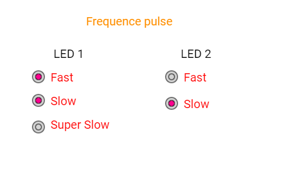

# RadioGroup: escolhendo a velocidade de dois LEDs

Um **widget** é uma peça da tela, como um botão, uma barra ou uma etiqueta. Duas listas de opções escolhem a velocidade com que dois LEDs piscam. Você só pode marcar uma velocidade por LED.

Este manual acompanha [radiogroup_leds.ino](radiogroup_leds.ino). A referência é o código local da **DisplayWX 1.0.33**, incluindo os `.h` e `.cpp` atuais dos widgets.



*Imagem que acompanha o exemplo. Ela ilustra a disposição das peças; valores, cores ativas e textos podem mudar durante a execução. Confira os estados iniciais descritos abaixo.*

## Caminho da leitura

1. [Entenda o que cada peça faz](#1-o-que-este-exemplo-faz).
2. [Prepare a placa, os fios e as bibliotecas](#2-prepare-a-placa-e-as-bibliotecas).
3. [Copie o programa completo](#3-programa-completo).
4. [Aprenda os objetos, as fichas, os callbacks e o loop](#4-o-programa-explicado-por-partes).
5. [Consulte os métodos disponíveis para seu programa](#5-métodos-dos-widgets-para-usar-no-seu-programa).
6. [Faça uma experiência](#6-experiência-opcional).
7. [Confira o resultado](#7-como-conferir-se-funcionou).

## 1. O que este exemplo faz

Cada callback consulta o ID selecionado e altera a pausa do seu LED. Duas tarefas independentes acendem, esperam, apagam e esperam novamente. As pausas são 100, 200 ou 500 ms por estado: um ciclo completo leva duas pausas.

| Peça no programa | Widget | Sua tarefa |
| --- | --- | --- |
| `grupo1` | RadioGroup | Escolhe Fast, Slow ou Super Slow para o LED 1. |
| `grupo2` | RadioGroup | Escolhe Fast ou Slow para o LED 2. |

**RadioGroup:** Um grupo de opções em que apenas uma fica selecionada por vez. Grupos diferentes são independentes.

Fast corresponde aproximadamente a 5 piscadas completas por segundo; Slow, 2,5; Super Slow, 1. Os valores são aproximados por causa do tempo de execução. Os dois grupos podem usar IDs 1 e 2, porque cada um é uma lista diferente.

Faça toques curtos, tirando o dedo antes do próximo. Alguns controles podem repetir a ação se você mantiver o dedo sobre eles. Arraste apenas os controles que foram feitos para deslizar.

## 2. Prepare a placa e as bibliotecas

Use uma placa **ESP32-S3**, display SPI **ST7796 de 320 × 480**, toque capacitivo **FT6336U**, cabo USB de dados e fios. A rotação 1 deixa uma área de desenho de **480 × 320 pixels**. Pixel é cada pontinho da imagem.

Na IDE Arduino, use a DisplayWX **1.0.33** deste projeto, **GFX Library for Arduino 1.6.5** e o pacote **esp32 by Espressif Systems 3.3.12**. O código da DisplayWX aceita as versões 3.3.11 e 3.3.12 desse pacote. Selecione o modelo ESP32-S3 da sua placa, sua porta USB e as opções de memória correspondentes ao hardware.

Abra o [user_setup.h da raiz da biblioteca](../../../user_setup.h), ao lado da pasta `src`. Deixe estas duas opções ativas:

```cpp
#define DISP_DEFAULT  // Display colorido.
#define TOUCH_FT6336  // Controlador FT6336U.
```

Desative as demais opções de display, toque e câmera colocando `//` no começo dessas linhas. Por exemplo: `// #define TOUCH_FT6236U`. O nome da opção correta é `TOUCH_FT6336`, sem U. Definir isso apenas no `.ino` não configura os outros arquivos da biblioteca.

### Ligações do display e do toque

| Sinal do módulo | GPIO do ESP32-S3 |
| --- | --- |
| MOSI / SDI do display | 11 |
| SCK / CLK | 12 |
| CS | 10 |
| DC / RS | 8 |
| RST do display | 9 |
| SDA do toque | 14 |
| SCL do toque | 13 |
| INT do toque | 18 |
| RST do toque | 17 |

`DISP_MISO = -1` significa que não há fio de leitura SPI. Una os GNDs. Alimente display e iluminação conforme o seu módulo; o sketch não controla um pino de backlight. Use sinais lógicos de 3,3 V. Faça a montagem com a alimentação desligada e ajuda de um adulto. Os números acima são GPIOs, não a posição física dos pinos no conector.

### Componentes deste exercício

Ligue cada saída ao anodo de um LED por um resistor de 330 Ω; os catodos vão ao GND. Os dois LEDs físicos são independentes dos círculos de seleção desenhados na tela.

| Nome no programa | GPIO no `.ino` e neste manual | Ligação |
| --- | --- | --- |
| `pinLed1` | 16 | LED 1 com resistor |
| `pinLed2` | 21 | LED 2 com resistor |

Os GPIOs desta tabela já estão definidos no `.ino` e nos trechos de código deste manual. Os pinos do display, da iluminação e do toque foram preservados; GPIOs 17 e 18 ficam reservados ao toque nesta montagem. Confira que os GPIOs dos periféricos estão expostos e livres na sua placa.

### Como carregar

1. Copie a pasta inteira deste exemplo para uma pasta de trabalho. Mantenha o nome da pasta igual ao nome do `.ino`.
2. Abra o `.ino` na IDE Arduino e substitua seu conteúdo pelo **programa completo abaixo**. Mantenha os arquivos `.h` que acompanham o exemplo.
3. Configure o `user_setup.h`, a placa e a porta como indicado acima.
4. Confira os fios, clique em **Verificar** e depois em **Carregar**.
5. Abra o Monitor Serial em **115200 baud** e reinicie a placa para acompanhar o início. Se estiver usando a USB nativa do ESP32-S3, a opção **USB CDC On Boot**, quando disponível para sua placa, precisa estar habilitada para os diagnósticos nessa porta.

## 3. Programa completo

Copie o bloco inteiro, da primeira linha à última chave. Ele inclui a preparação da tela e todas as funções usadas. Os trechos isolados da próxima seção explicam este mesmo programa; não devem ser acrescentados novamente.

```cpp
#if CONFIG_IDF_TARGET_ESP32S2 || CONFIG_IDF_TARGET_ESP32S3
#define VSPI FSPI
#endif

#include <SPI.h>
#include <Arduino_GFX_Library.h>

#include <displaywx.h>

#define FORMAT_SPIFFS_IF_FAILED false
const int DISPLAY_W = 480;
const int DISPLAY_H = 320;
const int DISP_FREQUENCY = 27000000;
const int TOUCH_MAP_X0 = 0;
const int TOUCH_MAP_Y0 = 0;
const int TOUCH_MAP_X1 = 320;
const int TOUCH_MAP_Y1 = 480;
const bool TOUCH_SWAP_XY = true;
const bool TOUCH_INVERT_X = false;
const bool TOUCH_INVERT_Y = true;
const int DISP_MOSI = 11;
const int DISP_MISO = -1;
const int DISP_SCLK = 12;
const int DISP_CS = 10;
const int DISP_DC = 8;
const int DISP_RST = 9;
const int TOUCH_SCL = 13;
const int TOUCH_SDA = 14;
const int TOUCH_INT = 18;
const int TOUCH_RST = 17;
const uint8_t rotationScreen = 1;
const bool isIPS = true;

void screen0();
void loadWidgets();

void callbackOfGroup_grupo1();
void callbackOfGroup_grupo2();

#if defined(CONFIG_IDF_TARGET_ESP32S3)
SPIClass spi_shared(FSPI);
#else
SPIClass spi_shared(HSPI);
#endif
Arduino_DataBus *bus = nullptr;
Arduino_GFX *tft = nullptr;
DisplayWX myDisplay;

// grupo1: Escolhe Fast, Slow ou Super Slow para o LED 1.
RadioGroup grupo1(0);
// grupo2: Escolhe Fast ou Slow para o LED 2.
RadioGroup grupo2(0);
const uint8_t qtdRadioGroup = 2;
RadioGroup *arrayRadio[qtdRadioGroup] = {&grupo1, &grupo2};
radio_t radiosOfGroup_grupo1[3] = {{65, 130, CFK_COLOR30, 1},{65, 170, CFK_COLOR30, 2},{65, 215, CFK_COLOR30, 3}};
radio_t radiosOfGroup_grupo2[2] = {{290, 130, CFK_COLOR30, 1},{290, 175, CFK_COLOR30, 2}};

const int pinLed1 = 16;
const int pinLed2 = 21;

const int pulseFast = 100;
const int pulseSlow = 200;
const int pulseSuperSlow = 500;

volatile int pulseLed1 = pulseFast;
volatile int pulseLed2 = pulseFast;

TaskHandle_t taskLed1Handle;
TaskHandle_t taskLed2Handle;

void taskLed1(void *parameter){
    (void)parameter;
    pinMode(pinLed1, OUTPUT);
    while(true){
        digitalWrite(pinLed1, HIGH);
        delay(pulseLed1);
        digitalWrite(pinLed1, LOW);
        delay(pulseLed1);
    }
}

void taskLed2(void *parameter){
    (void)parameter;
    pinMode(pinLed2, OUTPUT);
    while(true){
        digitalWrite(pinLed2, HIGH);
        delay(pulseLed2);
        digitalWrite(pinLed2, LOW);
        delay(pulseLed2);
    }
}

void setup(){

    Serial.begin(115200);

    spi_shared.begin(DISP_SCLK, DISP_MISO, DISP_MOSI);
    bus = new Arduino_HWSPI(DISP_DC, DISP_CS, DISP_SCLK, DISP_MOSI, DISP_MISO, &spi_shared);
    tft = new Arduino_ST7796(bus, DISP_RST, rotationScreen, isIPS, 320, 480);
    tft->begin(DISP_FREQUENCY);
    myDisplay.setDrawObject(tft);

    myDisplay.setTouchCorners(TOUCH_MAP_X0, TOUCH_MAP_X1, TOUCH_MAP_Y0, TOUCH_MAP_Y1);
    myDisplay.setInvertAxis(TOUCH_INVERT_X, TOUCH_INVERT_Y);
    myDisplay.setSwapAxis(TOUCH_SWAP_XY);
    // Inicia o controlador de toque escolhido em user_setup.h.
    myDisplay.startTouchFT6336(DISPLAY_W, DISPLAY_H, rotationScreen, TOUCH_SDA, TOUCH_SCL, TOUCH_INT, TOUCH_RST);

    loadWidgets();
    myDisplay.loadScreen(screen0);
    // Inicia o trabalho da biblioteca que atende o toque e atualiza a tela.
    myDisplay.createTask(false, 3);

    xTaskCreatePinnedToCore(taskLed1, "taskLed1", 10000, NULL, 1, &taskLed1Handle, 0);
    xTaskCreatePinnedToCore(taskLed2, "taskLed2", 10000, NULL, 1, &taskLed2Handle, 0);
}

void loop(){

}

void screen0(){

    myDisplay.setBackgroundColor(CFK_WHITE);
    myDisplay.printText("Frequence pulse", 145, 27, TL_DATUM, CFK_COLOR04, CFK_WHITE, &RobotoRegular10pt7b);

    myDisplay.printText("Fast", 85, 122, TL_DATUM, CFK_COLOR01, CFK_WHITE, &RobotoRegular10pt7b);
    myDisplay.printText("Slow", 85, 162, TL_DATUM, CFK_COLOR01, CFK_WHITE, &RobotoRegular10pt7b);
    myDisplay.printText("Super Slow", 85, 202, TL_DATUM, CFK_COLOR01, CFK_WHITE, &RobotoRegular10pt7b);
    myDisplay.printText("LED 1", 90, 82, TL_DATUM, CFK_BLACK, CFK_WHITE, &RobotoRegular10pt7b);
    myDisplay.printText("LED 2", 305, 82, TL_DATUM, CFK_BLACK, CFK_WHITE, &RobotoRegular10pt7b);

    myDisplay.printText("Fast", 310, 122, TL_DATUM, CFK_COLOR01, CFK_WHITE, &RobotoRegular10pt7b);
    myDisplay.printText("Slow", 310, 167, TL_DATUM, CFK_COLOR01, CFK_WHITE, &RobotoRegular10pt7b);
    myDisplay.drawWidgetsOnScreen(0);
}

void loadWidgets(){

    RadioGroupConfig configRadioGroup0 = {
            .buttons = radiosOfGroup_grupo1,
            // Função chamada quando o usuário aciona este controle.
            .callback = callbackOfGroup_grupo1,
            .radius = 10,
            .group = 1,
            .amount = 3,
            .defaultClickedId = 1
        };
    // Aplica a ficha ao objeto; faça isso durante a preparação.
    grupo1.setup(configRadioGroup0);
    RadioGroupConfig configRadioGroup1 = {
            .buttons = radiosOfGroup_grupo2,
            // Função chamada quando o usuário aciona este controle.
            .callback = callbackOfGroup_grupo2,
            .radius = 10,
            .group = 2,
            .amount = 2,
            .defaultClickedId = 1
        };
    // Aplica a ficha ao objeto; faça isso durante a preparação.
    grupo2.setup(configRadioGroup1);
    myDisplay.setRadioGroup(arrayRadio,qtdRadioGroup);

}

void callbackOfGroup_grupo1(){

    uint16_t selectedOption = grupo1.getSelected();
    Serial.print("New value for radiogroup is: ");Serial.println(selectedOption);
    switch(selectedOption){
        case 1:
            pulseLed1 = pulseFast;
            break;
        case 2:
            pulseLed1 = pulseSlow;
            break;
        case 3:
            pulseLed1 = pulseSuperSlow;
            break;
        default:
            pulseLed1 = pulseFast;
            break;
    }
}

void callbackOfGroup_grupo2(){

    uint16_t selectedOption = grupo2.getSelected();
    Serial.print("New value for radiogroup is: ");Serial.println(selectedOption);
    switch(selectedOption){
        case 1:
            pulseLed2 = pulseFast;
            break;
        case 2:
            pulseLed2 = pulseSlow;
            break;
        default:
            pulseLed2 = pulseFast;
            break;
    }
}
```

## 4. O programa explicado por partes

### 4.1 Objetos, variáveis e listas

Um **objeto** é uma peça que seu programa pode chamar pelo nome. Uma **variável** é uma caixinha que guarda um valor. `bool` guarda `true` ou `false`; `int` guarda um inteiro; `float` e `double` guardam números com parte decimal. `const` indica algo que não será trocado durante a execução.


```cpp
// grupo1: Escolhe Fast, Slow ou Super Slow para o LED 1.
RadioGroup grupo1(0);
// grupo2: Escolhe Fast ou Slow para o LED 2.
RadioGroup grupo2(0);
// Quantidade de objetos desta lista.
const uint8_t qtdRadioGroup = 2;
// Lista dos endereços dos widgets que a DisplayWX vai cuidar.
RadioGroup *arrayRadio[qtdRadioGroup] = {&grupo1, &grupo2};
// Cada opção guarda {X, Y, cor, ID}; só uma por grupo fica marcada.
radio_t radiosOfGroup_grupo1[3] = {{65, 130, CFK_COLOR30, 1},{65, 170, CFK_COLOR30, 2},{65, 215, CFK_COLOR30, 3}};
// Cada opção guarda {X, Y, cor, ID}; só uma por grupo fica marcada.
radio_t radiosOfGroup_grupo2[2] = {{290, 130, CFK_COLOR30, 1},{290, 175, CFK_COLOR30, 2}};

const int pinLed1 = 16;
const int pinLed2 = 21;

const int pulseFast = 100;
const int pulseSlow = 200;
const int pulseSuperSlow = 500;

volatile int pulseLed1 = pulseFast;
volatile int pulseLed2 = pulseFast;

TaskHandle_t taskLed1Handle;
TaskHandle_t taskLed2Handle;
```

| Objeto | Como interpretar a criação |
| --- | --- |
| `grupo1` (RadioGroup) | `0` é o número da tela. As posições estão na lista `radio_t`. |
| `grupo2` (RadioGroup) | `0` é o número da tela. As posições estão na lista `radio_t`. |

X cresce para a direita e Y cresce para baixo, a partir do canto superior esquerdo da tela. O número da tela decide em qual página a peça aparece. A primeira tela é 0.

O `&` antes do nome entrega o **endereço** do objeto, como informar onde fica uma casa. O `*` na declaração da lista indica que ela guarda endereços. `qtd...` precisa corresponder à quantidade de itens: ao acrescentar um widget, acrescente seu endereço e ajuste a quantidade. Mantenha os objetos e essas listas globais, fora das funções, para continuarem existindo enquanto a interface trabalha.

### 4.2 A ficha de configuração (`struct`)

A `struct` funciona como uma ficha: cada campo escolhe uma característica. O ponto em `.width` significa “preencha o campo largura”. Depois, `objeto.setup(ficha)` entrega a ficha ao widget. Configure cada peça uma vez em `loadWidgets()`, depois de preparar o display e antes de iniciar a tarefa.

#### `configRadioGroup0`: ficha de `grupo1`

```cpp
RadioGroupConfig configRadioGroup0 = {
            .buttons = radiosOfGroup_grupo1,
            // Função chamada quando o usuário aciona este controle.
            .callback = callbackOfGroup_grupo1,
            .radius = 10,
            .group = 1,
            .amount = 3,
            // ID da opção que começa selecionada.
            .defaultClickedId = 1
        };
// Aplica a ficha ao objeto; faça isso durante a preparação.
grupo1.setup(configRadioGroup0);
```

| Campo | Valor nesta ficha | Para que serve |
| --- | --- | --- |
| `buttons` | `radiosOfGroup_grupo1` | Lista de opções `radio_t`. Cada item guarda X, Y, cor e ID. |
| `callback` | `callbackOfGroup_grupo1` | Nome da função chamada quando há uma ação. Escreva o nome sem `()`. `nullptr` significa sem callback. |
| `radius` | `10` | Raio de cada bolinha; X e Y ficam na lista radio_t. |
| `group` | `1` | Identificador do grupo. Use números diferentes para grupos diferentes. |
| `amount` | `3` | Quantidade de opções presentes na lista `buttons`. |
| `defaultClickedId` | `1` | ID que começa selecionado. Precisa existir na lista. |

Escolhe Fast, Slow ou Super Slow para o LED 1.

#### `configRadioGroup1`: ficha de `grupo2`

```cpp
RadioGroupConfig configRadioGroup1 = {
            .buttons = radiosOfGroup_grupo2,
            // Função chamada quando o usuário aciona este controle.
            .callback = callbackOfGroup_grupo2,
            .radius = 10,
            .group = 2,
            .amount = 2,
            // ID da opção que começa selecionada.
            .defaultClickedId = 1
        };
// Aplica a ficha ao objeto; faça isso durante a preparação.
grupo2.setup(configRadioGroup1);
```

Escolhe Fast ou Slow para o LED 2.

Após configurar, registre cada lista. É assim que a DisplayWX sabe quais peças precisa acompanhar:

```cpp
// Registra a lista e sua quantidade para a biblioteca encontrar estes widgets.
myDisplay.setRadioGroup(arrayRadio,qtdRadioGroup);
```

`nullptr` significa “não liguei nada aqui”. Por exemplo, sem callback não há uma ação do seu programa para executar; sem `subtitle`, não há Label associado. Uma cor `CFK_...` é um valor de cor pronto da biblioteca. Uma fonte como `&RobotoRegular10pt7b` escolhe o desenho das letras. Para começar, conserve as fontes, os tamanhos e a ordem dos campos do exemplo.

### 4.3 O início: `setup()`

O Arduino executa `setup()` uma vez ao ligar. Ele prepara a comunicação, o display, o toque, os widgets e os componentes extras. A tarefa criada no fim continua cuidando da interface enquanto o seu `loop()` trabalha.

```cpp
void setup(){

    // Abre as mensagens de diagnóstico no computador.
    Serial.begin(115200);

    // Inicia os fios de comunicação SPI do display.
    spi_shared.begin(DISP_SCLK, DISP_MISO, DISP_MOSI);
    bus = new Arduino_HWSPI(DISP_DC, DISP_CS, DISP_SCLK, DISP_MOSI, DISP_MISO, &spi_shared);
    tft = new Arduino_ST7796(bus, DISP_RST, rotationScreen, isIPS, 320, 480);
    tft->begin(DISP_FREQUENCY);
    // Entrega à DisplayWX o objeto que desenha no display.
    myDisplay.setDrawObject(tft);

    // Informa a faixa de coordenadas recebida do toque.
    myDisplay.setTouchCorners(TOUCH_MAP_X0, TOUCH_MAP_X1, TOUCH_MAP_Y0, TOUCH_MAP_Y1);
    myDisplay.setInvertAxis(TOUCH_INVERT_X, TOUCH_INVERT_Y);
    myDisplay.setSwapAxis(TOUCH_SWAP_XY);
    // Inicia o controlador de toque escolhido em user_setup.h.
    myDisplay.startTouchFT6336(DISPLAY_W, DISPLAY_H, rotationScreen, TOUCH_SDA, TOUCH_SCL, TOUCH_INT, TOUCH_RST);

    // Preenche as fichas, configura e registra os widgets.
    loadWidgets();
    // Pede a troca de tela; passe o nome da função, sem ().
    myDisplay.loadScreen(screen0);
    // Inicia o trabalho da biblioteca que atende o toque e atualiza a tela.
    myDisplay.createTask(false, 3);

    // Inicia uma tarefa separada, que continua junto com a interface.
    xTaskCreatePinnedToCore(taskLed1, "taskLed1", 10000, NULL, 1, &taskLed1Handle, 0);
    // Inicia uma tarefa separada, que continua junto com a interface.
    xTaskCreatePinnedToCore(taskLed2, "taskLed2", 10000, NULL, 1, &taskLed2Handle, 0);
}
```

As declarações como `void screen0();` no começo do programa são **avisos de que essas funções existem**. Elas permitem usar seus nomes nas fichas antes de chegar à parte que contém o corpo da função. Não apague esses avisos ao copiar trechos.

### 4.4 Callbacks: o que acontece após a ação

Um **callback** é a tarefa que você escolhe para acontecer quando um controle é acionado ou uma edição é confirmada. Na ficha, escreva o nome **sem `()`**. A biblioteca o chama no momento adequado. Evite esperas longas dentro dele: guarde um pedido em uma variável e faça a parte demorada no `loop()`, quando necessário.

#### `callbackOfGroup_grupo1()`

Escolhe Fast, Slow ou Super Slow para o LED 1. Lê o ID selecionado e escolhe a ação correspondente. A mensagem na Serial ajuda a conferir que a ação aconteceu.

```cpp
void callbackOfGroup_grupo1(){

    // Lê o ID da opção escolhida no grupo.
    uint16_t selectedOption = grupo1.getSelected();
    Serial.print("New value for radiogroup is: ");Serial.println(selectedOption);
    switch(selectedOption){
        case 1:
            pulseLed1 = pulseFast;
            break;
        case 2:
            pulseLed1 = pulseSlow;
            break;
        case 3:
            pulseLed1 = pulseSuperSlow;
            break;
        default:
            pulseLed1 = pulseFast;
            break;
    }
}
```

#### `callbackOfGroup_grupo2()`

Escolhe Fast ou Slow para o LED 2. Lê o ID selecionado e escolhe a ação correspondente. A mensagem na Serial ajuda a conferir que a ação aconteceu.

```cpp
void callbackOfGroup_grupo2(){

    // Lê o ID da opção escolhida no grupo.
    uint16_t selectedOption = grupo2.getSelected();
    Serial.print("New value for radiogroup is: ");Serial.println(selectedOption);
    switch(selectedOption){
        case 1:
            pulseLed2 = pulseFast;
            break;
        case 2:
            pulseLed2 = pulseSlow;
            break;
        default:
            pulseLed2 = pulseFast;
            break;
    }
}
```

As mensagens da `Serial` servem para observar o programa; os widgets não precisam delas para desenhar.

### 4.5 O trabalho repetido: `loop()`

Cada callback consulta o ID selecionado e altera a pausa do seu LED. Duas tarefas independentes acendem, esperam, apagam e esperam novamente. As pausas são 100, 200 ou 500 ms por estado: um ciclo completo leva duas pausas.

```cpp
void loop(){

}
```

O corpo vazio é intencional: a tarefa da DisplayWX continua atendendo o toque. Não é necessário consultar o toque manualmente dentro do loop.

### 4.6 As telas

Cada função `screen...` pinta o fundo, coloca os textos fixos e manda desenhar os widgets daquela página. Troque de página com `myDisplay.loadScreen(screen0)` ou com a função da outra tela; passe o nome sem parênteses.

```cpp
void screen0(){

    // Pinta o fundo da tela com a cor escolhida.
    myDisplay.setBackgroundColor(CFK_WHITE);
    // Escreve um texto fixo; esse texto não é um widget interativo.
    myDisplay.printText("Frequence pulse", 145, 27, TL_DATUM, CFK_COLOR04, CFK_WHITE, &RobotoRegular10pt7b);

    // Escreve um texto fixo; esse texto não é um widget interativo.
    myDisplay.printText("Fast", 85, 122, TL_DATUM, CFK_COLOR01, CFK_WHITE, &RobotoRegular10pt7b);
    // Escreve um texto fixo; esse texto não é um widget interativo.
    myDisplay.printText("Slow", 85, 162, TL_DATUM, CFK_COLOR01, CFK_WHITE, &RobotoRegular10pt7b);
    // Escreve um texto fixo; esse texto não é um widget interativo.
    myDisplay.printText("Super Slow", 85, 202, TL_DATUM, CFK_COLOR01, CFK_WHITE, &RobotoRegular10pt7b);
    // Escreve um texto fixo; esse texto não é um widget interativo.
    myDisplay.printText("LED 1", 90, 82, TL_DATUM, CFK_BLACK, CFK_WHITE, &RobotoRegular10pt7b);
    // Escreve um texto fixo; esse texto não é um widget interativo.
    myDisplay.printText("LED 2", 305, 82, TL_DATUM, CFK_BLACK, CFK_WHITE, &RobotoRegular10pt7b);

    // Escreve um texto fixo; esse texto não é um widget interativo.
    myDisplay.printText("Fast", 310, 122, TL_DATUM, CFK_COLOR01, CFK_WHITE, &RobotoRegular10pt7b);
    // Escreve um texto fixo; esse texto não é um widget interativo.
    myDisplay.printText("Slow", 310, 167, TL_DATUM, CFK_COLOR01, CFK_WHITE, &RobotoRegular10pt7b);
    // Desenha os widgets registrados para esse número de tela.
    myDisplay.drawWidgetsOnScreen(0);
}
```

### 4.7 Funções extras

#### `taskLed1()`

Repete HIGH → espera → LOW → espera usando pulseLed1. A tarefa continua enquanto a interface atende os toques.

```cpp
void taskLed1(void *parameter){
    (void)parameter;
    // OUTPUT comanda uma saída; INPUT lê um sinal externo.
    pinMode(pinLed1, OUTPUT);
    while(true){
        // Comanda uma saída física: HIGH liga o sinal; LOW o desliga.
        digitalWrite(pinLed1, HIGH);
        // Pausa em milissegundos: 1000 ms equivalem a um segundo.
        delay(pulseLed1);
        // Comanda uma saída física: HIGH liga o sinal; LOW o desliga.
        digitalWrite(pinLed1, LOW);
        // Pausa em milissegundos: 1000 ms equivalem a um segundo.
        delay(pulseLed1);
    }
}
```

#### `taskLed2()`

Faz a mesma sequência para o LED 2, usando pulseLed2. Uma tarefa não precisa esperar a outra terminar.

```cpp
void taskLed2(void *parameter){
    (void)parameter;
    // OUTPUT comanda uma saída; INPUT lê um sinal externo.
    pinMode(pinLed2, OUTPUT);
    while(true){
        // Comanda uma saída física: HIGH liga o sinal; LOW o desliga.
        digitalWrite(pinLed2, HIGH);
        // Pausa em milissegundos: 1000 ms equivalem a um segundo.
        delay(pulseLed2);
        // Comanda uma saída física: HIGH liga o sinal; LOW o desliga.
        digitalWrite(pinLed2, LOW);
        // Pausa em milissegundos: 1000 ms equivalem a um segundo.
        delay(pulseLed2);
    }
}
```

## 5. Métodos dos widgets para usar no seu programa

Um **método** é uma ação que pertence a um objeto. Em `objeto.metodo(valor)`, primeiro vem o nome da peça, depois o ponto, a ação e suas informações entre parênteses. As tabelas usam objetos reais deste exemplo. Faça essas chamadas **depois da configuração**; a linha `setup(...)` pertence à preparação. Os nomes das fichas só existem dentro de `loadWidgets()`.

### RadioGroup: métodos para seu programa

Um grupo de opções em que apenas uma fica selecionada por vez. Grupos diferentes são independentes.

| Método | Como usar | Resultado e cuidado |
| --- | --- | --- |
| `setup(config)` | `grupo1.setup(configRadioGroup0);` | Aplica a ficha de configuração após preparar o display. Não retorna valor. Configure no `loadWidgets()` antes de iniciar a tarefa. |
| `setSelected(id, triggerCallback = true)` | `grupo1.setSelected(2, false);` | Seleciona um ID existente. Não é o índice da lista. ID inválido ou já selecionado não provoca mudança nem callback. `false` evita callback na mudança. |
| `getSelected()` | `uint16_t id = grupo1.getSelected();` | Retorna o ID da opção selecionada. |
| `getGroupId()` | `uint16_t grupo = grupo1.getGroupId();` | Retorna o identificador deste grupo, não o ID da opção. |
| `show()` | `grupo1.show();` | Torna visível na sua tela e pede atualização. Para TouchArea, volta a permitir toque; ela continua invisível. |
| `hide()` | `grupo1.hide();` | Impede futuras atualizações visuais e, quando há toque, sua interação. Não apaga os pixels já desenhados: repinte a tela como explicado abaixo. |

Cada `radio_t` tem `{x, y, cor, id}`; X e Y são o centro da bolinha. Use IDs distintos dentro do grupo e `defaultClickedId` existente. A configuração escolhe a opção inicial sem executar o callback.

### Como escolher se o callback deve acontecer

Nos métodos que mostram `triggerCallback = true`, omitir o último argumento permite solicitar o callback. Passar `false` evita o callback **daquela chamada**; não apaga callbacks já pendentes. A biblioteca executa os callbacks agendados por sua tarefa, então não conte com uma variável do callback já atualizada imediatamente na linha seguinte.

Se o callback comanda um pino ou copia um valor para uma variável, uma mudança silenciosa não fará essa outra tarefa. Escolha uma chamada com callback ou atualize o pino/variável explicitamente. A regra para repetir o mesmo valor está na tabela de cada classe; não é igual em todos os widgets. Não coloque setters com callback dentro do próprio callback sem necessidade, pois isso pode criar chamadas repetidas.

### Esconder e mostrar na tela

`hide()` não funciona como uma borracha para os pixels que já foram pintados. Para remover o desenho da página atual, esconda a peça e peça que a página seja montada novamente. Para fazê-la voltar, use `show()`. O estado/valor continua guardado.

```cpp
// Execute uma vez, na tela 0 deste exemplo.
grupo1.hide();
myDisplay.loadScreen(screen0);

// Em outra ação, quando quiser mostrar de novo:
grupo1.show();
myDisplay.loadScreen(screen0);
```

Os dois blocos são ações separadas: se executar todos de uma vez, o widget voltará logo em seguida. Textos fixos feitos com `printText()` continuam aparecendo, pois pertencem à função de tela. Um widget da tela 1 só aparece quando você volta à tela 1.

O desenho periódico e a detecção de toque ficam a cargo da DisplayWX. Seu `.ino` configura, registra, consulta e altera as peças pelas chamadas acima; não precisa chamar rotinas internas de desenho ou de detecção.

## 6. Experiência opcional

Seleciona Super Slow no primeiro grupo e solicita o callback. Com segundo argumento false, a seleção visual muda, mas a variável pulseLed1 não muda sozinha.

```cpp
grupo1.setSelected(3);
```

Para executar esse trecho uma vez sem repeti-lo em cada volta, coloque-o no lugar do comentário abaixo **dentro do loop existente**. Digite `t` no Monitor Serial e envie. Preserve as outras tarefas do loop; o trecho só roda quando chega essa letra.

```cpp
if (Serial.available() > 0) {
    char comando = Serial.read();
    if (comando == 't') {
        // Cole aqui o trecho da experiência.
    }
}
```

Mude uma coisa de cada vez. O programa completo da seção 3 continua sendo o ponto de partida para voltar ao comportamento original do exercício.

## 7. Como conferir se funcionou

1. Os dois LEDs começam em Fast.
2. Selecione Super Slow no grupo 1: só o LED 1 deve ficar mais lento.
3. Selecione Slow no grupo 2 e compare os ritmos.

| Se acontecer... | Confira... |
| --- | --- |
| Erro ao compilar sobre tela, toque ou tipo desconhecido | Placa selecionada, versões instaladas e opções ativas no `user_setup.h` da raiz da biblioteca. Copie o programa inteiro. |
| Tela apagada ou sem desenho | Alimentação, GND, iluminação do módulo e fios/conectores do display. |
| Desenho correto, mas o toque não responde ou está deslocado | Controlador selecionado, SDA/SCL e configuração de rotação, limites e inversão dos eixos. Use os valores completos do exemplo para essa montagem. |
| Tela funciona, mas o componente externo não acompanha | Use os GPIOs da tabela deste manual, GND comum e a polaridade correta. Uma mudança com callback desativado pode atualizar só o widget. |
| Método com argumentos diferentes dá erro | Consulte a tabela da classe exata. Nem todos os `onClick` ou `setValue` recebem os mesmos argumentos. |

Este manual foi conferido com os arquivos locais da biblioteca. A validação descrita aqui é de código e documentação; a compilação para a sua placa e o ensaio físico devem ser feitos com a montagem indicada.

### Arquivos usados como referência

- [radiogroup_leds.ino](radiogroup_leds.ino).
- RadioGroup: [declarações `.h`](../../../src/widgets/radiobutton/wradiogroup.h) e [implementação `.cpp`](../../../src/widgets/radiobutton/wradiogroup.cpp).
- [DisplayWX](../../../src/displaywx.h) e [implementação da integração](../../../src/displaywx.cpp).
