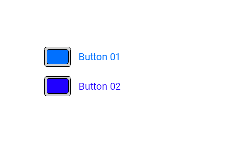

# RectButton: dois botões que enviam comandos

Um **widget** é uma peça que colocamos na tela, como um botão, um relógio ou um gráfico. O **RectButton** é um botão retangular com cantos arredondados. Ele guarda dois estados: ligado e desligado.

Imagine um interruptor de luz: você toca uma vez para ligar e outra vez para desligar. Neste exemplo, cada botão envia uma mensagem por um fio para outro aparelho. O botão de cima envia o comando **A**; o de baixo envia o comando **B**.

Este manual acompanha o [rectbutton_serial.ino](rectbutton_serial.ino) e explica o uso do widget no seu programa, com base no código da DisplayWX **1.0.33**.



*Imagem que acompanha o exemplo. Ela mostra os dois botões coloridos. Ao iniciar o programa, os dois começam desligados, com o interior cinza; a cor aparece quando você os liga.*

## Caminho da leitura

1. [Entenda o que acontece ao tocar](#1-o-que-acontece-ao-tocar).
2. [Prepare a placa e as bibliotecas](#2-prepare-a-placa-e-as-bibliotecas).
3. [Copie o programa completo](#3-programa-completo).
4. [Aprenda cada parte do programa](#4-o-programa-explicado-por-partes).
5. [Consulte os métodos do botão](#5-métodos-do-rectbutton-para-usar-no-seu-programa).
6. [Experimente comandos no loop](#6-experiência-opcional-comandos-pelo-monitor-serial).
7. [Confira o resultado e resolva problemas](#7-como-conferir-se-funcionou).

## 1. O que acontece ao tocar

O botão guarda um valor do tipo `bool`. Esse tipo só tem duas possibilidades:

| Valor no código | Significado neste exemplo | Número enviado |
| --- | --- | --- |
| `false` | Botão desligado | `0` |
| `true` | Botão ligado | `1` |

O caminho de um toque é este:

1. Você toca no retângulo do botão.
2. O botão troca seu estado: desligado vira ligado, ou ligado vira desligado.
3. A DisplayWX chama uma função que você escolheu. Ela se chama **callback**: é a tarefa que deve acontecer quando o botão é acionado.
4. Essa função consulta o estado do botão e envia a mensagem correspondente.
5. A DisplayWX atualiza a aparência do botão.

| Ação, partindo dos dois botões desligados | Mensagem na `Serial2` |
| --- | --- |
| Primeiro toque no botão de cima | `>commandA:1` |
| Segundo toque no botão de cima | `>commandA:0` |
| Primeiro toque no botão de baixo | `>commandB:1` |
| Segundo toque no botão de baixo | `>commandB:0` |

Faça **toques curtos**, retirando o dedo entre eles. O estado fica guardado depois que você tira o dedo. Nesta implementação, segurar o dedo sobre o botão pode provocar novas alternâncias depois do intervalo de proteção entre toques.

Os textos `Button 01` e `Button 02` são escritos ao lado dos botões. Eles não fazem parte da área que recebe o toque e não são widgets `Label` neste exemplo.

## 2. Prepare a placa e as bibliotecas

### 2.1 O material e o ambiente

Para reproduzir esta montagem, use:

- Uma placa **ESP32-S3** com os GPIOs da tabela abaixo disponíveis.
- Um display colorido **ST7796**, com resolução física de **320 × 480 pixels**, ligado por SPI.
- Um controlador de toque capacitivo **FT6336U**, ligado por I2C.
- Um cabo USB de dados e fios para as conexões.
- A IDE Arduino, a biblioteca **DisplayWX 1.0.33** deste projeto e a **GFX Library for Arduino**. A instalação usada como referência tem GFX **1.6.5**.
- O pacote de placas **esp32 by Espressif Systems 3.3.12**. Esta versão da DisplayWX aceita os pacotes **3.3.11 e 3.3.12**, conforme a verificação de versão no seu código.
- Para observar também a saída `Serial2`: um adaptador **USB–UART com sinais de 3,3 V** ou outra placa que receba UART de 3,3 V.

**Pixel** é cada pontinho da imagem. Com a rotação usada aqui, a área de desenho fica com **480 pixels de largura e 320 de altura**.

Você consegue testar os botões e as mensagens de diagnóstico pelo USB do ESP32-S3 sem conectar um receptor à `Serial2`. O receptor é necessário para conferir as mensagens `>commandA:...` e `>commandB:...` no fio de transmissão.

### 2.2 Escolha a tela e o toque na biblioteca

Abra o arquivo [user_setup.h](../../../user_setup.h), que fica na **raiz da biblioteca DisplayWX**, ao lado da pasta `src`.

Para esta montagem, deixe estas opções ativas:

```cpp
#define DISP_DEFAULT  // Usa a família de displays coloridos.
#define TOUCH_FT6336  // Usa o controlador de toque FT6336U.
```

Desative as outras opções de tela e de toque, colocando `//` no início das linhas correspondentes. Por exemplo, se existir `#define TOUCH_FT6236U`, transforme-a em `// #define TOUCH_FT6236U`.

O nome do chip é FT6336U, mas a opção que a biblioteca reconhece é **`TOUCH_FT6336`**, sem o `U` no final. Essas opções ficam no `user_setup.h` da biblioteca; colocá-las apenas no `.ino` não configura todos os arquivos da DisplayWX.

### 2.3 Ligue os sinais

Faça as conexões com a placa desligada. Os números abaixo são **números GPIO**, os números escritos ao lado dos pinos da placa, e não a posição de cada pino no conector.

| Sinal do módulo | GPIO do ESP32-S3 | Para que serve |
| --- | --- | --- |
| Display MOSI / SDI / DIN | 11 | Leva os dados da imagem até a tela. |
| Display SCLK / SCK / CLK | 12 | Marca o ritmo da comunicação SPI. |
| Display CS | 10 | Seleciona o display. |
| Display DC / RS | 8 | Indica se estamos enviando um comando ou dados. |
| Display RST / RESET | 9 | Reinicia o display. |
| Display MISO / SDO | Não conectado | Este exemplo não lê dados do display; usa `-1` no código. |
| Touch SCL | 13 | Marca o ritmo da comunicação I2C do toque. |
| Touch SDA | 14 | Transporta os dados do toque. |
| Touch INT | 18 | Sinaliza eventos do toque. |
| Touch RST | 17 | Reinicia o controlador de toque. |
| GND dos módulos | GND | Dá a todos a mesma referência elétrica. |

A alimentação e a iluminação do display, normalmente identificadas como `VCC` e `BL` ou `LED`, precisam seguir a indicação do **seu módulo**. O nome ST7796 identifica o controlador, mas não determina a tensão de alimentação da placa do display. Este exemplo não controla a iluminação por GPIO. Os sinais conectados ao ESP32-S3 devem ser compatíveis com **3,3 V**.

Para conferir a UART com um adaptador USB–UART:

| ESP32-S3 | Adaptador USB–UART de 3,3 V |
| --- | --- |
| GPIO **21**, transmissão `TX` da `Serial2` neste manual | Entrada `RX` |
| GND | GND |
| GPIO 16, recepção `RX` da `Serial2` | Pode ficar desconectado: este programa só envia mensagens. |

O `TX` de um aparelho se conecta ao `RX` do outro: quem fala precisa estar ligado a quem escuta. Para observar a saída, bastam os fios de sinal e GND; alimente o ESP32-S3 pelo seu USB.

### 2.4 Pinos separados e ordem de inicialização

O `.ino` da pasta e o programa completo deste manual usam **GPIO 21 para `txSerial2`** e **GPIO 17 para `TOUCH_RST`**. Assim, a transmissão serial e o reset do toque usam pinos separados. O GPIO 21 deve estar livre na sua placa.

O programa completo abaixo mantém os dois botões e os mesmos comandos do `.ino`. Ele apresenta um ajuste na ordem de inicialização: `Serial2.begin(...)` fica antes de `myDisplay.createTask(...)`, para a comunicação já estar pronta quando os botões começarem a responder.

Os comentários do programa abaixo também foram escritos em português. Para seguir este manual, use o programa completo abaixo e a ligação TX no GPIO 21.

## 3. Programa completo

Na IDE Arduino, crie um sketch e salve-o como **`rectbutton_serial_manual`**. Substitua todo o conteúdo pelo bloco abaixo. Este é o programa inteiro: não é necessário juntar os trechos das próximas seções.

```cpp
// Bibliotecas que permitem conversar com o display e criar os widgets.
#if CONFIG_IDF_TARGET_ESP32S2 || CONFIG_IDF_TARGET_ESP32S3
#define VSPI FSPI
#endif
#include <SPI.h>
#include <Arduino_GFX_Library.h>
#include <displaywx.h>

// No user_setup.h da biblioteca: DISP_DEFAULT e TOUCH_FT6336.

// Tamanho da imagem depois de girar a tela.
const int DISPLAY_W = 480;
const int DISPLAY_H = 320;
const int DISP_FREQUENCY = 27000000;

// Como as coordenadas do toque correspondem à imagem.
const int TOUCH_MAP_X0 = 0;
const int TOUCH_MAP_Y0 = 0;
const int TOUCH_MAP_X1 = 320;
const int TOUCH_MAP_Y1 = 480;
const bool TOUCH_SWAP_XY = true;
const bool TOUCH_INVERT_X = false;
const bool TOUCH_INVERT_Y = true;

// Fios do display.
const int DISP_MOSI = 11;
const int DISP_MISO = -1;
const int DISP_SCLK = 12;
const int DISP_CS = 10;
const int DISP_DC = 8;
const int DISP_RST = 9;

// Fios do controlador de toque.
const int TOUCH_SCL = 13;
const int TOUCH_SDA = 14;
const int TOUCH_INT = 18;
const int TOUCH_RST = 17;
const uint8_t rotationScreen = 1;
const bool isIPS = true;

// Avisamos que estas funções serão escritas mais abaixo.
void screen0();
void loadWidgets();
void rectbutton1_cb();
void rectbutton1copy_cb();

// Objetos responsáveis pela comunicação e pelo desenho.
#if defined(CONFIG_IDF_TARGET_ESP32S3)
SPIClass spi_shared(FSPI);
#else
SPIClass spi_shared(HSPI);
#endif
Arduino_DataBus *bus = nullptr;
Arduino_GFX *tft = nullptr;
DisplayWX myDisplay;

// Criamos os botões: posição X, posição Y e número da tela.
RectButton rectbutton1(90, 95, 0);
RectButton rectbutton1copy(90, 155, 0);

// Lista dos dois botões que a DisplayWX deve cuidar.
const uint8_t qtdRectBtn = 2;
RectButton *arrayRectbtn[qtdRectBtn] = {&rectbutton1, &rectbutton1copy};

// Comunicação com outro aparelho. GPIO 21 evita o conflito com TOUCH_RST.
const int rxSerial2 = 16;
const int txSerial2 = 21;
const int baudRate = 115200;

void setup() {
    // Serial: mensagens de diagnóstico para o computador.
    Serial.begin(115200);

    // Serial2: comandos enviados pelos GPIOs, antes de ativar os botões.
    Serial2.begin(baudRate, SERIAL_8N1, rxSerial2, txSerial2);

    // Prepara a comunicação SPI e liga o display ST7796.
    spi_shared.begin(DISP_SCLK, DISP_MISO, DISP_MOSI);
    bus = new Arduino_HWSPI(DISP_DC, DISP_CS, DISP_SCLK,
                           DISP_MOSI, DISP_MISO, &spi_shared);
    tft = new Arduino_ST7796(bus, DISP_RST, rotationScreen, isIPS, 320, 480);
    tft->begin(DISP_FREQUENCY);
    myDisplay.setDrawObject(tft);

    // Ajusta o toque para que o ponto tocado combine com a imagem.
    myDisplay.setTouchCorners(TOUCH_MAP_X0, TOUCH_MAP_X1,
                              TOUCH_MAP_Y0, TOUCH_MAP_Y1);
    myDisplay.setInvertAxis(TOUCH_INVERT_X, TOUCH_INVERT_Y);
    myDisplay.setSwapAxis(TOUCH_SWAP_XY);
    myDisplay.startTouchFT6336(DISPLAY_W, DISPLAY_H, rotationScreen,
                               TOUCH_SDA, TOUCH_SCL, TOUCH_INT, TOUCH_RST);

    loadWidgets();                 // Configura e registra os botões.
    myDisplay.loadScreen(screen0); // Pede que a primeira tela seja mostrada.
    myDisplay.createTask(false, 3); // Inicia o trabalho de toque e desenho.
}

void loop() {
    // Os toques e os callbacks são atendidos pela tarefa da DisplayWX.
}

void screen0() {
    myDisplay.setBackgroundColor(CFK_WHITE); // Pinta o fundo de branco.
    myDisplay.printText("Button 01", 160, 107, TL_DATUM,
                        CFK_COLOR20, CFK_WHITE, &RobotoRegular10pt7b);
    myDisplay.printText("Button 02", 160, 167, TL_DATUM,
                        CFK_COLOR23, CFK_WHITE, &RobotoRegular10pt7b);
    myDisplay.drawWidgetsOnScreen(0); // Mostra os widgets da tela número 0.
}

void loadWidgets() {
    // Ficha de configuração do botão de cima.
    RectButtonConfig configRectButton0 = {
        .callback = rectbutton1_cb,
        .width = 54,
        .height = 40,
        .pressedColor = CFK_COLOR20
    };
    rectbutton1.setup(configRectButton0);

    // Ficha de configuração do botão de baixo.
    RectButtonConfig configRectButton1 = {
        .callback = rectbutton1copy_cb,
        .width = 54,
        .height = 40,
        .pressedColor = CFK_COLOR23
    };
    rectbutton1copy.setup(configRectButton1);

    // Entrega a lista e a quantidade de botões à DisplayWX.
    myDisplay.setRectButton(arrayRectbtn, qtdRectBtn);
}

// Callback do primeiro botão: consulta o estado e envia o comando A.
void rectbutton1_cb() {
    bool myValue = rectbutton1.getStatus();
    Serial.print("New value for rectbutton is: ");
    Serial.println(myValue);
    Serial2.printf(">commandA:%d\n", myValue);
}

// Callback do segundo botão: consulta o estado e envia o comando B.
void rectbutton1copy_cb() {
    bool myValue = rectbutton1copy.getStatus();
    Serial.print("New value for rectbutton is: ");
    Serial.println(myValue);
    Serial2.printf(">commandB:%d\n", myValue);
}
```

Selecione a placa ESP32-S3 correspondente em **Ferramentas → Placa**, escolha sua porta USB e clique em **Verificar**. Se estiver usando uma placa genérica compatível, a opção do pacote é **ESP32S3 Dev Module**. As opções de Flash e PSRAM devem corresponder à sua placa.

Depois clique em **Carregar**. Abra o **Monitor Serial** na porta do ESP32-S3 e escolha **115200 baud**. Se estiver usando a conexão USB nativa do ESP32-S3 para o monitor, habilite **USB CDC On Boot** na configuração da placa; se usar um conversor USB–UART da própria placa, use a configuração correspondente a esse conversor.

## 4. O programa explicado por partes

Os blocos desta seção são pedaços do programa anterior. Eles servem para estudar; não são programas separados.

### 4.1 Bibliotecas e preparação da tela

```cpp
#include <SPI.h>                  // Conversa pelos fios SPI.
#include <Arduino_GFX_Library.h>  // Sabe desenhar no ST7796.
#include <displaywx.h>           // Oferece os widgets e organiza os toques.
```

Uma biblioteca é como uma caixa de ferramentas pronta. Em vez de escrever todo o código que acende cada pontinho da tela, usamos essas ferramentas.

`bus` representa o caminho até o display. `tft` representa o display. `myDisplay` organiza os widgets e os eventos. O `nullptr` usado inicialmente em `bus` e `tft` significa que ainda não ligamos essas variáveis a um objeto. As linhas com `new` criam esses objetos no `setup()`.

```cpp
tft->begin(DISP_FREQUENCY);       // Inicia o display com a velocidade escolhida.
myDisplay.setDrawObject(tft);    // Entrega o display à DisplayWX.
```

Essa preparação vem **antes** de configurar os widgets. A DisplayWX precisa saber em qual display eles serão desenhados.

Os valores `TOUCH_MAP_...`, `TOUCH_SWAP_XY` e `TOUCH_INVERT_...` ajustam o mapa do toque. Pense em girar uma folha: o desenho e o lugar onde você aponta precisam girar juntos. Para a montagem deste manual, comece com os valores do programa completo.

### 4.2 Instâncias: criando dois botões independentes

```cpp
RectButton rectbutton1(90, 95, 0);       // Botão de cima.
RectButton rectbutton1copy(90, 155, 0);  // Botão de baixo.
```

`RectButton` é o tipo da peça. `rectbutton1` e `rectbutton1copy` são os nomes dos dois objetos, também chamados de **instâncias**. Apesar de ter `copy` no nome, o segundo é outro botão, com estado e callback próprios.

Os três números significam:

| Posição no construtor | Exemplo | O que controla |
| --- | --- | --- |
| Primeiro: `x` | `90` | Distância da borda esquerda da tela até a borda esquerda do botão. |
| Segundo: `y` | `95` | Distância do topo da tela até o topo do botão. |
| Terceiro: `tela` | `0` | Número da tela à qual o botão pertence. |

A contagem começa em zero. O canto superior esquerdo da imagem é `(0, 0)`. Aumentar `x` desloca para a direita; aumentar `y` desloca para baixo. A largura e a altura são definidas depois, na configuração.

Os objetos ficam fora de todas as funções para continuarem existindo durante todo o programa. Assim, `setup()`, os callbacks e `loop()` podem usar os mesmos botões.

### 4.3 A lista de widgets

```cpp
const uint8_t qtdRectBtn = 2; // A lista tem dois botões.
RectButton *arrayRectbtn[qtdRectBtn] = {&rectbutton1, &rectbutton1copy};
```

Um **array** é uma lista. Aqui, a lista informa quais botões a DisplayWX deve acompanhar.

- `const` diz que a quantidade não muda durante o programa.
- `uint8_t` guarda um número inteiro pequeno, de 0 a 255.
- `&rectbutton1` significa “o endereço do primeiro botão”. É uma forma de apontar para o botão que já criamos.
- O `*` indica que a lista guarda esses endereços. Ela não cria novos botões.

A lista também fica fora das funções. A DisplayWX vai continuar usando-a depois que `loadWidgets()` terminar.

### 4.4 A struct de configuração

Uma **struct** reúne várias informações em uma ficha. `RectButtonConfig` é a ficha que informa o tamanho, a cor e a ação do botão.

```cpp
RectButtonConfig configRectButton0 = {
    .callback = rectbutton1_cb, // Função a executar quando o botão for acionado.
    .width = 54,               // Largura em pixels.
    .height = 40,              // Altura em pixels.
    .pressedColor = CFK_COLOR20 // Cor do interior quando estiver ligado.
};
rectbutton1.setup(configRectButton0); // Entrega a ficha ao primeiro botão.
```

Estes são **todos os campos** dessa configuração:

| Campo | Tipo | Como preencher |
| --- | --- | --- |
| `callback` | `functionCB_t` | Nome de uma função sem argumentos e sem valor de retorno, como `rectbutton1_cb`. Use `nullptr` se não quiser ação associada. |
| `width` | `uint16_t` | Largura em pixels. O exemplo usa `54`. |
| `height` | `uint16_t` | Altura em pixels. O exemplo usa `40`. |
| `pressedColor` | `uint16_t` | Cor no formato RGB565. Você pode usar os nomes prontos `CFK_COLOR20`, `CFK_COLOR23` ou `CFK_RED`, por exemplo. |

`uint16_t` guarda números inteiros de 0 a 65535. RGB565 é a forma de guardar uma cor nesse número; você pode começar usando os nomes `CFK_...`, sem fazer contas de cor.

Preencha os campos na ordem mostrada. Para a função, escreva `.callback = rectbutton1_cb`, **sem `()`**: estamos entregando o nome da tarefa para ser executada depois.

Use dimensões que caibam na tela e deixem espaço para a borda. Neste widget, evite largura ou altura de **12 pixels ou menos**, pois o desenho reserva espaço nas bordas. O exemplo de 54 × 40 é um bom ponto de partida. Também verifique se `x + width` e `y + height` cabem na área de desenho.

O segundo botão recebe outra ficha. Ela usa o callback `rectbutton1copy_cb` e a cor `CFK_COLOR23`.

`setup(config)` copia a ficha para o botão. Por isso, a ficha pode ser uma variável dentro de `loadWidgets()`. Depois de configurado, este widget ignora outra chamada de `setup(config)`: para experimentar outro tamanho ou cor inicial, altere a ficha no programa e carregue-o novamente.

### 4.5 Registrar os botões na DisplayWX

```cpp
myDisplay.setRectButton(arrayRectbtn, qtdRectBtn); // Entrega lista e quantidade.
```

Criar e configurar os botões não basta: a DisplayWX também precisa saber quais são eles. Esta linha registra os dois de uma só vez. Ela fica depois das duas chamadas de `setup(config)`.

Se acrescentar um terceiro botão em outro projeto, crie o objeto, configure-o, inclua seu endereço na lista e atualize a quantidade para `3`.

### 4.6 Callback: o que fazer quando o botão é acionado

```cpp
void rectbutton1_cb() { // void: esta função executa uma tarefa e não devolve valor.
    bool myValue = rectbutton1.getStatus(); // Lê false ou true.
    Serial.print("New value for rectbutton is: "); // Escreve o texto no computador.
    Serial.println(myValue);                     // Escreve 0 ou 1 e pula uma linha.
    Serial2.printf(">commandA:%d\n", myValue);     // Envia o comando pelo GPIO TX.
}
```

`getStatus()` consulta o botão; ele não muda o estado. O resultado é guardado na variável `myValue`.

Em `">commandA:%d\n"`:

- `>commandA:` é o texto fixo da mensagem.
- `%d` é o lugar onde entra o número `0` ou `1`.
- `\n` termina a linha, para separar uma mensagem da próxima.

`Serial` e `Serial2` são caminhos diferentes. A primeira mostra o diagnóstico no computador conectado ao ESP32-S3. A segunda envia o comando ao receptor conectado ao GPIO 21.

```cpp
Serial2.begin(baudRate, SERIAL_8N1, rxSerial2, txSerial2);
// Ordem: velocidade, formato, pino de RECEPÇÃO, pino de TRANSMISSÃO.
```

`115200` é a velocidade escolhida. `SERIAL_8N1` significa 8 bits de dados, nenhuma paridade e 1 bit de parada. Para os dois aparelhos se entenderem, configure o receptor com esses mesmos valores.

O callback do segundo botão faz a mesma tarefa usando `rectbutton1copy.getStatus()` e o texto `>commandB:`.

**Mantenha o callback curto.** Evite pausas longas e tarefas demoradas dentro dele, para os outros botões continuarem respondendo. Não é preciso chamar o callback no `loop()`: a DisplayWX cuida disso.

### 4.7 A função que monta a tela

```cpp
void screen0() {
    myDisplay.setBackgroundColor(CFK_WHITE); // Pinta a tela inteira.
    myDisplay.printText("Button 01", 160, 107, TL_DATUM,
                        CFK_COLOR20, CFK_WHITE, &RobotoRegular10pt7b);
    myDisplay.printText("Button 02", 160, 167, TL_DATUM,
                        CFK_COLOR23, CFK_WHITE, &RobotoRegular10pt7b);
    myDisplay.drawWidgetsOnScreen(0); // Desenha os widgets que pertencem à tela 0.
}
```

Em cada `printText`, os argumentos são: texto, posição X, posição Y, alinhamento, cor do texto, cor de fundo e fonte. `TL_DATUM` alinha pelo canto superior esquerdo. `RobotoRegular10pt7b` é o estilo e tamanho das letras.

O nome `screen0` é um nome escolhido no programa. O número passado a `drawWidgetsOnScreen(0)` precisa combinar com o terceiro número usado ao criar os botões.

Para pedir que essa tela seja montada, usamos:

```cpp
myDisplay.loadScreen(screen0); // Entrega a função da tela, sem executá-la aqui.
```

Assim como no callback, `screen0` vai sem `()`. A DisplayWX executa a função durante seu trabalho de atualização.

### 4.8 setup, loop e funções auxiliares

O `setup()` do Arduino é executado uma vez quando a placa liga ou reinicia. Ele prepara a comunicação, a tela, o toque e os widgets. O `loop()` é repetido enquanto a placa está funcionando.

```cpp
loadWidgets();                 // Nossa função auxiliar: prepara os dois botões.
myDisplay.loadScreen(screen0); // Escolhe o desenho da primeira tela.
myDisplay.createTask(false, 3); // Inicia a tarefa que atende a interface.
```

A tarefa é como um ajudante que continua verificando o toque e atualizando a tela. O watchdog é um vigia do sistema que pode reiniciar a placa quando certas tarefas ficam tempo demais sem dar sinal de vida. Em `createTask(false, 3)`, `false` desativa o watchdog ocioso; o segundo argumento seria o tempo limite em segundos se ele estivesse ativado. **O `3` não é um intervalo de três segundos entre leituras do toque.** Você pode manter os valores deste exemplo.

```cpp
void loop() {
    // Não há outra tarefa para fazer repetidamente neste exemplo.
}
```

O `loop()` fica vazio porque a ação acontece nos callbacks. Em outro projeto, ele pode ler um sensor ou tratar comandos, como na experiência da seção 6.

`loadWidgets()` e `screen0()` são funções auxiliares escritas no sketch. Seus nomes não são comandos especiais do Arduino. Já `rectbutton1.setup(config)` é um método do botão: ele configura aquele objeto, e é diferente do `setup()` principal do Arduino.

## 5. Métodos do RectButton para usar no seu programa

Um **método** é uma função que pertence a um objeto. Em `rectbutton1.getStatus()`, a parte antes do ponto escolhe o botão e a parte depois do ponto escolhe a tarefa.

Esta lista cobre a criação e os métodos de uso do `RectButton` no sketch. Rotinas de desenho, leitura de toque e manutenção interna ficam a cargo da DisplayWX.

Todos os exemplos também valem para o segundo botão: basta trocar `rectbutton1` por `rectbutton1copy`. Nas linhas que alteram o estado, considere o botão já configurado e a tarefa da DisplayWX em funcionamento.

| Criação ou método | Como usar | Para que serve e o que retorna |
| --- | --- | --- |
| `RectButton(x, y, tela)` | `RectButton rectbutton1(90, 95, 0);` | Cria o botão na posição e tela escolhidas. Começa desligado, visível e habilitado para toque. Ainda precisa de configuração. |
| `setup(config)` | `rectbutton1.setup(configRectButton0);` | Aplica a ficha `RectButtonConfig` uma vez. Não retorna valor. Use depois de preparar o display. |
| `getStatus()` | `bool ligado = rectbutton1.getStatus();` | Retorna `true` se está ligado ou `false` se está desligado. Não muda nada. |
| `setStatus(valor, triggerCallback = true)` | `rectbutton1.setStatus(true);` | Define o estado: o primeiro argumento `true` liga e `false` desliga. Sempre pede atualização visual. O segundo argumento escolhe se agenda o callback, caso exista: `true` permite e `false` impede nesta chamada. Não retorna valor. |
| `onClick(triggerCallback = true)` | `rectbutton1.onClick();` | Aciona o botão pelo programa: inverte o estado e pede atualização visual. O argumento escolhe se agenda o callback, caso exista: `true` permite e `false` impede nesta chamada. Não retorna valor. |
| `changeState()` | `rectbutton1.changeState();` | Inverte somente o estado guardado. Não pede atualização visual nem chama callback. Não retorna valor. Veja o uso intermediário abaixo. |
| `getEnabled()` | `bool aceitaToque = rectbutton1.getEnabled();` | Retorna `true` se o botão aceita toque ou `false` se ele está desabilitado. |
| `setEnabled(valor)` | `rectbutton1.setEnabled(false);` | Desabilita o toque com `false` e habilita com `true`. Não altera o estado ligado/desligado nem chama callback. Não retorna valor. |
| `hide()` | `rectbutton1.hide();` | Deixa o widget invisível para as próximas atualizações e impede o toque nele. Não altera seu estado nem chama callback. Veja como apagar o desenho abaixo. |
| `show()` | `rectbutton1.show();` | Torna o widget visível e pede atualização visual. Preserva o estado e a habilitação. Não chama callback nem retorna valor. |

### 5.1 Ler, ligar, desligar e alternar

Use cada chamada abaixo quando acontecer a ação desejada. Elas são exemplos separados, não uma sequência para repetir sem parar:

```cpp
bool ligado = rectbutton1.getStatus(); // Só consulta o estado.
rectbutton1.setStatus(true);          // Liga e agenda o callback.
rectbutton1.setStatus(false);         // Desliga e agenda o callback.
rectbutton1.onClick();                // Troca o estado e agenda o callback.
```

As chamadas acima usam o valor padrão `triggerCallback = true`. Isso significa que `setStatus(true)` faz o mesmo que `setStatus(true, true)`, e `onClick()` faz o mesmo que `onClick(true)`. O argumento é **opcional**: se você não o escrever, a biblioteca usa `true`.

**Com `triggerCallback = true`, `setStatus()` agenda o callback configurado mesmo quando o estado já era igual.** Por isso, não coloque `setStatus(true)` solto em um `loop()` que roda sem parar. Isso enviaria mensagens repetidas. Quando quiser agir apenas se houver diferença, faça:

```cpp
if (!rectbutton1.getStatus()) { // ! significa “não”: entra se estiver desligado.
    rectbutton1.setStatus(true); // Liga apenas quando necessário.
}
```

Evite chamar `setStatus()` ou `onClick()` **com `triggerCallback = true` dentro do callback desse mesmo botão**: eles podem agendar o callback outra vez e criar uma repetição contínua. Se precisar ajustar o botão dentro de seu callback, passe `false` nesse argumento, como em `rectbutton1.setStatus(false, false)`. Assim, essa chamada desliga o botão e pede atualização visual sem agendar outra execução do callback. No callback do exemplo básico, apenas lemos com `getStatus()`.

### 5.2 Habilitar o toque é diferente de ligar o botão

```cpp
rectbutton1.setEnabled(false); // O dedo deixa de acionar este botão.
bool aceitaToque = rectbutton1.getEnabled(); // Agora retorna false.
rectbutton1.setEnabled(true);  // O dedo pode acioná-lo novamente.
```

Um botão pode estar **ligado e desabilitado** ao mesmo tempo: continua com estado `true`, mas não aceita toques. Nesta implementação, desabilitar não muda automaticamente sua cor.

`setStatus()` e `onClick()` continuam podendo acionar o botão pelo programa mesmo que ele esteja desabilitado ou oculto. Se quiser respeitar a habilitação também no seu código, confira antes:

```cpp
if (rectbutton1.getEnabled()) { // Só aciona pelo programa se estiver habilitado.
    rectbutton1.onClick();
}
```

### 5.3 Esconder e mostrar

```cpp
rectbutton1.hide();             // Impede desenho e toque desse widget.
myDisplay.loadScreen(screen0); // Repinta o fundo e os elementos que ficaram visíveis.
```

Neste widget, `hide()` sozinho **não apaga os pixels já desenhados**. Por isso pedimos que `screen0()` seja executada novamente. Ela pinta o fundo branco e monta a tela sem o botão oculto. O texto `Button 01` continua aparecendo, pois é escrito separadamente em `screen0()`.

Para mostrar novamente:

```cpp
rectbutton1.show(); // Mostra o botão com o estado que ele já tinha.
```

`show()` não troca de tela. O botão só aparece quando sua tela está sendo exibida. Também não desfaz `setEnabled(false)`; se o botão estiver desabilitado, use `setEnabled(true)` para permitir toques.

### 5.4 Uso intermediário: trocar o estado sem executar a ação

Imagine que outro aparelho informou que está ligado e você quer mostrar esse estado na tela sem enviar um comando de volta. Para isso, use `setStatus()` ou `onClick()` com **`triggerCallback = false`**. Esse nome significa “disparar o callback”; pense nele como a pergunta: “devo executar também a tarefa associada ao botão?”

Estes são exemplos separados. Escolha a chamada que corresponde à ação desejada:

```cpp
rectbutton1.setStatus(true, false);  // Liga o botão e atualiza a aparência, sem callback.
rectbutton1.setStatus(false, false); // Desliga o botão e atualiza a aparência, sem callback.
rectbutton1.onClick(false);          // Inverte o estado e atualiza a aparência, sem callback.
```

Em `setStatus(true, false)`, cada valor responde a uma pergunta diferente:

- O primeiro, `true`, responde “o botão deve ficar ligado?”.
- O segundo, `false`, responde “devo executar o callback nesta chamada?”.

Já `onClick(false)` tem apenas a segunda pergunta: ele **sempre inverte o estado**. Esse `false` não significa “desligar o botão”. Se ele estava desligado, ficará ligado; se estava ligado, ficará desligado.

Essas chamadas pedem que a DisplayWX atualize a aparência normalmente quando o botão estiver visível na tela atual. Você não precisa recarregar a tela para mostrar a mudança. Neste exemplo, **elas não provocam envio pela Serial2**, porque o envio acontece no callback.

O argumento vale somente para aquela chamada. Ele não apaga o callback configurado nem desativa os próximos toques. Depois de `onClick(false)`, um novo toque no botão continua executando o callback normalmente, e `onClick()` também volta a solicitá-lo. Passar `false` não cancela callbacks que já tenham sido agendados por ações anteriores.

O método `changeState()` continua disponível, mas altera somente o valor guardado, sem pedir atualização visual:

```cpp
rectbutton1.changeState();      // Inverte o valor guardado, sem enviar comando.
myDisplay.loadScreen(screen0); // Pede que a tela mostre esse novo estado.
```

Sem a segunda linha, o desenho pode continuar mostrando o estado antigo até uma futura atualização. Para simplesmente alternar o botão e atualizar sua aparência sem callback, **prefira `onClick(false)`**. Reserve `changeState()` para quando quiser alterar apenas o estado guardado e cuidar da atualização da tela separadamente.

## 6. Experiência opcional: comandos pelo Monitor Serial

Depois que o exemplo básico funcionar, você pode testar os métodos sem tocar na tela. **Substitua apenas o `loop()` vazio** pelo código abaixo. Mantenha todo o restante do programa completo.

```cpp
void loop() {
    if (Serial.available() > 0) {   // Chegou algum caractere do computador?
        char comando = Serial.read(); // Lê uma letra ou número.

        switch (comando) { // Escolhe o que fazer com esse caractere.
            case '1':
                rectbutton1.setStatus(true); // Liga e envia commandA:1.
                break; // Termina esta opção.
            case '0':
                rectbutton1.setStatus(false); // Desliga e envia commandA:0.
                break;
            case 'c':
                rectbutton1.onClick(); // Alterna e envia o novo estado.
                break;
            case 'l':
                rectbutton1.setStatus(true, false); // Liga sem executar o callback.
                break;
            case 'f':
                rectbutton1.setStatus(false, false); // Desliga sem executar o callback.
                break;
            case 'a':
                rectbutton1.onClick(false); // Alterna sem executar o callback.
                break;
            case 'd':
                rectbutton1.setEnabled(false); // Desabilita o toque.
                break;
            case 'e':
                rectbutton1.setEnabled(true); // Habilita o toque.
                break;
            case 'h':
                rectbutton1.hide(); // Oculta o widget.
                myDisplay.loadScreen(screen0); // Apaga seu desenho antigo.
                break;
            case 's':
                rectbutton1.show(); // Mostra o widget novamente.
                break;
            case 'p':
                Serial.print("Ligado: ");
                Serial.println(rectbutton1.getStatus()); // Mostra 0 ou 1.
                Serial.print("Aceita toque: ");
                Serial.println(rectbutton1.getEnabled()); // Mostra 0 ou 1.
                break;
            default:
                break; // Ignora outros caracteres, inclusive a quebra de linha.
        }
    }
    delay(10); // Pausa curta apenas neste loop; a tarefa da tela continua ativa.
}
```

No Monitor Serial conectado ao ESP32-S3, envie **um comando de cada vez**, usando letras minúsculas:

| Envie | Resultado esperado |
| --- | --- |
| `1` | Liga o primeiro botão e envia `>commandA:1` na Serial2. |
| `0` | Desliga o primeiro botão e envia `>commandA:0` na Serial2. |
| `c` | Alterna o estado e envia o comando correspondente. |
| `l` | Liga o primeiro botão e atualiza sua aparência, sem provocar envio na Serial2. |
| `f` | Desliga o primeiro botão e atualiza sua aparência, sem provocar envio na Serial2. |
| `a` | Alterna o estado e atualiza sua aparência, sem provocar envio na Serial2. |
| `d` | Impede que o dedo acione o primeiro botão. |
| `e` | Permite que o dedo acione o primeiro botão novamente. |
| `h` | Esconde o primeiro botão, mantendo seu texto ao lado. |
| `s` | Mostra o primeiro botão. |
| `p` | Mostra o estado e a habilitação no Monitor Serial. |

Experimente `d`, toque no primeiro botão e veja que ele não muda. Depois envie `e` e toque outra vez. O segundo botão continua funcionando de forma independente.

Para testar o novo argumento, envie `f`, depois `l` e depois `a`, esperando a tela atualizar entre os comandos. O primeiro botão deve desligar, ligar e desligar novamente. Essas chamadas não executam o callback, portanto não geram suas mensagens no Monitor Serial nem na Serial2. Envie `p` para consultar o estado. Por fim, dê um toque curto no botão: o callback deve voltar a enviar o comando normalmente.

## 7. Como conferir se funcionou

Após carregar o programa completo e reiniciar a placa:

1. A tela deve ficar branca, com os dois botões cinza e os textos ao lado.
2. Dê um toque curto no centro do botão de cima, aproximadamente em `(117, 115)`. Ele deve ficar azul, e o Monitor Serial deve mostrar `New value for rectbutton is: 1`.
3. Retire o dedo, espere cerca de um segundo e toque de novo. Ele deve voltar ao estado desligado, e o monitor deve mostrar o valor `0`.
4. Repita no botão de baixo, aproximadamente em `(117, 175)`. Ele usa a cor violeta e controla o comando B.
5. Se conectou um receptor à `Serial2`, abra a porta desse receptor em um terminal serial a **115200, 8N1**. Confira as linhas `>commandA:1`, `>commandA:0`, `>commandB:1` e `>commandB:0` conforme seus toques.

O monitor do ESP32-S3 também pode mostrar mensagens da própria biblioteca. Procure as mensagens do callback para conferir os valores.

### Se algo não acontecer como esperado

| Problema | O que conferir |
| --- | --- |
| A compilação não encontra `displaywx.h` ou `Arduino_GFX_Library.h`. | Verifique a instalação das duas bibliotecas e o nome dos arquivos incluídos. |
| A compilação diz que `startTouchFT6336` não existe. | Ative somente `TOUCH_FT6336` no `user_setup.h` da biblioteca. Desative outro controlador de toque que esteja selecionado. |
| A compilação reclama da versão do ESP32. | Use o pacote de placas 3.3.11 ou 3.3.12, aceito por esta versão da DisplayWX. |
| A tela está apagada ou não mostra o desenho. | Confira alimentação, iluminação, controlador ST7796, pinos SPI e seleção `DISP_DEFAULT`. |
| Os botões aparecem, mas o toque não responde. | Confira o controlador FT6336U, os pinos SDA/SCL/INT/RST, a opção de toque e a chamada `createTask`. Toque no retângulo, não no texto ao lado. |
| O ponto tocado não corresponde ao botão. | Confira a rotação e os valores `TOUCH_MAP_...`, `TOUCH_SWAP_XY` e `TOUCH_INVERT_...`. Eles dependem da orientação do módulo. |
| O estado muda várias vezes ao segurar o dedo. | Faça toques curtos. A implementação pode aceitar novos acionamentos enquanto o dedo permanece sobre o botão. |
| O Monitor Serial do ESP32-S3 está vazio. | Confira a porta, a velocidade e a opção USB CDC quando usar o USB nativo. As mensagens dos botões aparecem ao acioná-los. |
| O receptor não recebe comandos. | Confira GPIO 21 → RX, GND comum, sinais de 3,3 V e formato 115200, 8N1. O reset do toque deve ficar separado, no GPIO 17. |
| `hide()` não apagou o botão. | Depois dele, peça `myDisplay.loadScreen(screen0)` para repintar a tela. |
| Um botão desabilitado ainda responde a `onClick()`. | `setEnabled(false)` bloqueia o toque. Para bloquear também sua chamada pelo código, consulte `getEnabled()` antes. |
| O botão muda de aparência pelo código, mas não envia o comando. | Confira `triggerCallback`. `setStatus(valor, false)` e `onClick(false)` atualizam o botão sem executar o callback que envia a mensagem. |
| `onClick(false)` ligou o botão quando eu queria desligá-lo. | Nesse método, `false` controla o callback. Para desligar sem callback, use `setStatus(false, false)`. |

## Referências deste manual

As explicações dos métodos foram conferidas nas declarações e na implementação do widget, não apenas nos comentários do exemplo:

- [Sketch original](rectbutton_serial.ino).
- [Imagem do exemplo](screenshot.png).
- [RectButton: configuração e métodos públicos](../../../src/widgets/rectbutton/wrectbutton.h).
- [RectButton: implementação dos métodos](../../../src/widgets/rectbutton/wrectbutton.cpp).
- [DisplayWX: registro dos widgets, tarefa e montagem das telas](../../../src/displaywx.cpp).
- [Configuração da biblioteca](../../../user_setup.h).
- [Versões do pacote ESP32 aceitas pela biblioteca](../../../src/extras/check_version.h).

**Validação deste documento:** os métodos foram conferidos no código-fonte local, incluindo o argumento opcional `triggerCallback` de `setStatus()` e `onClick()`. Os links locais foram verificados e o programa completo foi comparado ao `.ino`, descontando comentários, formatação, uma definição não usada e o ajuste na ordem de inicialização descrito na seção 2.4. Ambos usam `txSerial2 = 21`. A compilação não foi verificada: na tentativa anterior, o Arduino Builder e o compilador ESP32 disponíveis falharam ao iniciar com erro de realocação de DLL do Windows. Não foi realizado teste em uma placa conectada.
