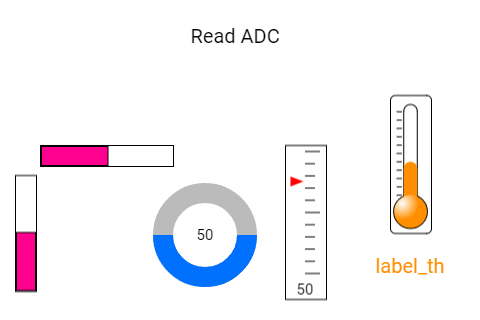

# Indicadores: uma leitura em barras, seta e termômetro

Um **widget** é uma peça da tela, como um botão, uma barra ou uma etiqueta. Uma única leitura aparece de várias formas: barra vertical, barra horizontal, arco circular, escala com seta e termômetro com legenda.

Este manual acompanha [vanalog_vbar_circularbar_thermometer.ino](vanalog_vbar_circularbar_thermometer.ino). A referência é o código local da **DisplayWX 1.0.33**, incluindo os `.h` e `.cpp` atuais dos widgets.



*Imagem que acompanha o exemplo. Ela ilustra a disposição das peças; valores, cores ativas e textos podem mudar durante a execução. Confira os estados iniciais descritos abaixo.*

## Caminho da leitura

1. [Entenda o que cada peça faz](#1-o-que-este-exemplo-faz).
2. [Prepare a placa, os fios e as bibliotecas](#2-prepare-a-placa-e-as-bibliotecas).
3. [Copie o programa completo](#3-programa-completo).
4. [Aprenda os objetos, as fichas, os callbacks e o loop](#4-o-programa-explicado-por-partes).
5. [Consulte os métodos disponíveis para seu programa](#5-métodos-dos-widgets-para-usar-no-seu-programa).
6. [Faça uma experiência](#6-experiência-opcional).
7. [Confira o resultado](#7-como-conferir-se-funcionou).

## 1. O que este exemplo faz

A cada dois segundos, o loop lê o ADC. Uma conversão cria o valor 0–100 para quatro indicadores; outra cria -100–100 para a seta. O termômetro atualiza seu Label porque recebeu seu endereço em subtitle.

| Peça no programa | Widget | Sua tarefa |
| --- | --- | --- |
| `labelthermometer11` | Label | Valor do termômetro com a unidade C. |
| `vertalog1` | VAnalog | Seta na escala de -100 a 100. |
| `vertbar1` | VBar | Barra vertical de 0 a 100. |
| `vertbar2` | VBar | Barra horizontal de 0 a 100. |
| `circload1` | CircularBar | Barra circular de 0 a 100. |
| `thermometer1` | Thermometer | Indicador de 0 a 100 em formato de termômetro. |

**Label:** Uma etiqueta de texto. Mostra palavras ou números com prefixo e sufixo, mas não recebe toques.

**VAnalog:** Uma escala com uma seta que aponta para o valor.

**VBar:** Uma barra que enche conforme um número. Pode ser vertical ou horizontal.

**CircularBar:** Uma barra em forma de arco, que pode completar uma volta.

**Thermometer:** Um indicador com formato de termômetro. Ele desenha o valor fornecido; não mede temperatura sozinho.

A letra C é só uma unidade colocada no desenho. O programa não está medindo temperatura: apresenta a posição do potenciômetro. Em VAnalog, o segundo argumento de setValue controla mostrar o número, não callback. As barras não recebem toque.

## 2. Prepare a placa e as bibliotecas

Use uma placa **ESP32-S3**, display SPI **ST7796 de 320 × 480**, toque capacitivo **FT6336U**, cabo USB de dados e fios. A rotação 1 deixa uma área de desenho de **480 × 320 pixels**. Pixel é cada pontinho da imagem.

Na IDE Arduino, use a DisplayWX **1.0.33** deste projeto, **GFX Library for Arduino 1.6.5** e o pacote **esp32 by Espressif Systems 3.3.12**. O código da DisplayWX aceita as versões 3.3.11 e 3.3.12 desse pacote. Selecione o modelo ESP32-S3 da sua placa, sua porta USB e as opções de memória correspondentes ao hardware.

Abra o [user_setup.h da raiz da biblioteca](../../../user_setup.h), ao lado da pasta `src`. Deixe estas duas opções ativas:

```cpp
#define DISP_DEFAULT  // Display colorido.
#define TOUCH_FT6336  // Controlador FT6336U.
```

Desative as demais opções de display, toque e câmera colocando `//` no começo dessas linhas. Por exemplo: `// #define TOUCH_FT6236U`. O nome da opção correta é `TOUCH_FT6336`, sem U. Definir isso apenas no `.ino` não configura os outros arquivos da biblioteca.

### Ligações do display e do toque

| Sinal do módulo | GPIO do ESP32-S3 |
| --- | --- |
| MOSI / SDI do display | 11 |
| SCK / CLK | 12 |
| CS | 10 |
| DC / RS | 8 |
| RST do display | 9 |
| SDA do toque | 14 |
| SCL do toque | 13 |
| INT do toque | 18 |
| RST do toque | 17 |

`DISP_MISO = -1` significa que não há fio de leitura SPI. Una os GNDs. Alimente display e iluminação conforme o seu módulo; o sketch não controla um pino de backlight. Use sinais lógicos de 3,3 V. Faça a montagem com a alimentação desligada e ajuda de um adulto. Os números acima são GPIOs, não a posição física dos pinos no conector.

### Componentes deste exercício

Use um potenciômetro de 10 kΩ: extremos em 3,3 V e GND, terminal central no GPIO 16. Nenhum sensor de temperatura é necessário para este exercício.

| Nome no programa | GPIO no código abaixo | Ligação |
| --- | --- | --- |
| `pinAdc` | 16 | Terminal central do potenciômetro |

Confira que esses GPIOs estão expostos e livres na sua placa. GPIOs 17 e 18 ficam reservados ao toque nesta montagem.

### Como carregar

1. Copie a pasta inteira deste exemplo para uma pasta de trabalho. Mantenha o nome da pasta igual ao nome do `.ino`.
2. Abra o `.ino` na IDE Arduino e substitua seu conteúdo pelo **programa completo abaixo**. Mantenha os arquivos `.h` que acompanham o exemplo.
3. Configure o `user_setup.h`, a placa e a porta como indicado acima.
4. Confira os fios, clique em **Verificar** e depois em **Carregar**.
5. Abra o Monitor Serial em **115200 baud** e reinicie a placa para acompanhar o início. Se estiver usando a USB nativa do ESP32-S3, a opção **USB CDC On Boot**, quando disponível para sua placa, precisa estar habilitada para os diagnósticos nessa porta.

### Ajustes desta versão didática

O programa abaixo mantém os widgets e a proposta do `.ino`, com estes ajustes explícitos para a montagem descrita:

- A inicialização dos pinos ou da Serial2 vem antes de `createTask()`, para que os callbacks encontrem o hardware pronto. As saídas começam em LOW quando não havia estado inicial explícito.

O `.ino` original da pasta continua disponível no link do início. Para usar as ligações deste manual, copie esta versão completa.

## 3. Programa completo

Copie o bloco inteiro, da primeira linha à última chave. Ele inclui a preparação da tela e todas as funções usadas. Os trechos isolados da próxima seção explicam este mesmo programa; não devem ser acrescentados novamente.

```cpp
#if CONFIG_IDF_TARGET_ESP32S2 || CONFIG_IDF_TARGET_ESP32S3
#define VSPI FSPI
#endif

#include <SPI.h>
#include <Arduino_GFX_Library.h>

#include <displaywx.h>

#define FORMAT_SPIFFS_IF_FAILED false
const int DISPLAY_W = 480;
const int DISPLAY_H = 320;
const int DISP_FREQUENCY = 27000000;
const int TOUCH_MAP_X0 = 0;
const int TOUCH_MAP_Y0 = 0;
const int TOUCH_MAP_X1 = 320;
const int TOUCH_MAP_Y1 = 480;
const bool TOUCH_SWAP_XY = true;
const bool TOUCH_INVERT_X = false;
const bool TOUCH_INVERT_Y = true;
const int DISP_MOSI = 11;
const int DISP_MISO = -1;
const int DISP_SCLK = 12;
const int DISP_CS = 10;
const int DISP_DC = 8;
const int DISP_RST = 9;
const int TOUCH_SCL = 13;
const int TOUCH_SDA = 14;
const int TOUCH_INT = 18;
const int TOUCH_RST = 17;
const uint8_t rotationScreen = 1;
const bool isIPS = true;

void screen0();
void loadWidgets();

#if defined(CONFIG_IDF_TARGET_ESP32S3)
SPIClass spi_shared(FSPI);
#else
SPIClass spi_shared(HSPI);
#endif
Arduino_DataBus *bus = nullptr;
Arduino_GFX *tft = nullptr;
DisplayWX myDisplay;

// labelthermometer11: Valor do termômetro com a unidade C.
Label labelthermometer11(375, 255, 0);
const uint8_t qtdLabel = 1;
Label *arrayLabel[qtdLabel] = {&labelthermometer11};
// vertalog1: Seta na escala de -100 a 100.
VAnalog vertalog1(285, 145, 0);
const uint8_t qtdVAnalog = 1;
VAnalog *arrayVanalog[qtdVAnalog] = {&vertalog1};
// vertbar1: Barra vertical de 0 a 100.
VBar vertbar1(15, 175, 0);
// vertbar2: Barra horizontal de 0 a 100.
VBar vertbar2(40, 145, 0);
const uint8_t qtdVBar = 2;
VBar *arrayVbar[qtdVBar] = {&vertbar1, &vertbar2};
// circload1: Barra circular de 0 a 100.
CircularBar circload1(205, 235, 0);
const uint8_t qtdCircBar = 1;
CircularBar *arrayCircularbar[qtdCircBar] = {&circload1};
// thermometer1: Indicador de 0 a 100 em formato de termômetro.
Thermometer thermometer1(390, 95, 0);
const uint8_t qtdThermometer = 1;
Thermometer *arrayThermometer[qtdThermometer] = {&thermometer1};

const int pinAdc = 16;

void setup(){

    Serial.begin(115200);

    spi_shared.begin(DISP_SCLK, DISP_MISO, DISP_MOSI);
    bus = new Arduino_HWSPI(DISP_DC, DISP_CS, DISP_SCLK, DISP_MOSI, DISP_MISO, &spi_shared);
    tft = new Arduino_ST7796(bus, DISP_RST, rotationScreen, isIPS, 320, 480);
    tft->begin(DISP_FREQUENCY);
    myDisplay.setDrawObject(tft);

    myDisplay.setTouchCorners(TOUCH_MAP_X0, TOUCH_MAP_X1, TOUCH_MAP_Y0, TOUCH_MAP_Y1);
    myDisplay.setInvertAxis(TOUCH_INVERT_X, TOUCH_INVERT_Y);
    myDisplay.setSwapAxis(TOUCH_SWAP_XY);
    // Inicia o controlador de toque escolhido em user_setup.h.
    myDisplay.startTouchFT6336(DISPLAY_W, DISPLAY_H, rotationScreen, TOUCH_SDA, TOUCH_SCL, TOUCH_INT, TOUCH_RST);

    loadWidgets();
    myDisplay.loadScreen(screen0);

    pinMode(pinAdc, INPUT);
    // Inicia o trabalho da biblioteca que atende o toque e atualiza a tela.
    myDisplay.createTask(false, 3);

}

void loop(){

    int valueAdc = analogRead(pinAdc);
    int mappedValue0to100 = map(valueAdc, 0, 4095, 0, 100);
    int mappedValueMinus100to100 = map(valueAdc, 0, 4095, -100, 100);

    myDisplay.startCustomDraw();
    vertalog1.setValue(mappedValueMinus100to100, true);
    vertbar1.setValue(mappedValue0to100);
    vertbar2.setValue(mappedValue0to100);
    circload1.setValue(mappedValue0to100);
    thermometer1.setValue(mappedValue0to100);
    myDisplay.finishCustomDraw();
    delay(2000);
}

void screen0(){

    myDisplay.setBackgroundColor(CFK_WHITE);

    myDisplay.printText("Read ADC", 190, 27, TL_DATUM, CFK_BLACK, CFK_WHITE, &RobotoRegular10pt7b);
    myDisplay.drawWidgetsOnScreen(0);
}

void loadWidgets(){

    LabelConfig configLabel0 = {
            .text = "label_th",
            .prefix = "",
            .suffix = "C",
            .fontFamily = &RobotoRegular10pt7b,
            .datum = TL_DATUM,
            .fontColor = CFK_COLOR04,
            .backgroundColor = CFK_WHITE
        };
    // Aplica a ficha ao objeto; faça isso durante a preparação.
    labelthermometer11.setup(configLabel0);
    myDisplay.setLabel(arrayLabel,qtdLabel);

    VerticalAnalogConfig configVAnalog0 = {
            .minValue = -100,
            .maxValue = 100,
            .width = 41,
            .height = 154,
            .arrowColor = CFK_COLOR01,
            .textColor = CFK_BLACK,
            .backgroundColor = CFK_WHITE,
            .borderColor = CFK_BLACK,
            .steps = 10
        };
    // Aplica a ficha ao objeto; faça isso durante a preparação.
    vertalog1.setup(configVAnalog0);
    myDisplay.setVAnalog(arrayVanalog,qtdVAnalog);

    VerticalBarConfig configVBar0 = {
            .subtitle = nullptr,
            .minValue = 0,
            .maxValue = 100,
            .round = 0,
            .orientation = Orientation::VERTICAL,
            .width = 21,
            .height = 116,
            .filledColor = CFK_COLOR30
        };
    // Aplica a ficha ao objeto; faça isso durante a preparação.
    vertbar1.setup(configVBar0);
    VerticalBarConfig configVBar1 = {
            .subtitle = nullptr,
            .minValue = 0,
            .maxValue = 100,
            .round = 0,
            .orientation = Orientation::HORIZONTAL,
            .width = 133,
            .height = 21,
            .filledColor = CFK_COLOR30
        };
    // Aplica a ficha ao objeto; faça isso durante a preparação.
    vertbar2.setup(configVBar1);
    myDisplay.setVBar(arrayVbar,qtdVBar);

    CircularBarConfig configCirculaBar0 = {
            .minValue = 0,
            .maxValue = 100,
            .radius = 52,
            .startAngle = 0,
            .endAngle = 360,
            .color = CFK_COLOR20,
            .backgroundColor = CFK_GREY11,
            .textColor = CFK_BLACK,
            .backgroundText = CFK_WHITE,
            .thickness = 20,
            .showValue = true,
            .inverted = false
        };
    // Aplica a ficha ao objeto; faça isso durante a preparação.
    circload1.setup(configCirculaBar0);
    myDisplay.setCircularBar(arrayCircularbar,qtdCircBar);

    ThermometerConfig configThermometer0 = {
            .subtitle = &labelthermometer11,
            .unit = "C",
            .minValue = 0,
            .maxValue = 100,
            .width = 41,
            .height = 138,
            .filledColor = CFK_COLOR04,
            .backgroundColor = CFK_WHITE,
            .markColor = CFK_BLACK,
            .decimalPlaces = 1
        };
    // Aplica a ficha ao objeto; faça isso durante a preparação.
    thermometer1.setup(configThermometer0);
    myDisplay.setThermometer(arrayThermometer,qtdThermometer);

}
```

## 4. O programa explicado por partes

### 4.1 Objetos, variáveis e listas

Um **objeto** é uma peça que seu programa pode chamar pelo nome. Uma **variável** é uma caixinha que guarda um valor. `bool` guarda `true` ou `false`; `int` guarda um inteiro; `float` e `double` guardam números com parte decimal. `const` indica algo que não será trocado durante a execução.


```cpp
// labelthermometer11: Valor do termômetro com a unidade C.
Label labelthermometer11(375, 255, 0);
// Quantidade de objetos desta lista.
const uint8_t qtdLabel = 1;
// Lista dos endereços dos widgets que a DisplayWX vai cuidar.
Label *arrayLabel[qtdLabel] = {&labelthermometer11};
// vertalog1: Seta na escala de -100 a 100.
VAnalog vertalog1(285, 145, 0);
// Quantidade de objetos desta lista.
const uint8_t qtdVAnalog = 1;
// Lista dos endereços dos widgets que a DisplayWX vai cuidar.
VAnalog *arrayVanalog[qtdVAnalog] = {&vertalog1};
// vertbar1: Barra vertical de 0 a 100.
VBar vertbar1(15, 175, 0);
// vertbar2: Barra horizontal de 0 a 100.
VBar vertbar2(40, 145, 0);
// Quantidade de objetos desta lista.
const uint8_t qtdVBar = 2;
// Lista dos endereços dos widgets que a DisplayWX vai cuidar.
VBar *arrayVbar[qtdVBar] = {&vertbar1, &vertbar2};
// circload1: Barra circular de 0 a 100.
CircularBar circload1(205, 235, 0);
// Quantidade de objetos desta lista.
const uint8_t qtdCircBar = 1;
// Lista dos endereços dos widgets que a DisplayWX vai cuidar.
CircularBar *arrayCircularbar[qtdCircBar] = {&circload1};
// thermometer1: Indicador de 0 a 100 em formato de termômetro.
Thermometer thermometer1(390, 95, 0);
// Quantidade de objetos desta lista.
const uint8_t qtdThermometer = 1;
// Lista dos endereços dos widgets que a DisplayWX vai cuidar.
Thermometer *arrayThermometer[qtdThermometer] = {&thermometer1};

const int pinAdc = 16;
```

| Objeto | Como interpretar a criação |
| --- | --- |
| `labelthermometer11` (Label) | X = 375, Y = 255, tela = 0. Referência da posição: ponto de alinhamento escolhido por datum. |
| `vertalog1` (VAnalog) | X = 285, Y = 145, tela = 0. Referência da posição: canto superior esquerdo. |
| `vertbar1` (VBar) | X = 15, Y = 175, tela = 0. Referência da posição: canto superior esquerdo. |
| `vertbar2` (VBar) | X = 40, Y = 145, tela = 0. Referência da posição: canto superior esquerdo. |
| `circload1` (CircularBar) | X = 205, Y = 235, tela = 0. Referência da posição: centro do círculo. |
| `thermometer1` (Thermometer) | X = 390, Y = 95, tela = 0. Referência da posição: canto superior esquerdo. |

X cresce para a direita e Y cresce para baixo, a partir do canto superior esquerdo da tela. O número da tela decide em qual página a peça aparece. A primeira tela é 0.

O `&` antes do nome entrega o **endereço** do objeto, como informar onde fica uma casa. O `*` na declaração da lista indica que ela guarda endereços. `qtd...` precisa corresponder à quantidade de itens: ao acrescentar um widget, acrescente seu endereço e ajuste a quantidade. Mantenha os objetos e essas listas globais, fora das funções, para continuarem existindo enquanto a interface trabalha.

### 4.2 A ficha de configuração (`struct`)

A `struct` funciona como uma ficha: cada campo escolhe uma característica. O ponto em `.width` significa “preencha o campo largura”. Depois, `objeto.setup(ficha)` entrega a ficha ao widget. Configure cada peça uma vez em `loadWidgets()`, depois de preparar o display e antes de iniciar a tarefa.

#### `configLabel0`: ficha de `labelthermometer11`

```cpp
LabelConfig configLabel0 = {
            .text = "label_th",
            .prefix = "",
            .suffix = "C",
            .fontFamily = &RobotoRegular10pt7b,
            .datum = TL_DATUM,
            .fontColor = CFK_COLOR04,
            .backgroundColor = CFK_WHITE
        };
// Aplica a ficha ao objeto; faça isso durante a preparação.
labelthermometer11.setup(configLabel0);
```

| Campo | Valor nesta ficha | Para que serve |
| --- | --- | --- |
| `text` | `"label_th"` | Texto inicial. Escreva entre aspas, por exemplo `"Olá"`. |
| `prefix` | `""` | Texto colocado antes do valor, como `"Valor: "`. `""` deixa vazio. |
| `suffix` | `"C"` | Texto colocado depois do valor, como `" V"`. `""` deixa vazio. |
| `fontFamily` | `&RobotoRegular10pt7b` | Fonte das letras, por exemplo `&RobotoRegular10pt7b`. O `&` aponta para uma fonte que já existe. |
| `datum` | `TL_DATUM` | Alinhamento do texto em relação a `(x,y)`: `TL_DATUM` usa o canto superior esquerdo; `TC_DATUM`, o centro do topo. |
| `fontColor` | `CFK_COLOR04` | Cor das letras, usando os nomes `CFK_...`. |
| `backgroundColor` | `CFK_WHITE` | Cor do fundo, por exemplo `CFK_WHITE`. Use a cor da área onde o widget aparece. |

Valor do termômetro com a unidade C.

#### `configVAnalog0`: ficha de `vertalog1`

```cpp
VerticalAnalogConfig configVAnalog0 = {
            .minValue = -100,
            .maxValue = 100,
            .width = 41,
            .height = 154,
            .arrowColor = CFK_COLOR01,
            .textColor = CFK_BLACK,
            .backgroundColor = CFK_WHITE,
            .borderColor = CFK_BLACK,
            .steps = 10
        };
// Aplica a ficha ao objeto; faça isso durante a preparação.
vertalog1.setup(configVAnalog0);
```

| Campo | Valor nesta ficha | Para que serve |
| --- | --- | --- |
| `minValue` | `-100` | Menor valor da escala. Escolha um número menor que `maxValue`. |
| `maxValue` | `100` | Maior valor da escala. Escolha um número maior que `minValue`. |
| `width` | `41` | Largura em pixels, os pontinhos da imagem. Mantenha o desenho dentro da tela. |
| `height` | `154` | Altura em pixels. Reserve espaço suficiente para o desenho e as letras. |
| `arrowColor` | `CFK_COLOR01` | Cor da seta que indica o valor. |
| `textColor` | `CFK_BLACK` | Cor das letras/números. |
| `backgroundColor` | `CFK_WHITE` | Cor do fundo, por exemplo `CFK_WHITE`. Use a cor da área onde o widget aparece. |
| `borderColor` | `CFK_BLACK` | Cor da borda. |
| `steps` | `10` | Número de divisões da escala; use um valor maior que zero. |

Seta na escala de -100 a 100.

#### `configVBar0`: ficha de `vertbar1`

```cpp
VerticalBarConfig configVBar0 = {
            // Label que vai acompanhar o valor deste indicador.
            .subtitle = nullptr,
            .minValue = 0,
            .maxValue = 100,
            .round = 0,
            .orientation = Orientation::VERTICAL,
            .width = 21,
            .height = 116,
            .filledColor = CFK_COLOR30
        };
// Aplica a ficha ao objeto; faça isso durante a preparação.
vertbar1.setup(configVBar0);
```

| Campo | Valor nesta ficha | Para que serve |
| --- | --- | --- |
| `subtitle` | `nullptr` | Endereço de um Label para mostrar o valor, como `&meuTexto`; use `nullptr` se não quiser legenda. |
| `minValue` | `0` | Menor valor da escala. Escolha um número menor que `maxValue`. |
| `maxValue` | `100` | Maior valor da escala. Escolha um número maior que `minValue`. |
| `round` | `0` | Arredondamento dos cantos em pixels. `0` deixa os cantos retos. |
| `orientation` | `Orientation::VERTICAL` | `Orientation::VERTICAL` preenche na vertical; `Orientation::HORIZONTAL`, na horizontal. |
| `width` | `21` | Largura em pixels, os pontinhos da imagem. Mantenha o desenho dentro da tela. |
| `height` | `116` | Altura em pixels. Reserve espaço suficiente para o desenho e as letras. |
| `filledColor` | `CFK_COLOR30` | Cor da parte preenchida. |

Barra vertical de 0 a 100.

#### `configVBar1`: ficha de `vertbar2`

```cpp
VerticalBarConfig configVBar1 = {
            // Label que vai acompanhar o valor deste indicador.
            .subtitle = nullptr,
            .minValue = 0,
            .maxValue = 100,
            .round = 0,
            .orientation = Orientation::HORIZONTAL,
            .width = 133,
            .height = 21,
            .filledColor = CFK_COLOR30
        };
// Aplica a ficha ao objeto; faça isso durante a preparação.
vertbar2.setup(configVBar1);
```

Barra horizontal de 0 a 100.

#### `configCirculaBar0`: ficha de `circload1`

```cpp
CircularBarConfig configCirculaBar0 = {
            .minValue = 0,
            .maxValue = 100,
            .radius = 52,
            .startAngle = 0,
            .endAngle = 360,
            .color = CFK_COLOR20,
            .backgroundColor = CFK_GREY11,
            .textColor = CFK_BLACK,
            .backgroundText = CFK_WHITE,
            .thickness = 20,
            .showValue = true,
            .inverted = false
        };
// Aplica a ficha ao objeto; faça isso durante a preparação.
circload1.setup(configCirculaBar0);
```

| Campo | Valor nesta ficha | Para que serve |
| --- | --- | --- |
| `minValue` | `0` | Menor valor da escala. Escolha um número menor que `maxValue`. |
| `maxValue` | `100` | Maior valor da escala. Escolha um número maior que `minValue`. |
| `radius` | `52` | Raio em pixels: distância do centro até a borda do círculo. |
| `startAngle` | `0` | Ângulo inicial do arco em graus; o exemplo usa `0`. |
| `endAngle` | `360` | Ângulo final do arco em graus; `360` junto de início `0` completa a volta. |
| `color` | `CFK_COLOR20` | Cor principal do desenho. |
| `backgroundColor` | `CFK_GREY11` | Cor do fundo, por exemplo `CFK_WHITE`. Use a cor da área onde o widget aparece. |
| `textColor` | `CFK_BLACK` | Cor das letras/números. |
| `backgroundText` | `CFK_WHITE` | Cor do fundo da região que mostra o número. |
| `thickness` | `20` | Espessura do arco em pixels. Deve ser menor que o raio. |
| `showValue` | `true` | `true` pede o número no centro; `false` mostra só a barra. É preciso espaço interno para o número. |
| `inverted` | `false` | `true` inverte o sentido do preenchimento; `false` mantém o sentido normal. |

Barra circular de 0 a 100.

#### `configThermometer0`: ficha de `thermometer1`

```cpp
ThermometerConfig configThermometer0 = {
            // Label que vai acompanhar o valor deste indicador.
            .subtitle = &labelthermometer11,
            .unit = "C",
            .minValue = 0,
            .maxValue = 100,
            .width = 41,
            .height = 138,
            .filledColor = CFK_COLOR04,
            .backgroundColor = CFK_WHITE,
            .markColor = CFK_BLACK,
            .decimalPlaces = 1
        };
// Aplica a ficha ao objeto; faça isso durante a preparação.
thermometer1.setup(configThermometer0);
```

| Campo | Valor nesta ficha | Para que serve |
| --- | --- | --- |
| `subtitle` | `&labelthermometer11` | Endereço de um Label para mostrar o valor, como `&meuTexto`; use `nullptr` se não quiser legenda. |
| `unit` | `"C"` | Unidade escrita junto ao valor, como `"C"`. É só um texto: não converte nem mede temperatura. |
| `minValue` | `0` | Menor valor da escala. Escolha um número menor que `maxValue`. |
| `maxValue` | `100` | Maior valor da escala. Escolha um número maior que `minValue`. |
| `width` | `41` | Largura em pixels, os pontinhos da imagem. Mantenha o desenho dentro da tela. |
| `height` | `138` | Altura em pixels. Reserve espaço suficiente para o desenho e as letras. |
| `filledColor` | `CFK_COLOR04` | Cor da parte preenchida. |
| `backgroundColor` | `CFK_WHITE` | Cor do fundo, por exemplo `CFK_WHITE`. Use a cor da área onde o widget aparece. |
| `markColor` | `CFK_BLACK` | Cor das marcas da escala. |
| `decimalPlaces` | `1` | Quantidade de casas após o ponto decimal. |

Indicador de 0 a 100 em formato de termômetro.

Após configurar, registre cada lista. É assim que a DisplayWX sabe quais peças precisa acompanhar:

```cpp
// Registra a lista e sua quantidade para a biblioteca encontrar estes widgets.
myDisplay.setLabel(arrayLabel,qtdLabel);
// Registra a lista e sua quantidade para a biblioteca encontrar estes widgets.
myDisplay.setVAnalog(arrayVanalog,qtdVAnalog);
// Registra a lista e sua quantidade para a biblioteca encontrar estes widgets.
myDisplay.setVBar(arrayVbar,qtdVBar);
// Registra a lista e sua quantidade para a biblioteca encontrar estes widgets.
myDisplay.setCircularBar(arrayCircularbar,qtdCircBar);
// Registra a lista e sua quantidade para a biblioteca encontrar estes widgets.
myDisplay.setThermometer(arrayThermometer,qtdThermometer);
```

`nullptr` significa “não liguei nada aqui”. Por exemplo, sem callback não há uma ação do seu programa para executar; sem `subtitle`, não há Label associado. Uma cor `CFK_...` é um valor de cor pronto da biblioteca. Uma fonte como `&RobotoRegular10pt7b` escolhe o desenho das letras. Para começar, conserve as fontes, os tamanhos e a ordem dos campos do exemplo.

### 4.3 O início: `setup()`

O Arduino executa `setup()` uma vez ao ligar. Ele prepara a comunicação, o display, o toque, os widgets e os componentes extras. A tarefa criada no fim continua cuidando da interface enquanto o seu `loop()` trabalha.

```cpp
void setup(){

    // Abre as mensagens de diagnóstico no computador.
    Serial.begin(115200);

    // Inicia os fios de comunicação SPI do display.
    spi_shared.begin(DISP_SCLK, DISP_MISO, DISP_MOSI);
    bus = new Arduino_HWSPI(DISP_DC, DISP_CS, DISP_SCLK, DISP_MOSI, DISP_MISO, &spi_shared);
    tft = new Arduino_ST7796(bus, DISP_RST, rotationScreen, isIPS, 320, 480);
    tft->begin(DISP_FREQUENCY);
    // Entrega à DisplayWX o objeto que desenha no display.
    myDisplay.setDrawObject(tft);

    // Informa a faixa de coordenadas recebida do toque.
    myDisplay.setTouchCorners(TOUCH_MAP_X0, TOUCH_MAP_X1, TOUCH_MAP_Y0, TOUCH_MAP_Y1);
    myDisplay.setInvertAxis(TOUCH_INVERT_X, TOUCH_INVERT_Y);
    myDisplay.setSwapAxis(TOUCH_SWAP_XY);
    // Inicia o controlador de toque escolhido em user_setup.h.
    myDisplay.startTouchFT6336(DISPLAY_W, DISPLAY_H, rotationScreen, TOUCH_SDA, TOUCH_SCL, TOUCH_INT, TOUCH_RST);

    // Preenche as fichas, configura e registra os widgets.
    loadWidgets();
    // Pede a troca de tela; passe o nome da função, sem ().
    myDisplay.loadScreen(screen0);

    // OUTPUT comanda uma saída; INPUT lê um sinal externo.
    pinMode(pinAdc, INPUT);
    // Inicia o trabalho da biblioteca que atende o toque e atualiza a tela.
    myDisplay.createTask(false, 3);

}
```

As declarações como `void screen0();` no começo do programa são **avisos de que essas funções existem**. Elas permitem usar seus nomes nas fichas antes de chegar à parte que contém o corpo da função. Não apague esses avisos ao copiar trechos.

### 4.4 Callbacks: o que acontece após a ação

Um **callback** é a tarefa que você escolhe para acontecer quando um controle é acionado ou uma edição é confirmada. Na ficha, escreva o nome **sem `()`**. A biblioteca o chama no momento adequado. Evite esperas longas dentro dele: guarde um pedido em uma variável e faça a parte demorada no `loop()`, quando necessário.

Este sketch não associa callbacks a seus widgets. O programa entrega valores aos indicadores e textos no `loop()`. Tocar neles não cria uma leitura nova.

### 4.5 O trabalho repetido: `loop()`

A cada dois segundos, o loop lê o ADC. Uma conversão cria o valor 0–100 para quatro indicadores; outra cria -100–100 para a seta. O termômetro atualiza seu Label porque recebeu seu endereço em subtitle.

```cpp
void loop(){

    // Lê a entrada analógica: nesta configuração, de 0 a 4095.
    int valueAdc = analogRead(pinAdc);
    // Transforma a leitura de uma escala em outra, usando números inteiros.
    int mappedValue0to100 = map(valueAdc, 0, 4095, 0, 100);
    // Transforma a leitura de uma escala em outra, usando números inteiros.
    int mappedValueMinus100to100 = map(valueAdc, 0, 4095, -100, 100);

    // Reserva o desenho para esta sequência do seu programa.
    myDisplay.startCustomDraw();
    vertalog1.setValue(mappedValueMinus100to100, true);
    vertbar1.setValue(mappedValue0to100);
    vertbar2.setValue(mappedValue0to100);
    circload1.setValue(mappedValue0to100);
    thermometer1.setValue(mappedValue0to100);
    // Devolve o desenho à tarefa da interface.
    myDisplay.finishCustomDraw();
    // Pausa em milissegundos: 1000 ms equivalem a um segundo.
    delay(2000);
}
```

Mantenha `startCustomDraw()` e `finishCustomDraw()` em pares, como abrir e fechar um caderno de desenho. Deixe pausas, esperas de rede e tarefas demoradas fora desse par.

`analogRead()` fornece uma contagem. `map()` troca a escala por uma conta: por exemplo, 0–4095 pode virar 0–100. Não transforma o widget em um sensor; a leitura continua vindo do pino físico.

### 4.6 As telas

Cada função `screen...` pinta o fundo, coloca os textos fixos e manda desenhar os widgets daquela página. Troque de página com `myDisplay.loadScreen(screen0)` ou com a função da outra tela; passe o nome sem parênteses.

```cpp
void screen0(){

    // Pinta o fundo da tela com a cor escolhida.
    myDisplay.setBackgroundColor(CFK_WHITE);

    // Escreve um texto fixo; esse texto não é um widget interativo.
    myDisplay.printText("Read ADC", 190, 27, TL_DATUM, CFK_BLACK, CFK_WHITE, &RobotoRegular10pt7b);
    // Desenha os widgets registrados para esse número de tela.
    myDisplay.drawWidgetsOnScreen(0);
}
```

### 4.7 Funções extras

Este exemplo não precisa de outras funções próprias além das que acabamos de estudar. As funções como `digitalWrite`, `delay` e `analogRead` pertencem ao ambiente Arduino.

## 5. Métodos dos widgets para usar no seu programa

Um **método** é uma ação que pertence a um objeto. Em `objeto.metodo(valor)`, primeiro vem o nome da peça, depois o ponto, a ação e suas informações entre parênteses. As tabelas usam objetos reais deste exemplo. Faça essas chamadas **depois da configuração**; a linha `setup(...)` pertence à preparação. Os nomes das fichas só existem dentro de `loadWidgets()`.

### Label: métodos para seu programa

Uma etiqueta de texto. Mostra palavras ou números com prefixo e sufixo, mas não recebe toques.

| Método | Como usar | Resultado e cuidado |
| --- | --- | --- |
| `setup(config)` | `labelthermometer11.setup(configLabel0);` | Aplica a ficha de configuração após preparar o display. Não retorna valor. Configure no `loadWidgets()` antes de iniciar a tarefa. |
| `setText(texto)` | `labelthermometer11.setText("Pronto");` | Mostra texto de `const char*` ou `String`, montando prefixo + texto + sufixo. Não retorna valor. |
| `setPrefix(texto)` | `labelthermometer11.setPrefix("Valor: ");` | Guarda o texto que vem antes. Chame depois `setText`, `setTextInt` ou `setTextFloat` para reconstruir o conteúdo exibido. |
| `setSuffix(texto)` | `labelthermometer11.setSuffix(" V");` | Guarda o texto que vem depois. Atualize o conteúdo em seguida para mostrar a nova combinação. |
| `setTextInt(valor)` | `labelthermometer11.setTextInt(42);` | Mostra um número inteiro com prefixo e sufixo. |
| `setTextFloat(valor, casas = 2)` | `labelthermometer11.setTextFloat(3.25, 2);` | Mostra número decimal. O segundo argumento escolhe 0 a 5 casas; omitido, usa 2. |
| `setDecimalPlaces(casas)` | `labelthermometer11.setDecimalPlaces(1);` | Guarda a precisão, limitada a 0–5. Não reformata sozinho o texto; `setTextFloat` define novamente a precisão com seu próprio argumento. |
| `setFontSize(escala)` | `labelthermometer11.setFontSize(2);` | Define o fator de tamanho das letras; use 1 para normal. Não pede atualização sozinho: atualize o texto ou recarregue a tela depois. |
| `show()` | `labelthermometer11.show();` | Torna visível na sua tela e pede atualização. Para TouchArea, volta a permitir toque; ela continua invisível. |
| `hide()` | `labelthermometer11.hide();` | Impede futuras atualizações visuais e, quando há toque, sua interação. Não apaga os pixels já desenhados: repinte a tela como explicado abaixo. |

Para limpar prefixo ou sufixo, use `""`. Altere os dois antes de mandar o novo conteúdo. Um Label não mede nada: é o programa que fornece o valor.

### VAnalog: métodos para seu programa

Uma escala com uma seta que aponta para o valor.

| Método | Como usar | Resultado e cuidado |
| --- | --- | --- |
| `setup(config)` | `vertalog1.setup(configVAnalog0);` | Aplica a ficha de configuração após preparar o display. Não retorna valor. Configure no `loadWidgets()` antes de iniciar a tarefa. |
| `setValue(valor, mostrarNumero)` | `vertalog1.setValue(50, true);` | Atualiza o indicador com um valor limitado à escala, sem callback. O segundo argumento controla a exibição do número, não um callback; é obrigatório. |
| `setScale(minimo, maximo)` | `vertalog1.setScale(0, 100);` | Troca os dois limites e pede atualização. Use limites diferentes. |
| `setMinValue(minimo)` | `vertalog1.setMinValue(0);` | Troca o limite inferior e pede atualização da escala. |
| `setMaxValue(maximo)` | `vertalog1.setMaxValue(100);` | Troca o limite superior e pede atualização da escala. |
| `getMinValue()` | `int minimo = vertalog1.getMinValue();` | Retorna o limite inferior, não a leitura atual. |
| `getMaxValue()` | `int maximo = vertalog1.getMaxValue();` | Retorna o limite superior, não a leitura atual. |
| `show()` | `vertalog1.show();` | Torna visível na sua tela e pede atualização. Para TouchArea, volta a permitir toque; ela continua invisível. |
| `hide()` | `vertalog1.hide();` | Impede futuras atualizações visuais e, quando há toque, sua interação. Não apaga os pixels já desenhados: repinte a tela como explicado abaixo. |

Não existe `getValue()` público: guarde o valor em uma variável se precisar relê-lo. Mantenha mínimo menor que máximo. Em `setValue(50, false)`, a seta muda, mas o número não é solicitado para exibição. Esse `false` não tem relação com callbacks.

### VBar: métodos para seu programa

Uma barra que enche conforme um número. Pode ser vertical ou horizontal.

| Método | Como usar | Resultado e cuidado |
| --- | --- | --- |
| `setup(config)` | `vertbar1.setup(configVBar0);` | Aplica a ficha de configuração após preparar o display. Não retorna valor. Configure no `loadWidgets()` antes de iniciar a tarefa. |
| `setValue(valor)` | `vertbar1.setValue(50);` | Atualiza o indicador com um valor limitado à escala, sem callback. Aceita número inteiro. |
| `setScale(minimo, maximo)` | `vertbar1.setScale(0, 100);` | Troca os dois limites e pede atualização. Use limites diferentes. |
| `setMinValue(minimo)` | `vertbar1.setMinValue(0);` | Troca o limite inferior e pede atualização da escala. |
| `setMaxValue(maximo)` | `vertbar1.setMaxValue(100);` | Troca o limite superior e pede atualização da escala. |
| `getMinValue()` | `int minimo = vertbar1.getMinValue();` | Retorna o limite inferior, não a leitura atual. |
| `getMaxValue()` | `int maximo = vertbar1.getMaxValue();` | Retorna o limite superior, não a leitura atual. |
| `show()` | `vertbar1.show();` | Torna visível na sua tela e pede atualização. Para TouchArea, volta a permitir toque; ela continua invisível. |
| `hide()` | `vertbar1.hide();` | Impede futuras atualizações visuais e, quando há toque, sua interação. Não apaga os pixels já desenhados: repinte a tela como explicado abaixo. |

Não existe `getValue()` público: guarde o valor em uma variável se precisar relê-lo. Mantenha mínimo menor que máximo. O Label de `subtitle` é atualizado com o valor. Configure o Label antes do indicador e registre ambos.

### CircularBar: métodos para seu programa

Uma barra em forma de arco, que pode completar uma volta.

| Método | Como usar | Resultado e cuidado |
| --- | --- | --- |
| `setup(config)` | `circload1.setup(configCirculaBar0);` | Aplica a ficha de configuração após preparar o display. Não retorna valor. Configure no `loadWidgets()` antes de iniciar a tarefa. |
| `setValue(valor)` | `circload1.setValue(50);` | Atualiza o indicador com um valor limitado à escala, sem callback. Aceita número inteiro. |
| `setScale(minimo, maximo)` | `circload1.setScale(0, 100);` | Troca os dois limites e pede atualização. Use limites diferentes. |
| `setMinValue(minimo)` | `circload1.setMinValue(0);` | Troca o limite inferior e pede atualização da escala. |
| `setMaxValue(maximo)` | `circload1.setMaxValue(100);` | Troca o limite superior e pede atualização da escala. |
| `getMinValue()` | `int minimo = circload1.getMinValue();` | Retorna o limite inferior, não a leitura atual. |
| `getMaxValue()` | `int maximo = circload1.getMaxValue();` | Retorna o limite superior, não a leitura atual. |
| `show()` | `circload1.show();` | Torna visível na sua tela e pede atualização. Para TouchArea, volta a permitir toque; ela continua invisível. |
| `hide()` | `circload1.hide();` | Impede futuras atualizações visuais e, quando há toque, sua interação. Não apaga os pixels já desenhados: repinte a tela como explicado abaixo. |

Não existe `getValue()` público: guarde o valor em uma variável se precisar relê-lo. Mantenha mínimo menor que máximo. Se o raio menos a espessura for menor que 15 pixels, o número central é desativado por falta de espaço.

### Thermometer: métodos para seu programa

Um indicador com formato de termômetro. Ele desenha o valor fornecido; não mede temperatura sozinho.

| Método | Como usar | Resultado e cuidado |
| --- | --- | --- |
| `setup(config)` | `thermometer1.setup(configThermometer0);` | Aplica a ficha de configuração após preparar o display. Não retorna valor. Configure no `loadWidgets()` antes de iniciar a tarefa. |
| `setValue(valor)` | `thermometer1.setValue(50);` | Atualiza o indicador com um valor limitado à escala, sem callback. Aceita número decimal. |
| `setScale(minimo, maximo)` | `thermometer1.setScale(0, 100);` | Troca os dois limites e pede atualização. Use limites diferentes. |
| `setMinValue(minimo)` | `thermometer1.setMinValue(0);` | Troca o limite inferior e pede atualização da escala. |
| `setMaxValue(maximo)` | `thermometer1.setMaxValue(100);` | Troca o limite superior e pede atualização da escala. |
| `getMinValue()` | `int minimo = thermometer1.getMinValue();` | Retorna o limite inferior, não a leitura atual. |
| `getMaxValue()` | `int maximo = thermometer1.getMaxValue();` | Retorna o limite superior, não a leitura atual. |
| `show()` | `thermometer1.show();` | Torna visível na sua tela e pede atualização. Para TouchArea, volta a permitir toque; ela continua invisível. |
| `hide()` | `thermometer1.hide();` | Impede futuras atualizações visuais e, quando há toque, sua interação. Não apaga os pixels já desenhados: repinte a tela como explicado abaixo. |

Não existe `getValue()` público: guarde o valor em uma variável se precisar relê-lo. Mantenha mínimo menor que máximo. O Label de `subtitle` é atualizado com o valor. Configure o Label antes do indicador e registre ambos.

### Esconder e mostrar na tela

`hide()` não funciona como uma borracha para os pixels que já foram pintados. Para remover o desenho da página atual, esconda a peça e peça que a página seja montada novamente. Para fazê-la voltar, use `show()`. O estado/valor continua guardado.

```cpp
// Execute uma vez, na tela 0 deste exemplo.
labelthermometer11.hide();
myDisplay.loadScreen(screen0);

// Em outra ação, quando quiser mostrar de novo:
labelthermometer11.show();
myDisplay.loadScreen(screen0);
```

Os dois blocos são ações separadas: se executar todos de uma vez, o widget voltará logo em seguida. Textos fixos feitos com `printText()` continuam aparecendo, pois pertencem à função de tela. Um widget da tela 1 só aparece quando você volta à tela 1.

O desenho periódico e a detecção de toque ficam a cargo da DisplayWX. Seu `.ino` configura, registra, consulta e altera as peças pelas chamadas acima; não precisa chamar rotinas internas de desenho ou de detecção.

## 6. Experiência opcional

Substitua temporariamente as atualizações do loop para comparar o meio de cada escala. O Label acompanha o termômetro automaticamente.

```cpp
vertalog1.setValue(0, true);
vertbar1.setValue(50);
vertbar2.setValue(50);
circload1.setValue(50);
thermometer1.setValue(50);
```

Mude uma coisa de cada vez. O programa completo da seção 3 continua sendo o ponto de partida para voltar ao comportamento original do exercício.

## 7. Como conferir se funcionou

1. Gire o potenciômetro perto do mínimo: os indicadores 0–100 ficam baixos e a seta vai perto de -100.
2. Na metade, os indicadores ficam perto de 50 e a seta perto de zero.
3. Perto do máximo, todos chegam perto do topo de suas escalas. Espere até dois segundos entre as observações.

| Se acontecer... | Confira... |
| --- | --- |
| Erro ao compilar sobre tela, toque ou tipo desconhecido | Placa selecionada, versões instaladas e opções ativas no `user_setup.h` da raiz da biblioteca. Copie o programa inteiro. |
| Tela apagada ou sem desenho | Alimentação, GND, iluminação do módulo e fios/conectores do display. |
| Desenho correto, mas o toque não responde ou está deslocado | Controlador selecionado, SDA/SCL e configuração de rotação, limites e inversão dos eixos. Use os valores completos do exemplo para essa montagem. |
| Tela funciona, mas o componente externo não acompanha | Use os GPIOs da tabela deste manual, GND comum e a polaridade correta. Uma mudança com callback desativado pode atualizar só o widget. |
| Valor parece demorar para mudar | Confira o `delay()` no loop. Vários exemplos só enviam uma atualização a cada dois segundos. |
| Método com argumentos diferentes dá erro | Consulte a tabela da classe exata. Nem todos os `onClick` ou `setValue` recebem os mesmos argumentos. |

Este manual foi conferido com os arquivos locais da biblioteca. A validação descrita aqui é de código e documentação; a compilação para a sua placa e o ensaio físico devem ser feitos com a montagem indicada.

### Arquivos usados como referência

- [vanalog_vbar_circularbar_thermometer.ino](vanalog_vbar_circularbar_thermometer.ino).
- Label: [declarações `.h`](../../../src/widgets/label/wlabel.h) e [implementação `.cpp`](../../../src/widgets/label/wlabel.cpp).
- VAnalog: [declarações `.h`](../../../src/widgets/verticalanalog/wverticalanalog.h) e [implementação `.cpp`](../../../src/widgets/verticalanalog/wverticalanalog.cpp).
- VBar: [declarações `.h`](../../../src/widgets/verticalbar/wverticalbar.h) e [implementação `.cpp`](../../../src/widgets/verticalbar/wverticalbar.cpp).
- CircularBar: [declarações `.h`](../../../src/widgets/circularbar/wcircularbar.h) e [implementação `.cpp`](../../../src/widgets/circularbar/wcircularbar.cpp).
- Thermometer: [declarações `.h`](../../../src/widgets/thermometer/wthermometer.h) e [implementação `.cpp`](../../../src/widgets/thermometer/wthermometer.cpp).
- [DisplayWX](../../../src/displaywx.h) e [implementação da integração](../../../src/displaywx.cpp).
